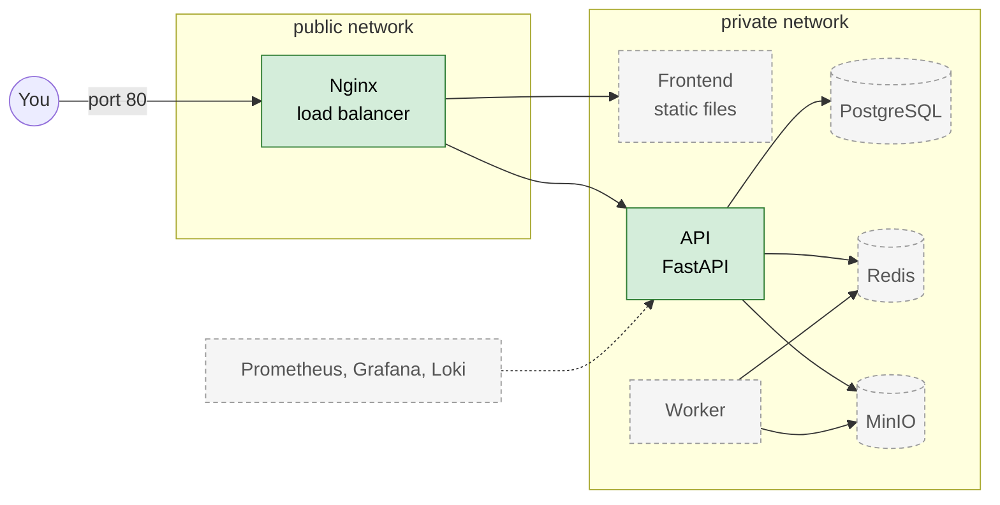

# AWS Local Lab

A local copy of an AWS web hosting architecture (load balancer, private network, database, cache, object
storage, queue, monitoring, Kubernetes, Terraform), built step by step on a laptop as a hands-on course.

> **Status:** Phase 1 (Docker Compose) · **2 of 14 labs complete**, Lab 02 in progress · **5 of 60 steps done**.
> Next: [Lab 02, step 5](PLAN.md) (three API replicas). Everything not marked ✅ below is **planned, not built yet**.

Everything runs locally with fake credentials. Nothing here ever touches a real AWS account.

## What you'll learn
- Containers and images: what EC2/ECS/ECR do, and how to package an app with Docker.
- Load balancing and health checks (ALB), replicas and failover.
- VPC-style networking: public and private subnets, security groups, as Docker networks.
- Managed data services: a relational database with migrations (RDS), a cache (ElastiCache), object storage with
  presigned URLs (S3), queues and background workers (SQS).
- Observability: metrics, dashboards and logs (CloudWatch), load testing with k6.
- Kubernetes (EKS) with autoscaling, and Infrastructure as Code with Terraform against a local AWS emulator.

## Architecture
Target architecture of Phase 1. Green = exists today, dashed grey = planned.



**Today:** one API container behind an Nginx load balancer, which is the only published port (`127.0.0.1:80`). There is
no private network, replicas or data service yet; those arrive lab by lab. Phases 2 and 3 (Kubernetes, Terraform) are described in the roadmap.

## Local ↔ AWS mapping
| Component | AWS service | Local tool | Status |
|---|---|---|---|
| Container image and runtime | ECR, ECS / EKS / EC2 | Docker, Docker Compose | ✅ built (Lab 01) |
| API (`/health`, `/whoami`) | your app on ECS | FastAPI + Uvicorn | ✅ built (Lab 01) |
| Load balancer | ALB, target groups | Nginx | 🚧 in progress (Lab 02: proxy built, replicas and failover next) |
| Private network | VPC, subnets, security groups | Docker networks | 🔜 planned (Lab 03) |
| Database | RDS | PostgreSQL | 🔜 planned (Lab 04) |
| Cache | ElastiCache | Redis | 🔜 planned (Lab 05) |
| Object storage | S3 | MinIO | 🔜 planned (Lab 06) |
| Queue and worker | SQS | Redis list, then SQS on an emulator | 🔜 planned (Lab 07, 13) |
| Static frontend and CDN | S3 static hosting, CloudFront | Nginx + cache headers | 🔜 planned (Lab 08) |
| Monitoring | CloudWatch | Prometheus, Grafana, Loki | 🔜 planned (Lab 09) |
| Load testing | (none) | k6 | 🔜 planned (Lab 10) |
| Kubernetes | EKS | k3d | 🔜 planned (Lab 11) |
| Autoscaling | Auto Scaling | Horizontal Pod Autoscaler | 🔜 planned (Lab 12) |
| Infrastructure as Code | CloudFormation / Terraform | Terraform + local AWS emulator | 🔜 planned (Lab 13) |

Multi-AZ, IAM, a real CDN and managed backups cannot be simulated on one laptop; each lab says what it leaves out.

## The course
Each lab is a tutorial written while building: theory first, exact commands, real captured output,
troubleshooting, a quiz. Start at the [course index](docs/labs/README.md); terms are in the [glossary](docs/glossary.md).

| Lab | Topic | Tutorial |
|---|---|---|
| 00 | Setup: tools, Docker basics, how the course works | [Lab 00](docs/labs/00-setup.md) |
| 01 | Containers and the first API | [Lab 01](docs/labs/01-containers.md) |
| 02 | Load balancing and health checks | [Lab 02](docs/labs/02-load-balancing.md) (in progress) |
| 03 | Networking: public and private | coming soon |
| 04 | Database, migrations, persistence | coming soon |
| 05 | Caching | coming soon |
| 06 | Object storage and presigned URLs | coming soon |
| 07 | Queues and workers | coming soon |
| 08 | Static frontend and caching headers | coming soon |
| 09 | Monitoring and logs | coming soon |
| 10 | Testing and load tests | coming soon |
| 11 | Kubernetes | coming soon |
| 12 | Autoscaling | coming soon |
| 13 | Infrastructure as Code | coming soon |

## Quick start
Built and tested on **Windows 11** with:

| Tool | Version tested |
|---|---|
| Docker Desktop (Engine + Compose) | 29.2.1 + Compose v5.0.2 |
| Git (with Git Bash) | 2.48.1 |
| GNU Make | 4.4.1 (`winget install --id ezwinports.make -e`) |

Start Docker Desktop, then, from PowerShell or Git Bash:

```bash
git clone https://github.com/moncef2k/aws-local-lab.git
cd aws-local-lab
git checkout dev          # work in progress lives on dev until each lab's pull request is merged
cp .env.example .env      # optional: the defaults also work without it
make up
curl http://localhost/whoami
make down
```

`/whoami` answers with the hostname of the API container, proxied by Nginx, for example `{"hostname":"71efbb43a2d7"}`.
If port 80 is taken on your machine, set `LB_HOST_PORT=8080` in `.env` and use `http://localhost:8080`. `make help` lists
the targets. `make test` and `make load-test` are not implemented yet and fail on purpose.
Details, versions and troubleshooting: [Lab 00](docs/labs/00-setup.md), [Lab 01](docs/labs/01-containers.md), [Lab 02](docs/labs/02-load-balancing.md).

## Repo structure
| Path | What it is |
|---|---|
| `api/` | FastAPI app and its Dockerfile (built) |
| `lb/` | Nginx load balancer configuration (built; in progress) |
| `docs/` | the course: [`labs/`](docs/labs/README.md) tutorials and the [glossary](docs/glossary.md) |
| `scripts/` | helper scripts (`screenshot.sh`: page screenshots with Playwright in Docker) |
| `docker-compose.yml`, `Makefile`, `.env.example` | how the stack is started and configured |
| `PLAN.md`, `SPEC.md` | the step-by-step plan (source of truth for progress) and the original brief |
| `CLAUDE.md`, `.claude/` | the working rules and tooling used to build the project with Claude Code |
| `worker/`, `frontend/`, `monitoring/`, `tests/`, `k8s/`, `terraform/` | empty placeholders, filled in by later labs |

## How this project is built
- **Small steps.** [`PLAN.md`](PLAN.md) breaks the work into 60 steps, each a small change with a check that proves it works.
- **Two commits per step:** one for the code, one for the lab tutorial. A read-only reviewer agent checks each step
  before the next one starts.
- **Built with [Claude Code](https://claude.com/claude-code)** under the rules in [`CLAUDE.md`](CLAUDE.md): pinned
  versions, fake credentials only, real captured outputs in the docs.
- **`main` is protected.** Work happens on `dev`, and each finished lab reaches `main` through one pull request.

## Roadmap
**Phase 1: Docker Compose**
- [x] [Lab 00](docs/labs/00-setup.md): setup, tools, repo skeleton
- [x] [Lab 01](docs/labs/01-containers.md): containers and the first API
- [ ] [Lab 02](docs/labs/02-load-balancing.md): load balancing (ALB), in progress (1 of 4 steps done)
- [ ] Lab 03: networking (VPC)
- [ ] Lab 04: database (RDS)
- [ ] Lab 05: caching (ElastiCache)
- [ ] Lab 06: object storage (S3)
- [ ] Lab 07: queues and workers (SQS)
- [ ] Lab 08: frontend and CDN
- [ ] Lab 09: monitoring (CloudWatch)
- [ ] Lab 10: testing and load

**Phase 2: Kubernetes**
- [ ] Lab 11: Kubernetes (EKS)
- [ ] Lab 12: autoscaling (HPA)

**Phase 3: Terraform against a local AWS emulator**
- [ ] Lab 13: Infrastructure as Code

## License
No license yet.
