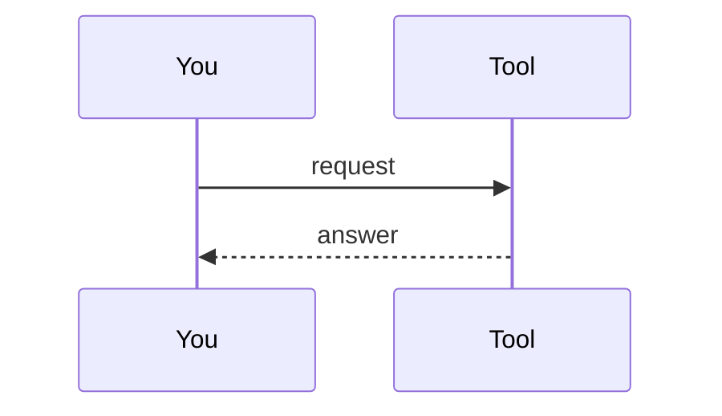

# <Tool> NN — <Module title>

> **Course:** [<Tool>](./README.md)  ·  **Time:** ~<N> min  ·  **Needs:** <earlier modules, or "nothing">
> **Used in the labs:** <lab and step links>

## What you will learn
- <3–5 concrete outcomes>

## Words you need
Every term the module uses, in plain words, before it is used. Never leave an unexplained word in a table.

| Word | Plain-words meaning |
|---|---|
| ... | ... |

## The idea
**Everyday analogy first** (2–4 sentences), then **the precise explanation** (what it is, why it exists, what problem it solves).



## The code or config, line by line
```text
<the sample, with a comment on every line>
```

| Line | What it does | If you change or remove it |
|---|---|---|
| ... | ... | ... |

## The commands
For each command: what it does, what each flag means, how to read the output.

| Command / flag | Meaning |
|---|---|
| ... | ... |

## Hands-on
Runs on your laptop with Docker (throw-away `docker run --rm <pinned image>`; never `:latest`).
Paste the **real** output you captured, trimmed. Never invent output.

```bash
<commands>
```
```text
<real output>
```
**How to read it:** <line by line where useful>

## What if…?
<One experiment that breaks or changes the key idea, with its real result.>

## In short
1. <one line>
2. <one line>
3. <one line>

## Check your understanding
1. <question>
2. <question>
3. <question>
4. <question>
5. <question>

<details><summary>Answers</summary>

1. <answer>
2. <answer>
3. <answer>
4. <answer>
5. <answer>

</details>

## Official documentation
- <links>

## Where you use this in the project
- <links to the lab sections that use the concept>
