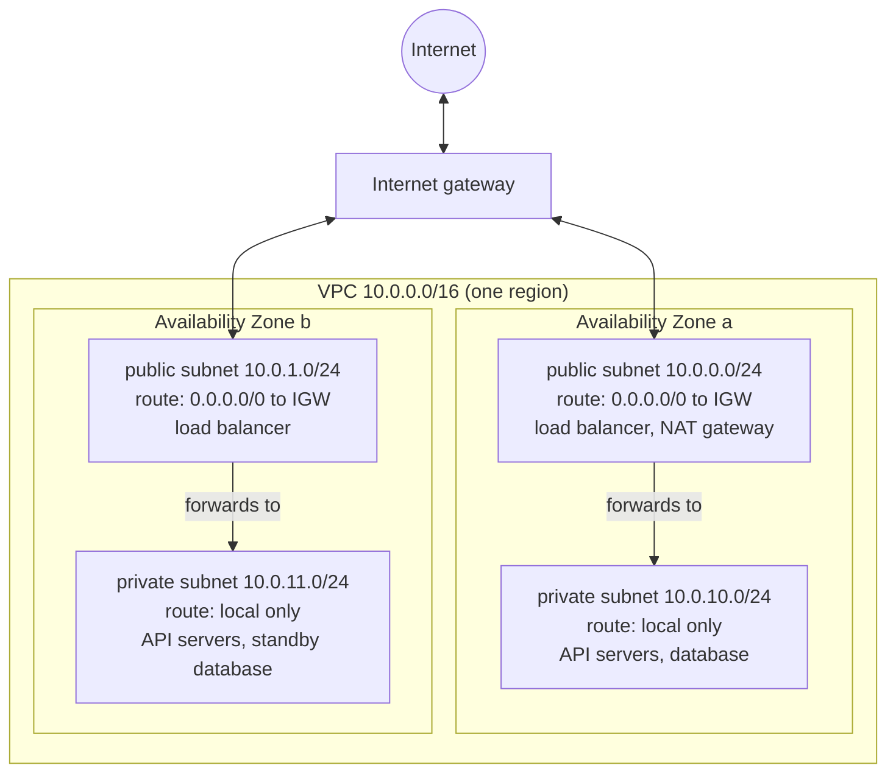
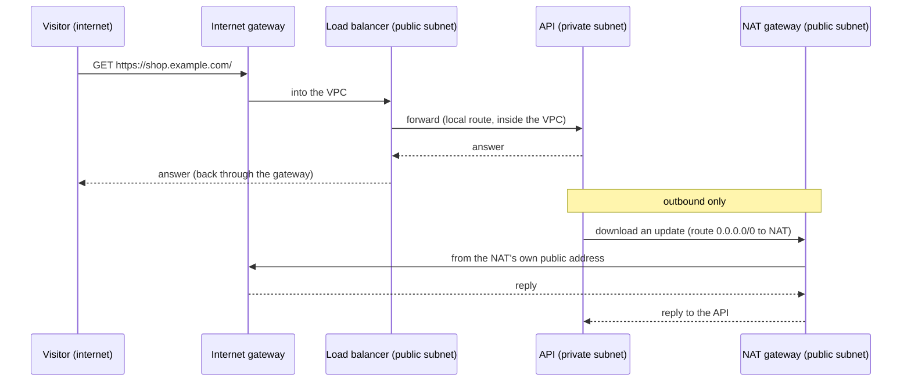

# AWS 04 — VPC: subnets, route tables, gateways

> **Course:** [AWS](./README.md)  ·  **Time:** ~45 min  ·  **Needs:** [Networking 06 — Subnets and CIDR](../networking/06-subnets-and-cidr.md); [Networking 07](../networking/07-firewalls-and-security-groups.md) is a good follow-up
> **Used in the labs:** [Lab 03](../../labs/03-networking.md) (the `public` and `private` Docker networks stand in for public and private subnets)
> **No real AWS here:** this module never touches an AWS account. Its hands-on uses the lab's local networks as stand-ins and clearly says where they differ from AWS.

## What you will learn
- Explain what a **VPC** is and name its parts: subnets, route tables, internet gateway, NAT gateway.
- Say precisely what makes a subnet **public** and what makes it **private** (hint: it is a *route*, not a label).
- Read a route table, and decide where a packet goes using the "most specific route wins" rule.
- Draw the standard two-zone layout for a web application, and match each piece to this project.

## Words you need
| Word | Plain-words meaning |
|---|---|
| **Region** | A geographic area where AWS runs data centres (for example Ireland). Resources live in one region. |
| **Availability Zone (AZ)** | One data-centre location inside a region. Spreading over two or more AZs survives the loss of one. |
| **VPC** | "Virtual Private Cloud": your own private network inside one AWS region, defined by one address range (CIDR, [Networking 06](../networking/06-subnets-and-cidr.md)). |
| **CIDR** | The `address/number` notation for an address range, like `10.0.0.0/16` ([Networking 06](../networking/06-subnets-and-cidr.md)): bigger number, smaller range. |
| **Subnet** | A slice of the VPC's range, living in **one** AZ. Resources (servers, load balancers, databases) are placed in subnets. |
| **Route table** | A list of rules ("routes") that says where traffic for each destination range goes. Every subnet uses one. |
| **Route** | One line of a route table: *destination range → target*. |
| **Local route** | The route every route table has for the VPC's own range: traffic inside the VPC stays inside. It cannot be removed. |
| **Default route** | The route for destination `0.0.0.0/0`, meaning "every address not matched by a more specific route", usually the way to the internet. |
| **Internet gateway (IGW)** | The VPC's door to the internet, in both directions. It is highly available and has no charge of its own. |
| **NAT gateway** | A managed service that lets machines in a private subnet start connections to the internet without the internet being able to start connections to them. It bills per hour and per GB. |
| **Public IP / Elastic IP** | An internet-reachable address. A machine in a public subnet is only reachable from the internet if it also has one. |
| **Longest prefix match** | When several routes match a destination, the one with the longest prefix (the most specific range) wins. |
| **VPC endpoint** | A private path from the VPC to an AWS service (such as S3) that does not use the internet. |
| **Security group** | A firewall around one resource ([Networking 07](../networking/07-firewalls-and-security-groups.md)). |

## The idea
**Analogy.** A VPC is a **fenced company campus**. The fence is the VPC boundary: by default nothing crosses it. Inside, the campus has **buildings** (subnets), each in one of two **districts** (AZs).
Each building has a **map on the door** (its route table) telling people which exit to take for each destination. Every map says "for anywhere on campus, walk there" (the local route).
Only the **reception buildings** have a second line: "for everywhere else, go through the main gate" (the default route to the internet gateway). The **back-office buildings** have no such line: people there can
walk around campus but have no road to the main gate. If back-office staff need to order supplies, a **courier** (a NAT gateway) sits in reception: the staff hand over the order, and the courier goes out and brings
the answer back, but strangers can never walk in through the courier.

**Precisely.** A subnet is **public** if its route table has a route `0.0.0.0/0 → internet gateway` (and its machines have public IPs). It is **private** if it has no such route. Nothing else makes the difference:
there is no "public" checkbox. A private subnet that needs outbound internet gets a route `0.0.0.0/0 → NAT gateway`, where the NAT gateway itself sits in a *public* subnet.



**A visitor's request, and an update the API fetches itself:**


**How a route table is used.** For each packet, the table is searched for the routes whose range contains the destination; the **longest prefix wins**. Two typical tables:

| Route table | Destination | Target | Meaning |
|---|---|---|---|
| Public subnets | `10.0.0.0/16` | local | Anything inside the VPC stays inside. |
| | `0.0.0.0/0` | internet gateway | Everything else goes to the internet. |
| Private subnets (no internet) | `10.0.0.0/16` | local | Inside the VPC only. Anything else: **no route**, unreachable. |
| Private subnets (with NAT) | `10.0.0.0/16` | local | Inside the VPC. |
| | `0.0.0.0/0` | NAT gateway | Outbound only, through the courier. |

The standard sizes: a VPC accepts a range between `/16` (65,536 addresses) and `/28` (16); AWS keeps **5 addresses** in every subnet, so a `/24` has 251 usable. Every AWS account also has a **default VPC** in each region
(range `172.31.0.0/16`, with public subnets) so that you can start servers without building a network first; production setups build their own.

## The code, line by line
The routing rule is simple enough to write in a few lines of Python (standard library only). It builds a four-subnet plan and then looks routes up:

```python
import ipaddress as ip
vpc = ip.ip_network('10.0.0.0/16')                       # the VPC range
n = ip.ip_network('10.0.0.0/24')                         # one subnet
assert n.subnet_of(vpc)                                  # must lie inside the VPC
usable = n.num_addresses - 5                             # AWS keeps 5 per subnet
def route(table, dest):
    d = ip.ip_address(dest)
    hits = [(ip.ip_network(c).prefixlen, t) for c, t in table if d in ip.ip_network(c)]
    return max(hits)[1] if hits else 'NO ROUTE (unreachable)'
```
| Line | What it does | If you change or remove it |
|---|---|---|
| `ip.ip_network('10.0.0.0/16')` | Parses a CIDR range into an object that knows its size and members. | A typo (`10.0.0.5/16`) raises `ValueError`: a range cannot have stray host bits. |
| `n.subnet_of(vpc)` | `True` only if the subnet lies completely inside the VPC range. | Without the check, you could plan a subnet outside the VPC, which AWS refuses. |
| `n.num_addresses - 5` | Addresses a resource can really use in AWS. | Using `- 2` would be the plain-IP rule, not the AWS rule. |
| `d in ip.ip_network(c)` | Does this route's range contain the destination? Builds the list of **matching** routes. | Without the filter you would pick a route that does not apply. |
| `(prefixlen, target)` and `max(hits)` | Pairs each match with the length of its prefix and takes the largest: **longest prefix wins**. | Taking the first match instead would let `0.0.0.0/0` hide a more specific route. |
| `... if hits else 'NO ROUTE'` | When nothing matches, the packet has nowhere to go. | This is exactly the situation of a private subnet and an internet address. |

## The commands
| Command | What it does | Reading the result |
|---|---|---|
| `docker run --rm --network NET IMG ip route` | Starts a throw-away container on a network and prints its routing table. | `default via X` = the default route and its gateway; `A.B.C.D/N dev eth0 scope link` = the local route for that subnet (`scope link` = directly reachable). |
| `docker compose exec -T lb ip route` | The same inside the running load balancer. | One `dev` per network the container is attached to. |
| `wget -q -O /dev/null -T 3 http://1.1.1.1` | Tries to fetch a page from an address given as numbers (no DNS involved). | `Network unreachable` = no route at all; a *timeout* = a route exists but nothing came back. |
| `docker run --rm python:3.12.16-slim-trixie python -c "..."` | Runs the Python snippet in a pinned throw-away image. | |

## Hands-on
Captured on this laptop (Docker 29.2.1) against the **live networks of the lab** (`aws-local-lab_public` and `aws-local-lab_private`, [Lab 03](../../labs/03-networking.md)). Docker's `public` network plays a public subnet,
the `internal` one plays a private subnet. Git Bash users: `export MSYS_NO_PATHCONV=1` first.

**1. The routing table of a container on the `public` network.**
```bash
docker run --rm --network aws-local-lab_public nginx:1.30.6-alpine ip route
```
```text
default via 172.24.0.1 dev eth0 
172.24.0.0/16 dev eth0 scope link  src 172.24.0.3 
```
| Line | Meaning |
|---|---|
| `172.24.0.0/16 dev eth0 scope link src 172.24.0.3` | The **local route**: the whole `public` range is directly reachable; this container's own address is `172.24.0.3`. |
| `default via 172.24.0.1 dev eth0` | The **default route** (`0.0.0.0/0`): everything else goes through the gateway `172.24.0.1`. In AWS this line would read "to the internet gateway". |

**2. The routing table of a container on the `private` (internal) network.**
```bash
docker run --rm --network aws-local-lab_private nginx:1.30.6-alpine ip route
```
```text
172.23.0.0/16 dev eth0 scope link  src 172.23.0.7 
```
Only the local route. **There is no default route**: this is the table of a private subnet without NAT.

**3. The load balancer, which sits in both.**
```bash
docker compose exec -T lb ip route
```
```text
default via 172.24.0.1 dev eth1 
172.23.0.0/16 dev eth0 scope link  src 172.23.0.5 
172.24.0.0/16 dev eth1 scope link  src 172.24.0.2 
```
One local route per network (`eth0` is `private`, `eth1` is `public`), and the default route leaves through the **public** side only, like AWS's load balancer (an ALB, "Application Load Balancer") with legs in public subnets that can still talk to the private targets.

**4. What the missing default route does.** Fetch an internet address *by number* (so DNS is not part of the story), from each side:
```bash
docker run --rm --network aws-local-lab_public  nginx:1.30.6-alpine wget -q -O /dev/null -T 3 http://1.1.1.1
docker run --rm --network aws-local-lab_private nginx:1.30.6-alpine wget -q -O /dev/null -T 3 http://1.1.1.1
```
```text
(public: no output, the page was downloaded and thrown away; exit code 0)
wget: can't connect to remote host (1.1.1.1): Network unreachable
```
On `private` the answer comes **instantly** and says *Network unreachable*: the machine looked in its route table, found no route, and did not even try. (In [Lab 03](../../labs/03-networking.md) the same container
reported a name-resolution error instead, because it looked up a *name*; here we used a number, so we see the routing failure itself.)

**5. A two-zone VPC plan and route lookups, in code.** The snippet above, completed into one script (Python standard library only, run in a pinned throw-away container):
```bash
docker run --rm python:3.12.16-slim-trixie python -c "
import ipaddress as ip

# 1. A VPC plan: 2 zones x (1 public + 1 private) subnets, cut out of 10.0.0.0/16
vpc = ip.ip_network('10.0.0.0/16')
plan = [('public-a', '10.0.0.0/24', 'zone a'), ('public-b', '10.0.1.0/24', 'zone b'),
        ('private-a', '10.0.10.0/24', 'zone a'), ('private-b', '10.0.11.0/24', 'zone b')]
for name, cidr, az in plan:
    n = ip.ip_network(cidr)
    assert n.subnet_of(vpc)
    print('%-10s %-14s %-7s addresses=%d usable-in-AWS=%d' % (name, cidr, az, n.num_addresses, n.num_addresses - 5))
nets = [ip.ip_network(c) for _, c, _ in plan]
print('any overlap between the subnets?', any(a.overlaps(b) for i, a in enumerate(nets) for b in nets[i + 1:]))

# 2. Route tables: the most specific matching route wins (longest prefix)
tables = {
  'public subnets ': [('10.0.0.0/16', 'local'), ('0.0.0.0/0', 'internet gateway')],
  'private subnets': [('10.0.0.0/16', 'local')],
}
def route(table, dest):
    d = ip.ip_address(dest)
    hits = [(ip.ip_network(c).prefixlen, t) for c, t in table if d in ip.ip_network(c)]
    return max(hits)[1] if hits else 'NO ROUTE (unreachable)'
print()
for who, table in tables.items():
    for dest in ('10.0.11.25', '1.1.1.1'):
        print('%s -> %-10s : %s' % (who, dest, route(table, dest)))
"
```
```text
public-a   10.0.0.0/24    zone a  addresses=256 usable-in-AWS=251
public-b   10.0.1.0/24    zone b  addresses=256 usable-in-AWS=251
private-a  10.0.10.0/24   zone a  addresses=256 usable-in-AWS=251
private-b  10.0.11.0/24   zone b  addresses=256 usable-in-AWS=251
any overlap between the subnets? False

public subnets  -> 10.0.11.25 : local
public subnets  -> 1.1.1.1    : internet gateway
private subnets -> 10.0.11.25 : local
private subnets -> 1.1.1.1    : NO ROUTE (unreachable)
```
**How to read it:** four non-overlapping `/24` subnets inside `10.0.0.0/16`, two per zone, each with 251 usable addresses. For the address `10.0.11.25` (inside the VPC) both tables answer `local`, the *most specific* match. For `1.1.1.1` the public
table falls back to the default route (internet gateway), while the private table has **no matching route**: exactly what test 4 showed on the real private network.

## What if…?
**…you add a NAT gateway for the private subnets?** You would add one line to their route table, `0.0.0.0/0 → NAT gateway`, and the `NO ROUTE` answer would become "NAT gateway" for internet addresses; inbound connections from the internet would still be impossible. We cannot
show that line locally (our `internal` network has no gateway at all), and we did not try a locally built NAT. **…you attach the API to the `public` network as well?** Its routing table would gain the default route of example 1, and it would
reach the internet: that is the "move the server into a public subnet" mistake, and why [Lab 03's isolation test](../../labs/03-networking.md#step-9--an-isolation-test) fails if it happens.

## In short
1. A VPC is your private network in one region, cut into subnets, each in one availability zone.
2. "Public" means *the subnet's route table has a route to an internet gateway*; "private" means it has none. A NAT gateway gives private machines outbound-only access.
3. Routes are chosen by the **longest matching prefix**; no matching route means "unreachable".

## Check your understanding
1. What exactly makes a subnet public?
2. A server in a private subnet must download updates but must not be reachable from the internet. What do you add, and where does it live?
3. A route table has `10.0.0.0/16 → local` and `0.0.0.0/0 → internet gateway`. Where does a packet for `10.0.5.9` go, and one for `8.8.8.8`?
4. Why does `wget http://1.1.1.1` from the private container fail instantly instead of waiting for a timeout?
5. How many addresses can you actually use in an AWS `/24` subnet, and why?

<details><summary>Answers</summary>

1. Its route table contains a route `0.0.0.0/0` whose target is an internet gateway (and its machines have public IP addresses). There is no other switch.
2. A NAT gateway, placed in a **public** subnet, plus a route `0.0.0.0/0 → NAT gateway` in the private subnet's route table. Outbound connections work, inbound ones from the internet do not.
3. `10.0.5.9` matches both routes; the longest prefix (`/16`) wins, so it stays local. `8.8.8.8` only matches `0.0.0.0/0`, so it goes to the internet gateway.
4. There is no route for that address at all (no default route), so the system answers "Network unreachable" immediately. A timeout happens when a route exists but no answer comes back.
5. 251: 256 addresses minus the 5 AWS keeps in every subnet (network address, VPC router, DNS, one reserved for future use, and the last address).

</details>

## Official documentation
- [How Amazon VPC works](https://docs.aws.amazon.com/vpc/latest/userguide/how-it-works.html)
- [Route tables](https://docs.aws.amazon.com/vpc/latest/userguide/VPC_Route_Tables.html)
- [Internet gateways](https://docs.aws.amazon.com/vpc/latest/userguide/VPC_Internet_Gateway.html) and [NAT gateways](https://docs.aws.amazon.com/vpc/latest/userguide/vpc-nat-gateway.html)
- [Default VPC](https://docs.aws.amazon.com/vpc/latest/userguide/default-vpc.html)
- [VPC pricing](https://aws.amazon.com/vpc/pricing/) (NAT gateways and public IPv4 addresses are the parts that cost money)

## Where you use this in the project
- [Lab 03, step 8](../../labs/03-networking.md#step-8--public-and-private-networks): `public` and `private` (`internal: true`) are the public and private subnets.
- [Lab 03, section 7](../../labs/03-networking.md#7-going-to-real-aws): what the real VPC would contain (two zones, internet gateway, NAT gateway, security-group chain).
- [Lab 04, step 10](../../labs/04-database.md#step-10--the-postgres-container): Postgres is placed on `private`, like a database of RDS (AWS's managed database service) placed in a DB subnet group made of private subnets.
