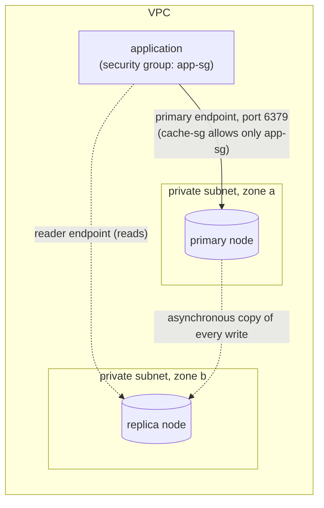
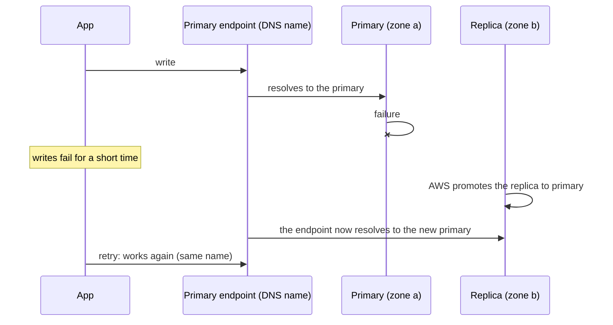

# AWS 07 — ElastiCache

> **Course:** [AWS](./README.md)  ·  **Time:** ~45 min  ·  **Needs:** [AWS 04 — VPC](./04-vpc.md) (subnets); [AWS 06 — RDS](./06-rds.md) (the "managed service" idea); [Docker 01](../docker/01-images-and-containers.md) for the exercise
> **Used in the labs:** [Lab 05](../../labs/05-caching.md) (the `redis` container stands in for an ElastiCache cluster) and [Lab 07](../../labs/07-queues-workers.md) (the same Redis also holds the job queue)
> **No real AWS here:** this module never touches an AWS account. Its hands-on queries the lab's local Redis, and runs a throw-away primary and replica pair to show what ElastiCache's replication and failover do for you.

## What you will learn
- Say what **Amazon ElastiCache** is, and name its pieces: **node**, **replication group**, **primary and replicas**, **shard**, **subnet group**, **parameter group**, **endpoints**.
- Map each piece to what the lab does with a single `redis` container, and say what is **not** simulated.
- See **replication** and a **failover** with your own eyes (primary dies, replica promoted).
- Read the numbers that CloudWatch graphs for a cache (hits, misses, evictions, memory) from Redis itself.
- Know the questions to answer before creating a real cluster (node type, replicas, Multi-AZ, encryption, cost model).

## Words you need
| Word | Plain-words meaning |
|---|---|
| **ElastiCache** | The AWS service that runs in-memory caches for you. Its engines are **Valkey** and **Redis OSS** (key-value stores with data types) and **Memcached** (a simpler cache). |
| **Node** | One cache server (one Redis process on one AWS-managed machine). |
| **Node type** | The size of a node: memory, CPU and network (for example `cache.t4g.micro` is small, `cache.r7g.large` is big). It decides how much data fits and what you pay. |
| **Replication group** | A set of nodes that hold the **same** data: one **primary** (accepts writes) and up to five **replicas** (copies that serve reads). |
| **Primary / replica** | The primary takes writes and copies them to the replicas. A replica is **read-only**. |
| **Shard** | A slice of the data in **cluster mode** (enabled): the key space is split over several primaries, each with its own replicas, to hold more data than one node can. |
| **Multi-AZ / automatic failover** | Replicas are placed in other Availability Zones; if the primary fails, AWS **promotes** a replica by itself. |
| **Primary endpoint** | A DNS name that always points to the **current** primary. After a failover it points to the new one: the application keeps the same name. A **reader endpoint** spreads reads over the replicas. |
| **Subnet group** | The list of **private subnets** ([AWS 04](./04-vpc.md)) in which ElastiCache may place nodes. |
| **Parameter group** | A named set of engine settings, such as `maxmemory-policy`, applied to the nodes. |
| **Security group** | The firewall of the nodes ([Networking 07](../networking/07-firewalls-and-security-groups.md)): it should allow port 6379 only from your application's security group. |
| **AUTH token / ACL** | The password (or user accounts with permissions) clients must give. With **in-transit encryption** the connection uses TLS (`rediss://`, two `s`). |
| **Snapshot (backup)** | A copy of the cache's data you can restore into a **new** cluster. |
| **Eviction** | Removing keys to make room when memory is full ([Lab 05](../../labs/05-caching.md)). |
| **CloudWatch metrics** | Numbers AWS records for you: `CacheHits`, `CacheMisses`, `Evictions`, `CurrConnections`, `DatabaseMemoryUsagePercentage`, `ReplicationLag`... |

## The idea
**Analogy.** A **display shelf at the front of a shop**: the things people ask for most are within reach, so the clerk does not walk to the warehouse (the database) every time. Doing it yourself, you build the shelf, restock it and replace it when it breaks. ElastiCache is **renting a managed shelf**: AWS installs it, keeps a spare shelf in another room and swaps it in if the first one collapses. You still decide **what goes on the shelf**, for how long (TTL), and what to throw away when it is full.

**Precisely.** ElastiCache creates the nodes in the **private subnets** you choose, installs and patches the engine, replaces failed nodes, copies data from the primary to the replicas and, with Multi-AZ, promotes a replica when the primary fails. You choose the **node type**, the **number of replicas**, the **settings** (parameter group), who may connect (security group, AUTH) and what to put in it. As with RDS, your application only needs the **endpoint**.



**What the application sees when the primary fails:**


| ElastiCache piece | What the lab has instead |
|---|---|
| Cluster / replication group | one `redis` container (`role:master`, no replicas: step 4 of the hands-on) |
| Engine and version | `redis:8.10.3-alpine3.23` (pinned) |
| Node type (memory) | `--maxmemory 64mb` |
| Parameter group (`maxmemory-policy`) | the flag `--maxmemory-policy allkeys-lru` |
| Subnet group, private placement | the `private` (internal) Docker network, no `ports:` |
| Security group | membership of `private` |
| AUTH token | `--requirepass`, from `REDIS_PASSWORD` in `.env` |
| Primary endpoint | the service name `redis` (Docker DNS) |
| Replicas, Multi-AZ, automatic failover | **not simulated** (shown with throw-away containers below) |
| Snapshots, TLS, encryption at rest | **not simulated** |
| CloudWatch metrics | `INFO stats` and `INFO memory` of Redis itself |

## The code, line by line
The lab's `redis` service (`docker-compose.yml`, [Lab 05, step 15](../../labs/05-caching.md)), read as an ElastiCache configuration:
```yaml
  redis:
    image: redis:8.10.3-alpine3.23                 # the engine and its exact version
    command:
      - sh
      - -c
      - exec redis-server --requirepass "$$REDIS_PASSWORD" --maxmemory 64mb --maxmemory-policy allkeys-lru --save "" --appendonly no
    networks:
      - private                                    # private subnet: no way in from outside
```
| Part | What it does | The ElastiCache counterpart |
|---|---|---|
| `image: redis:8.10.3-alpine3.23` | The engine, at an exact version. | Engine and **engine version** chosen when you create the cluster; AWS patches minor versions for you. |
| `--requirepass "$$REDIS_PASSWORD"` | Clients must authenticate; the password comes from the environment, not from the file. | **AUTH token** (or an ACL user), kept in Secrets Manager. |
| `--maxmemory 64mb` | The memory the cache may use. | The **node type** (a `cache.t4g.micro` has about half a GB). |
| `--maxmemory-policy allkeys-lru` | When full, evict the least recently used key. | A **parameter group** value; AWS's default parameter groups usually use `volatile-lru` (evict only keys that have a TTL). |
| `--save "" --appendonly no` | No snapshot and no append-only file: nothing is written to disk. | **Backups/snapshots** are optional in ElastiCache; without them a lost node means an empty cache. |
| `networks: - private` | Reachable only from containers on that network. | **Subnet group + security group**. |

## The commands
| Command / flag | Meaning |
|---|---|
| `docker compose exec -T redis sh -c 'REDISCLI_AUTH="$REDIS_PASSWORD" redis-cli "$@"' sh ARGS` | Run `redis-cli` inside the lab's container. The shell reads the password from the container's own environment (`REDISCLI_AUTH`), so it is never typed or printed. `-T` = no terminal. |
| `redis-cli info SECTION` | Print one section of the server's own report: `server`, `memory`, `replication`, `stats`, `keyspace`. |
| `redis-cli config get NAME` | Print one setting (what a parameter group holds). |
| `grep -E '^(a\|b):'` | Keep only the lines starting with `a:` or `b:`. |
| `docker run -d --rm --name ec-primary --network ec-demo redis:8.10.3-alpine3.23 redis-server ...` | A throw-away Redis server: `-d` background, `--rm` delete when stopped, `--name`, `--network` (a private demo network), then the server command and its flags. |
| `--replicaof ec-primary 6379` and `--masterauth PASSWORD` | Start this server as a **replica** of `ec-primary`, authenticating to it. |
| `docker exec ec-primary redis-cli -a PASSWORD --no-auth-warning ...` | Run `redis-cli` in a demo container; `-a` gives the (fake) password, `--no-auth-warning` hides Redis's reminder. |
| `redis-cli replicaof no one` | Stop being a replica and become a primary (a **promotion**: what ElastiCache's failover does). |
| `docker kill ec-primary` | Kill the primary at once: a crash, not a clean stop. |
| `tr -d '\r'` | Delete carriage returns from Redis's answers. |

## Hands-on
**1. The lab's own Redis, read as an ElastiCache cluster.** Against the running stack (Lab 05). Real output:
```text
--- 1. engine
redis_version:8.10.3
redis_mode:standalone
os:Linux 6.6.87.2-microsoft-standard-WSL2 x86_64
tcp_port:6379
--- 2. settings that an ElastiCache parameter group would hold
maxmemory = 67108864
maxmemory-policy = allkeys-lru
appendonly = no
save = 
--- 3. memory
used_memory_human:1.18M
maxmemory_human:64.00M
maxmemory_policy:allkeys-lru
--- 4. replication
role:master
connected_slaves:0
--- 5. what CloudWatch would graph (CacheHits, CacheMisses, Evictions, connections)
total_connections_received:42
evicted_keys:0
keyspace_hits:22
keyspace_misses:2
(keyspace empty)
--- 6. access
no password: NOAUTH Authentication required.
published port: :0
```
(Each block comes from `redis-cli info ...` or `config get`; the labels were added with `echo`, and 20 requests were sent through the API first.) **How to read it:**
- **1:** engine and version, in standalone mode (no sharding: "cluster mode disabled").
- **2:** the two settings of a parameter group: `maxmemory` is exactly 64 MB (67,108,864 bytes) and the policy `allkeys-lru`. `appendonly no` and an empty `save` mean no persistence.
- **3:** 1.18 MB used out of 64 MB. CloudWatch shows this as `BytesUsedForCache` and `DatabaseMemoryUsagePercentage`.
- **4:** `role:master` with `connected_slaves:0`: a one-node "cluster" with **no replica**, so no failover.
- **5:** the raw counters behind `CacheHits` (22), `CacheMisses` (2) and `Evictions` (0). The **hit ratio** is hits ÷ (hits + misses) = 22 ÷ 24, about 92 %. (`(keyspace empty)`: nothing is cached at that moment.)
- **6:** no password gives `NOAUTH`, and `docker compose port redis 6379` prints `:0`: no published port. This is ElastiCache's "private subnet + security group + AUTH" combination.

**2. Replication and failover, with throw-away containers.** The lab has no replica, so this builds the shape of a replication group: a primary and a replica (same pinned image, a fake password). `run.sh`:
```bash
#!/usr/bin/env bash
# AWS 07: a primary and a replica Redis, the shape of an ElastiCache replication group (throw-away containers).
IMG=redis:8.10.3-alpine3.23
rc() { docker exec "$1" redis-cli -a demo-only-not-a-secret --no-auth-warning "${@:2}" | tr -d '\r'; }
docker network create ec-demo >/dev/null
docker run -d --rm --name ec-primary --network ec-demo $IMG redis-server --requirepass demo-only-not-a-secret --save "" --appendonly no >/dev/null
docker run -d --rm --name ec-replica --network ec-demo $IMG redis-server --requirepass demo-only-not-a-secret \
  --masterauth demo-only-not-a-secret --replicaof ec-primary 6379 --save "" --appendonly no >/dev/null
until rc ec-replica info replication 2>/dev/null | grep -q 'master_link_status:up'; do sleep 1; done   # wait for the first copy

echo "== 1. who is who"
echo "primary: $(rc ec-primary info replication | grep -E '^(role|connected_slaves):' | tr '\n' ' ')"
echo "replica: $(rc ec-replica info replication | grep -E '^(role|master_host|master_link_status):' | tr '\n' ' ')"

echo "== 2. a write on the primary is copied to the replica"
rc ec-primary set greeting hello
sleep 0.5
echo "get greeting on the replica -> $(rc ec-replica get greeting)"

echo "== 3. the replica refuses writes"
rc ec-replica set other value

echo "== 4. the primary dies"
docker kill ec-primary >/dev/null
sleep 6
echo "replica link to the primary: $(rc ec-replica info replication | grep -E '^master_link_status:')"
echo "reads still work on the replica: get greeting -> $(rc ec-replica get greeting)"
rc ec-replica set other value

echo "== 5. promote the replica (what ElastiCache failover does for you)"
rc ec-replica replicaof no one
echo "role now: $(rc ec-replica info replication | grep -E '^role:')"
rc ec-replica set after_failover works
echo "get after_failover -> $(rc ec-replica get after_failover); get greeting (kept) -> $(rc ec-replica get greeting)"
docker stop ec-replica >/dev/null; docker network rm ec-demo >/dev/null
```
```text
== 1. who is who
primary: role:master connected_slaves:1 
replica: role:slave master_host:ec-primary master_link_status:up 
== 2. a write on the primary is copied to the replica
OK
get greeting on the replica -> hello
== 3. the replica refuses writes
READONLY You can't write against a read only replica.

== 4. the primary dies
replica link to the primary: master_link_status:down
reads still work on the replica: get greeting -> hello
READONLY You can't write against a read only replica.

== 5. promote the replica (what ElastiCache failover does for you)
OK
role now: role:master
OK
get after_failover -> works; get greeting (kept) -> hello
```
**How to read it:**
- **1:** the primary reports `connected_slaves:1` and the replica `role:slave`, `master_link_status:up`: the copy is running.
- **2:** a value set on the **primary** appears on the **replica** (`get greeting` returns `hello`).
- **3:** a write on the replica is refused: `READONLY You can't write against a read only replica`. This is why a **reader endpoint** is for reads only.
- **4:** after `docker kill`, the replica's link is `down`, **reads still work** (`hello`) and **writes are still refused**: a replica does not take over by itself.
- **5:** `replicaof no one` **promotes** it: `role:master`, writes work (`after_failover -> works`) and the data copied earlier is **kept** (`greeting -> hello`). Here you ran the promotion by hand and would have to point the application at the new address. In ElastiCache **AWS detects the failure, promotes a replica and repoints the primary endpoint** (the documentation says how long it takes); the application reconnects to the same name.

## What if…?
**…there is no replica when the node dies?** That is the lab's situation (hands-on 1, section 4). In ElastiCache a single-node cluster that fails is **replaced by an empty node**: the cache starts cold, every request misses and goes to the database at once (the "burst of misses" of [Lab 05](../../labs/05-caching.md)). It is acceptable for a cache that only holds rebuildable copies, and why the lab can run it without replicas. **But it is not acceptable for data that exists only there**: the job queue of [Lab 07](../../labs/07-queues-workers.md) lives in the same Redis, so a restart empties the queue. In AWS a queue belongs in **SQS**, not in a cache.

## In short
1. ElastiCache runs Valkey, Redis OSS or Memcached nodes **in your private subnets**, patches them and replaces failed ones. You choose the node type, replicas, settings and access; the application uses an **endpoint**.
2. A **replication group** has one primary (writes) and replicas (read-only copies); with **Multi-AZ** a failed primary is replaced by a promoted replica and the endpoint follows. The lab's single container has none of this.
3. Redis's own `INFO` shows what CloudWatch graphs: hits, misses, evictions, memory. Treat a cache as **rebuildable** data; keep data that must not be lost in a database or a queue service.

## Check your understanding
1. What is the difference between the primary and a replica of a replication group?
2. In the experiment, why did a write on the replica fail, and why did reads still work after the primary was killed?
3. What does ElastiCache do automatically on failover that you did by hand with `replicaof no one`?
4. Which parts of the lab's `redis` service correspond to a parameter group, an AUTH token and a subnet group?
5. A cache node dies and there is no replica. What does the application experience, and why is it acceptable for a cache but not for a queue?

<details><summary>Answers</summary>

1. The primary accepts **writes** and copies them to the replicas; a replica is a **read-only** copy that serves reads and can be promoted if the primary fails.
2. A replica is read-only (`READONLY You can't write against a read only replica`), so writes are refused whatever the state of the primary. It keeps its copy of the data, so reads work after the primary dies; it only accepts writes once promoted.
3. It detects the failure, **promotes a replica** to primary, and **repoints the primary endpoint** (DNS name) to it, so the application reconnects to the same name.
4. `--maxmemory-policy allkeys-lru` (and `--maxmemory`) are parameter-group settings; `--requirepass` is the AUTH token; `networks: - private` (internal network, no `ports:`) is the subnet group plus security group.
5. A new, **empty** node: the cache starts cold, requests miss and fall back to the database, then the cache refills. A cache only holds **rebuildable copies**, so that is slower, not wrong; a queue holds work that exists nowhere else, so an empty node loses it.

</details>

## Official documentation
- [Amazon ElastiCache: what it is](https://docs.aws.amazon.com/AmazonElastiCache/latest/dg/WhatIs.html) and [replication groups](https://docs.aws.amazon.com/AmazonElastiCache/latest/dg/Replication.html)
- [ElastiCache: Multi-AZ with automatic failover](https://docs.aws.amazon.com/AmazonElastiCache/latest/dg/AutoFailover.html) and [metrics](https://docs.aws.amazon.com/AmazonElastiCache/latest/dg/CacheMetrics.html)
- [Redis: replication](https://redis.io/docs/latest/operate/oss_and_stack/management/replication/) and [ElastiCache pricing](https://aws.amazon.com/elasticache/pricing/)

## Where you use this in the project
- [Lab 05](../../labs/05-caching.md): the `redis` service, its flags and the section "Going to real AWS" that lists what ElastiCache adds (replicas, Multi-AZ, TLS, backups).
- [Lab 05, step 16](../../labs/05-caching.md): cache-aside with the API: the hit/miss counters of hands-on 1 are what the `X-Cache` header and the test check.
- [Lab 07](../../labs/07-queues-workers.md): the queue shares this Redis, and step 22 shows what a restart does to it: the reason AWS has SQS.
- [AWS 06 - RDS](./06-rds.md): the same managed-service idea (endpoint, parameter group, security group, Multi-AZ) for a database.
