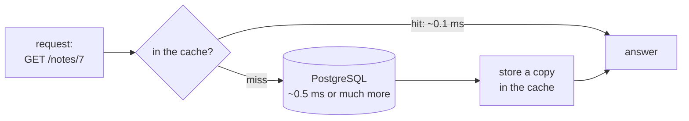

# Caching 01 — Why cache

> **Course:** [Caching](./README.md)  ·  **Time:** ~40 min  ·  **Needs:** [Databases 05](../databases/05-sqlalchemy.md) (reading a table from Python); [Docker 01](../docker/01-images-and-containers.md) for the exercise
> **Used in the labs:** [Lab 05, step 15](../../labs/05-caching.md) (the `redis` container) and [Lab 05, step 16](../../labs/05-caching.md) (`GET /notes/{id}` answers from the cache when it can)

## What you will learn
- Say what a **cache** is and the two problems it solves: **slow reads** and **load on the database**.
- Measure the difference between a database read and a cache read, **with your own numbers**.
- Read a **hit ratio** and work out the average read time for a given ratio.
- Explain when a cache helps a lot, when it helps a little, and what it costs.
- Name the AWS counterpart (ElastiCache) and the other kinds of cache you meet (browser, CDN).

## Words you need
| Word | Plain-words meaning |
|---|---|
| **Cache** | A small, fast store that keeps **copies** of data that is slow to get, so the next request can be answered from the copy. |
| **Source of truth** | The place where the data **really** lives (here PostgreSQL). The cache only holds copies; if it is lost, nothing is lost. |
| **Latency** | The time between asking and getting the answer. Measured here in milliseconds (ms). |
| **Cache hit** | The copy was in the cache: answered fast. |
| **Cache miss** | The copy was not there: the program must read the source of truth (slower), and usually stores the answer in the cache. |
| **Hit ratio** | hits ÷ (hits + misses): the share of requests answered from the cache. 90 % means 9 reads out of 10. |
| **Median** | The middle value of many measurements: half were faster, half slower. Less disturbed by a few odd slow runs than the average. |
| **In-memory store** | A database that keeps its data in RAM (memory) instead of on disk: very fast reads. Redis is one. |
| **ElastiCache** | The AWS service that runs Redis (or Valkey, Memcached) caches for you ([AWS 07](../aws/07-elasticache.md)). |
| **Load** | How much work a system is doing. A cache lowers the load on the database because fewer requests reach it. |

## The idea
**Analogy.** A **librarian** who is asked the same question all day ("when does the museum close?"). Walking to the archive each time takes minutes. So she writes the answer on a **sticky note on her desk** and reads from it next time. The note is a *copy* (the archive is the source of truth); it is fast to read, but it takes desk space and may become **out of date** if the opening hours change.

**Precisely.** Some reads are expensive: they hit a **disk**, run a **big query**, cross a **network** to a remote database, or call another service. If many requests ask for the **same** data, doing the expensive work every time wastes time and puts **load** on the database. A cache keeps the answer in a faster place (memory, nearer to the program). The program first **looks in the cache** (a *hit* answers at once); on a *miss* it does the expensive read and **stores** the result. Two benefits follow: **lower latency** for the user, and **less load** on the database, so it can serve more users.



## The code or config, line by line
The experiment, `why_cache.py`. It runs **inside an API container**, so it uses the lab's own `DATABASE_URL` and `REDIS_URL`, and times the same read four ways:
```python
"""Why cache? Time the same read from the database, from Redis, and through the API with and without the cache.
Runs inside an api container, so it uses the lab's own DATABASE_URL and REDIS_URL."""
import json
import os
import statistics
import time
import urllib.request

import redis
from sqlalchemy import create_engine, text

engine = create_engine(os.environ["DATABASE_URL"])
cache = redis.Redis.from_url(os.environ["REDIS_URL"], decode_responses=True)
API = "http://127.0.0.1:8000"


def call(method, path, body=None):
    req = urllib.request.Request(API + path, method=method, data=json.dumps(body).encode() if body else None,
                                 headers={"Content-Type": "application/json"})
    with urllib.request.urlopen(req) as resp:
        return resp.status, resp.headers.get("X-Cache"), resp.read()


def median_ms(fn, runs=300):
    for _ in range(20):  # warm up: connections, imports
        fn()
    times = []
    for _ in range(runs):
        start = time.perf_counter()
        fn()
        times.append((time.perf_counter() - start) * 1000)
    return statistics.median(times)


status, _, body = call("POST", "/notes", {"title": "why cache", "body": "x" * 200})
note_id = json.loads(body)["id"]
key = f"note:{note_id}"
print(f"note {note_id} created\n")

def read_db():
    with engine.connect() as conn:
        conn.execute(text("select id, title, body, created_at from notes where id = :i"), {"i": note_id}).one()

def read_cache():
    cache.get(key)

def api_hit():
    call("GET", f"/notes/{note_id}")

def api_miss():
    cache.delete(key)  # forget the cached copy, so the API has to ask the database again
    call("GET", f"/notes/{note_id}")

call("GET", f"/notes/{note_id}")  # fill the cache once
print("1. one read, the median of 300 tries")
db, rc = median_ms(read_db), median_ms(read_cache)
print(f"   PostgreSQL (connection from the pool): {db:7.3f} ms")
print(f"   Redis GET                            : {rc:7.3f} ms   ({db / rc:.1f} times faster)")

print("2. the same read through the API (GET /notes/{id}, straight to one replica)")
cache.delete(key)
first = call("GET", f"/notes/{note_id}")[1]   # X-Cache header of the first read after the delete
second = call("GET", f"/notes/{note_id}")[1]  # ... and of the next one
print(f"   X-Cache of the first call after a delete: {first}, of the next: {second}")
hit, miss = median_ms(api_hit), median_ms(api_miss)
print(f"   cache HIT : {hit:7.3f} ms")
print(f"   cache MISS: {miss:7.3f} ms   (the HIT is {miss / hit:.1f} times faster)")

print("3. the average read time for a given hit ratio (computed from the two numbers above)")
for ratio in (0, 0.5, 0.9, 0.99):
    print(f"   hit ratio {ratio * 100:5.1f} % -> {ratio * hit + (1 - ratio) * miss:7.3f} ms")


def read_db_slow():
    with engine.connect() as conn:  # pg_sleep(0.05) pretends the query is expensive: a big join, a remote database
        conn.execute(text("select pg_sleep(0.05), id, title from notes where id = :i"), {"i": note_id}).one()

print("4. when the database read is expensive (simulated: the query takes 50 ms)")
slow = median_ms(read_db_slow, runs=20)
print(f"   PostgreSQL, 50 ms query: {slow:8.3f} ms")
print(f"   Redis GET (same data)  : {rc:8.3f} ms   ({slow / rc:.0f} times faster)")

call("DELETE", f"/notes/{note_id}")
```
| Part | What it does | If you change or remove it |
|---|---|---|
| `engine = create_engine(os.environ["DATABASE_URL"])`, `cache = redis.Redis.from_url(...)` | The lab's database and cache, found through the environment variables the API container already has. | |
| `median_ms(fn, runs=300)` | Runs `fn` 20 times to **warm up** (connections, imports), then times 300 runs with `time.perf_counter()` and returns the **median** in milliseconds. | Without the warm-up the first calls (new connections) would distort the result. |
| `call(...)` | A tiny HTTP client (`urllib`) that returns the status, the `X-Cache` header and the body. | |
| `read_db()` | One `select` of one note by id, with a connection taken from the pool ([Databases 08](../databases/08-connection-pooling.md)). | |
| `read_cache()` | One Redis `GET` of the key the API uses for that note (`note:<id>`). | |
| `api_hit()` | `GET /notes/{id}` straight to this replica (`127.0.0.1:8000`, no load balancer): the API finds the note in the cache. | |
| `api_miss()` | Deletes the cached copy **first**, then does the same `GET`: the API must read PostgreSQL and fill the cache. | |
| `cache.delete(key)`; `first` / `second` | Shows the `X-Cache` header: `MISS` for the first read after a delete, `HIT` for the next. | |
| the hit-ratio loop | **Computes** the average read time for several hit ratios from the two API numbers: `ratio × hit + (1 − ratio) × miss`. | |
| `read_db_slow()` with `pg_sleep(0.05)` | Pretends the query is **expensive** (50 ms), as a big join or a remote database would be. This part is a **simulation**. | |

## The commands
| Command / flag | Meaning |
|---|---|
| `docker compose exec -T api python - < why_cache.py` | Run the script **inside** the running `api` container. `-T` = no terminal (needed to feed a file in); `python -` reads the program from standard input; `< why_cache.py` sends the file as that input. |
| `127.0.0.1:8000` (in the script) | The address of the API inside its own container: it bypasses the load balancer and Docker Desktop's port forwarding, which would add noise to millisecond measurements. |

## Hands-on
Against the running lab ([Lab 05](../../labs/05-caching.md)): save `why_cache.py` and run the command above. The script creates a note, measures, and deletes the note. Real output (your numbers will differ; the **ratios** are what matter):
```text
note 85 created

1. one read, the median of 300 tries
   PostgreSQL (connection from the pool):   0.518 ms
   Redis GET                            :   0.137 ms   (3.8 times faster)
2. the same read through the API (GET /notes/{id}, straight to one replica)
   X-Cache of the first call after a delete: MISS, of the next: HIT
   cache HIT :   1.148 ms
   cache MISS:   2.366 ms   (the HIT is 2.1 times faster)
3. the average read time for a given hit ratio (computed from the two numbers above)
   hit ratio   0.0 % ->   2.366 ms
   hit ratio  50.0 % ->   1.757 ms
   hit ratio  90.0 % ->   1.270 ms
   hit ratio  99.0 % ->   1.161 ms
4. when the database read is expensive (simulated: the query takes 50 ms)
   PostgreSQL, 50 ms query:   51.470 ms
   Redis GET (same data)  :    0.137 ms   (375 times faster)
```
**How to read it:**
- **1:** one read of one row takes **0.518 ms** from PostgreSQL and **0.137 ms** from Redis: Redis is about **3.8 times faster**. Both are tiny numbers: the lab's database is small, local and fast.
- **2:** through the API, a **hit** takes **1.148 ms** and a **miss 2.366 ms**: about **2.1 times** faster. (The API does more than the raw read: it parses the request, builds and returns JSON. The miss also reads the database and **writes** the copy into Redis.) The `X-Cache` header proves which case happened: `MISS`, then `HIT`. In this script the miss time also includes the `cache.delete(key)` call that prepares it: one more round trip to Redis, about the 0.14 ms measured in section 1, so the miss is slightly overstated.
- **3:** the **hit ratio** decides the average: with no cache (0 %) 2.4 ms; at **90 %** 1.3 ms; at 99 % 1.2 ms. Most of the gain comes from the first 90 %; the last points add little.
- **4:** if the read is **expensive** (simulated here as 50 ms), the cache answers in **0.137 ms**: about **375 times faster**. This is where caches really pay: the slower the original read, the bigger the gain.

## What if…?
**…the cache barely helps?** Section 2 is the honest answer for a **small, local, indexed** read: a 2× gain on a 2 ms request is real but modest, and the cache has **costs**: another service to run and secure ([AWS 07](../aws/07-elasticache.md)), memory to pay for, and the risk of **stale data** (a copy that no longer matches the source: [Caching 05](./README.md), planned). A cache is worth it when the read is **slow or frequent or both**: expensive queries, data that **many users read** and few change, load that would otherwise need a bigger database. Measure first, as this module does. Also note that **you cannot cache everything**: data that changes at every request (a counter being incremented) has nothing to reuse.

## In short
1. A cache keeps **copies** of data that is slow to get; the source of truth stays in the database. A **hit** is answered from the copy, a **miss** reads the source and stores a copy.
2. It lowers **latency** and the **load** on the database. The gain depends on how slow the original read is (2× for a tiny local query, hundreds of times for an expensive one) and on the **hit ratio**.
3. It costs memory, another service, and the risk of stale copies: measure before adding one.

## Check your understanding
1. What is the difference between a hit and a miss, and what happens after a miss?
2. In the experiment a raw Redis read was 3.8 times faster than PostgreSQL, but the API's hit was only 2.1 times faster than its miss. Why the smaller gain?
3. What is the average read time with a 90 % hit ratio if a hit takes 1 ms and a miss 11 ms?
4. Why was the gain 375 times in section 4?
5. Name two costs of adding a cache.

<details><summary>Answers</summary>

1. A **hit**: the copy is in the cache and is returned at once. A **miss**: it is not, so the program reads the source of truth (the database) and then usually **stores a copy** in the cache for the next request.
2. The API does other work on every request (parsing, building JSON), which is the same for a hit and a miss; the cache only removes the database part, so the **relative** gain is smaller than the raw read comparison. A miss also pays for writing the copy.
3. `0.9 × 1 + 0.1 × 11 = 0.9 + 1.1 = 2.0 ms`.
4. Because the database read was **expensive** (50 ms, simulated), while the cache read stays at a fraction of a millisecond. The slower the original read, the more a cache saves.
5. Any two of: another service to run and secure, memory to pay for, a copy that can become **stale**, extra code to fill and invalidate the cache.

</details>

## Official documentation
- [Redis: caching use case](https://redis.io/solutions/caching/) and [Redis documentation: develop with Redis](https://redis.io/docs/latest/develop/)
- [Amazon ElastiCache: caching strategies](https://docs.aws.amazon.com/AmazonElastiCache/latest/dg/Strategies.html)
- [AWS: What is caching?](https://aws.amazon.com/caching/) (an introduction)

## Where you use this in the project
- [Lab 05, step 15](../../labs/05-caching.md): the `redis` container, the place the copies live; [step 16](../../labs/05-caching.md): `GET /notes/{id}` returns `X-Cache: HIT` or `MISS`, exactly the header used here.
- [Lab 05, step 17](../../labs/05-caching.md): the test that proves the second read is a hit.
- [AWS 07 - ElastiCache](../aws/07-elasticache.md): what the managed version adds; [Databases 06 - Indexes](../databases/06-indexes.md): the other way to make a read fast.
