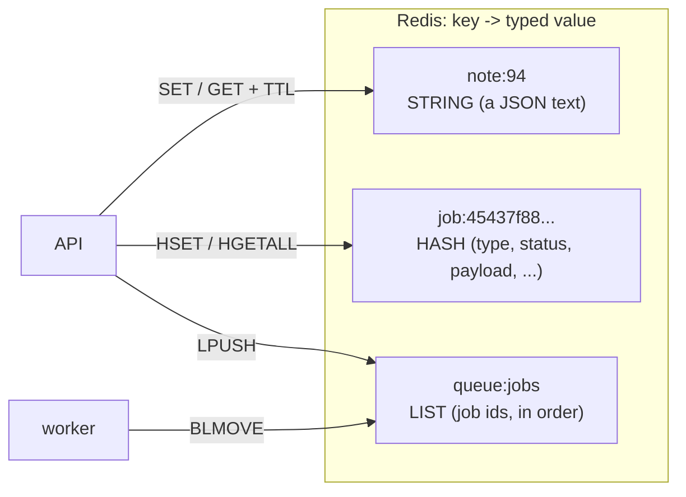

# Caching 02 — Redis basics and data types

> **Course:** [Caching](./README.md)  ·  **Time:** ~45 min  ·  **Needs:** [Caching 01](./01-why-cache.md); [Docker 01](../docker/01-images-and-containers.md) for the exercise
> **Used in the labs:** [Lab 05, step 15](../../labs/05-caching.md) (`redis-cli ping`, the `redis` container), [Lab 05, step 16](../../labs/05-caching.md) (a cached note is a string) and [Lab 07, step 22](../../labs/07-queues-workers.md) (a job is a hash, the queue is a list)

## What you will learn
- Explain what Redis stores (**keys** and **typed values**, in memory) and how you talk to it (`redis-cli`).
- Use the five basic **data types**: string, list, hash, set, sorted set, with their typical commands.
- Use **expiry** (`EX`, `TTL`) and **atomic counters** (`INCR`).
- Read the lab's own keys (`note:<id>`, `job:<id>`, `queue:jobs`) and say which type each one is, and why.
- Recognise the `WRONGTYPE` error, and why `SCAN` is preferred to listing all keys.

## Words you need
| Word | Plain-words meaning |
|---|---|
| **Redis** | A database that keeps its data **in memory** and gives each piece a name (a key). Very fast; used for caches, queues, counters. |
| **Key** | The name of a piece of data: `note:7`. A text. The colon is only a **convention** to group related keys (`note:7`, `note:8`). |
| **Value** | What is stored under a key. It has a **type**. |
| **Data type** | The **shape** of a value: a plain text (string), a line of values (list), a record of named fields (hash), a bag of unique values (set), or unique values with a score (sorted set). Each type has its own commands. |
| **Command** | One instruction sent to Redis: `SET`, `GET`, `LPUSH`... Each command is **atomic**: it runs completely, with nothing else in between, even with many clients. |
| **Atomic** | Indivisible: `INCR` reads, adds one and writes as one step, so two clients incrementing at once never lose a count. |
| **`redis-cli`** | The command-line client of Redis: `redis-cli set a 1`. |
| **TTL** | *Time to live*: the number of seconds before a key deletes itself. `-1` means "no expiry", `-2` "no such key". |
| **`nil`** | Redis's answer for "nothing here" (shown as `(nil)` below). |
| **`SCAN`** | A command that walks the keys **a little at a time**, so it never blocks the server (unlike `KEYS *`). |
| **`WRONGTYPE`** | The error Redis answers when you use a command of one type on a key of another (for example a list command on a string). Nothing is changed. |
| **`LPUSH`, `BLMOVE`, `LREM`** | List commands used by the lab's queue: `LPUSH` adds at the head; `BLMOVE` takes an item from one list and puts it on another (waiting if the first is empty); `LREM` removes an item. |

## The idea
**Analogy.** A **labelled filing cabinet**. Every drawer has a **label** (the key) and holds one thing, but the things come in different **shapes**: a sticky note with a single line (a **string**), a queue of tickets in order (a **list**), an index card with named boxes "type: thumbnail, status: done" (a **hash**), a bag of tokens with no doubles (a **set**), a ranking board where each name has a score (a **sorted set**). You must handle each drawer with the right tools: you cannot "take the next ticket" from a sticky note.

**Precisely.** Redis is a **key-value store**: a big dictionary in memory from text keys to typed values. You send **commands**; the type of the key decides which commands are allowed, and a command on the wrong type is refused. Because Redis runs one command at a time, each command is atomic: that is what makes counters and queues safe with many clients. Keys can have a **TTL** and disappear by themselves (what makes it a good cache, [Caching 01](./01-why-cache.md)).



| Type | Typical commands | Good for |
|---|---|---|
| **String** | `SET`, `GET`, `INCR`, `EXPIRE` | a cached value (text, JSON), a counter, a flag |
| **List** | `LPUSH`, `RPUSH`, `LRANGE`, `RPOP`, `LLEN` | a queue, the latest N items |
| **Hash** | `HSET`, `HGET`, `HGETALL`, `HINCRBY` | a small record with fields you update one by one |
| **Set** | `SADD`, `SMEMBERS`, `SISMEMBER`, `SCARD` | unique values: tags, "who has seen this" |
| **Sorted set** | `ZADD`, `ZRANGE`, `ZREVRANGE` | rankings, "top 10", things ordered by time or score |

## The code or config, line by line
`run.sh` starts a throw-away Redis, runs a few commands per type through the helper `r`, and prints each as `> command  ->  answer`:
```bash
#!/usr/bin/env bash
# Caching 02: the data types of Redis, one section each, on a throw-away server (no password, no published port).
docker run -d --rm --name redis-demo redis:8.10.3-alpine3.23 >/dev/null
until docker exec redis-demo redis-cli ping 2>/dev/null | grep -q PONG; do sleep 0.5; done
# r COMMAND...: run one redis-cli command and print "> command  ->  answer" on one line
r() {
  out=$(docker exec redis-demo redis-cli "$@" | tr '\n' ' ' | sed 's/ *$//')
  echo "> $*  ->  ${out:-(nil)}"
}

echo "== 1. strings: one value per key"
r set greeting hello
r get greeting
r get nothing-here
r set counter 0
r incr counter
r incr counter
r incrby counter 10
r set note:7 '{"title":"hello","body":"world"}'
r type note:7

echo "== 2. expiry: a key that deletes itself"
r set session abc123 ex 30
r ttl session
r set session new nx
r ttl greeting

echo "== 3. lists: an ordered line of values"
r rpush todo write test deploy
r lpush todo plan
r lrange todo 0 -1
r llen todo
r rpop todo
r lrange todo 0 -1

echo "== 4. hashes: a small record with named fields"
r hset job:1 type thumbnail status queued
r hget job:1 status
r hset job:1 status done
r hgetall job:1
r hincrby job:1 attempts 1

echo "== 5. sets: unique values, no order"
r sadd tags red blue red
r smembers tags
r sismember tags red
r scard tags

echo "== 6. sorted sets: unique values ordered by a score"
r zadd scores 10 alice 25 bob 15 carol
r zrange scores 0 -1 withscores
r zrevrange scores 0 0 withscores

echo "== 7. a command for the wrong type is refused"
r lpush greeting x
r type greeting
r type todo

echo "== 8. looking at the keys"
r dbsize
r scan 0 match 'job:*'
docker stop redis-demo >/dev/null
```
| Part | What it does | If you change or remove it |
|---|---|---|
| `docker run -d --rm --name redis-demo redis:8.10.3-alpine3.23` | A throw-away Redis, the same pinned image as the lab. No password, no published port: only reachable with `docker exec`. | |
| `until ... redis-cli ping ... grep -q PONG; do sleep 0.5; done` | Wait until the server answers `PONG` (it is ready). | Without it the first commands could fail while Redis starts. |
| `r() { out=$(docker exec redis-demo redis-cli "$@" ...) ...}` | Runs one command in the container, joins a multi-line answer on one line (`tr '\n' ' '`) and shows `(nil)` when the answer is empty. | |
| `set counter 0` / `incr counter` / `incrby counter 10` | A number kept in a **string**; `INCR` adds 1 **atomically**, `INCRBY` adds n. | Doing `GET` then `SET` in your program would lose counts when two clients overlap. |
| `set session abc123 ex 30` / `ttl session` | `EX 30` makes the key expire in 30 seconds; `TTL` shows the seconds left. | |
| `set session new nx` | `NX` = "only if the key does **not** exist": nothing is written and the answer is `(nil)`. | |
| `rpush todo write test deploy` / `lpush todo plan` / `rpop todo` | `RPUSH` adds on the right (the end), `LPUSH` on the left (the start), `RPOP` removes the last. | |
| `hset job:1 type thumbnail status queued` | Creates a hash with two fields and answers how many fields were **new** (2). A second `hset job:1 status done` answers `0` (a field was updated, none added). | |
| `sadd tags red blue red` | Adds three values to a set; answers `2`: the second `red` was a duplicate. | |
| `zadd scores 10 alice 25 bob 15 carol` | Adds members with a score; `ZRANGE ... withscores` lists them from the lowest score; `ZREVRANGE` from the highest. | |
| `lpush greeting x` | A list command on a **string** key: refused with `WRONGTYPE`. | |
| `scan 0 match 'job:*'` | Walks the keys in small steps; the answer is the next cursor (`0` = finished) and the matching keys. | `KEYS *` returns everything at once and **blocks** Redis while it does. |

The same types in the lab itself, `lab_keys.sh` (change the `cd` line to **your own project folder**): it creates a note and reads it (the API caches it), stops the worker so a job stays in the queue, and asks the lab's Redis what it holds, then cleans up. `r` is the same helper, run inside the lab's `redis` container, with the password taken from the container's own environment (never typed or printed):
```bash
#!/usr/bin/env bash
# The lab's own Redis keys: a cached note (string), a job record (hash) and the queue (list).
cd /c/Users/ASUSG14/Documents/aws-local-lab
export MSYS_NO_PATHCONV=1
U=http://127.0.0.1:8088

# r COMMAND...: one redis-cli command inside the lab's redis container (the password comes from its own
# environment), printed as "> command  ->  answer" on one line
r() {
  out=$(docker compose exec -T redis sh -c 'REDISCLI_AUTH="$REDIS_PASSWORD" redis-cli "$@"' sh "$@" | tr -d '\r' | tr '\n' ' ' | sed 's/ *$//')
  echo "> $*  ->  ${out:-(nil)}"
}

NID=$(curl -s -X POST $U/notes -H 'Content-Type: application/json' -d '{"title":"redis types","body":"demo"}' | sed -n 's/.*"id":\([0-9]*\).*/\1/p')
curl -s -o /dev/null $U/notes/$NID                 # a read fills the cache
docker compose stop worker >/dev/null 2>&1         # no worker: the job stays in the queue
JID=$(curl -s -X POST $U/jobs -H 'Content-Type: application/json' -d '{"type":"noop"}' | sed -n 's/.*"id":"\([0-9a-f]*\)".*/\1/p')

echo "== the cached note"
r type note:$NID
r get note:$NID
r ttl note:$NID
echo "== the job record"
r type job:$JID
r hgetall job:$JID
r ttl job:$JID
echo "== the queue"
r type queue:jobs
r llen queue:jobs
r lrange queue:jobs 0 -1

# clean up
docker compose start worker >/dev/null 2>&1
sleep 4
curl -s -o /dev/null -X DELETE $U/notes/$NID
r del job:$JID > /dev/null
```

## The commands
| Command / flag | Meaning |
|---|---|
| `redis-cli COMMAND ARGS` | Send one command to Redis and print the answer. Without arguments it opens an interactive prompt. |
| `docker exec redis-demo redis-cli ...` | Run `redis-cli` **inside** the demo container, where it reaches the server on its own `localhost`. |
| `docker compose exec -T redis sh -c 'REDISCLI_AUTH="$REDIS_PASSWORD" redis-cli "$@"' sh ARGS` | The same inside the lab's `redis` service, which needs a password: the shell reads it from the container's own variable `REDIS_PASSWORD` and gives it to `redis-cli` through `REDISCLI_AUTH`. `-T` = no terminal. |
| `TYPE key` | Print the type of a key (`string`, `list`, `hash`, `set`, `zset`, or `none`). |
| `tr '\n' ' '`, `sed 's/ *$//'` | Shell: replace line breaks by spaces; trim the spaces at the end of the line. |
| `sed -n 's/.*\"id\":\([0-9]*\).*/\1/p'` | Pull the number after `\"id\":` out of the JSON answer: `-n` prints nothing by itself, the `p` at the end prints only the line where the replacement happened, and `\1` is what the parentheses matched. |
| `until CMD; do sleep 0.5; done` | Repeat `sleep 0.5` **until** the command succeeds: waits for Redis to answer `PONG` before the first test. |
| `curl -o /dev/null` | Make the request but throw the answer away (the request is the point: it fills the cache, or deletes the note). |
| `docker compose stop worker` / `start worker` | Pause and resume the lab's worker, so a job stays in the queue long enough to look at. |
| `curl -s -X POST URL -H 'Content-Type: application/json' -d '...'` | Create something through the API (a note, a job); `-s` quiet, `-X` the method, `-H` a header, `-d` the body. |
| `MSYS_NO_PATHCONV=1` | Git Bash on Windows: stop it from rewriting arguments that start with `/`. |

## Hands-on
Throw-away container (`redis:8.10.3-alpine3.23`). Save `run.sh` and run `bash run.sh`. Real output:
```text
== 1. strings: one value per key
> set greeting hello  ->  OK
> get greeting  ->  hello
> get nothing-here  ->  (nil)
> set counter 0  ->  OK
> incr counter  ->  1
> incr counter  ->  2
> incrby counter 10  ->  12
> set note:7 {"title":"hello","body":"world"}  ->  OK
> type note:7  ->  string
== 2. expiry: a key that deletes itself
> set session abc123 ex 30  ->  OK
> ttl session  ->  30
> set session new nx  ->  (nil)
> ttl greeting  ->  -1
== 3. lists: an ordered line of values
> rpush todo write test deploy  ->  3
> lpush todo plan  ->  4
> lrange todo 0 -1  ->  plan write test deploy
> llen todo  ->  4
> rpop todo  ->  deploy
> lrange todo 0 -1  ->  plan write test
== 4. hashes: a small record with named fields
> hset job:1 type thumbnail status queued  ->  2
> hget job:1 status  ->  queued
> hset job:1 status done  ->  0
> hgetall job:1  ->  type thumbnail status done
> hincrby job:1 attempts 1  ->  1
== 5. sets: unique values, no order
> sadd tags red blue red  ->  2
> smembers tags  ->  red blue
> sismember tags red  ->  1
> scard tags  ->  2
== 6. sorted sets: unique values ordered by a score
> zadd scores 10 alice 25 bob 15 carol  ->  3
> zrange scores 0 -1 withscores  ->  alice 10 carol 15 bob 25
> zrevrange scores 0 0 withscores  ->  bob 25
== 7. a command for the wrong type is refused
> lpush greeting x  ->  WRONGTYPE Operation against a key holding the wrong kind of value
> type greeting  ->  string
> type todo  ->  list
== 8. looking at the keys
> dbsize  ->  8
> scan 0 match job:*  ->  0 job:1
```
**How to read it:**
- **1, strings:** `get nothing-here` gives `(nil)`; `incr` goes 1, 2 and `incrby counter 10` gives 12 (each step atomic); `note:7` holds a **JSON text**, and `type` says `string`. This is how the API stores a cached note.
- **2, expiry:** `ttl session` shows `30` seconds; the second `set ... nx` is **refused** (`(nil)`), the key exists; `ttl greeting` is `-1`: a key with no expiry.
- **3, lists:** after `rpush` and `lpush` the order is `plan write test deploy`; `rpop` removed the **last** (`deploy`). Add on one side, remove on the other: a queue.
- **4, hashes:** `hset` answers `2` (two new fields), then `0` when `status` was only **updated**; `hgetall` lists the fields and values; `hincrby` created and incremented a counter field.
- **5, sets:** `red` was added twice but the set has `2` members; `sismember` answers `1` (yes).
- **6, sorted sets:** ordered by score: alice 10, carol 15, bob 25; `zrevrange 0 0` gives the highest, bob.
- **7, types:** `lpush greeting x` fails with `WRONGTYPE Operation against a key holding the wrong kind of value`: `greeting` is a string.
- **8, keys:** 8 keys exist; `scan 0 match job:*` answers the next cursor `0` (done) and `job:1`.

**The lab's own keys.** Run `lab_keys.sh` against the running lab. Real output (job ids cut to 8 characters):
```text
== the cached note
> type note:94  ->  string
> get note:94  ->  {"title":"redis types","body":"demo","id":94,"created_at":"2026-11-23T09:25:38.788894Z"}
> ttl note:94  ->  56
== the job record
> type job:45437f88...  ->  hash
> hgetall job:45437f88...  ->  type noop status queued payload {} created_at 2026-11-23T09:25:41.259597+00:00
> ttl job:45437f88...  ->  86397
== the queue
> type queue:jobs  ->  list
> llen queue:jobs  ->  1
> lrange queue:jobs 0 -1  ->  45437f88...
```
- The **cached note** `note:94` is a **string** holding the note as JSON, with a TTL of 56 seconds left (`CACHE_TTL_SECONDS` is 60: [Lab 05](../../labs/05-caching.md)). It will delete itself.
- The **job** is a **hash**: `type`, `status`, `payload`, `created_at`. The worker can change `status` alone, which a JSON string could not do without reading and rewriting the whole text. Its TTL is 86,397 seconds, almost 24 hours (`JOB_TTL`).
- The **queue** `queue:jobs` is a **list** holding the job id (`llen` 1): a hash holds the record, the list only the order ([Lab 07, step 22](../../labs/07-queues-workers.md)).

## What if…?
**…you use the wrong type?** Section 7 of the exercise is the answer: Redis **refuses** (`WRONGTYPE`) instead of guessing, and the key is left as it was. In a program the same mistake shows up as an exception, usually because two parts of the code use the same key name for different things: the **naming convention** (`note:<id>`, `job:<id>`, `queue:jobs`) exists to prevent it. Another classic mistake is `KEYS *` on a big server: it **blocks** Redis until it has listed everything, so use `SCAN`, which returns a few keys at a time.

## In short
1. Redis is a dictionary in memory: a **key** (text) → a **typed value**, with commands per type, each command atomic, and optional expiry (`EX`, `TTL`).
2. The five basic types: **string** (a value, a counter), **list** (an ordered line), **hash** (a record of fields), **set** (unique values), **sorted set** (unique values with a score).
3. The lab uses three of them: a cached note is a **string** with a TTL, a job is a **hash**, the queue is a **list**. Use `TYPE` to check, and `SCAN` instead of `KEYS *`.

## Check your understanding
1. What is the difference between a string and a hash for storing a job's record?
2. Why is `INCR counter` safe when many clients use it at the same time, while `GET` then `SET` is not?
3. What does `set session new nx` answer when `session` already exists, and why?
4. In the lab, which type is `queue:jobs`, which command adds a job to it and which takes one out?
5. Why is `SCAN` preferred to `KEYS *` on a busy server?

<details><summary>Answers</summary>

1. A string holds one value (for example the whole record as JSON); to change one field you must read, change and rewrite the whole text. A hash holds **named fields**, so `HSET job:1 status done` changes just one field, atomically.
2. `INCR` is one atomic command: Redis reads, adds one and writes with nothing else in between. With `GET` then `SET` two clients can both read 5 and both write 6: one count is lost.
3. `(nil)`: nothing is written. `NX` means "only if the key does **not** exist", and it exists.
4. A **list**. The API adds with `LPUSH` (at the head); the worker takes the oldest with `BLMOVE ... RIGHT LEFT` (from the tail, moving it to the processing list).
5. `KEYS *` builds the whole list at once and blocks Redis while it does, so every other client waits. `SCAN` returns a few keys per call (with a cursor), so Redis stays responsive.

</details>

## Official documentation
- [Redis data types](https://redis.io/docs/latest/develop/data-types/) and [the command reference](https://redis.io/docs/latest/commands/)
- [`redis-cli`](https://redis.io/docs/latest/develop/tools/cli/), [`INCR`](https://redis.io/docs/latest/commands/incr/) (atomic counters) and [`SCAN`](https://redis.io/docs/latest/commands/scan/)
- [The Redis keyspace (keys, expiry)](https://redis.io/docs/latest/develop/using-commands/keyspace/)

## Where you use this in the project
- [Lab 05, step 15](../../labs/05-caching.md): the `redis` container and `redis-cli ping`; [step 16](../../labs/05-caching.md): `SET note:<id> ... EX` and `GET` (a string with a TTL) in the API's cache-aside read.
- [Lab 07, step 22](../../labs/07-queues-workers.md) and [step 23](../../labs/07-queues-workers.md): the job **hash** and the queue **list** (`LPUSH`, `BLMOVE`, `LREM`).
- [AWS 07 - ElastiCache](../aws/07-elasticache.md): the managed Redis; [Caching 01](./01-why-cache.md): why the copies are worth keeping.
