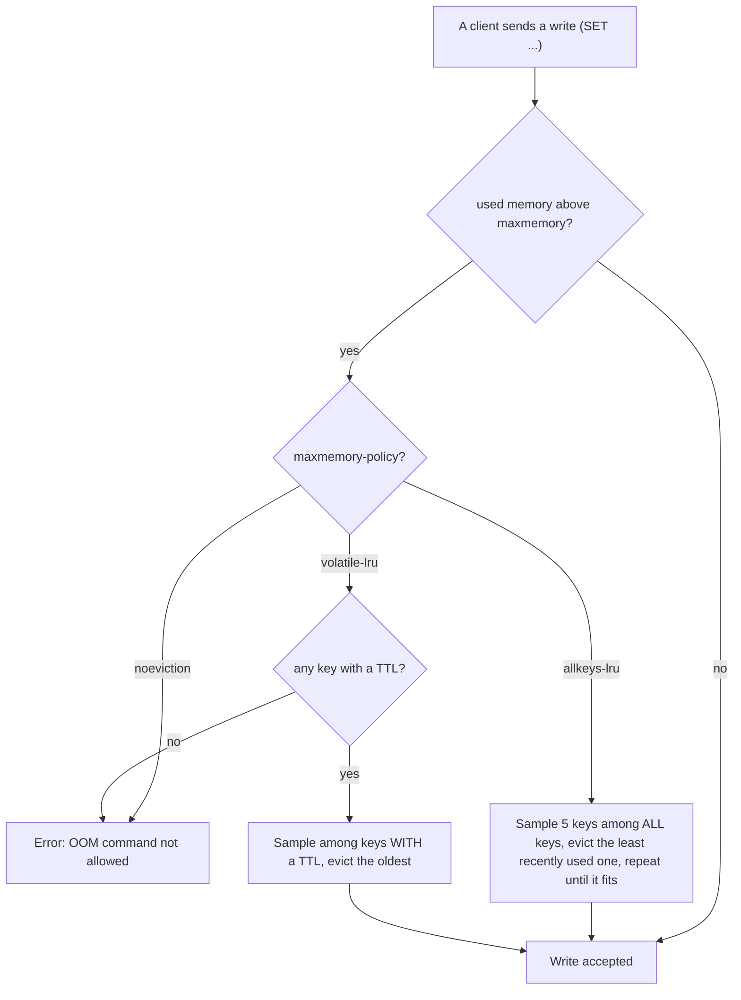

# Caching 03 — Eviction and `maxmemory`

> **Course:** [Caching](./README.md)  ·  **Time:** ~40 min  ·  **Needs:** [Caching 01](./01-why-cache.md) and [Caching 02](./02-redis-data-types.md)
> **Used in the labs:** [Lab 05, step 15](../../labs/05-caching.md) (the Redis container and its `--maxmemory 64mb --maxmemory-policy allkeys-lru` options)

## What you will learn
- Say why a cache must have a **memory limit**, and what happens at that limit.
- Name the main **eviction policies** of Redis and choose between them.
- Explain what **LRU** means, and why Redis only *approximates* it.
- Read the lab's Redis settings and the counters that show evictions (`evicted_keys`, `used_memory_human`).
- Reproduce, on a throw-away Redis, the difference between `noeviction`, `volatile-lru` and `allkeys-lru`.

## Words you need
| Word | Plain-words meaning |
|---|---|
| **Memory (RAM)** | The fast, temporary storage of a computer. Redis keeps **all** its data there, which is why it is fast, and why it is limited by the machine. |
| **`maxmemory`** | A Redis setting: the most memory Redis may use for its data. `0` means no limit (until the machine runs out). |
| **Eviction** | When the limit is reached, Redis **throws away** some keys to make room for new ones. |
| **Eviction policy** | The rule that decides *which* keys to throw away. Set with `maxmemory-policy`. |
| **LRU** (Least Recently Used) | "Throw away the key that was **used longest ago**". The idea: what nobody asked for recently is unlikely to be asked for soon. |
| **LFU** (Least Frequently Used) | "Throw away the key used **least often**", counting uses over time. |
| **TTL** | The time a key still has to live before it expires by itself (see [Caching 02](./02-redis-data-types.md)). A key **with** a TTL is called *volatile*. |
| **Volatile key** | A key that has a TTL. A key without one is *persistent* (it stays until you delete it). |
| **OOM** (out of memory) | The error `OOM command not allowed when used memory > 'maxmemory'`: Redis refuses a command that would add data, because it is full and is not allowed to evict. |
| **Sampling** | Looking at a few random keys instead of all of them. Redis picks `maxmemory-samples` keys (5 by default) and evicts the oldest *of those*. |
| **`used_memory`** | The memory Redis uses right now (shown by `INFO memory`). It includes some fixed overhead, about 1 MB when empty. |
| **Cache hit / miss** | A hit: the value was in the cache. A miss: it was not, so the caller goes to the database ([Caching 01](./01-why-cache.md)). |

## The idea
**Everyday analogy.** A cache is a small desk next to a big warehouse (the database). The desk holds the papers you use most, so you rarely walk to the warehouse. The desk has a fixed size. When it is full and you need room for a new paper, you must put one back in the warehouse. The sensible choice is the paper you have **not touched for the longest time**: that is LRU. If the rule were "never remove anything" you could not put any new paper on the desk (`noeviction`: new work is refused). If the rule were "only remove papers marked *temporary*" and none is marked, you are stuck the same way (`volatile-lru` with no TTLs).

**Precisely.** Redis stores everything in memory, so memory is the scarce resource. With no limit, a busy cache grows until the operating system kills the process. `maxmemory` sets a ceiling, and `maxmemory-policy` says what to do when a write would cross it:

| Policy | Which keys can be evicted | Which one goes first | Typical use |
|---|---|---|---|
| `noeviction` | none | — (writes are **refused** with `OOM`; reads still work) | Redis used as a **database or queue**: losing data is worse than refusing a write |
| `allkeys-lru` | **all** keys | the least recently used | **A cache** where every key is a rebuildable copy (this lab) |
| `volatile-lru` | only keys **with a TTL** | the least recently used among them | A mix: keys without TTL are "permanent", keys with TTL are the cache |
| `allkeys-lfu` / `volatile-lfu` | all / TTL keys | the least frequently used | A few keys are asked for very often, and must stay even if not asked for in the last minutes |
| `allkeys-random` / `volatile-random` | all / TTL keys | a random one | Rarely best; cheap |
| `volatile-ttl` | TTL keys | the one **closest to expiry** | You want to drop what would expire soon anyway |



**LRU is approximate.** Keeping a perfect ordering of millions of keys would cost memory and time. Redis stores in each key a small clock (precision **one second**) and, when it must evict, takes `maxmemory-samples` random keys and removes the oldest of them. Two consequences you will see below: keys used within the same second look equally "young", and a key is evicted *probably* but not *surely* when it is old. Raising `maxmemory-samples` (to 10, for example) makes the choice closer to true LRU at a small CPU cost.

**The lab's choice.** A cached note is a copy that can be rebuilt from Postgres, so losing one is harmless: `allkeys-lru` with a 64 MB ceiling. The same Redis also holds the job queue (Lab 07), where losing a key *is* harmful: that is the caveat noted in [Lab 07](../../labs/07-queues-workers.md), and it is why real systems keep the **cache** and the **queue** in separate Redis servers (or use SQS for the queue).

## The config, line by line
The `redis` service of `docker-compose.yml` (step 15), trimmed:

```text
exec redis-server \
  --requirepass "$REDIS_PASSWORD" \
  --maxmemory 64mb \
  --maxmemory-policy allkeys-lru \
  --save "" \
  --appendonly no
```

| Line | What it does | If you change or remove it |
|---|---|---|
| `exec redis-server` | Starts Redis as the container's main process (`exec` replaces the shell, so Redis receives the stop signal). | Without `exec`, `docker stop` waits 10 s and kills Redis. |
| `--requirepass "$REDIS_PASSWORD"` | Clients must authenticate; the password comes from the container's environment, not from the file. | Without it, any container on the private network can read the cache. |
| `--maxmemory 64mb` | The ceiling for the data. | Remove it: no limit, Redis grows until the machine is out of memory. Too small: constant evictions, few hits. |
| `--maxmemory-policy allkeys-lru` | Evict the least recently used key, whatever its TTL. | `noeviction` (the Redis default!) makes the cache refuse writes when full; `volatile-lru` evicts nothing if no key has a TTL. |
| `--save ""` and `--appendonly no` | No snapshot and no log on disk. | Turn them on and Redis would keep its data across restarts, like a database (that is a different design). |

## The commands
| Command / flag | Meaning |
|---|---|
| `CONFIG GET maxmemory` | Show a setting (`CONFIG SET name value` changes it **without a restart**, but the change is lost at the next restart). Value in bytes: `67108864` = 64 × 1024 × 1024. |
| `CONFIG GET maxmemory-policy` / `maxmemory-samples` | The policy in use and the sample size (default 5). |
| `INFO memory` | A report on memory. Read `used_memory_human` (now), `maxmemory_human` (the ceiling) and `maxmemory_policy`. |
| `INFO stats` | Counters since start. Read `evicted_keys` (keys thrown away because of `maxmemory`) and `expired_keys` (keys that reached their TTL: not the same thing). |
| `DBSIZE` | The number of keys. |
| `EXISTS key` | `1` if the key exists, `0` if not. It does **not** count as a use for LRU purposes in the way a `GET` does. |
| `EVAL "script" 0 arg...` | Run a small Lua script **inside** Redis in one atomic step (`0` = the script uses no key names; extra words become `ARGV[1]`, `ARGV[2]`...). Used below to write 500 keys in one go. |
| `redis-server --maxmemory 2mb --maxmemory-policy P` | Start a server with those options (the same options as in the compose file). |
| `docker run -d --rm --name N IMAGE ...` | Start a throw-away container in the background (`-d`), delete it when it stops (`--rm`), and name it so `docker exec` can find it. |
| `docker exec N redis-cli ...` | Run `redis-cli` inside container `N`. |

## Hands-on
Three throw-away Redis servers (image `redis:8.10.3-alpine3.23`, the one of the lab) with a **2 MB** ceiling, so that a few thousand 1 KB keys are enough to fill them. Each server gets two marker keys, `hot` and `cold`, and then rounds of new keys; the script reads `hot` at every round and never touches `cold`. Save it as `run.sh` anywhere:

```bash
#!/usr/bin/env bash
export MSYS_NO_PATHCONV=1               # Git Bash on Windows: do not rewrite arguments that start with /
IMG=redis:8.10.3-alpine3.23

fill() {                                # fill CONTAINER ROUNDS KEYS_PER_ROUND
  c=$1; rounds=$2; per=$3
  for i in $(seq 1 "$rounds"); do
    docker exec "$c" redis-cli --no-raw eval "
      for j=1,tonumber(ARGV[2]) do
        local r = redis.pcall('SET', 'k:'..ARGV[1]..':'..j, string.rep('x', 1024))
        if type(r) == 'table' and r.err then return r.err end
      end
      return 'round ok'" 0 "$i" "$per" | tr -d '\r' | sed "s/^/  round $i: /"
    docker exec "$c" redis-cli get hot > /dev/null     # "hot" is used at every round
    sleep 1.1                                          # LRU has a one-second clock: let it tick
  done
}

stats() {
  c=$1
  echo "  keys in Redis      : $(docker exec "$c" redis-cli dbsize)"
  echo "  hot key  (touched) : $(docker exec "$c" redis-cli exists hot) (1 = still there)"
  echo "  cold key (ignored) : $(docker exec "$c" redis-cli exists cold) (1 = still there)"
  echo "  evicted_keys       : $(docker exec "$c" redis-cli info stats | tr -d '\r' | sed -n 's/^evicted_keys://p')"
  echo "  used_memory_human  : $(docker exec "$c" redis-cli info memory | tr -d '\r' | sed -n 's/^used_memory_human://p')"
}

run_policy() {                          # run_policy POLICY ROUNDS KEYS_PER_ROUND
  policy=$1; rounds=$2; per=$3
  echo "=== policy: $policy (maxmemory 2mb)"
  docker run -d --rm --name ev-$policy $IMG redis-server --maxmemory 2mb --maxmemory-policy $policy --save "" --appendonly no > /dev/null
  until docker exec ev-$policy redis-cli ping 2>/dev/null | grep -q PONG; do sleep 0.3; done
  docker exec ev-$policy redis-cli set hot 1 > /dev/null     # no TTL on either marker key
  docker exec ev-$policy redis-cli set cold 1 > /dev/null
  fill ev-$policy "$rounds" "$per"
  stats ev-$policy
  docker stop ev-$policy > /dev/null
}

run_policy noeviction   4 500
echo
run_policy volatile-lru 4 500
echo
run_policy allkeys-lru  45 40
```

| Part | What it does | If changed or removed |
|---|---|---|
| `redis-cli --no-raw eval "..." 0 "$i" "$per"` | Runs the Lua script in Redis: add `$per` keys of 1024 characters each, named `k:<round>:<n>`. `redis.pcall` returns an error instead of aborting, so the script can report `OOM`. | Without `pcall`, the first refused write would stop the script with a long error. |
| `docker exec "$c" redis-cli get hot` | Uses the `hot` key (it becomes "recently used"). | Remove it: `hot` ages like every other key. |
| `sleep 1.1` | Redis's LRU clock ticks once a second; without a pause, all keys of the run look equally young. | Remove it: the run is faster but LRU cannot tell keys apart, `hot` may be evicted too. |
| `--maxmemory 2mb` | A tiny ceiling for the demo. About 1 MB of it is Redis's own overhead, so about 1000 keys of 1 KB fit. | The lab uses 64mb. |
| `run_policy allkeys-lru 45 40` | 45 rounds of 40 keys: slow enough (≈ 1 MB per 25 rounds) that eviction removes the oldest keys one batch at a time. | Rounds of 500 keys are a bad demo, see "What if…?". |

Run it (about two minutes; the `round ok` lines are left out here):

```bash
bash run.sh
```
```text
=== policy: noeviction (maxmemory 2mb)
  round 2: "OOM command not allowed when used memory > 'maxmemory'."
  round 3: "OOM command not allowed when used memory > 'maxmemory'."
  round 4: "OOM command not allowed when used memory > 'maxmemory'."
  keys in Redis      : 502
  hot key  (touched) : 1 (1 = still there)
  cold key (ignored) : 1 (1 = still there)
  evicted_keys       : 0
  used_memory_human  : 2.18M

=== policy: volatile-lru (maxmemory 2mb)
  round 2: "OOM command not allowed when used memory > 'maxmemory'."
  round 3: "OOM command not allowed when used memory > 'maxmemory'."
  round 4: "OOM command not allowed when used memory > 'maxmemory'."
  keys in Redis      : 502
  hot key  (touched) : 1 (1 = still there)
  cold key (ignored) : 1 (1 = still there)
  evicted_keys       : 0
  used_memory_human  : 2.18M

=== policy: allkeys-lru (maxmemory 2mb)
  keys in Redis      : 402
  hot key  (touched) : 1 (1 = still there)
  cold key (ignored) : 0 (1 = still there)
  evicted_keys       : 1438
  used_memory_human  : 2.00M
```

**How to read it:**
- **`noeviction`:** round 1 (not shown) fit, round 2 hit the ceiling and every write after it was refused: `OOM command not allowed`. 502 keys are all there is: the 500 of round 1 plus `hot` and `cold`. Nothing was evicted (`evicted_keys: 0`), and `used_memory_human` is a little over the 2 MB ceiling: Redis checks the memory when a command (here a whole script of 500 writes) **starts**, so a command admitted just under the ceiling may end slightly over it.
- **`volatile-lru`:** the same, and for a reason worth remembering: **no key had a TTL**, so there was nothing Redis was *allowed* to evict. A cache using `volatile-lru` must put a TTL on everything it stores, or it silently behaves like `noeviction`.
- **`allkeys-lru`:** all 45 rounds were accepted (no error), but only **402 keys** remain and `evicted_keys` counts **1438** thrown away. The key we kept using (`hot`) survived, and the one we never touched (`cold`) was evicted: least recently used goes first. Memory stays at the ceiling (`2.00M`). (The counts do not add up exactly: 1800 keys written + 2 markers − 1438 evicted = 364, not 402. The same 38-key gap appeared in the run of the next section, 4002 − 3640 = 362 against 400 left. I did not investigate it; do not rely on `evicted_keys` for exact bookkeeping, only for its trend.)

Now the lab's own Redis (from the project folder; the password comes from the container's environment, so it is not typed here):

```bash
docker compose exec -T redis sh -c 'REDISCLI_AUTH="$REDIS_PASSWORD" redis-cli config get maxmemory'
docker compose exec -T redis sh -c 'REDISCLI_AUTH="$REDIS_PASSWORD" redis-cli config get maxmemory-policy'
docker compose exec -T redis sh -c 'REDISCLI_AUTH="$REDIS_PASSWORD" redis-cli config get maxmemory-samples'
docker compose exec -T redis sh -c 'REDISCLI_AUTH="$REDIS_PASSWORD" redis-cli info memory' | grep -E '^(used_memory_human|maxmemory_human|maxmemory_policy)'
docker compose exec -T redis sh -c 'REDISCLI_AUTH="$REDIS_PASSWORD" redis-cli info stats' | grep -E '^(expired_keys|evicted_keys)'
```
```text
maxmemory
67108864
maxmemory-policy
allkeys-lru
maxmemory-samples
5
used_memory_human:1.16M
maxmemory_human:64.00M
maxmemory_policy:allkeys-lru
expired_keys:0
evicted_keys:0
```
(Each `CONFIG GET` prints the name, then the value; the first `grep` keeps three lines of `INFO memory`, the second two of `INFO stats`.) The lab's cache uses 1.16 MB of its 64 MB ceiling, with the policy `allkeys-lru`, and has evicted **nothing** yet: with a handful of notes the ceiling is far away. You would only see `evicted_keys` rise with millions of cached keys, or after lowering `maxmemory`.

## What if…?
**…the rounds are big?** The first time I ran the `allkeys-lru` experiment with `run_policy allkeys-lru 8 500` (8 rounds of 500 keys, about 0.5 MB each, a big part of the ~1 MB that fits), the result was:

```text
=== policy: allkeys-lru (maxmemory 2mb)
  keys in Redis      : 400
  hot key  (touched) : 0 (1 = still there)
  cold key (ignored) : 0 (1 = still there)
  evicted_keys       : 3640
  used_memory_human  : 2.00M
```
Even the key we kept using, `hot`, was evicted. Why: the eviction runs once at the start of each big write and must free about half a megabyte at once, so it digs deeper than the keys of the last second, and `hot`, used within the same second as the newest keys, is no younger than they are (**one-second clock**). LRU protects a key that is *clearly* more recent than the ones evicted, not one that ties with them. The lesson for real systems: a cache that is far too small for its working set (here, one write is half the cache) evicts *useful* keys, and the hit rate collapses. Size `maxmemory` so that the keys in use fit with room to spare, and watch `evicted_keys`: if it climbs fast while your hit rate falls, the cache is too small.

## In short
1. A cache needs a **memory ceiling** (`maxmemory`) and a rule for what to throw away at the ceiling (`maxmemory-policy`); the Redis default, `noeviction`, refuses writes instead, which is right for a queue and wrong for a cache.
2. `allkeys-lru` evicts the **least recently used** key among all keys (approximately: it samples 5 keys and removes the oldest). `volatile-lru` only considers keys that have a **TTL**.
3. Watch `used_memory_human` and `evicted_keys` in `INFO`: a few evictions are normal, a rising number with a falling hit rate means the cache is too small.

## Check your understanding
1. What happens at the memory ceiling when the policy is `noeviction`? And with `allkeys-lru`?
2. Why did the `volatile-lru` server in the experiment behave exactly like `noeviction`?
3. Redis does not keep a perfect LRU order. What does it do instead, and what is the practical consequence?
4. In the lab, is `evicted_keys: 0` a problem? What would make it grow?
5. Why is `allkeys-lru` a good choice for cached notes but a risky one for the job queue stored in the same Redis?

<details><summary>Answers</summary>

1. With `noeviction` Redis **refuses** the writes that would add data (`OOM command not allowed ...`); reads still work and nothing is deleted. With `allkeys-lru` it **deletes** the least recently used keys until the new data fits, and the write succeeds.
2. `volatile-lru` may only evict keys that have a TTL, and none of the keys in the experiment had one. With nothing evictable, Redis can only refuse, exactly like `noeviction`.
3. It samples a few random keys (`maxmemory-samples`, 5 by default) and evicts the oldest of the sample, with a clock of one-second precision. So an old key is *probably* evicted first, not *surely*, and keys used within the same second are not distinguished. A larger sample is closer to true LRU but costs more CPU.
4. No: the cache holds 1.16 MB of a 64 MB ceiling, so nothing needs to be evicted. It would grow if the cached data approached 64 MB (many more keys, bigger values) or if `maxmemory` were lowered.
5. A cached note is a copy that Postgres can provide again, so evicting it only costs one slower request. A job in the queue exists **only** in Redis: if LRU evicts it, the work is lost. Real systems keep the queue in a Redis with `noeviction` (or in a durable queue such as SQS).

</details>

## Official documentation
- [Key eviction in Redis](https://redis.io/docs/latest/develop/reference/eviction/) (policies, approximated LRU, `maxmemory-samples`)
- [`CONFIG GET`](https://redis.io/docs/latest/commands/config-get/) and [`INFO`](https://redis.io/docs/latest/commands/info/)

## Where you use this in the project
- [Lab 05, step 15](../../labs/05-caching.md): `--maxmemory 64mb --maxmemory-policy allkeys-lru --save "" --appendonly no` in `docker-compose.yml`.
- [Lab 07, steps 22–23](../../labs/07-queues-workers.md): the queue lives in the same cache-style Redis, the caveat discussed above.
- [AWS 07 - ElastiCache](../aws/07-elasticache.md): in ElastiCache the same settings are set in a **parameter group** (`maxmemory-policy`); the managed default is `volatile-lru`.
