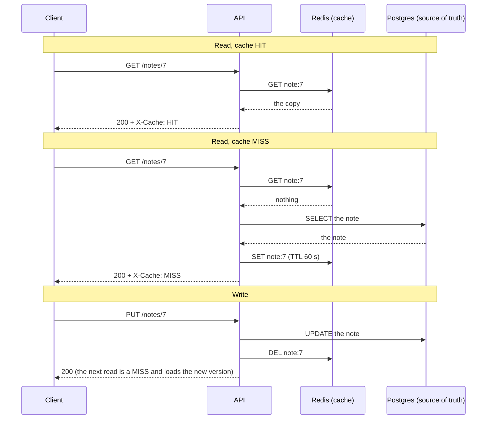

# Caching 04 — Cache-aside and other patterns

> **Course:** [Caching](./README.md)  ·  **Time:** ~45 min  ·  **Needs:** [Caching 01](./01-why-cache.md) and [Caching 02](./02-redis-data-types.md)
> **Used in the labs:** [Lab 05, step 16](../../labs/05-caching.md) (`GET /notes/{id}` reads the cache first)

## What you will learn
- Name the five classic ways to combine a cache and a database, and say what each one costs.
- Describe **cache-aside** step by step, for a **hit**, a **miss** and a write.
- Read the real `read_note` and `forget` code of this project line by line.
- Show with the lab itself how a request goes `MISS`, `HIT`, `MISS` again after an update, and `BYPASS` when the cache is down.
- Explain why a write-back cache can lose data, and a write-around cache can serve old data.

## Words you need
| Word | Plain-words meaning |
|---|---|
| **Cache** | A fast, small store holding **copies** of data that lives somewhere slower (here Redis in front of Postgres). |
| **Source of truth** | The one place whose content is the real, official data (here: Postgres). The cache may be wrong; the source of truth is not. |
| **Hit / miss** | A **hit**: the copy was in the cache. A **miss**: it was not, so the slow source had to be read. |
| **Stale** | Out of date: a cached copy that no longer matches the source of truth. |
| **Invalidate** | Throw a cached copy away (or mark it unusable) because the original changed. |
| **TTL** | *Time to live*: a countdown on a cached copy; at zero Redis deletes it by itself. A safety net against stale data ([Caching 02](./02-redis-data-types.md)). |
| **Cache-aside** (lazy loading) | The **application** manages the cache itself: look in the cache; on a miss, read the source, then store a copy. The cache never talks to the database. |
| **Read-through** | The same idea, but the **cache** loads the missing value itself (the application only talks to the cache). |
| **Write-through** | Every write goes to the cache **and** the database, in the same operation. |
| **Write-around** | Writes go **only** to the database; the cache is filled later, by reads. |
| **Write-back** (write-behind) | Writes go **only** to the cache; the database is updated **later**, in batches. |
| **Dirty** | A cached value that has been changed but not yet written to the database (write-back). |
| **Bypass** | Skip the cache and answer from the source because the cache cannot be used (here, Redis is down). |

## The idea
**Everyday analogy.** You study with a big library (the database) in another building, and a small shelf (the cache) next to your desk. **Cache-aside** is how most people behave: when you need a book you look on your shelf first; if it is not there you walk to the library, bring it back, and **put it on your shelf** for next time. When you learn that the library replaced a book with a new edition, you **take the old copy off your shelf** so you will fetch the new one next time. Nobody else manages your shelf: *you* do. The other patterns change who does the work: a **read-through** shelf would fetch missing books by itself; **write-through** means every correction is written in both places at once; **write-around** means you correct the library only and leave the shelf alone; **write-back** means you scribble corrections on the shelf and promise to copy them to the library "later" — and if the shelf burns down first, the corrections are gone.

**Precisely.** The patterns answer two questions: *who fills the cache on a read?* and *what happens to the cache on a write?*

| Pattern | Read | Write | Good at | Costs |
|---|---|---|---|---|
| **Cache-aside** (this project) | The app: cache, else database, then store a copy | The app writes the database, then **deletes** the cached copy | Simple; the cache only holds what is asked for; survives a cache outage (the app falls back to the database) | The first read of each key is slow (a miss); a short window of stale data is possible |
| **Read-through** | The cache loads misses itself | (any) | The app code is simpler | Needs a cache that supports it; the cache must know the database |
| **Write-through** | cache, else database | Database **and** cache, together | Reads always see fresh data; no misses after a write | Slower writes; the cache fills with data nobody reads |
| **Write-around** | cache, else database | Database only | No cache pollution by data written once | The cache keeps the **old** copy until it expires or is deleted |
| **Write-back** | cache | Cache only; database **later** | Very fast writes, few database writes | Data **lost** if the cache dies before the flush; the database is behind |



**Why delete on write rather than update the copy?** Deleting is simpler and safer: the next read rebuilds the copy from the source of truth, so the cache can never hold something the database does not. Updating the copy needs the exact same transformation the database applied, and two writers racing can leave the cache with the older of the two values. (Those races are the subject of Caching 06.)

## The code, line by line
The read path of the API (`api/main.py`), trimmed to what matters:

```python
@app.get("/notes/{note_id}", response_model=NoteOut)
def read_note(note_id: int, db: DbSession):
    key = f"note:{note_id}"                      # the cache key for this note
    state = "MISS"                               # what we will report unless something else happens
    try:
        cached = cache.get(key)                  # 1. look in Redis
        if cached is not None:
            return Response(content=cached, media_type="application/json", headers={"X-Cache": "HIT"})
    except redis.RedisError as exc:
        state = "BYPASS"                         # Redis is down: do not even try to store a copy
    body = NoteOut.model_validate(get_note_or_404(db, note_id)).model_dump_json()   # 2. the database
    if state == "MISS":
        try:
            cache.set(key, body, ex=CACHE_TTL)   # 3. keep a copy for CACHE_TTL seconds (60)
        except redis.RedisError as exc:
            pass                                 # a failed copy must not fail the request
    return Response(content=body, media_type="application/json", headers={"X-Cache": state})


def forget(note_id: int) -> None:                # called by PUT and DELETE after the database changed
    try:
        cache.delete(f"note:{note_id}")          # 4. invalidate the copy
    except redis.RedisError as exc:
        pass                                     # a dead cache must not break a write
```
(The real code also writes a log line at each step; they are left out here.)

| Line | What it does | If you change or remove it |
|---|---|---|
| `key = f"note:{note_id}"` | One key per note, with a prefix (`note:`) so keys of different kinds never collide. | Without a prefix, a job id or another feature could overwrite a note's copy. |
| `cache.get(key)` | Asks Redis for the copy. `None` means a miss. | |
| `except redis.RedisError` around the read | If Redis is unreachable the app **does not fail**: it goes to the database and reports `BYPASS`. The cache is an optimisation, not a dependency. | Remove it and a Redis outage makes **every note read** fail with a `500`. |
| `get_note_or_404(db, note_id)` | The **source of truth**: read the note from Postgres, or answer `404`. | |
| `cache.set(key, body, ex=CACHE_TTL)` | Stores the answer as text, with a **TTL** of 60 s. `ex` = expire after that many seconds. | Without `ex` a copy lives until evicted: if a write ever forgets to delete it, the wrong data stays for good. |
| `if state == "MISS"` | Stores a copy only if the cache was **reachable**; after `BYPASS` it does not try again (and wait for a timeout) in the same request. | |
| `headers={"X-Cache": ...}` | Tells the client what happened: `HIT`, `MISS` or `BYPASS`. Not needed in production; here it makes the cache **visible**. | |
| `cache.delete(f"note:{note_id}")` | The invalidation: the next read is a miss and fetches the new version. Deleting a key that does not exist is fine. | Forget this call in `PUT` and clients see the old note until the TTL ends (up to 60 s). |

## The commands
| Command / flag | Meaning |
|---|---|
| `curl -s -i URL` | `-s` silent, `-i` print the response **headers** (lines of extra information that come before the body, such as `x-cache`) with the body: the status line and `x-cache` are what we read. |
| `grep -iE '^(HTTP\|x-cache)'` | Keep only the lines that start with `HTTP` or `x-cache` (`-i` = ignore upper/lower case, `-E` = extended patterns, where a `|` means "or"). In this table the `|` is written `\|`; in your terminal type a plain `|`. |
| `tr -d '\r'` | Delete the carriage returns that HTTP puts at the end of each header line. |
| `curl -X PUT URL -H 'Content-Type: application/json' -d '{...}'` | Send a `PUT` with a JSON body (`-X` = method, `-H` = a header, `-d` = the body). |
| `docker compose stop redis` / `start redis` | Stop and start only the Redis container: an outage on demand. |
| `redis-cli ttl KEY` | Seconds left before the key expires (`-1`: no expiry, `-2`: no such key). |

## Hands-on
**Part 1 — the lab's own cache-aside.** The lab must be running (`make up`). The script creates a note, reads it several times, changes it, stops Redis, starts it again, and prints the `X-Cache` header each time (`$U` is the load balancer; change the port if yours differs):

```bash
U=http://127.0.0.1:8088
xc() { curl -s -i "$U/notes/$1" | tr -d '\r' | grep -iE '^(HTTP|x-cache)' | tr '\n' ' '; echo; }
ID=$(curl -s -X POST $U/notes -H 'Content-Type: application/json' -d '{"title":"cache-aside demo","body":"first version"}' | sed -n 's/.*"id":\([0-9]*\).*/\1/p')
xc $ID; xc $ID; xc $ID                                    # 1) 2) 3)
curl -s -o /dev/null -X PUT $U/notes/$ID -H 'Content-Type: application/json' -d '{"title":"cache-aside demo","body":"second version"}'
xc $ID; xc $ID                                            # 4) 5)
docker compose stop redis;  xc $ID                        # 6) the cache is down
docker compose start redis                                # wait until it answers PONG, then:
xc $ID; xc $ID                                            # 7) 8)
docker compose exec -T redis sh -c 'REDISCLI_AUTH="$REDIS_PASSWORD" redis-cli ttl note:'$ID
curl -s -o /dev/null -X DELETE $U/notes/$ID; xc $ID       # 9)
```
(`sed -n 's/.*"id":\([0-9]*\).*/\1/p'` pulls the number after `"id":` out of the answer; `-n` prints only what the `p` flag selects. `$(...)` captures a command's output in a variable.) The real output of the walkthrough:

```text
created note 101
1) first read (nothing cached yet):    HTTP/1.1 200 OK x-cache: MISS
2) second read:                        HTTP/1.1 200 OK x-cache: HIT
3) third read:                         HTTP/1.1 200 OK x-cache: HIT
   PUT: the note changed, its copy was deleted
4) read after the PUT:                 HTTP/1.1 200 OK x-cache: MISS
5) read again:                         HTTP/1.1 200 OK x-cache: HIT
   what the cached copy says:          second version
   (Redis stopped)
6) read with the cache down:           HTTP/1.1 200 OK x-cache: BYPASS
   (Redis started again; its memory is empty)
7) read after Redis came back:         HTTP/1.1 200 OK x-cache: MISS
8) read again:                         HTTP/1.1 200 OK x-cache: HIT
   key and remaining life in Redis:    60 seconds
9) read after DELETE:                  HTTP/1.1 404 Not Found
```
**How to read it:** (1) nothing cached: **MISS**, the database is read and a copy stored. (2)–(3) the copy answers: **HIT**. The `PUT` updates Postgres and **deletes** the copy, so (4) is a **MISS** again and loads the *new* version; (5) is a HIT, and the cached text is `second version`: the cache did not serve the old note. (6) With Redis stopped the API still answers `200`, from the database: **BYPASS**. (7) Redis came back **empty** (it has no disk by design, [Caching 03](./03-eviction-and-maxmemory.md)): a MISS, then (8) a HIT. Redis reports **60 seconds** of life left for the fresh copy. (9) After `DELETE` the note is gone: a `404`, and nothing is cached for a missing note.

**Part 2 — the five patterns side by side.** `patterns.py` (below) simulates four of them with Python dictionaries standing in for the cache and the database: each strategy writes `"v1"`, reads three times, writes `"v2"`, reads three times, and counts the database work. It is a **simulation** (no Redis, no Postgres): it shows the logic, not the speed.

```python
# Four ways to keep a cache and a database together, with dictionaries instead of real servers.
class Strategy:
    name = "?"
    def __init__(self):
        self.db, self.cache = {}, {}
        self.db_reads = self.db_writes = 0

    def db_read(self, key):
        self.db_reads += 1
        return self.db.get(key)

    def db_write(self, key, value):
        self.db_writes += 1
        self.db[key] = value

    def read(self, key):                      # cache-aside read, used by all the strategies
        if key in self.cache:
            return self.cache[key]
        value = self.db_read(key)
        self.cache[key] = value
        return value


class CacheAsideInvalidate(Strategy):
    name = "cache-aside + delete on write"
    def write(self, key, value):
        self.db_write(key, value)
        self.cache.pop(key, None)             # forget the copy; the next read refills it


class WriteThrough(Strategy):
    name = "write-through"
    def write(self, key, value):
        self.db_write(key, value)
        self.cache[key] = value               # the copy is updated in the same step


class WriteAround(Strategy):
    name = "write-around (no invalidation)"
    def write(self, key, value):
        self.db_write(key, value)             # the database only: any copy is left as it was


class WriteBack(Strategy):
    name = "write-back (database later)"
    def write(self, key, value):
        self.cache[key] = value               # the cache only; the database is updated later
    def flush(self):
        for k, v in self.cache.items():
            self.db_write(k, v)


print(f"{'strategy':32} {'db reads':>8} {'db writes':>9}  readers saw")
for cls in (CacheAsideInvalidate, WriteThrough, WriteAround, WriteBack):
    s = cls()
    seen = []
    s.write("note", "v1")
    seen += [s.read("note") for _ in range(3)]
    s.write("note", "v2")
    seen += [s.read("note") for _ in range(3)]
    print(f"{s.name:32} {s.db_reads:>8} {s.db_writes:>9}  {' '.join(seen)}   (database now holds: {s.db.get('note')})")

# The risk of write-back: the cache is lost before the flush.
s = WriteBack()
s.write("note", "v1"); s.flush()              # v1 reaches the database
s.write("note", "v2")                         # v2 only in the cache
s.cache.clear()                               # the cache server dies before the next flush
print(f"\nwrite-back after a cache crash: database holds {s.db['note']!r}; the write of 'v2' is lost")
```
(Save it as `patterns.py`.) Run it in a throw-away Python container:

```bash
D=$(pwd -W)    # Git Bash on Windows; on Linux or macOS: D=$(pwd)
MSYS_NO_PATHCONV=1 docker run --rm -v "$D:/demo:ro" -w /demo python:3.12.16-slim-trixie python patterns.py
```
```text
strategy                         db reads db writes  readers saw
cache-aside + delete on write           2         2  v1 v1 v1 v2 v2 v2   (database now holds: v2)
write-through                           0         2  v1 v1 v1 v2 v2 v2   (database now holds: v2)
write-around (no invalidation)          1         2  v1 v1 v1 v1 v1 v1   (database now holds: v2)
write-back (database later)             0         0  v1 v1 v1 v2 v2 v2   (database now holds: None)

write-back after a cache crash: database holds 'v1'; the write of 'v2' is lost
```
**How to read it:**
- **Cache-aside:** 2 database reads (one miss per version), readers always see the latest value.
- **Write-through:** **0** reads (every write refreshed the copy), 2 writes: no miss ever, at the price of writing in two places.
- **Write-around:** only 1 database read, and the readers saw `v1` **six times**, even after the database held `v2`: the copy was never refreshed or deleted. That is *stale data*; in the lab the 60 s TTL would end it, here there is none.
- **Write-back:** the fastest (0 database operations) and the readers saw the new value, but **the database holds nothing** until a flush; in the last line a cache crash before the flush **loses the `v2` write**.

## What if…?
**…the row changes behind the cache's back?** Cache-aside only stays correct if every change goes through code that deletes the copy. Change the row **directly in Postgres** (as a script, a migration or a person with `psql` would), and the API keeps serving the old text:

```bash
# create a note, read it twice, then change its row with SQL, not through the API
docker compose exec -T postgres sh -c "psql -U \"\$POSTGRES_USER\" -d \"\$POSTGRES_DB\" -c \"UPDATE notes SET body='changed behind the cache' WHERE id=$ID\""
docker compose exec -T redis sh -c "REDISCLI_AUTH=\"\$REDIS_PASSWORD\" redis-cli del note:$ID"
```
(`$ID` is the note's id; `psql -c` runs one SQL statement; the `\$` keeps the variable for the container's shell, so the credentials are not typed.) The real result, reading the note after each action:

```text
note 102
1) x-cache: MISS  body: original text
2) x-cache: HIT  body: original text
UPDATE 1
3) after the SQL update: x-cache: HIT  body: original text
   redis DEL note:102 -> 1
4) after deleting the copy: x-cache: MISS  body: changed behind the cache
```
After the SQL `UPDATE` (3) the API still answers `HIT` with `original text`: the copy is **stale**, and would stay so until its 60 s TTL ends. Deleting the key by hand (`DEL` answered `1`: one key removed) made the next read a `MISS` that loaded `changed behind the cache`. The lesson: the TTL is the safety net for changes the application did not make, and every write path must delete the copy; the same simulation line "write-around" (Part 2) shows the logic.

## In short
1. **Cache-aside**: read the cache; on a miss read the database and store a copy with a TTL; on a write, change the database and **delete** the copy. The app does the work, and the app survives a dead cache (`BYPASS`).
2. The other patterns move work around: **read-through** (the cache loads misses), **write-through** (write both), **write-around** (database only: copies go stale), **write-back** (cache only, database later: can lose data).
3. The source of truth is always the database; a cached copy is disposable, so it must be safe to delete it at any time.

## Check your understanding
1. In cache-aside, what exactly happens on a **miss**?
2. Why does the lab `DELETE` the cached copy on `PUT` instead of updating it?
3. What does `X-Cache: BYPASS` mean, and why is it good that the API still answers `200`?
4. Which pattern can lose data if the cache crashes, and why?
5. In the simulation, why did the **write-around** readers see `v1` six times?

<details><summary>Answers</summary>

1. The app finds nothing in the cache, reads the database (the source of truth), stores a copy in the cache with a TTL, and returns the data. The next read of the same key is a hit.
2. Deleting is simple and always correct: the next read rebuilds the copy from the database, so the cache cannot hold something the database does not. Updating the copy requires repeating the database's change exactly, and two writers can leave the older value behind.
3. The cache (Redis) could not be used, so the API answered from the database without storing a copy. It is good because the cache is an **optimisation**: its failure makes things slower, not broken.
4. **Write-back**: writes go only to the cache and reach the database later, so everything written since the last flush is lost if the cache dies.
5. Write-around writes only the database. The cache still held the copy of `v1` made by the first read, and nothing deleted or refreshed it, so every later read was a hit on the old value.

</details>

## Official documentation
- [Redis `SET` (with `EX`)](https://redis.io/docs/latest/commands/set/)
- [AWS: caching strategies for ElastiCache (lazy loading and write-through)](https://docs.aws.amazon.com/AmazonElastiCache/latest/dg/Strategies.html)

## Where you use this in the project
- [Lab 05, step 16](../../labs/05-caching.md): `read_note` (cache-aside, `X-Cache`) and `forget` (invalidation) in `api/main.py`; the cache test `tests/05_cache.sh` checks `MISS`, `HIT`, the invalidation and the `BYPASS`.
- [Caching 03](./03-eviction-and-maxmemory.md): what Redis throws away when it is full; the next modules cover the **TTL and invalidation** details and the **pitfalls** (stampede, stale data) of this pattern.
- [AWS 07 - ElastiCache](../aws/07-elasticache.md): the managed Redis this pattern talks to in AWS.
