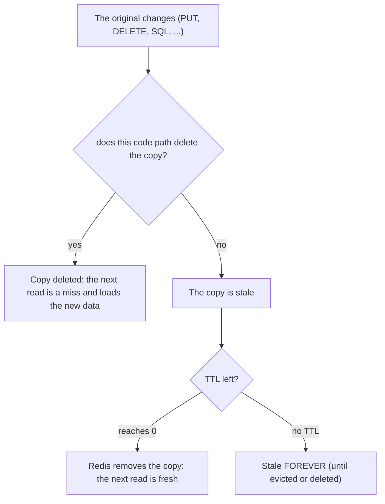

# Caching 05 — TTL, expiry and invalidation

> **Course:** [Caching](./README.md)  ·  **Time:** ~40 min  ·  **Needs:** [Caching 02](./02-redis-data-types.md) and [Caching 04](./04-cache-aside-and-patterns.md)
> **Used in the labs:** [Lab 05, step 16](../../labs/05-caching.md) (`ex=CACHE_TTL` when a copy is stored, `DEL` on update and delete)

## What you will learn
- Say what a **TTL** is, how to set, read, change and remove it in Redis, and what `-1` and `-2` mean.
- Explain **how Redis really expires** keys (when a key disappears, and why `expired_keys` is not the same as `evicted_keys`).
- Choose a TTL: what a short one costs, what a long one costs.
- Name the three ways to keep a cache correct — **expiry**, **delete on write**, **versioned keys** — and say which one the lab uses.
- Avoid the classic trap: a plain `SET` silently **removes** a key's TTL.

## Words you need
| Word | Plain-words meaning |
|---|---|
| **TTL** (time to live) | A countdown attached to a key. When it reaches zero the key is gone. In Redis it is counted in seconds (`TTL`) or milliseconds (`PTTL`). |
| **Expire / expiry** | A key disappearing **by itself** because its TTL ended. Not the same as being *evicted* (thrown out because memory is full, [Caching 03](./03-eviction-and-maxmemory.md)). |
| **Invalidate** | Remove or mark as unusable a cached copy **because the original changed**, without waiting for the TTL. |
| **Stale** | Out of date: a copy that no longer matches the source of truth. |
| **Source of truth** | The place whose data is the official one (here Postgres). |
| **Lazy expiry** | Redis checks whether a key has expired **at the moment someone asks for it**, and removes it then. |
| **Active expiry** | Redis also runs a background job, many times a second, that samples some keys with a TTL and removes the expired ones, so keys nobody asks for do not stay forever. |
| **Persist** | Remove the TTL: the key lives until deleted. |
| **Jitter** | A small **random** amount added to a TTL, so that many keys created together do not all expire at the same instant. |
| **Version (in a key)** | A number or label inside the key name (`note:7:v3`); changing it makes the old copies unreachable without deleting them. |
| **Race** | Two operations happening at nearly the same time, whose result depends on which finishes first. |

## The idea
**Everyday analogy.** Food in a fridge. Every item has a **use-by date** (the TTL): even if you forget about it, it is thrown away eventually, so the fridge never fills with spoiled food. That is your **safety net**. But when you *know* an item is bad now (the shop recalls the milk you bought), you do not wait for the date: you throw it out immediately — that is **invalidation**. Good kitchens use both. A very short date wastes good food and sends you back to the shop all the time (many cache **misses**); a very long one lets you eat food that changed long ago (**stale** data).

**Precisely.** A cache holds copies; a copy is only useful while it matches the original. There are three tools to keep copies correct:

| Tool | How it works | Strong point | Weak point |
|---|---|---|---|
| **Expiry** (TTL) | Each copy is stored with a countdown | Needs no knowledge of *who* changes the data; limits how wrong a copy can be; frees memory | Data is wrong **for up to the whole TTL** after a change |
| **Delete on write** (invalidation) | Whoever changes the original deletes the copy | The next read is fresh, immediately | Every writer must remember to do it; a missed path leaves a stale copy until the TTL |
| **Versioned keys** | The version is part of the key (`note:7:v3`); a change makes a new version | Never serves old data; no deletion needed | Old versions stay in memory until their TTL or eviction; the reader must know the current version |

**The lab uses the first two together**: the API stores each copy with a 60-second TTL (`cache.set(key, body, ex=CACHE_TTL)`) *and* deletes it on `PUT` and `DELETE`. The delete is the plan; the TTL is the net for everything the plan misses (a row changed with SQL, a crashed request, a bug).



**How Redis removes expired keys.** It does two things. **Lazily**: when a command touches a key, Redis first checks its deadline and, if it has passed, deletes the key and answers as if it never existed. **Actively**: about ten times a second a background task picks a sample of the keys that have a TTL and deletes the expired ones, repeating while many of the sample were expired. So an expired key is never *returned*, but it may use memory for a short moment until the sampling reaches it. The counters `expired_keys` (all) and `expired_keys_active` (removed by the background job) in `INFO stats` show it.

**Choosing a TTL.** Ask: *how long can a user see old data without harm?* A product description can be an hour old; an account balance cannot be a second old. A short TTL means more misses (more load on the database); a long TTL means more staleness. With delete-on-write you can afford a longer TTL, because it is only the net. Add **jitter** (for example TTL = 60 s + a random 0–10 s) to keys that are created together, so they do not all expire in the same second and send a burst of misses to the database (the "stampede" of Caching 06).

## The code, line by line
The two places of the API (`api/main.py`), trimmed:

```python
CACHE_TTL = int(os.environ.get("CACHE_TTL_SECONDS", "60"))     # the life of a copy, in seconds

cache.set(key, body, ex=CACHE_TTL)                             # on a miss: store the copy WITH a TTL
cache.delete(f"note:{note_id}")                                # on PUT and DELETE: invalidate
```

| Line | What it does | If you change or remove it |
|---|---|---|
| `os.environ.get("CACHE_TTL_SECONDS", "60")` | Reads the TTL from the environment (`docker-compose.yml` passes `${CACHE_TTL_SECONDS:-60}`), 60 seconds by default, so you can tune it without changing code. | A bigger value means fewer misses and a longer window of staleness for changes made outside the API. |
| `cache.set(key, body, ex=CACHE_TTL)` | `SET key value EX seconds`: store **and** set the countdown in one atomic command. | Without `ex` the copy never expires. If a write forgets to delete it, it stays wrong for good (until evicted). |
| `cache.delete(f"note:{note_id}")` | `DEL key`: removes the copy now. Answers `1` if a key was removed, `0` if there was none; both are fine. | Remove it from `PUT` and updates become visible only when the TTL ends, up to 60 s later. |

## The commands
| Command | Meaning |
|---|---|
| `SET key value EX 10` | Store with a life of 10 **seconds** (`PX 1500`: 1500 **milliseconds**). |
| `SETEX key 10 value` | The older spelling of the same thing. |
| `TTL key` | Seconds left. **`-1`**: the key exists and has **no** TTL. **`-2`**: the key does **not exist** (never created, expired or deleted). `PTTL` gives milliseconds. |
| `EXPIRE key 100` | Give an existing key a (new) life of 100 s. Answers `1` if done, `0` if the key does not exist. |
| `PERSIST key` | Remove the TTL: the key lives until deleted. |
| `SET key value KEEPTTL` | Overwrite the value **and keep** the remaining TTL. |
| `DEL key` | Delete now. Answers the number of keys deleted. |
| `INFO stats` | Counters: `expired_keys`, `expired_keys_active`, `evicted_keys`. |
| `docker run -d --rm --name N IMAGE redis-server --save "" --appendonly no` | A throw-away Redis with no disk persistence, deleted when stopped. |
| `docker exec N redis-cli ...` | Run `redis-cli` inside that container. |

## Hands-on
A throw-away Redis (`redis:8.10.3-alpine3.23`, the lab's version; no password because nothing else can reach it). The script `run.sh` defines `r`, which runs one `redis-cli` command and prints `> command  ->  answer`, then the seven experiments below:

```bash
IMG=redis:8.10.3-alpine3.23
docker run -d --rm --name ttl-demo $IMG redis-server --save "" --appendonly no > /dev/null
until docker exec ttl-demo redis-cli ping 2>/dev/null | grep -q PONG; do sleep 0.3; done      # wait until it answers PONG
r() { printf '> %s  ->  %s\n' "$*" "$(docker exec ttl-demo redis-cli "$@" | tr -d '\r' | tr '\n' ' ' | sed 's/ *$//')"; }

r set note:1 hello ex 10;  r ttl note:1;  sleep 4;  r ttl note:1                              # 1
r set forever 1;  r ttl forever;  r ttl no:such:key                                            # 2
r expire note:1 100;  r ttl note:1;  r persist note:1;  r ttl note:1                           # 3
r set note:2 v1 ex 30;  r ttl note:2;  r set note:2 v2;  r ttl note:2                          # 4 (the trap)
r set note:2 v3 ex 30;  r set note:2 v4 keepttl;  r ttl note:2
r set short x px 1500;  r get short;  sleep 2;  r get short;  r exists short                   # 5
r info stats | tr ' ' '\n' | grep -E '^(expired_keys|evicted_keys)' | tr '\n' ' '; echo       # 6
r set note:3 old ex 60;  r del note:3;  r get note:3;  r del note:3                            # 7
docker stop ttl-demo
```
(`tr -d '\r'` removes the carriage returns, `tr '\n' ' '` joins the lines, `sed 's/ *$//'` trims the end; `sleep 4` waits four seconds.) The real output:

```text
== 1. a key with a life of 10 seconds
> set note:1 hello ex 10  ->  OK
> ttl note:1  ->  10
> ttl note:1  ->  5
== 2. the three answers of TTL
> set forever 1  ->  OK
> ttl forever  ->  -1
> ttl no:such:key  ->  -2
== 3. changing the life of a key
> expire note:1 100  ->  1
> ttl note:1  ->  100
> persist note:1  ->  1
> ttl note:1  ->  -1
== 4. the trap: a plain SET on a key with a TTL removes the TTL
> set note:2 v1 ex 30  ->  OK
> ttl note:2  ->  30
> set note:2 v2  ->  OK
> ttl note:2  ->  -1
> set note:2 v3 ex 30  ->  OK
> set note:2 v4 keepttl  ->  OK
> ttl note:2  ->  29
== 5. expiry really happens
> set short x px 1500  ->  OK
> get short  ->  x
> get short  ->
> exists short  ->  0
== 6. counters Redis keeps about expiry
expired_keys:1 expired_keys_active:1 evicted_keys:0
== 7. invalidation by hand: delete
> set note:3 old ex 60  ->  OK
> del note:3  ->  1
> get note:3  ->
> del note:3  ->  0
```
(The `== n. ... ==` lines are `echo` titles of the script; the numbers in the code block are the same experiments.) **How to read it:**
1. The countdown is real: 10, then **5** four seconds later (the commands themselves take a moment).
2. `-1` = the key exists but never expires; `-2` = no such key. These two special values are the answers to remember.
3. `EXPIRE` set a new life (`1` = done); `PERSIST` removed it (`-1` again).
4. **The trap.** `SET note:2 v2` **overwrote the key and wiped its TTL**: `-1`. A cache whose update code does a plain `SET` on a key that had a TTL silently makes the copy **immortal**. Use `SET ... EX n` again, or `KEEPTTL` (the TTL was `29`, kept).
5. A key with `PX 1500` is there at first, and 2 s later `GET` answers nothing (empty line = nil) and `EXISTS` says `0`: the key has expired.
6. `expired_keys:1`: one key expired by itself (the one of experiment 5), and `expired_keys_active:1` says it was the **background job** that removed it, before the second `GET` asked for it. `evicted_keys:0`: nothing was thrown out for lack of memory. **Expired and evicted are two different counters.**
7. `DEL` answers `1` the first time (one key removed) and `0` the second (nothing to remove), and `GET` after it gives nothing.

**In the lab itself**, a cached note and its countdown (through the load balancer, then Redis; `$ID` is a new note's id):
```text
before any read: ttl = -2  (-2 = no such key)
right after a read:   ttl = 60
10 s later:           ttl = 49
a HIT does not renew it: ttl = 49
after DELETE:         ttl = -2
```
Before any read there is no copy (`-2`); the first read stores one with the full 60 s; ten seconds later 49 are left. **A cache hit does not renew the TTL**: the copy still expires 60 s after it was *stored*, however often it is read. After `DELETE` (which also deletes the copy) the key is gone.

## What if…?
**…the TTL is too short, or there is none?** The two extremes are visible in the results above. With **no TTL** (experiment 4 after the plain `SET`, `-1`), a copy that a writer forgot to delete lives on, wrong, until Redis is full and evicts it ([Caching 03](./03-eviction-and-maxmemory.md)); the lab prevents this by always using `ex=CACHE_TTL`. With a **very short TTL** the copy would expire before the next read, every read would be a miss, and the cache would add work (a failed lookup, then the database, then a store) instead of saving it. The right TTL sits between: long enough for several reads, short enough to bound the staleness.

## In short
1. A **TTL** is a countdown on a key: `SET key value EX 60`. `TTL` shows it (`-1` = none, `-2` = no such key). Redis removes expired keys lazily when touched and actively in the background.
2. Keep copies correct with **expiry** (the safety net, bounds the staleness), **delete on write** (immediate), or **versioned keys**. The lab uses a 60 s TTL **plus** delete on `PUT` and `DELETE`.
3. A plain `SET` on a key **removes** its TTL: always set the TTL again or use `KEEPTTL`. A hit does not extend the TTL.

## Check your understanding
1. What do `TTL` answers `-1` and `-2` mean?
2. Why does the API both set a 60-second TTL and delete the copy on `PUT`? Is one of them enough?
3. What happens to a key's TTL if you run `SET key newvalue` on it? How can you avoid that?
4. What is the difference between the counters `expired_keys` and `evicted_keys`?
5. Why add random **jitter** to TTLs when many keys are created at the same moment?

<details><summary>Answers</summary>

1. `-1`: the key exists and has no TTL (it never expires). `-2`: the key does not exist (never created, already expired or deleted).
2. The delete makes updates visible at once; the TTL is a safety net for every case where the delete did not happen (a change made with SQL, a crashed request, a missed code path). Delete alone leaves a copy immortal if it is ever missed; TTL alone leaves data stale for up to 60 s after every change. Together they give immediate updates and a bounded worst case.
3. The TTL is removed (`TTL` answers `-1`): the key becomes immortal. Avoid it by giving the TTL again (`SET key newvalue EX 60`) or keeping the old one (`SET key newvalue KEEPTTL`).
4. `expired_keys` counts keys removed because their TTL ended; `evicted_keys` counts keys thrown out because Redis hit `maxmemory`. Expiry is planned and normal; eviction means the cache is full.
5. Keys created together with the same TTL expire together, so many requests miss in the same second and hit the database at once. A random extra spreads the expirations over time.

</details>

## Official documentation
- [Redis `EXPIRE`](https://redis.io/docs/latest/commands/expire/), [`TTL`](https://redis.io/docs/latest/commands/ttl/) and [`SET`](https://redis.io/docs/latest/commands/set/) (`EX`, `PX`, `KEEPTTL`)
- [Redis keyspace: key expiration](https://redis.io/docs/latest/develop/using-commands/keyspace/#key-expiration) (lazy and active expiry)
- [AWS: ElastiCache caching strategies](https://docs.aws.amazon.com/AmazonElastiCache/latest/dg/Strategies.html) (adding TTL to lazy loading)

## Where you use this in the project
- [Lab 05, step 16](../../labs/05-caching.md): `CACHE_TTL_SECONDS` (default 60), `ex=CACHE_TTL` in `read_note`, `cache.delete` in `forget` (called by `PUT` and `DELETE`); the cache test checks the invalidation.
- [Caching 04](./04-cache-aside-and-patterns.md): the pattern these two tools serve, including the stale copy after an SQL change; [Caching 03](./03-eviction-and-maxmemory.md): what happens to keys *without* a TTL when memory runs out.
- [Lab 07](../../labs/07-queues-workers.md): job records are Redis hashes with a one-day TTL (`JOB_TTL`), so finished jobs clean themselves up.
