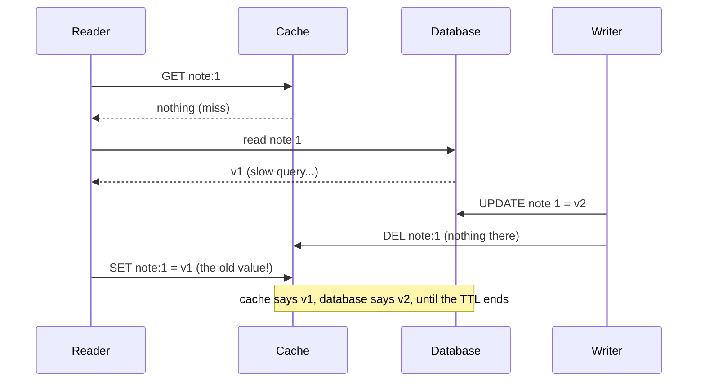

# Caching 06 — Common pitfalls (stampede, stale data, penetration)

> **Course:** [Caching](./README.md)  ·  **Time:** ~45 min  ·  **Needs:** [Caching 04](./04-cache-aside-and-patterns.md) and [Caching 05](./05-ttl-and-invalidation.md)
> **Used in the labs:** [Lab 05, steps 16–17](../../labs/05-caching.md) (the cache-aside read path and its test): what the simple pattern does **not** cover

## What you will learn
- Recognise three classic cache failures: the **stampede** (many requests rebuild the same copy at once), **penetration** (requests for data that does not exist always reach the database) and the **stale copy** left by a race.
- Reproduce all three on a real Redis, and see the numbers fall with a **lock**, **negative caching** and a short TTL.
- Say which of them the lab's cache can suffer from, and why it is acceptable here.
- Know the other remedies (jitter, early refresh, Bloom filters) and when they matter.

## Words you need
| Word | Plain-words meaning |
|---|---|
| **Cache hit / miss** | A hit: the copy is in the cache. A miss: it is not, so the database is read. |
| **Stampede** (also *thundering herd*, *dog-pile*) | A hot key expires and, in the same instant, many requests miss and **all** go to the database to rebuild it. |
| **Penetration** | Requests for keys that **do not exist anywhere**: each one misses the cache (there is nothing to cache) and goes to the database, so the cache protects nothing. |
| **Negative caching** | Storing the answer "this does not exist" for a short time, so the next requests do not ask the database again. |
| **Lock** (mutex) | A marker that only one request can hold at a time. Here a Redis key created with `SET key value NX EX seconds`: `NX` = "only if it does not exist yet", `EX` = "delete it after this many seconds", so a crashed holder cannot block everyone for ever. |
| **Race** (race condition) | Two operations in flight at the same time whose result depends on the order in which their steps interleave. |
| **Stale** | Out of date: the copy no longer matches the database. |
| **Jitter** | A small random amount added to a TTL so that copies created together do not expire together. |
| **Thread** | One line of execution inside a program; several threads run "at the same time". The experiments use 20 of them as 20 simultaneous requests. |
| **Bloom filter** | A very compact structure that can say "this key is **certainly not** in the data" (or "maybe"), used in front of a cache to refuse impossible keys cheaply. |

## The idea
**Everyday analogy.** A school secretary keeps a **notice board** (the cache) with the answers to questions parents often ask, so she does not walk to the archive (the database) every time.
- **Stampede.** Monday morning the board's timetable is taken down at 8:00 to be refreshed. Two hundred parents arrive at 8:00 and she sends **two hundred** people to the archive for the same page, instead of fetching it once and pinning it up.
- **Penetration.** A prankster keeps asking for the grades of a pupil who does not exist. The board never has an answer, so each question sends her to the archive, and she is too busy for the real parents. Writing "no such pupil — checked 10:00" on the board for five minutes stops it.
- **Stale copy.** She leaves for the archive to fetch last term's timetable. While she walks, the head replaces it with this term's and goes to remove the old sheet from the board — there is none yet. She comes back and pins up the **old** sheet. The board is now wrong, with nobody having made a mistake.

**Precisely.** Cache-aside ([Caching 04](./04-cache-aside-and-patterns.md)) is simple because each request decides alone: look, else read the database, then store. Its weak points all come from many requests deciding **alone at the same time**, or from asking for something that cannot be cached:

| Pitfall | Cause | Effect | Main remedies |
|---|---|---|---|
| **Stampede** | A popular copy expires or is deleted; many requests miss together | The database receives N identical, slow queries at once: it may slow down or fall over, and the extra delay makes more requests pile up | A **lock** so one request rebuilds; **jitter** on TTLs; refresh the copy **just before** it expires |
| **Penetration** | Requests for keys that do not exist (typos, scans, attacks) | Every one reaches the database; the cache gives no protection | **Negative caching** (short TTL); validate the input; a **Bloom filter**; rate limiting |
| **Stale copy by race** | A reader holding an old value stores it **after** the writer deleted the copy | The cache is wrong until the TTL ends, with no error anywhere | A short TTL; delete again shortly after a write; or write versioned keys |



## The code, line by line
The experiment script `pitfalls.py` (full text in the next section) uses three small functions. The two remedies, trimmed:

```python
def get_with_lock(db, key):                                   # remedy for the stampede
    while True:
        v = r.get(f"c:{key}")                                 # 1. look in the cache
        if v is not None:
            return v
        if r.set(f"lock:{key}", "1", nx=True, ex=5):          # 2. try to take the lock (NX: only if free)
            try:
                v = db.read(key)                              # 3. the winner reads the database ...
                if v is not None:
                    r.set(f"c:{key}", v, ex=30)               #    ... and stores the copy
                return v
            finally:
                r.delete(f"lock:{key}")                       # 4. always release the lock
        time.sleep(0.05)                                      # 5. the others wait a moment, then look again

def get_negative(db, key):                                    # remedy for penetration
    v = r.get(f"c:{key}")
    if v is not None:
        return v or None                                      # "" is the marker for "does not exist"
    v = db.read(key)
    r.set(f"c:{key}", v if v is not None else "", ex=30 if v is not None else 5)   # a missing key is kept 5 s only
    return v
```

| Line | What it does | If you change or remove it |
|---|---|---|
| `r.set(f"lock:{key}", "1", nx=True, ex=5)` | Creates the lock **only if it does not exist** (`NX`), in one atomic Redis command: exactly one request gets `True`. It disappears by itself after 5 s (`EX`). | Without `NX` everyone "takes" the lock and nothing is serialised. Without `EX` a request that crashes while holding the lock blocks the key for ever. |
| `try: ... finally: r.delete(...)` | Releases the lock even if the database read raises an error. | Without the `finally` an error leaves the lock in place until it expires: 5 s of waiting for everybody. |
| `time.sleep(0.05)` then the `while True` loop | The losers wait 50 ms and look in the cache again: by then the winner has stored the copy and they get a hit. | Without the pause they would hammer Redis in a tight loop. |
| `return v or None` | The empty text `""` is the stored marker "does not exist": it is returned as "nothing". | Without a marker a missing key cannot be told apart from "not cached". |
| `ex=30 if v is not None else 5` | Real data is kept 30 s; the "does not exist" answer only **5 s**, because the thing might be created in the meantime. | A long TTL on the marker would hide a note that was just created. |

## The commands
| Command / flag | Meaning |
|---|---|
| `SET key value NX EX 5` | Set the key only if it does not exist (`NX`) and make it expire in 5 seconds (`EX`). Answers `OK`, or nothing if the key existed: the building block of a simple lock. |
| `docker network create pit-net` | A private network just for the experiment, so the Python container can reach Redis by its name. Removed at the end (`docker network rm pit-net`). |
| `docker run -d --rm --name pit-redis --network pit-net redis:8.10.3-alpine3.23 redis-server --save "" --appendonly no` | A throw-away Redis (the lab's version), no disk, no password (nothing else can reach it). |
| `docker run --rm --network pit-net -v "$D:/demo:ro" -w /demo --user 10001 aws-local-lab-api:0.1.0 python pitfalls.py` | Run the script in the project's API image (it contains the `redis` Python library), on that network, with your folder mounted read-only. |
| `seq 1 20 \| xargs -P 20 -I{} sh -c "curl ..."` | Run 20 `curl` commands **in parallel** (`-P 20`): 20 requests at nearly the same moment. In your terminal type a plain `|` (the `\|` is only how a `|` is written inside a table cell). |

## Hands-on
**Part 1 — in the lab itself.** Twenty parallel reads of a note that has no cached copy yet, then twenty more, then a note that does not exist (the load balancer is at `$U`):
```bash
U=http://127.0.0.1:8088
ID=$(curl -s -X POST $U/notes -H 'Content-Type: application/json' -d '{"title":"stampede demo","body":"x"}' | sed -n 's/.*"id":\([0-9]*\).*/\1/p')
seq 1 20 | xargs -P 20 -I{} sh -c "curl -s -D - -o /dev/null $U/notes/$ID | tr -d '\r' | grep -i '^x-cache'" | sort | uniq -c
seq 1 20 | xargs -P 20 -I{} sh -c "curl -s -D - -o /dev/null $U/notes/$ID | tr -d '\r' | grep -i '^x-cache'" | sort | uniq -c
for i in 1 2 3; do curl -s -o /dev/null -w '  GET /notes/999999 -> HTTP %{http_code}\n' $U/notes/999999; done
docker compose exec -T redis sh -c 'REDISCLI_AUTH="$REDIS_PASSWORD" redis-cli exists note:999999'
```
```text
note 113 (no copy cached yet)
     19 x-cache: HIT
      1 x-cache: MISS
-- then, with the copy stored:
     20 x-cache: HIT
-- a note that does not exist, 3 times, and what Redis holds:
  GET /notes/999999 -> HTTP 404
  GET /notes/999999 -> HTTP 404
  GET /notes/999999 -> HTTP 404
  redis EXISTS note:999999 -> 0
```
(The `note ...` and `--` lines are `echo` labels.) **How to read it:** the stampede **did not appear** in the lab: of 20 simultaneous requests only **1** was a `MISS` and 19 were hits, because reading one row from Postgres takes a few milliseconds, so the first request had stored the copy before most of the others looked. The weakness is real but needs a **slow** rebuild (a heavy query, a call to another service) or a **very hot** key, which is why the next experiment makes the database slow on purpose. For the missing note, every request answered `404` and Redis holds **nothing** for it (`EXISTS` = `0`): each of the three went to the database. With three requests it does not matter; with a million it would.

**Part 2 — on a real Redis, with a slow database.** The script `pitfalls.py`: 20 threads play 20 simultaneous requests; the "database" is a function that takes 0.3 s per read and counts its reads. Save it in an empty folder:

```python
"""Three cache pitfalls on a real (throw-away) Redis, with a deliberately slow 'database'."""
import threading
import time

import redis

r = redis.Redis(host="pit-redis", decode_responses=True)


class Db:
    """A slow database: every read takes 0.3 s and is counted."""

    def __init__(self, rows):
        self.rows, self.reads, self._lock = dict(rows), 0, threading.Lock()

    def read(self, key):
        with self._lock:
            self.reads += 1
        time.sleep(0.3)
        return self.rows.get(key)


def get_plain(db, key):
    """Cache-aside, as in the lab."""
    v = r.get(f"c:{key}")
    if v is not None:
        return v
    v = db.read(key)
    if v is not None:
        r.set(f"c:{key}", v, ex=30)
    return v

# get_with_lock and get_negative: exactly as in "The code, line by line" above


def run(getter, db, key, n):
    threads = [threading.Thread(target=getter, args=(db, key)) for _ in range(n)]
    for t in threads:
        t.start()
    for t in threads:
        t.join()


print("== 1. stampede: 20 requests arrive together, the copy has just expired")
for name, getter in (("plain cache-aside", get_plain), ("with a lock", get_with_lock)):
    r.flushall()
    db = Db({"1": "v1"})
    t0 = time.time()
    run(getter, db, "1", 20)
    print(f"  {name:18} database reads: {db.reads:2}   total time: {time.time() - t0:.2f} s")

print("== 2. penetration: 10 requests for a key that does not exist")
for name, getter in (("plain cache-aside", get_plain), ("negative caching", get_negative)):
    r.flushall()
    db = Db({})
    for _ in range(10):
        getter(db, "999")
    print(f"  {name:18} database reads: {db.reads:2}   cached under c:999: {r.get('c:999')!r}   ttl: {r.ttl('c:999')}")

print("== 3. a stale copy from a race (the steps happen in this exact order)")
r.flushall()
db = Db({"1": "v1"})
seen = db.read("1")                      # step 1  reader: cache miss, reads the database -> v1
db.rows["1"] = "v2"                      # step 2  writer: updates the database ...
r.delete("c:1")                          #                  ... and deletes the copy (there is none yet)
r.set("c:1", seen, ex=30)                # step 3  reader: stores what it read earlier -> v1 (now old)
print(f"  database holds {db.rows['1']!r}, the cache holds {r.get('c:1')!r}, copy expires in {r.ttl('c:1')} s")
```
(In the real file `get_with_lock` and `get_negative` are written out in full between `get_plain` and `run`: copy them from the previous section. `r.flushall()` empties the throw-away Redis between experiments.) Run it:

```bash
export MSYS_NO_PATHCONV=1                 # Git Bash on Windows
docker network create pit-net
docker run -d --rm --name pit-redis --network pit-net redis:8.10.3-alpine3.23 redis-server --save "" --appendonly no
D=$(pwd -W)                               # on Linux or macOS: D=$(pwd)
docker run --rm --network pit-net -v "$D:/demo:ro" -w /demo --user 10001 aws-local-lab-api:0.1.0 python pitfalls.py
docker stop pit-redis; docker network rm pit-net
```
```text
== 1. stampede: 20 requests arrive together, the copy has just expired
  plain cache-aside  database reads: 20   total time: 0.33 s
  with a lock        database reads:  1   total time: 0.33 s
== 2. penetration: 10 requests for a key that does not exist
  plain cache-aside  database reads: 10   cached under c:999: None   ttl: -2
  negative caching   database reads:  1   cached under c:999: ''   ttl: 5
== 3. a stale copy from a race (the steps happen in this exact order)
  database holds 'v2', the cache holds 'v1', copy expires in 30 s
```
**How to read it:**
1. **Stampede.** Without protection **all 20** requests read the database for the same row: 20 slow queries instead of 1. With the lock, **one** request rebuilt the copy and the 19 others waited and then hit the cache. The total time is the same (0.33 s, one slow read), so the lock costs nothing for the users and saves 19 queries. At 20 requests this is a curiosity; at 2,000 on a heavy query it is the difference between a normal day and an outage.
2. **Penetration.** Ten requests for a key that does not exist: 10 database reads, and nothing cached (`None`, `ttl: -2` = no key). With negative caching the first request found nothing, stored the empty marker (`''`) for **5 s** (`ttl: 5`), and the other nine were answered by the cache: **1** read.
3. **Stale copy.** The three steps of the sequence diagram, executed in that order: the cache ends up with `v1` while the database holds `v2`, and **stays wrong for 30 s**. Nothing failed; no error was raised. In the lab the TTL is 60 s, so that is the worst case.

## What if…?
**…you ran the lock experiment without `NX`, or with a lock that never expires?** Not run here: the line-by-line table above gives the consequences (no mutual exclusion; a crashed holder blocks the key until someone deletes it). What was run is the *absence* of a lock (20 reads instead of 1). Note also the honest limit of this lock: it is a **simple** one, fine to protect a database from a stampede, but not a strict guarantee for critical work (the lock can expire while its holder is still working); real systems that need that use more careful schemes.

## In short
1. **Stampede**: a hot copy expires and many requests rebuild it together. Remedies: a **lock** (`SET key 1 NX EX 5`) so one rebuilds, **jitter** on TTLs, early refresh. In the experiment: 20 database reads became 1.
2. **Penetration**: requests for keys that do not exist always reach the database. Remedy: **negative caching** with a short TTL (10 reads became 1), input validation, a Bloom filter.
3. **Stale copy by race**: a reader stores an old value after the writer deleted the copy. The TTL bounds the damage (30 s in the experiment, 60 s in the lab). The lab's cache has all three weaknesses and accepts them: its database reads are fast, its traffic is small, and the TTL is the safety net.

## Check your understanding
1. What happens in a stampede, and why does a lock help?
2. In `SET lock 1 NX EX 5`, what do `NX` and `EX` do, and what goes wrong without each of them?
3. Why does the lab's cache not protect the database from requests for `/notes/999999`? What is the cheapest remedy, and why is its TTL short?
4. Describe in three steps how a reader can leave a **stale** value in the cache even though the writer deleted the copy.
5. In Part 1, only one of 20 parallel requests was a `MISS`. Does that prove the lab cannot suffer a stampede?

<details><summary>Answers</summary>

1. A hot copy expires and many requests miss at the same moment; each one reads the database and rebuilds the same copy, so the database gets N identical slow queries. With a lock only the request that obtains it rebuilds; the others wait briefly and then read the fresh copy from the cache.
2. `NX` creates the key only if it does not exist, so exactly one request gets the lock (without it everybody "gets" it and nothing is serialised). `EX 5` makes it disappear after 5 seconds (without it a crashed holder keeps the lock for ever and nobody can rebuild the copy).
3. A key that does not exist produces nothing to cache, so every request goes to the database. Negative caching stores "does not exist" (an empty marker) for a few seconds. The TTL is short because the data may be created in the meantime, and a long-lived marker would hide it.
4. (1) The reader misses and reads the old value from the database. (2) The writer updates the database and deletes the copy (there is none to delete). (3) The reader stores the old value it read in step 1. The cache holds the old value until its TTL ends.
5. No. It shows that **this** rebuild is so fast (a few milliseconds) that the first request stores the copy before most others look. The risk exists whenever the rebuild is slow or the key is very hot; Part 2 shows it with a database that takes 0.3 s per read.

</details>

## Official documentation
- [Redis `SET` with `NX` and `EX`](https://redis.io/docs/latest/commands/set/) and [distributed locks with Redis](https://redis.io/docs/latest/develop/use/patterns/distributed-locks/) (the limits of simple locks)
- [AWS: ElastiCache caching strategies](https://docs.aws.amazon.com/AmazonElastiCache/latest/dg/Strategies.html) (TTL, and adding jitter to it)
- [Redis Bloom filters](https://redis.io/docs/latest/develop/data-types/probabilistic/bloom-filter/)

## Where you use this in the project
- [Lab 05, step 16](../../labs/05-caching.md): the read path `read_note` has none of these protections (see the first experiment); step 17's test checks the cache's behaviour, not these edge cases.
- [Caching 04](./04-cache-aside-and-patterns.md) and [Caching 05](./05-ttl-and-invalidation.md): the pattern and the TTL that this module stresses; [Caching 03](./03-eviction-and-maxmemory.md): a full cache evicts copies, which also causes misses.
- [Lab 09](../../labs/09-monitoring.md): the monitoring stack could show the symptoms (a burst of slow requests, a rise in database load), though the lab does not measure database queries yet.
