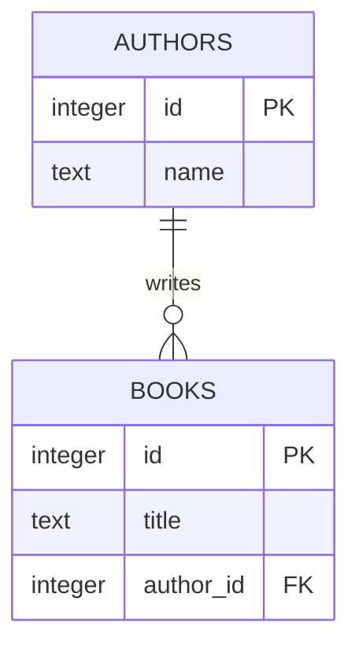
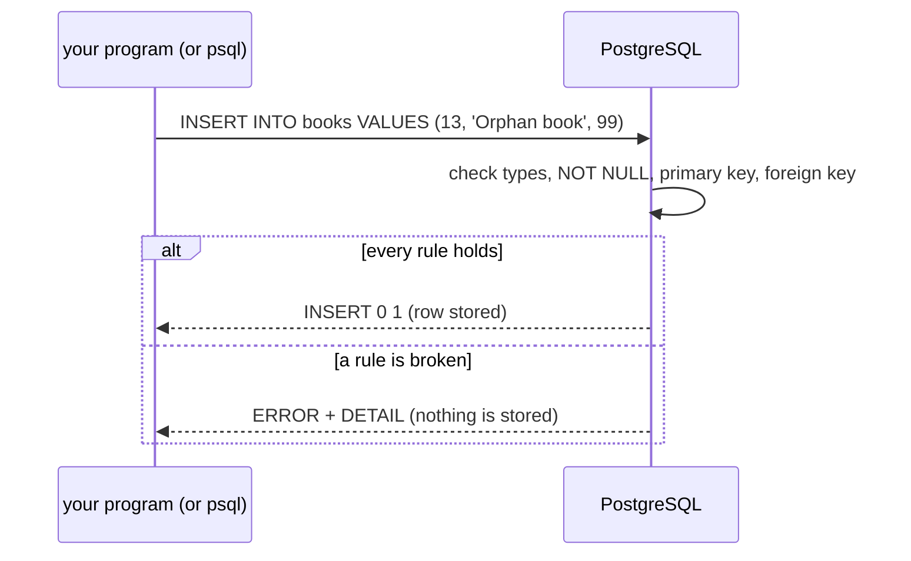

# Databases 01 — Relational databases: tables, rows, keys

> **Course:** [Databases](./README.md)  ·  **Time:** ~40 min  ·  **Needs:** nothing ([Docker 01](../docker/01-images-and-containers.md) helps: the exercises run in a throw-away container)
> **Used in the labs:** [Lab 04, step 10](../../labs/04-database.md#step-10--the-postgres-container) (the Postgres container, `\dt`) and [step 11](../../labs/04-database.md#step-11--the-database-layer-the-first-migration-and-the-migrate-job) (the `notes` table)

## What you will learn
- Describe a **relational database** with the words *table*, *row*, *column* and *data type*.
- Explain what a **primary key** and a **foreign key** are, and why tables refer to each other by number instead of repeating data.
- See the database **refuse** wrong data (duplicate key, missing parent, missing value), and read its error messages.
- Tell `NULL` ("unknown") from an empty text, and read the `notes` table of this project.

## Words you need
| Word | Plain-words meaning |
|---|---|
| **Database** | A program that stores data safely and answers questions about it quickly ([Lab 04](../../labs/04-database.md)). |
| **Relational database** | A database that keeps data in **tables** that can be linked to each other. PostgreSQL is one. |
| **Table** | A grid that holds one kind of thing (`authors`, `books`, `notes`). |
| **Row** (record) | One line of a table: one author, one book, one note. |
| **Column** (field) | One named property that every row has (`title`, `created_at`). |
| **Data type** | What kind of value a column accepts: `integer` (whole number), `text`, `timestamp with time zone` (date and time)... |
| **Primary key** | A column (or set of columns) whose value is **unique** in every row and never empty: the row's identity, like a library-card number. |
| **Foreign key** | A column that holds the primary key of a row in **another** table: a pointer, like writing a card number on a loan slip. |
| **Constraint** | A rule the database enforces by itself (`NOT NULL`, `PRIMARY KEY`, `REFERENCES`). A row that breaks it is refused. |
| **`NULL`** | "No value / unknown". It is **not** zero and **not** an empty text. |
| **SQL** | The language used to talk to a relational database (`CREATE TABLE`, `INSERT`, `SELECT`). Module [Databases 02](./README.md) covers it in depth. |
| **Join** | A query that follows foreign keys to combine rows from two tables into one result. |

## The idea
**Analogy.** Think of a **library with strict card files**. One drawer holds the *authors* (one card each, numbered), another drawer holds the *books*. A book card does not repeat the author's name: it
just says "author card **1**". If the author's name changes, you fix **one** card and every book follows. And the librarian is strict: two cards may not share a number, a book cannot point to an author card that does not
exist, and a card with a required line left blank is not accepted.

**Precisely.** A relational database stores data in tables with fixed columns and types. Each table has a **primary key** that identifies its rows. Tables are linked by **foreign keys**: a value in one table that must match a primary key in another.
The database **enforces** these rules itself (constraints), so the data stays consistent even if the application has a bug. That is the big difference from a pile of files: the rules live *with the data*.


(`||--o{` reads "one author, zero or more books": a **one-to-many** relationship.)

**Who talks to whom when you insert a row:**


## The code, line by line
Two tables and the link between them, in SQL:

```sql
CREATE TABLE authors (            -- create a table named authors
  id   integer PRIMARY KEY,       -- whole number, unique and never empty: the row's identity
  name text    NOT NULL           -- text; the database refuses a row without a name
);
CREATE TABLE books (
  id        integer PRIMARY KEY,                    -- identity of the book
  title     text    NOT NULL,                       -- required
  author_id integer NOT NULL REFERENCES authors (id) -- foreign key: must match an existing authors.id
);
```
(The `--` comments are SQL comments; the database ignores them.)

| Line | What it does | If you change or remove it |
|---|---|---|
| `CREATE TABLE authors (...)` | Creates an empty table with the listed columns. | Without it the first `INSERT` fails with "relation does not exist". |
| `id integer PRIMARY KEY` | Column `id` of type `integer`; no two rows may share a value, and it can never be `NULL`. PostgreSQL also builds an *index* on it so lookups by `id` are fast. | Remove `PRIMARY KEY` and two authors could get number 1: a foreign key could no longer point to "the" author. |
| `name text NOT NULL` | A text column that must have a value. | Without `NOT NULL`, a nameless author is accepted. |
| `author_id integer NOT NULL REFERENCES authors (id)` | A foreign key: the value must exist in `authors.id`. `NOT NULL` additionally says every book has an author. | Without `REFERENCES`, a book can point to author 99 who does not exist. Without `NOT NULL`, a book may have no author at all. |

## The commands
| Command / flag | Meaning |
|---|---|
| `docker run --rm -d --name course-pg -e POSTGRES_PASSWORD=... postgres:18.7-alpine3.24` | Start a throw-away PostgreSQL: `--rm` delete it when it stops, `-d` in the background, `--name` give it a name, `-e` set its first password (a **fake** one here). |
| `pg_isready -U postgres` | Asks the server "are you accepting connections?" (exit code 0 = yes). |
| `docker exec -i course-pg psql -U postgres -q` | Run the SQL client `psql` inside the container, reading SQL from your terminal (`-i`); `-q` hides the confirmation lines such as `CREATE TABLE`. |
| `\dt` | psql command: list the tables. |
| `\d books` | psql command: describe one table (columns, types, keys). |
| `SELECT ... FROM ... JOIN ... ON ...` | Read rows; `JOIN ... ON a.id = b.author_id` follows the foreign key. |
| `docker stop course-pg` | Stop the container; because of `--rm` it disappears with everything in it. |

## Hands-on
Throw-away database, fake password, nothing touches the lab. Real output, trimmed.

**1. Start it, create the tables, look at them**
```bash
docker run --rm -d --name course-pg -e POSTGRES_PASSWORD=demo-only-not-a-secret postgres:18.7-alpine3.24
until docker exec course-pg pg_isready -U postgres -q; do sleep 1; done        # wait until it accepts connections
P() { docker exec -i course-pg psql -U postgres -q "$@"; }                    # a shortcut for the client
P <<'SQL'
CREATE TABLE authors (id integer PRIMARY KEY, name text NOT NULL);
CREATE TABLE books (id integer PRIMARY KEY, title text NOT NULL, author_id integer NOT NULL REFERENCES authors (id));
SQL
docker exec course-pg psql -U postgres -c '\dt' -c '\d books'
```
```text
           List of tables
 Schema |  Name   | Type  |  Owner   
--------+---------+-------+----------
 public | authors | table | postgres
 public | books   | table | postgres
(2 rows)

                 Table "public.books"
  Column   |  Type   | Collation | Nullable | Default 
-----------+---------+-----------+----------+---------
 id        | integer |           | not null | 
 title     | text    |           | not null | 
 author_id | integer |           | not null | 
Indexes:
    "books_pkey" PRIMARY KEY, btree (id)
Foreign-key constraints:
    "books_author_id_fkey" FOREIGN KEY (author_id) REFERENCES authors(id)
```
`\d books` lists the three columns with `not null`, the primary key (with its index, `books_pkey`) and the foreign key pointing to `authors(id)`.

**2. Add rows, read them, and follow the link**
```bash
P <<'SQL'
INSERT INTO authors VALUES (1, 'Ursula K. Le Guin'), (2, 'Octavia E. Butler');
INSERT INTO books VALUES (10, 'The Dispossessed', 1), (11, 'Kindred', 2), (12, 'The Left Hand of Darkness', 1);
SELECT * FROM books;
SELECT b.title, a.name AS author FROM books b JOIN authors a ON a.id = b.author_id ORDER BY b.id;
SQL
```
```text
 id |           title           | author_id 
----+---------------------------+-----------
 10 | The Dispossessed          |         1
 11 | Kindred                   |         2
 12 | The Left Hand of Darkness |         1
(3 rows)

           title           |      author       
---------------------------+-------------------
 The Dispossessed          | Ursula K. Le Guin
 Kindred                   | Octavia E. Butler
 The Left Hand of Darkness | Ursula K. Le Guin
(3 rows)
```
The `books` table only stores the number (`1`, `2`). The **join** follows it: `b.author_id = a.id` glues each book to its author's row, so the name is stored once and shown many times.

**3. The librarian says no**
```bash
P -c "INSERT INTO books VALUES (10, 'Another book', 1);"          # same primary key
P -c "INSERT INTO books VALUES (13, 'Orphan book', 99);"          # author 99 does not exist
P -c "INSERT INTO books (id, author_id) VALUES (14, 1);"          # no title
```
```text
ERROR:  duplicate key value violates unique constraint "books_pkey"
DETAIL:  Key (id)=(10) already exists.
ERROR:  insert or update on table "books" violates foreign key constraint "books_author_id_fkey"
DETAIL:  Key (author_id)=(99) is not present in table "authors".
ERROR:  null value in column "title" of relation "books" violates not-null constraint
DETAIL:  Failing row contains (14, null, 1).
```
Each message names the **rule** that was broken (`books_pkey`, `books_author_id_fkey`, `not-null`) and, in `DETAIL`, the offending value. Nothing was stored. The `ERROR` / `DETAIL` pair is how an application learns what went wrong.

**4. `NULL` is not "empty"**
```bash
P -c "CREATE TABLE people (id integer PRIMARY KEY, nickname text); INSERT INTO people VALUES (1, 'Sam'), (2, NULL), (3, '');" \
  -c "SELECT id, nickname, nickname IS NULL AS is_null, nickname = '' AS is_empty_text FROM people ORDER BY id;"
```
```text
 id | nickname | is_null | is_empty_text 
----+----------+---------+---------------
  1 | Sam      | f       | f
  2 |          | t       | 
  3 |          | f       | t
(3 rows)
```
Row 2 has **no value** (`NULL`): `is_null` is true, and asking whether it equals an empty text gives *no answer at all* (the blank in the last column), because "unknown = empty" is itself unknown. Row 3 holds a real empty text: `is_null` is false, `is_empty_text` is true.
They look the same on screen and behave differently; this is why columns like `title` are `NOT NULL`.

## What if…?
**…you delete an author whose books still exist?**
```bash
P -c "DELETE FROM authors WHERE id = 1;"
```
```text
ERROR:  update or delete on table "authors" violates foreign key constraint "books_author_id_fkey" on table "books"
DETAIL:  Key (id)=(1) is still referenced from table "books".
```
The foreign key works in **both directions**: you cannot point to a missing author, and you cannot remove an author that is still pointed to (that would leave "orphan" books). To delete the author you first delete (or re-point) their books, or you declare the link with a rule such as `ON DELETE CASCADE`
("delete the books too"), which this module does not try.

Clean up: `docker stop course-pg` (started with `--rm`, so the container and all its data disappear).

## In short
1. A relational database stores data in **tables** of rows and columns with fixed types; a **primary key** identifies each row, a **foreign key** points to a row in another table.
2. The database **enforces** its constraints (`NOT NULL`, `PRIMARY KEY`, `REFERENCES`) and refuses wrong data with a clear error, so consistency does not depend on every program being perfect.
3. `NULL` means "unknown", not zero and not an empty text; a `JOIN` follows foreign keys to combine tables.

## Check your understanding
1. What is the difference between a row and a column?
2. Why does the `books` table store `author_id` instead of the author's name?
3. What does the database do when you insert a book whose `author_id` is 99 and no such author exists?
4. Is `NULL` the same as an empty text `''`? Give one difference.
5. Which two constraints make the `notes.title` column of this project mandatory and at most 200 characters?

<details><summary>Answers</summary>

1. A **row** is one record (one book); a **column** is one property that every row has (the title).
2. To avoid repeating (and risking inconsistent copies of) the name: it is stored once in `authors`, and `author_id` points to it; changing the name changes it everywhere.
3. It refuses the insert with a foreign-key error (`... is not present in table "authors"`) and stores nothing.
4. No. `NULL` means "no value / unknown"; `''` is a real value of zero length. For example `nickname IS NULL` is true only for `NULL`, and `NULL = ''` gives no answer.
5. `NOT NULL` makes it mandatory; the type `character varying(200)` (`varchar(200)`) limits it to 200 characters (a type rule rather than a constraint keyword).

</details>

## Official documentation
- [PostgreSQL tutorial: creating a new table](https://www.postgresql.org/docs/current/tutorial-table.html)
- [Constraints (`NOT NULL`, primary keys, foreign keys)](https://www.postgresql.org/docs/current/ddl-constraints.html)
- [Data types](https://www.postgresql.org/docs/current/datatype.html)
- [`psql`, the command-line client](https://www.postgresql.org/docs/current/app-psql.html)

## Where you use this in the project
- [Lab 04, step 10](../../labs/04-database.md#step-10--the-postgres-container): the Postgres container, and `\dt` in step 11 to list the tables.
- [Lab 04, step 11](../../labs/04-database.md#step-11--the-database-layer-the-first-migration-and-the-migrate-job): the `notes` table. Real output of `\d notes` from the lab:
```text
   Column   |           Type           | Collation | Nullable |              Default              
------------+--------------------------+-----------+----------+-----------------------------------
 id         | integer                  |           | not null | nextval('notes_id_seq'::regclass)
 title      | character varying(200)   |           | not null | 
 body       | text                     |           | not null | ''::text
 created_at | timestamp with time zone |           | not null | now()
Indexes:
    "notes_pkey" PRIMARY KEY, btree (id)
```
  Read it with this module's words: a table with four **columns** and their **types**, a **primary key** `id` that the database numbers itself (`nextval(...)`), `NOT NULL` on every column, and **defaults** for `body` and `created_at`. It has no foreign key yet: `notes` is the only table so far.
