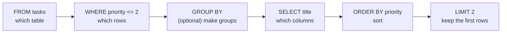
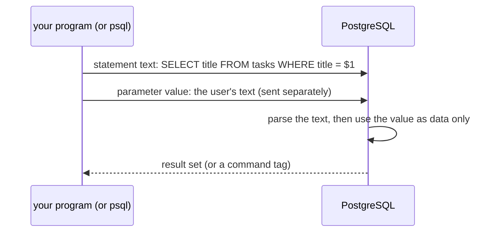

# Databases 02 — SQL basics

> **Course:** [Databases](./README.md)  ·  **Time:** ~45 min  ·  **Needs:** [Databases 01 — Relational databases: tables, rows, keys](./01-relational-basics.md)
> **Used in the labs:** [Lab 04, step 12](../../labs/04-database.md#step-12--the-notes-crud) (every `/notes` route is one SQL statement) and [step 11](../../labs/04-database.md#step-11--the-database-layer-the-first-migration-and-the-migrate-job) (the migration creates a table)

## What you will learn
- Read and write the four everyday statements: `INSERT`, `SELECT`, `UPDATE`, `DELETE`, plus `CREATE TABLE`.
- Filter, sort and limit rows (`WHERE`, `ORDER BY`, `LIMIT`) and count them in groups (`GROUP BY`, `count`).
- Use `RETURNING` to get back what a statement changed, and read the **command tag** (`UPDATE 3`) that tells you how many rows it touched.
- Explain **SQL injection** and why programs pass user input as **parameters**, never glued into the text.

## Words you need
| Word | Plain-words meaning |
|---|---|
| **SQL** | *Structured Query Language*: the standard language for talking to a relational database. |
| **Statement** (query) | One complete instruction ending with `;`, such as `SELECT * FROM tasks;`. |
| **Keyword** | A word with a fixed meaning in SQL (`SELECT`, `WHERE`). Written in capitals by habit; SQL does not care. |
| **Clause** | One part of a statement that starts with a keyword: `WHERE priority <= 2` is a clause. |
| **Literal** | A value written directly in the statement: `'buy milk'` (text, in single quotes), `3` (number), `true`. |
| **Result set** | The table of rows that a `SELECT` returns. |
| **Aggregate function** | A function that turns many rows into one value: `count(*)` counts them. |
| **`RETURNING`** | A PostgreSQL clause that makes `INSERT`, `UPDATE` or `DELETE` also return the rows it changed. |
| **Command tag** | The short line psql prints after a statement: `INSERT 0 4`, `UPDATE 1`, `DELETE 1` (the number is how many rows). |
| **Parameter** (placeholder) | A hole (`$1`, `%(title)s`) in a statement that receives its value separately from the text. |
| **SQL injection** | An attack where user input is pasted into the SQL text and changes its meaning. |

## The idea
**Analogy.** SQL is **filling in a request form at the library counter**. The form is rigid: "SHOW me the *title* FROM the *tasks* shelf WHERE the *priority* is at most 2, sorted by priority". You say **what** you want, never **how** to find it; the clerk (the database) decides how.
The same form types exist for adding a card (`INSERT`), changing one (`UPDATE`) and shredding one (`DELETE`). And the most dangerous form is the one where you forget the "WHERE" line: it applies to **every** card.

**Precisely.** A statement is made of clauses in a fixed order. For a `SELECT` the database reads them in a different, logical order than you write them: first *which table* (`FROM`), then *which rows* (`WHERE`), then groups (`GROUP BY`), then *which columns* to show (`SELECT`), then sorting (`ORDER BY`) and the cut-off (`LIMIT`).
Statements fall into families: **defining** tables (`CREATE TABLE`), **changing** rows (`INSERT`, `UPDATE`, `DELETE`) and **reading** them (`SELECT`).



**Who talks to whom when a program runs a statement with a parameter:**


## The code, line by line
A small table and the statements you will use every day:

```sql
CREATE TABLE tasks (                 -- a new table
  id       serial  PRIMARY KEY,      -- whole number the database numbers itself (1, 2, 3...), unique
  title    text    NOT NULL,         -- required text
  done     boolean NOT NULL DEFAULT false,   -- true/false, false if you give no value
  priority integer NOT NULL DEFAULT 3        -- 1 = most urgent, 3 if you give no value
);
INSERT INTO tasks (title, priority) VALUES ('write report', 1), ('buy milk', 3)   -- add 2 rows; id and done are filled in
RETURNING id, title;                                                              -- and show me what was added
SELECT title FROM tasks WHERE priority <= 2 ORDER BY priority, title;             -- read: filter, then sort
UPDATE tasks SET done = true WHERE title = 'buy milk' RETURNING id, title, done;  -- change the rows that match
DELETE FROM tasks WHERE done RETURNING id;                                        -- remove the rows that match
```
(`--` starts a comment that the database ignores.)

| Line | What it does | If you change or remove it |
|---|---|---|
| `id serial PRIMARY KEY` | An auto-numbered unique identity. `serial` makes PostgreSQL count for you; the project's `notes.id` does the same (`nextval(...)` in `\d notes`). | Without it you must invent unique ids yourself. |
| `DEFAULT false` / `DEFAULT 3` | The value used when an `INSERT` does not mention the column. | Without a default and with `NOT NULL`, leaving the column out is an error. |
| `INSERT INTO tasks (title, priority) VALUES (...), (...)` | Adds rows: first the column names, then one parenthesised list of values per row. Columns not listed get their default. | Swap the order of the names without swapping the values and the data lands in the wrong columns. |
| `RETURNING id, title` | Returns the listed columns of the rows just written, so the program learns the new `id` without a second query. | Without it you only get the command tag (`INSERT 0 2`). |
| `SELECT title FROM tasks` | Read only the `title` column of every row. `SELECT *` means "all columns". | `*` in application code breaks silently when columns are added. |
| `WHERE priority <= 2` | Keeps only the rows for which the test is true (`=`, `<>`, `<`, `<=`, `AND`, `OR`...). | **No `WHERE` means every row** (see hands-on 4). |
| `ORDER BY priority, title` | Sorts by priority, then by title for equal priorities. | Without it, the order of rows is **not guaranteed**. |
| `LIMIT 2` | Returns at most 2 rows. | Without it a big table returns everything. |
| `UPDATE ... SET done = true WHERE ...` | Changes a column in the matching rows. | Forget `WHERE` and all rows change. |
| `DELETE FROM tasks WHERE done` | Removes the matching rows (`WHERE done` = "where done is true"). | Forget `WHERE` and the table is emptied. |

## The commands
| Command / flag | Meaning |
|---|---|
| `docker run --rm -d --name course-pg2 -e POSTGRES_PASSWORD=... postgres:18.7-alpine3.24` | Start a throw-away PostgreSQL (fake password): `--rm` delete when stopped, `-d` background, `--name` give it a name. |
| `docker exec -i course-pg2 psql -U postgres` | Run the SQL client inside the container; `-i` lets it read your statements from the terminal (here a here-document `<<'SQL' ... SQL`). |
| `SELECT count(*) AS how_many ... GROUP BY priority` | `count(*)` counts rows; `GROUP BY` makes one result row per distinct priority; `AS` renames the column in the result. |
| `PREPARE name (text) AS ... $1` / `EXECUTE name(...)` | Define a statement with a **parameter** `$1`, then run it giving the value separately: the safe way. |
| `$$...$$` | PostgreSQL "dollar quoting": a text literal in which quotes need no escaping (handy for the injection demo). |
| `docker stop course-pg2` | Stop the container; `--rm` removes it with all its data. |

## Hands-on
Throw-away database, fake password, nothing touches the lab. Real output, trimmed.

**1. Create the table and insert rows**
```bash
docker run --rm -d --name course-pg2 -e POSTGRES_PASSWORD=demo-only-not-a-secret postgres:18.7-alpine3.24
until docker exec course-pg2 pg_isready -U postgres -q; do sleep 1; done
P() { docker exec -i course-pg2 psql -U postgres "$@"; }
P <<'SQL'
CREATE TABLE tasks (id serial PRIMARY KEY, title text NOT NULL, done boolean NOT NULL DEFAULT false, priority integer NOT NULL DEFAULT 3);
INSERT INTO tasks (title, priority) VALUES ('write report', 1), ('buy milk', 3), ('call bank', 2), ('fix bike', 3) RETURNING id, title;
SQL
```
```text
CREATE TABLE
 id |    title     
----+--------------
  1 | write report
  2 | buy milk
  3 | call bank
  4 | fix bike
(4 rows)

INSERT 0 4
```
`RETURNING` gave back the four new rows **with the ids the database chose** (1 to 4). `INSERT 0 4` is the command tag: 4 rows inserted (the `0` is a historical field you can ignore).

**2. Read: all, filtered and sorted, limited**
```bash
P <<'SQL'
SELECT * FROM tasks;
SELECT title FROM tasks WHERE priority <= 2 ORDER BY priority, title;
SELECT title FROM tasks ORDER BY id LIMIT 2;
SQL
```
```text
 id |    title     | done | priority 
----+--------------+------+----------
  1 | write report | f    |        1
  2 | buy milk     | f    |        3
  3 | call bank    | f    |        2
  4 | fix bike     | f    |        3
(4 rows)

    title     
--------------
 write report
 call bank
(2 rows)

    title     
--------------
 write report
 buy milk
(2 rows)
```
`done` shows `f` (false) for every row: it was not mentioned in the `INSERT`, so its default applied. The second query keeps priorities 1 and 2 and sorts them (1 first). The third takes only the first two rows by `id`.

**3. Change, count in groups, remove**
```bash
P <<'SQL'
UPDATE tasks SET done = true WHERE title = 'buy milk' RETURNING id, title, done;
SELECT priority, count(*) AS how_many FROM tasks GROUP BY priority ORDER BY priority;
DELETE FROM tasks WHERE done RETURNING id;
SELECT count(*) AS left_over FROM tasks;
SQL
```
```text
 id |  title   | done 
----+----------+------
  2 | buy milk | t
(1 row)

UPDATE 1
 priority | how_many 
----------+----------
        1 |        1
        2 |        1
        3 |        2
(3 rows)

 id 
----
  2
(1 row)

DELETE 1
 left_over 
-----------
         3
(1 row)
```
`UPDATE 1` and `DELETE 1` tell you how many rows were touched: **always read it**. `GROUP BY priority` made one line per priority with its count (two tasks have priority 3). After the delete, 3 rows are left.

**4. The forgotten `WHERE`**
```bash
P <<'SQL'
UPDATE tasks SET priority = 9;
SELECT title, priority FROM tasks ORDER BY id;
SQL
```
```text
UPDATE 3
    title     | priority 
--------------+----------
 write report |        9
 call bank    |        9
 fix bike     |        9
(3 rows)
```
`UPDATE 3`: all three remaining rows changed, including the urgent ones. Nothing asked for confirmation. The command tag is your only warning: if you expected `UPDATE 1`, stop and check (in a real database you would do this inside a transaction, see [Databases 07](./README.md), planned).

## What if…?
**…a program builds the SQL by pasting in what the user typed?** Suppose a search box sends the text `' OR '1'='1`, and the program writes `... WHERE title = '` + text + `'`. The database receives this statement:
```bash
P <<'SQL'
SELECT title FROM tasks WHERE title = '' OR '1'='1';
SQL
```
```text
    title     
--------------
 write report
 call bank
 fix bike
(3 rows)
```
The user's text closed the quote and added a condition that is always true: **every row came back**. That is **SQL injection**; with other input, an attacker can read or destroy other tables. The fix is never to paste text into SQL, but to send the statement and the value **separately**, as a *parameter*:
```bash
P <<'SQL'
PREPARE find (text) AS SELECT title FROM tasks WHERE title = $1;
EXECUTE find($$' OR '1'='1$$);
SQL
```
```text
PREPARE
 title 
-------
(0 rows)
```
Now the same hostile text is just a value: no task has that title, so 0 rows. Libraries do this for you: the project's API uses SQLAlchemy, which always sends parameters (next section). Clean up: `docker stop course-pg2`.

## In short
1. `INSERT`, `SELECT`, `UPDATE`, `DELETE` are the everyday statements; `WHERE` chooses rows, `ORDER BY` sorts, `LIMIT` cuts, `GROUP BY` with `count(*)` counts per group, and `RETURNING` returns what was changed.
2. A statement without `WHERE` hits **every row**: always read the command tag (`UPDATE 3`) and check it is the number you expected.
3. Never paste user input into SQL text (**injection**): pass it as a **parameter**, as SQLAlchemy does for this project.

## Check your understanding
1. What does `SELECT title FROM tasks WHERE priority <= 2 ORDER BY priority LIMIT 1;` return, in words?
2. You run `DELETE FROM tasks;` by mistake. What would `psql` print, and why is that a warning sign when you expected one row?
3. What does `RETURNING id` save a program from doing?
4. What is the difference between `WHERE title = '` + user text + `'` and a parameter `WHERE title = $1`?
5. Which four statements are behind the routes `POST`, `GET`, `PUT` and `DELETE` of `/notes`?

<details><summary>Answers</summary>

1. The title of the single most urgent task among those with priority 1 or 2 (filter first, then sort by priority, then keep one row).
2. `DELETE 3` (or whatever the table's row count was): the number of rows removed. If you expected `DELETE 1`, a bigger number means the statement matched far more rows than intended (here, all of them).
3. A second query to find out the `id` the database just assigned.
4. In the first, the user's text becomes **part of the SQL**, so it can change the statement (injection). In the second, the statement is fixed and the text is delivered **only as a value**, so it can never be executed as SQL.
5. `INSERT` (POST), `SELECT` (GET one or all), `UPDATE` (PUT), `DELETE` (DELETE).

</details>

## Official documentation
- [PostgreSQL tutorial: the SQL language](https://www.postgresql.org/docs/current/tutorial-sql.html)
- [`SELECT`](https://www.postgresql.org/docs/current/sql-select.html), [`INSERT`](https://www.postgresql.org/docs/current/sql-insert.html), [`UPDATE`](https://www.postgresql.org/docs/current/sql-update.html), [`DELETE`](https://www.postgresql.org/docs/current/sql-delete.html)
- [Aggregate functions (`count`...)](https://www.postgresql.org/docs/current/functions-aggregate.html)
- [`PREPARE`](https://www.postgresql.org/docs/current/sql-prepare.html)
- [OWASP: SQL injection](https://owasp.org/www-community/attacks/SQL_Injection)

## Where you use this in the project
Every `/notes` route of [Lab 04, step 12](../../labs/04-database.md#step-12--the-notes-crud) is one of these statements, written for you by SQLAlchemy. Real log of the statements it sent for create, read by id, update, list and delete (SQLAlchemy `echo` turned on in an API replica; the `BEGIN`/`COMMIT` lines, the three start-up queries and the log prefixes are left out, and multi-line statements are joined onto one line):
```text
INSERT INTO notes (title, body) VALUES (%(title)s::VARCHAR, %(body)s::VARCHAR) RETURNING notes.id, notes.created_at
[generated in 0.00013s] {'title': 'sql-demo', 'body': 'x'}
SELECT notes.id, notes.title, notes.body, notes.created_at FROM notes WHERE notes.id = %(pk_1)s::INTEGER
[generated in 0.00012s] {'pk_1': 5}
UPDATE notes SET title=%(title)s::VARCHAR WHERE notes.id = %(notes_id)s::INTEGER
[generated in 0.00010s] {'title': 'sql-demo (edited)', 'notes_id': 5}
SELECT notes.id, notes.title, notes.body, notes.created_at FROM notes ORDER BY notes.id
DELETE FROM notes WHERE notes.id = %(id)s::INTEGER
[generated in 0.00009s] {'id': 5}
```
Read it with this module: `POST` is an `INSERT ... RETURNING` (that is how the API learns the new `id` and `created_at`), `GET /notes/{id}` is a `SELECT ... WHERE id = ...`, `PUT` an `UPDATE ... WHERE id = ...` (note the `WHERE`!), the list an `ORDER BY id`, and `DELETE` a `DELETE ... WHERE id = ...`. Every value is a **parameter** (`%(title)s`, with the values on the line below), never glued into the text: injection-proof by construction.
The first migration ([step 11](../../labs/04-database.md#step-11--the-database-layer-the-first-migration-and-the-migrate-job)) is a `CREATE TABLE`, like the one at the top of this page.
