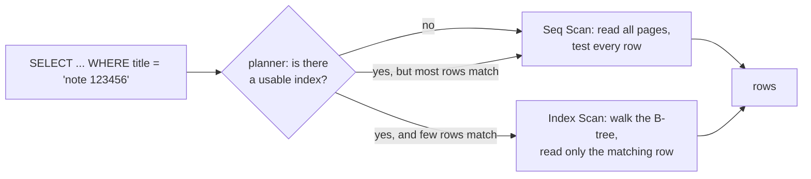

# Databases 06 — Indexes

> **Course:** [Databases](./README.md)  ·  **Time:** ~45 min  ·  **Needs:** [Databases 01](./01-relational-basics.md) and [Databases 02](./02-sql.md); [Docker 01](../docker/01-images-and-containers.md) for the exercise
> **Used in the labs:** [Lab 04, step 12](../../labs/04-database.md) (`GET /notes/{id}` is a primary-key lookup, served by the primary key's index)

## What you will learn
- Explain what an **index** is and why it makes a lookup fast.
- Read a query plan from `EXPLAIN ANALYZE`: tell a **sequential scan** from an **index scan**.
- Know what an index costs: disk space and slower writes.
- Recognise queries an index cannot help (a leading wildcard, a function on the column) and queries where the planner is right to ignore it.
- Check which indexes a table has, and drop one you do not need.

## Words you need
| Word | Plain-words meaning |
|---|---|
| **Index** | A second structure kept next to a table that lets the database find rows by a column's value without reading the whole table. Like the index at the back of a book. |
| **B-tree** | The usual index shape: a sorted tree. Finding a value takes a few steps even in millions of rows, and the sorting also helps `ORDER BY` and ranges (`>`, `<`, `BETWEEN`). |
| **Primary key** | The column(s) that identify a row ([Databases 01](./01-relational-basics.md)). PostgreSQL builds an index for it automatically (`notes_pkey`). |
| **Sequential scan (Seq Scan)** | Reading **every** row of the table and keeping the matching ones. Fine for a small table, slow for a big one. |
| **Index scan** | Using an index to jump straight to the matching rows. (A *bitmap index scan* is a variant that first collects the places, then reads them in order.) |
| **Query planner** | The part of PostgreSQL that decides **how** to run a query (use an index or not) by estimating the cost of each way. |
| **Statistics** | Numbers PostgreSQL keeps about each table (row count, how values are spread). The planner relies on them; `ANALYZE table` refreshes them. |
| **`EXPLAIN`** | A command that shows the plan of a query without running it. **`EXPLAIN ANALYZE`** also **runs** it and shows the real row counts and times. |
| **Page (block)** | PostgreSQL reads and writes the disk in chunks of 8 kB. `Buffers: shared hit=2168` counts the pages touched. |
| **Selectivity** | How few rows a condition keeps. `id = 5` keeps one row (very selective); `title >= 'note'` keeps most rows (not selective). |
| **Expression index** | An index on a computed value, such as `lower(title)`, not on the raw column. |
| **Write cost** | Every `INSERT`, `UPDATE` or `DELETE` must also update each index of the table. |

## The idea
**Analogy.** Finding a word in a 500-page book. Without an index you read page by page from the start (a sequential scan). With the **index at the back** you look the word up in alphabetical order, read "page 312", and open the book there. The index costs extra pages (space), and the author must update it every time the text changes (write cost).

**Precisely.** A table stores its rows in no useful order. A query such as `WHERE title = 'note 123456'` must check every row unless an index on `title` exists. The index is a sorted tree of `(value → where the row is)`, so the lookup reads a handful of pages instead of thousands. PostgreSQL's planner chooses between the two ways **by estimated cost**: it does not always use an index, and it should not (reading 90 % of a table through an index is slower than reading it straight).



## The code or config, line by line
The whole experiment is one SQL file, `indexes_demo.sql`. It builds the lab's `notes` table with 200,000 rows and tries queries before and after each index:
```sql
-- Databases 06: indexes. Same shape as the lab's "notes" table, filled with 200,000 rows.
\pset footer off
\echo '== 1. build the table (200,000 rows)'
create table notes (
    id         serial primary key,
    title      text not null,
    body       text not null default '',
    created_at timestamptz not null default now()
);
insert into notes (title, body, created_at)
select 'note ' || g, md5(g::text), now() - (g || ' seconds')::interval
from generate_series(1, 200000) as g;
analyze notes;
select count(*) as rows from notes;

\echo '== 2. lookup by id: the primary key already has an index'
explain (analyze, costs off, timing off) select * from notes where id = 123456;

\echo '== 3. lookup by title: no index on title yet'
explain (analyze, costs off, timing off) select * from notes where title = 'note 123456';

\echo '== 4. create an index on title, look again'
create index notes_title_idx on notes (title);
explain (analyze, costs off, timing off) select * from notes where title = 'note 123456';

\echo '== 5. an index is no help when the pattern starts with a wildcard'
explain (analyze, costs off, timing off) select * from notes where title like '%123456';

\echo '== 6. the newest 5 notes: without, then with an index on created_at'
explain (analyze, costs off, timing off) select * from notes order by created_at desc limit 5;
create index notes_created_idx on notes (created_at);
explain (analyze, costs off, timing off) select * from notes order by created_at desc limit 5;

\echo '== 7. an index takes room'
select relname, pg_size_pretty(pg_relation_size(oid)) as size
from pg_class where relname in ('notes', 'notes_pkey', 'notes_title_idx', 'notes_created_idx')
order by pg_relation_size(oid) desc;

\echo '== 8. and slows writes down: insert 100,000 rows into the table with 3 indexes, then into a copy with none'
create table notes_plain (like notes including defaults);
\timing on
insert into notes (title, body) select 'more ' || g, md5(g::text) from generate_series(1, 100000) g;
insert into notes_plain (title, body) select 'more ' || g, md5(g::text) from generate_series(1, 100000) g;
\timing off

\echo '== 9. the planner chooses: a condition that matches almost every row'
explain (analyze, costs off, timing off) select * from notes where title >= 'note';
```
| Line(s) | What it does | If you change or remove it |
|---|---|---|
| `create table notes (id serial primary key, ...)` | The lab's table. `primary key` makes PostgreSQL create the index `notes_pkey` by itself. | Without `primary key` there would be no index on `id` and step 2 would be a Seq Scan. |
| `insert ... from generate_series(1, 200000)` | Fills the table with 200,000 generated rows. | With only a few rows the planner reads the whole table anyway: indexes only pay off on bigger tables. |
| `analyze notes;` | Refreshes the statistics, so the planner knows the table is big. | Without fresh statistics the planner may guess wrong right after a bulk load. |
| `explain (analyze, costs off, timing off)` | Runs the query and prints the plan with real row counts; `costs off` and `timing off` hide estimates that vary between machines. | Plain `explain` shows the plan without running the query. |
| `where id = 123456` / `where title = 'note 123456'` | The same kind of lookup, on an indexed and a non-indexed column. | |
| `create index notes_title_idx on notes (title);` | Builds a B-tree on `title`. The name is yours. | |
| `like '%123456'` | A pattern that starts with `%`: the value could be anything before it. | |
| `order by created_at desc limit 5` | "The 5 newest notes". | |
| `pg_relation_size(oid)` | Size in bytes of a table or an index. | |
| `create table notes_plain (like notes including defaults)` | A copy of the table with **no** index (the primary key is not copied). | |
| `\timing on` / `\timing off` | A `psql` command: print the elapsed time of each statement. | |
| `title >= 'note'` | A condition that matches most rows. | |

## The commands
| Command / flag | Meaning |
|---|---|
| `docker run -d --rm --name course-pg6 -e POSTGRES_PASSWORD=demo-only-not-a-secret postgres:18.7-alpine3.24` | A throw-away PostgreSQL (fake password): `-d` background, `--rm` delete when stopped, `--name` give it a name. |
| `docker exec course-pg6 pg_isready -U postgres` | Asks the server whether it accepts connections yet; run in a loop until it says yes. |
| `docker cp indexes_demo.sql course-pg6:/tmp/` | Copy the file into the container. |
| `docker exec course-pg6 psql -U postgres -v ON_ERROR_STOP=1 -q -f /tmp/indexes_demo.sql` | Run the file with `psql`: `-U` user, `-v ON_ERROR_STOP=1` stop at the first error, `-q` quiet, `-f` read commands from a file. |
| `MSYS_NO_PATHCONV=1` | On Git Bash for Windows: stops `/tmp/...` from being rewritten into a Windows path. |
| `\d notes` | A `psql` command: describe a table, with its **indexes** at the end. |
| `\echo '== ...'` | Print a label, to find your way in the output. |

## Hands-on
Runs in a throw-away PostgreSQL (`postgres:18.7-alpine3.24`). Save `indexes_demo.sql` above in a folder, then:
```bash
cd db06 && export MSYS_NO_PATHCONV=1
docker run -d --rm --name course-pg6 -e POSTGRES_PASSWORD=demo-only-not-a-secret postgres:18.7-alpine3.24
for i in $(seq 30); do docker exec course-pg6 pg_isready -U postgres -q && break; sleep 1; done; sleep 2
docker cp indexes_demo.sql course-pg6:/tmp/indexes_demo.sql
docker exec course-pg6 psql -U postgres -v ON_ERROR_STOP=1 -q -f /tmp/indexes_demo.sql
```
The output below is **trimmed** to the lines that matter (the plans also print `Buffers`, `Planning` and `Index Searches` lines). Your times will differ; the shape of the plans will not.
```text
== 2. lookup by id: the primary key already has an index
 Index Scan using notes_pkey on notes (actual rows=1.00 loops=1)
   Index Cond: (id = 123456)
   Buffers: shared hit=4
 Execution Time: 0.038 ms

== 3. lookup by title: no index on title yet
 Seq Scan on notes (actual rows=1.00 loops=1)
   Filter: (title = 'note 123456'::text)
   Rows Removed by Filter: 199999
   Buffers: shared hit=2168
 Execution Time: 8.235 ms

== 4. create an index on title, look again
 Index Scan using notes_title_idx on notes (actual rows=1.00 loops=1)
   Index Cond: (title = 'note 123456'::text)
   Buffers: shared hit=1 read=3
 Execution Time: 0.068 ms

== 5. an index is no help when the pattern starts with a wildcard
 Seq Scan on notes (actual rows=1.00 loops=1)
   Filter: (title ~~ '%123456'::text)
   Rows Removed by Filter: 199999
 Execution Time: 10.642 ms

== 6. the newest 5 notes: without, then with an index on created_at
         ->  Sort (actual rows=5.00 loops=2)
               Sort Key: created_at DESC
               ->  Parallel Seq Scan on notes (actual rows=100000.00 loops=2)
 Execution Time: 14.778 ms
 Limit (actual rows=5.00 loops=1)
   ->  Index Scan Backward using notes_created_idx on notes (actual rows=5.00 loops=1)
 Execution Time: 0.091 ms

== 7. an index takes room
      relname      |  size   
-------------------+---------
 notes             | 17 MB
 notes_title_idx   | 6184 kB
 notes_pkey        | 4408 kB
 notes_created_idx | 4408 kB

== 8. and slows writes down: ...
Time: 626.044 ms
Time: 275.525 ms

== 9. the planner chooses: a condition that matches almost every row
 Seq Scan on notes (actual rows=200000.00 loops=1)
   Filter: (title >= 'note'::text)
 Execution Time: 22.058 ms
```
**How to read it:**
- **2:** the primary key's index finds the row in `0.038 ms`, touching 4 pages. This is what `GET /notes/{id}` does in the lab.
- **3:** with no index, PostgreSQL read **all** 2,168 pages and threw away 199,999 rows (`Rows Removed by Filter`): `8.2 ms`. It looks small, but the cost grows with the table, the index lookup barely does.
- **4:** after `create index`, the same query is an **Index Scan**: `0.068 ms`, a few pages. About 120 times faster here, with no change to the query.
- **5:** `like '%123456'` is a Seq Scan again. A sorted index can find "starts with `note 1`" but not "ends with `123456`": the start of the value is unknown.
- **6:** "newest 5" without an index reads and sorts all rows (`14.8 ms`). With the index on `created_at` PostgreSQL walks the index **backward** and stops after 5 rows (`0.09 ms`). An `ORDER BY id ... LIMIT n` is served the same way by the primary key's index.
- **7:** each index is a real structure on disk: `notes_title_idx` is a third the size of the table.
- **8:** the same 100,000 inserts took `626 ms` into the table with three indexes and `276 ms` into the copy with none: every index must be updated on each write (a single run on a laptop, so only the order of magnitude counts).
- **9:** the condition keeps two thirds of the rows, so the planner **chooses a Seq Scan** although an index on `title` exists. It is right: jumping through an index for most of the table is slower than reading it straight.

## What if…?
**…you wrap the indexed column in a function?** `lower(title) = 'note 123456'` on the table that has the index `notes_title_idx`:
```text
 Gather (actual rows=1.00 loops=1)
   ->  Parallel Seq Scan on notes (actual rows=0.33 loops=3)
         Filter: (lower(title) = 'note 123456'::text)
         Rows Removed by Filter: 100000
 Execution Time: 35.398 ms
```
The index is **sorted by `title`**, not by `lower(title)`, so it cannot be used. An **expression index** `create index notes_lower_title_idx on notes (lower(title));` fixes it:
```text
 Bitmap Heap Scan on notes (actual rows=1.00 loops=1)
   ->  Bitmap Index Scan on notes_lower_title_idx (actual rows=1.00 loops=1)
 Execution Time: 0.075 ms
```
`\d notes` lists what the table has (`PRIMARY KEY, btree (id)`, `btree (created_at)`, `btree (lower(title))`, `btree (title)`), and `drop index notes_lower_title_idx;` removes one. Stop the exercise container with `docker stop course-pg6` (it removes itself).

## In short
1. An index is a sorted structure that lets PostgreSQL find rows without reading the table: lookups go from thousands of pages to a handful. The primary key has one for free.
2. An index costs disk space and slows every write, so add one for a query that is really slow and selective, not for every column.
3. Check with `EXPLAIN ANALYZE`: an index is ignored when the condition matches most rows, starts with a wildcard, or wraps the column in a function.

## Check your understanding
1. What is the difference between a sequential scan and an index scan, and which one reads more pages for `id = 123456` in a table with no index on `id`?
2. Why is `like '%123456'` not helped by an index on `title`?
3. The planner chose a Seq Scan for `title >= 'note'` although `notes_title_idx` exists. Was that a mistake? Why?
4. Name two costs of adding an index.
5. A query `where lower(title) = 'x'` is slow although `title` is indexed. What are two ways to fix it?

<details><summary>Answers</summary>

1. A sequential scan reads every row of the table; an index scan walks the index to the matching rows only. With no index on `id`, the sequential scan reads all the pages (2,168 in the exercise), the index scan only a few.
2. The index is sorted by the start of the value. A pattern that begins with `%` does not say how the value starts, so the database cannot jump to a place in the sorted tree and must check every row.
3. No. The condition keeps two thirds of the rows; reading the table in order is cheaper than jumping through the index for each of them. The planner estimates costs and picks the cheapest.
4. Disk space (the index is stored on disk, `notes_title_idx` was a third of the table's size) and slower writes (every `INSERT`, `UPDATE`, `DELETE` must update every index; 626 ms against 276 ms for the same 100,000 inserts).
5. Create an **expression index** on `lower(title)`; or store the lower-case value in its own column and index that column (and query it directly).

</details>

## Official documentation
- [PostgreSQL: Indexes](https://www.postgresql.org/docs/current/indexes.html) and [index types (B-tree)](https://www.postgresql.org/docs/current/indexes-types.html)
- [PostgreSQL: Using `EXPLAIN`](https://www.postgresql.org/docs/current/using-explain.html)
- [PostgreSQL: indexes on expressions](https://www.postgresql.org/docs/current/indexes-expressional.html)
- [PostgreSQL: `CREATE INDEX`](https://www.postgresql.org/docs/current/sql-createindex.html)

## Where you use this in the project
- [Lab 04, step 12](../../labs/04-database.md): `GET /notes/{id}` is a primary-key lookup, the case of step 2 of the experiment. `GET /notes` returns **every** note, so no index can avoid reading them all: that route is one to limit (paginate) when the table grows.
- [Databases 04](./04-schemas-and-migrations.md): the migration that creates `notes` declares `primary_key=True`; adding any other index later is a new migration (`op.create_index`).
- [Databases 05](./05-sqlalchemy.md): an index declared on a SQLAlchemy model reaches the real database only through a migration, like any other schema change.
- [Lab 05](../../labs/05-caching.md): a cache is the other way to make a repeated read fast, by not asking the database at all.
