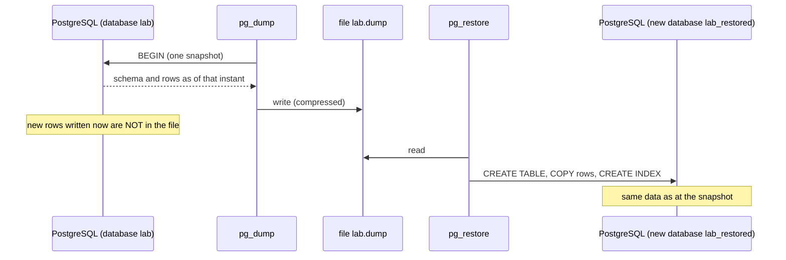

# Databases 09 — Backups: pg_dump and restore

> **Course:** [Databases](./README.md)  ·  **Time:** ~45 min  ·  **Needs:** [Databases 02](./02-sql.md) and [Databases 03](./03-postgresql.md); [Docker 01](../docker/01-images-and-containers.md) for the exercise
> **Used in the labs:** [Lab 04](../../labs/04-database.md) (the data survives `docker compose down`, but a **volume is not a backup**; RDS snapshots are the AWS counterpart)

## What you will learn
- Explain why a **backup** is not the same as a **volume** or a replica, and what it protects you from.
- Make a backup with `pg_dump` in its two main shapes (plain SQL and the compressed custom format) and read what is inside.
- **Restore** one into a new database with `psql` and `pg_restore`, and **prove** the copy is identical.
- Say what a backup does **not** contain (everything written after it) and what to do when a restore hits objects that already exist.
- Name the AWS equivalents: RDS automated backups, snapshots and point-in-time recovery.

## Words you need
| Word | Plain-words meaning |
|---|---|
| **Backup** | A separate copy of your data, kept somewhere else, from which you can rebuild after a loss (a bad `DELETE`, a corrupted disk, a lost server). |
| **Restore** | Using a backup to create the data again. A backup you have never restored is only a hope. |
| **`pg_dump`** | The PostgreSQL tool that reads one database and writes it out as a backup file. It is an ordinary client: it connects like `psql`. |
| **Logical backup** | A backup made of **instructions** (create this table, insert these rows). `pg_dump` makes logical backups. Opposite: a **physical** backup copies the database's files. |
| **Plain format** | A dump written as a text file of SQL commands. You restore it by running it with `psql`. |
| **Custom format (`-Fc`)** | A compressed archive with a table of contents. You restore it with `pg_restore`, which can also pick single tables. |
| **`pg_restore`** | The tool that reads a custom-format dump and recreates the objects and rows. |
| **Snapshot (consistent)** | `pg_dump` reads everything in **one transaction** ([Databases 07](./07-transactions.md)), so the file shows the database at one single moment even while other sessions write. |
| **Fingerprint** | A short value computed from data (here an `md5` of all rows). Same fingerprint, same data. |
| **RPO** | *Recovery Point Objective*: how much recent data you can afford to lose. A backup every night means an RPO of up to a day. |
| **RTO** | *Recovery Time Objective*: how long a restore may take before it hurts. |
| **Point-in-time recovery (PITR)** | Restoring to **any chosen second**, by replaying the write-ahead log (WAL, the journal of all changes) on top of a base backup. RDS offers it; `pg_dump` alone does not. |

## The idea
**Analogy.** A **photograph of a room**. It shows how the room looked at one instant; if the room burns down, you can rebuild it from the photo. But anything bought *after* the photo is missing from it, and a photo you never compared with the real room might be blurry. So you take photos regularly, keep them in another building, and now and then **rebuild a room from a photo** to be sure it works.

**Precisely.** Docker volumes ([Docker 08](../docker/08-volumes-and-bind-mounts.md)) and replicas protect against a **container** dying; they copy your mistakes just as faithfully. A **backup** protects against the data itself being lost or damaged. `pg_dump` connects to the running server, opens a transaction, reads every table, and writes either the SQL that recreates them (plain) or a compressed archive (custom). It does not stop the application: readers and writers carry on. A restore is the reverse: connect to an **empty** database and replay the file. Two numbers frame a backup plan: how much you can lose (**RPO**) and how long you can wait (**RTO**).



## The code or config, line by line
The whole experiment, `run.sh`. It starts a throw-away PostgreSQL, builds a database of 20,000 rows, backs it up in both formats, writes one more row, restores into new databases and compares fingerprints:
```bash
#!/usr/bin/env bash
# Databases 09: backup and restore with pg_dump / pg_restore, in a throw-away PostgreSQL.
export MSYS_NO_PATHCONV=1
docker run -d --rm --name course-pg9 -e POSTGRES_PASSWORD=demo-only-not-a-secret postgres:18.7-alpine3.24 >/dev/null
until docker exec course-pg9 pg_isready -U postgres -q; do sleep 1; done; sleep 2
sql() { docker exec course-pg9 psql -U postgres -d "$1" -tA -c "$2"; }
fingerprint="select count(*) || ' rows, md5 ' || md5(string_agg(id || title, ',' order by id)) from notes"

echo "== 1. a database with data"
docker exec course-pg9 psql -U postgres -q -c "create database lab"
docker exec course-pg9 psql -U postgres -d lab -q -c "
  create table notes (id serial primary key, title text not null, created_at timestamptz not null default now());
  create index notes_title_idx on notes (title);
  insert into notes (title) select 'note ' || g from generate_series(1, 20000) g;"
echo "lab:           $(sql lab "$fingerprint")"

echo "== 2. two kinds of backup"
docker exec course-pg9 sh -c "pg_dump -U postgres -d lab > /tmp/lab.sql && pg_dump -U postgres -d lab -Fc -f /tmp/lab.dump"
docker exec course-pg9 sh -c "ls -l /tmp/lab.sql /tmp/lab.dump | awk '{print \$5, \$9}'"
echo "-- the start of the plain SQL file (comments removed):"
docker exec course-pg9 sh -c "grep -v '^--' /tmp/lab.sql | grep -v '^\$' | grep -E 'CREATE|COPY|ALTER|SELECT' | head -8" | cut -c1-110
echo "-- the table of contents of the custom file:"
docker exec course-pg9 sh -c "pg_restore -l /tmp/lab.dump | grep -E 'TABLE|INDEX|SEQUENCE|CONSTRAINT' | cut -c1-90"

echo "== 3. data written AFTER the backup"
docker exec course-pg9 psql -U postgres -d lab -q -c "insert into notes (title) values ('written after the backup')"
echo "lab (now):     $(sql lab "$fingerprint")"

echo "== 4. restore into a NEW database"
docker exec course-pg9 psql -U postgres -q -c "create database lab_restored"
docker exec course-pg9 pg_restore -U postgres -d lab_restored /tmp/lab.dump && echo "pg_restore finished without errors"
echo "lab_restored:  $(sql lab_restored "$fingerprint")"
docker exec course-pg9 psql -U postgres -q -c "create database lab_plain"
docker exec course-pg9 psql -U postgres -d lab_plain -q -f /tmp/lab.sql
echo "lab_plain:     $(sql lab_plain "$fingerprint")"

echo "== 5. restore into a database that already has the tables"
docker exec course-pg9 pg_restore -U postgres -d lab_restored /tmp/lab.dump 2>&1 | grep -E 'already exists|errors ignored' | head -3 | cut -c1-120
echo "-- with --clean --if-exists (drop each object first):"
docker exec course-pg9 pg_restore -U postgres -d lab_restored --clean --if-exists /tmp/lab.dump && echo "no errors"
echo "lab_restored:  $(sql lab_restored "$fingerprint")"
docker stop course-pg9 >/dev/null
```
| Part | What it does | If you change or remove it |
|---|---|---|
| `sql() { docker exec ... psql -U postgres -d "$1" -tA -c "$2"; }` | A helper: run one SQL command in one database and print the bare value (`-t` no headers, `-A` unaligned). | |
| `fingerprint="select count(*) \|\| ' rows, md5 ' \|\| md5(string_agg(id \|\| title, ',' order by id)) from notes"` | The row count plus an `md5` of every `id` and `title` in order: equal fingerprints mean equal data. | Without `order by id` the aggregation order is not guaranteed and the `md5` could differ for identical data. |
| `create table notes (...)` + index + `generate_series(1, 20000)` | The lab's `notes` table with a primary key, a second index and 20,000 rows. | |
| `pg_dump -U postgres -d lab > /tmp/lab.sql` | **Plain** dump: SQL text on standard output, redirected to a file. | |
| `pg_dump -U postgres -d lab -Fc -f /tmp/lab.dump` | **Custom** dump (`-Fc`): compressed archive written to the file given with `-f`. | |
| `pg_restore -l /tmp/lab.dump` | **L**ists the table of contents of the archive: what is inside, without restoring. | |
| `insert ... 'written after the backup'` | One more row **after** the dumps. It must **not** appear in the restored copies. | |
| `create database lab_restored` + `pg_restore -d lab_restored ...` | Restore the archive into a **new** database (`-d` = target database). | |
| `psql -d lab_plain -q -f /tmp/lab.sql` | Restore the plain file by **running** it with `psql` (`-f` = read commands from a file). | |
| second `pg_restore` into `lab_restored` | A restore into a database that **already** has the objects. | |
| `--clean --if-exists` | Drop each object before recreating it, and do not complain if it is not there. | |

## The commands
| Command / flag | Meaning |
|---|---|
| `docker run -d --rm --name course-pg9 -e POSTGRES_PASSWORD=... postgres:18.7-alpine3.24` | A throw-away PostgreSQL: `-d` background, `--rm` delete when stopped, `--name` give it a name, `-e` set the (fake) password. |
| `until docker exec course-pg9 pg_isready -U postgres -q; do sleep 1; done` | Wait until the server accepts connections: `pg_isready` asks it, `until` repeats while it fails, `-q` quiet. |
| `docker exec course-pg9 psql -U postgres -d lab -q -c "SQL"` | Run SQL in the container: `-U` user, `-d` database, `-q` quiet, `-c` this one command. |
| `pg_dump -U postgres -d lab` | Dump database `lab`. Without `-f` the SQL goes to standard output; with `-Fc -f FILE` an archive goes to a file. |
| `pg_restore -U postgres -d DB FILE` | Restore the archive `FILE` into database `DB`. `-l` lists it instead; `--clean --if-exists` replaces existing objects. |
| `docker exec course-pg9 sh -c "..."` | Run a shell line **inside** the container, so `>` redirections and `ls` happen there. |
| `ls -l FILES \| awk '{print $5, $9}'` | List the files and print only the size in bytes (column 5) and the name (column 9). |
| `MSYS_NO_PATHCONV=1` | Git Bash on Windows: stop `/tmp/...` arguments from being rewritten into Windows paths. |

## Hands-on
Throw-away container (`postgres:18.7-alpine3.24`). Save `run.sh` and run `bash run.sh`. Real output:
```text
== 1. a database with data
lab:           20000 rows, md5 a10dc802c6369ea413ae5ed2a17859cd
== 2. two kinds of backup
103256 /tmp/lab.dump
919977 /tmp/lab.sql
-- the start of the plain SQL file (comments removed):
SELECT pg_catalog.set_config('search_path', '', false);
CREATE TABLE public.notes (
ALTER TABLE public.notes OWNER TO postgres;
CREATE SEQUENCE public.notes_id_seq
ALTER SEQUENCE public.notes_id_seq OWNER TO postgres;
ALTER SEQUENCE public.notes_id_seq OWNED BY public.notes.id;
ALTER TABLE ONLY public.notes ALTER COLUMN id SET DEFAULT nextval('public.notes_id_seq'::regclass);
COPY public.notes (id, title, created_at) FROM stdin;
-- the table of contents of the custom file:
220; 1259 16386 TABLE public notes postgres
219; 1259 16385 SEQUENCE public notes_id_seq postgres
3483; 0 0 SEQUENCE OWNED BY public notes_id_seq postgres
3476; 0 16386 TABLE DATA public notes postgres
3484; 0 0 SEQUENCE SET public notes_id_seq postgres
3326; 2606 16397 CONSTRAINT public notes notes_pkey postgres
3327; 1259 16398 INDEX public notes_title_idx postgres
== 3. data written AFTER the backup
lab (now):     20001 rows, md5 76aef37b447b509e4e17f30827a8b602
== 4. restore into a NEW database
pg_restore finished without errors
lab_restored:  20000 rows, md5 a10dc802c6369ea413ae5ed2a17859cd
 set_config 
------------
 
(1 row)

 setval 
--------
  20000
(1 row)

lab_plain:     20000 rows, md5 a10dc802c6369ea413ae5ed2a17859cd
== 5. restore into a database that already has the tables
pg_restore: error: could not execute query: ERROR:  relation "notes" already exists
pg_restore: error: could not execute query: ERROR:  relation "notes_id_seq" already exists
DETAIL:  Key (id)=(1) already exists.
-- with --clean --if-exists (drop each object first):
no errors
lab_restored:  20000 rows, md5 a10dc802c6369ea413ae5ed2a17859cd
```
(In section 4 the two small tables `set_config` and `setval` are printed by `SELECT` commands inside the plain dump while `psql` replays it; they are normal.) **How to read it:**
- **1:** the original has 20,000 rows; remember its fingerprint ending `...859cd`.
- **2:** the plain file is **919,977 bytes**, the custom one **103,256**: compression makes it about **9 times smaller**. The plain file starts with `CREATE TABLE`, the sequence, and `COPY ... FROM stdin;`, followed by the rows themselves: it is just SQL. The archive's table of contents lists the pieces: the table, its sequence, the **data**, the primary key constraint and the index.
- **3:** after the backup one row was added: the live database now has **20,001** rows and another fingerprint.
- **4:** both restores give **20,000 rows with the same `md5`** as the original at backup time: the data is **identical**, and **without** the row written afterwards (the index is in the archive's table of contents too). A backup is a photograph of **one moment**: everything after it is lost unless you take another, or use point-in-time recovery.
- **5:** restoring the same archive into a database that **already** has the tables fails with `relation "notes" already exists` (and `Key (id)=(1) already exists` for the rows). With `--clean --if-exists` each object is dropped first and the restore ends without errors, with the same fingerprint again.

## What if…?
**…you never test a restore?** Section 4 is the answer: the only proof a backup works is a restore whose result you **compare** with the original. A dump can be empty, truncated, taken from the wrong database or made with a wrong password and you would only learn it in the worst moment. Real plans schedule a restore test, and keep the backups **elsewhere** (another disk, another machine or region): a backup stored in the same volume dies with it. Not tried here: `pg_dumpall --globals-only` saves the **roles** and their passwords, which `pg_dump` of one database does not.

## In short
1. A **backup** is a separate copy you can rebuild from; volumes and replicas do not replace it. `pg_dump` reads a consistent snapshot of one database without stopping it.
2. Plain SQL (`psql -f`) is readable; custom `-Fc` (`pg_restore`) is compressed (about 9× smaller here) and selective. Restore into an **empty** database, or use `--clean --if-exists`.
3. A backup holds only data **up to its moment**. Prove it by restoring and comparing a fingerprint; for "restore to any second" you need WAL-based point-in-time recovery (what RDS automated backups give you).

## Check your understanding
1. Why is a Docker volume, or a second replica, not a backup?
2. What is the difference between the plain and the custom dump format, and which tool restores each?
3. In the experiment the live database had 20,001 rows but the restored one 20,000. Is that a bug? Why?
4. What happened when `pg_restore` ran into a database that already had `notes`, and how was it fixed?
5. What do RPO and RTO mean, and which one does a nightly backup limit?

<details><summary>Answers</summary>

1. A volume and a replica copy **every change**, including a mistaken `DELETE` or `DROP TABLE`, and live in the same place as the original. A backup is an independent, older copy that you can go back to.
2. Plain: a text file of SQL, restored by **running it with `psql`**. Custom (`-Fc`): a compressed archive with a table of contents, restored by **`pg_restore`**, which can also restore only some tables.
3. No. The dump is a snapshot of the moment it was taken; the row inserted afterwards is not in it. A backup never contains later writes.
4. It failed with `relation "notes" already exists` (and duplicate-key errors on the rows). `--clean --if-exists` drops each object first, so the restore replaces it and finishes without errors.
5. **RPO**: how much recent data you can afford to lose; **RTO**: how long recovery may take. A nightly backup limits the RPO to up to a day of lost data.

</details>

## Official documentation
- [PostgreSQL: Backup and Restore](https://www.postgresql.org/docs/current/backup.html) and [`pg_dump`](https://www.postgresql.org/docs/current/app-pgdump.html)
- [PostgreSQL: `pg_restore`](https://www.postgresql.org/docs/current/app-pgrestore.html) and [continuous archiving and PITR](https://www.postgresql.org/docs/current/continuous-archiving.html)
- [AWS: Backing up and restoring an Amazon RDS DB instance](https://docs.aws.amazon.com/AmazonRDS/latest/UserGuide/CHAP_CommonTasks.BackupRestore.html)

## Where you use this in the project
- [Lab 04](../../labs/04-database.md): the `pgdata` volume keeps the notes across `docker compose down`, but `make clean` deletes it for good: a `pg_dump` taken first (`docker compose exec postgres pg_dump ...`) is the safety net. The lab's section on real AWS lists backups and snapshots as **not simulated**; this module is the closest local tool.
- [AWS 06 - RDS](../aws/06-rds.md): automated backups, manual snapshots and point-in-time recovery, and the fact that a restore creates a **new** instance (as `lab_restored` here).
- [Databases 07](./07-transactions.md): why `pg_dump` can read a consistent snapshot while the application keeps writing.
