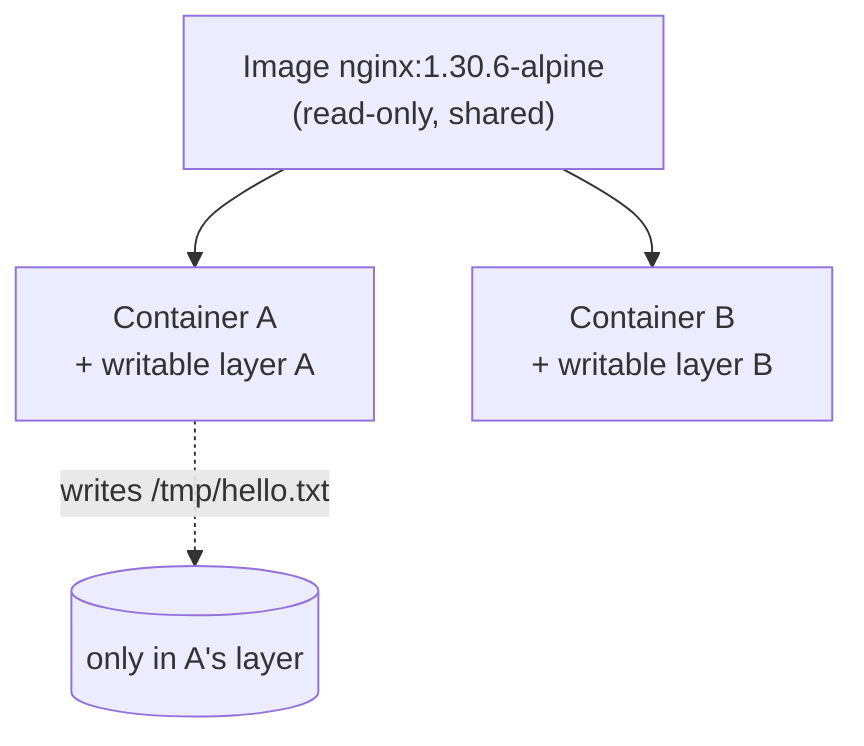
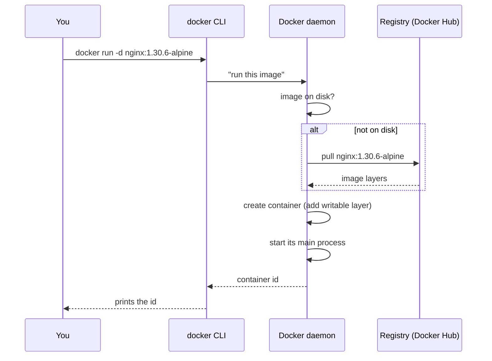
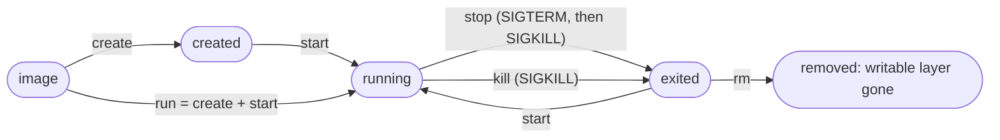

# Docker 01 — Images, containers and their lifecycle

> **Course:** [Docker](./README.md)  ·  **Time:** ~30 min  ·  **Needs:** nothing (Docker Desktop installed, see [Lab 00](../../labs/00-setup.md))
> **Used in the labs:** [Lab 01, step 2](../../labs/01-containers.md#step-2--a-minimal-api-in-a-container) (`docker build`, `docker run`), [Lab 02, step 6](../../labs/02-load-balancing.md#step-6--health-checks-and-failover) (`docker kill`, restart)

## What you will learn
- Tell an **image** from a **container**, and say which one you build and which one you run.
- Follow a container through its life: created, running, stopped, removed.
- Explain what is kept when a container stops, and what is lost when it is removed.
- Read the key `docker` commands for this: `create`, `start`, `run`, `ps`, `exec`, `stop`, `kill`, `rm`, `diff`.

## Words you need
| Word | Plain-words meaning |
|---|---|
| **Image** | A read-only package: a program plus everything it needs to run (files, libraries, settings). It never changes once built. |
| **Container** | A running (or stopped) copy made from an image: the program actually doing something, with its own private files. |
| **Docker daemon** | The background program (inside Docker Desktop) that really builds images and runs containers. |
| **Docker CLI** | The `docker` command you type. It only sends requests to the daemon. |
| **Writable layer** | A thin, private, empty layer that each container gets on top of its image. Everything the container writes goes there. |
| **Process** | A program that is currently running. A container is, at heart, one main process in a box. |
| **Signal** | A small message the system sends to a process. `SIGTERM` means "please finish and quit", `SIGKILL` means "you are stopped now, no discussion". |
| **Exit code** | A number a process leaves when it ends. `0` means success, anything else means something went wrong or it was stopped. |
| **Tag** | A label on an image version, like `1.30.6-alpine`. Details in [Docker 05](./README.md#modules). |

## The idea
**Analogy.** An image is a *recipe card* with every ingredient already measured and sealed in a box. It is read-only:
nobody can write on the card. A container is a *dish cooked from that card*. You can cook ten dishes from one card; if
you add salt to one dish, the card and the other nine dishes do not change. When you throw a dish away, the salt goes
with it, but the card is still in the drawer.

**Precisely.** An image is built once and shared (Docker pulls it from a registry or builds it from a Dockerfile). Starting
a container takes the image's files, adds an empty **writable layer** on top and starts the image's main process inside it.
The container sees one normal set of files, but only the top layer is its own. Many containers share the same image
files on disk, which is why starting ten of them is cheap.



**Who talks to whom when you type `docker run`:**


**The life of a container:**

An **exited** container is not gone: it keeps its writable layer and can be started again. Only `rm` deletes it.

## The commands, line by line
We use `nginx:1.30.6-alpine` (a small web server, already used by the lab's load balancer) just as a program that keeps running.

| Command | What it does | Flags and reading the result |
|---|---|---|
| `docker create --name course-demo-a IMG` | Makes a container from the image but does **not** start it. | `--name` gives it a readable name instead of a random one. Prints the container id. |
| `docker start course-demo-a` | Starts an existing container. | Re-uses its writable layer. |
| `docker run -d --name course-demo-b IMG` | `create` + `start` in one command. | `-d` ("detached") = run in the background and give the terminal back. Without it your terminal is stuck on the container's output. |
| `docker ps -a` | Lists containers. | `-a` includes stopped ones; without it only running ones. `STATUS` says `Created`, `Up …` or `Exited (code)`. `--filter name=x` keeps names containing `x`; `--format` chooses the columns. |
| `docker exec course-demo-a CMD` | Runs one more command inside a running container. | Use `sh -c '…'` to run a small shell line. `-it` is only for interactive use. |
| `docker diff course-demo-a` | Lists what the container changed compared to its image. | `A` added, `C` changed, `D` deleted. |
| `docker stop course-demo-a` | Asks the main process to quit (`SIGTERM`), waits up to 10 s, then forces it (`SIGKILL`). | The container becomes `Exited`. |
| `docker kill course-demo-b` | Sends `SIGKILL` at once. | No time to finish work. |
| `docker inspect -f '{{.State.ExitCode}}' NAME` | Prints one field of the container's details. | `-f` takes a Go template. |
| `docker rm course-demo-a` | Deletes a **stopped** container and its writable layer. | `docker rm -f` also stops it first. |
| `docker run --rm IMG CMD` | Run once, delete the container when it ends. | `--rm` removes the container automatically at exit. |

## Hands-on
Everything below ran on this laptop (Docker 29.2.1 on Docker Desktop, WSL2). Two containers from the same image, to see that each has its own files.

> **Windows tip (Git Bash only).** Git Bash rewrites anything that looks like a Linux path (`/tmp/...`) into a Windows path *before*
> Docker receives it. Put `MSYS_NO_PATHCONV=1` in front of the command (or `export` it) when an argument starts with `/`. PowerShell does not do this.

> **Output note.** `create`, `start`, `run -d`, `stop` and `kill` each print the container's name or id. Those lines are left out
> of the outputs below (they were redirected to `/dev/null` when captured) so you can focus on the interesting lines.

```bash
export MSYS_NO_PATHCONV=1                  # Git Bash only, see the tip above
IMG=nginx:1.30.6-alpine
docker create --name course-demo-a $IMG
docker ps -a --filter name=course-demo --format 'table {{.Names}}\t{{.Image}}\t{{.Status}}'
```
```text
NAMES           IMAGE                 STATUS
course-demo-a   nginx:1.30.6-alpine   Created
```
**Created, not running:** the box exists, its program has not started. Now start it and add a second one:
```bash
docker start course-demo-a
docker run -d --name course-demo-b $IMG
docker ps -a --filter name=course-demo --format 'table {{.Names}}\t{{.Image}}\t{{.Status}}'
```
```text
NAMES           IMAGE                 STATUS
course-demo-b   nginx:1.30.6-alpine   Up Less than a second
course-demo-a   nginx:1.30.6-alpine   Up Less than a second
```
Write a file inside **A only**, then look for it in both, and ask Docker what A changed:
```bash
docker exec course-demo-a sh -c 'echo hello > /tmp/hello.txt'
docker exec course-demo-a cat /tmp/hello.txt
docker exec course-demo-b cat /tmp/hello.txt
docker diff course-demo-a | grep ' /tmp'
```
```text
hello
cat: can't open '/tmp/hello.txt': No such file or directory
C /tmp
A /tmp/hello.txt
```
**How to read it:** A has the file, B does not: each container has its own writable layer. `docker diff` shows the layer's
content: `C /tmp` (the folder changed) and `A /tmp/hello.txt` (the file was added). The image itself was not touched.

Now stop A, check its state, start it again:
```bash
docker stop course-demo-a
docker inspect -f 'status={{.State.Status}} exit={{.State.ExitCode}}' course-demo-a
docker start course-demo-a
docker exec course-demo-a cat /tmp/hello.txt
```
```text
status=exited exit=0
hello
```
**Stopped is not deleted:** the file survived the stop/start. Exit code `0`: nginx quit cleanly when asked (`SIGTERM`).

Kill B instead:
```bash
docker kill course-demo-b
docker inspect -f 'status={{.State.Status}} exit={{.State.ExitCode}}' course-demo-b
```
```text
status=exited exit=137
```
**`137` = 128 + 9:** the process was ended by signal 9 (`SIGKILL`). This is what you will see in
[Lab 02, step 6](../../labs/02-load-balancing.md#step-6--health-checks-and-failover), where the failover test kills a replica on purpose.

## What if…?
**…you remove a container and create a new one from the same image?** The file is gone, because it lived in the removed writable layer.
```bash
docker stop course-demo-a
docker rm course-demo-a course-demo-b
docker run -d --name course-demo-a $IMG
docker exec course-demo-a cat /tmp/hello.txt
```
```text
course-demo-a
course-demo-b
cat: can't open '/tmp/hello.txt': No such file or directory
```
(`docker rm` prints the names it removed.) This is why containers must be **disposable**: anything worth keeping goes in
a *volume* (a folder managed by Docker outside the writable layer), see [Docker 08](./README.md#modules), or in a database.
It is also why the lab's API keeps no local state.

**…you use the Windows path trap on purpose?**
```bash
unset MSYS_NO_PATHCONV
docker run --rm $IMG echo /tmp
```
```text
C:/Users/ASUSG14/AppData/Local/Temp
```
(The `/tmp` was rewritten by Git Bash, not by Docker. Without the variable, my first attempt at this exercise silently wrote the file to a
wrong place.)

Clean up (the `--rm` run removes itself):
```bash
docker stop course-demo-a && docker rm course-demo-a
docker ps -a --filter name=course-demo
```
```text
course-demo-a
NAMES     IMAGE     STATUS
```

## In short
1. An **image** is a read-only recipe; a **container** is a dish made from it, with its own private writable layer.
2. Containers go *created → running → exited → removed*; only `rm` throws the container's files away.
3. `stop` asks politely (exit `0` here), `kill` forces (exit `137`); design containers to be thrown away.

## Check your understanding
1. Which one do you *build* and which one do you *run*: image or container?
2. You write a file in a running container and then run `docker stop` followed by `docker start` on it. Is the file still there?
3. You write a file, then `docker rm` the container and `docker run` the same image again. Is the file there?
4. What is the difference between `docker stop` and `docker kill`, and what exit code does a killed container show?
5. What does `-d` do in `docker run -d`, and what does `--rm` do?

<details><summary>Answers</summary>

1. You build an image and run a container (made from the image).
2. Yes: a stopped container is kept, with its writable layer.
3. No: `rm` deleted the old writable layer and the new container starts with a fresh one.
4. `stop` sends `SIGTERM` and waits up to 10 seconds before forcing; `kill` sends `SIGKILL` immediately. A killed container shows exit code `137` (128 + 9).
5. `-d` runs the container in the background and returns the terminal; `--rm` deletes the container automatically when it exits.

</details>

## Official documentation
- [What is an image?](https://docs.docker.com/get-started/docker-concepts/the-basics/what-is-an-image/)
- [What is a container?](https://docs.docker.com/get-started/docker-concepts/the-basics/what-is-a-container/)
- [`docker container run` reference](https://docs.docker.com/reference/cli/docker/container/run/)
- [`docker container diff` reference](https://docs.docker.com/reference/cli/docker/container/diff/)

## Where you use this in the project
- [Lab 01, step 2](../../labs/01-containers.md#step-2--a-minimal-api-in-a-container): `docker build` makes the API **image**, `docker run` starts a **container** from it.
- [Lab 01, step 3](../../labs/01-containers.md#step-3--describe-the-api-as-a-compose-service): Compose starts and re-creates containers for you.
- [Lab 02, step 6](../../labs/02-load-balancing.md#step-6--health-checks-and-failover): `docker kill` on a replica, then a restart.
- [Lab 03, step 8](../../labs/03-networking.md#step-8--public-and-private-networks): `docker compose up -d` **re-created** the containers, which is safe because the API is stateless.
