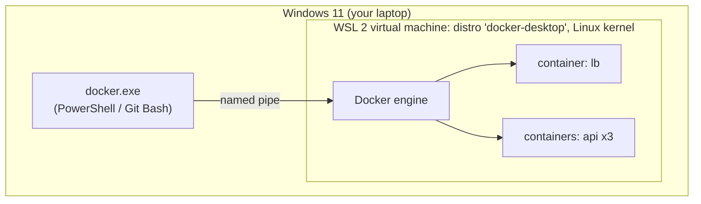
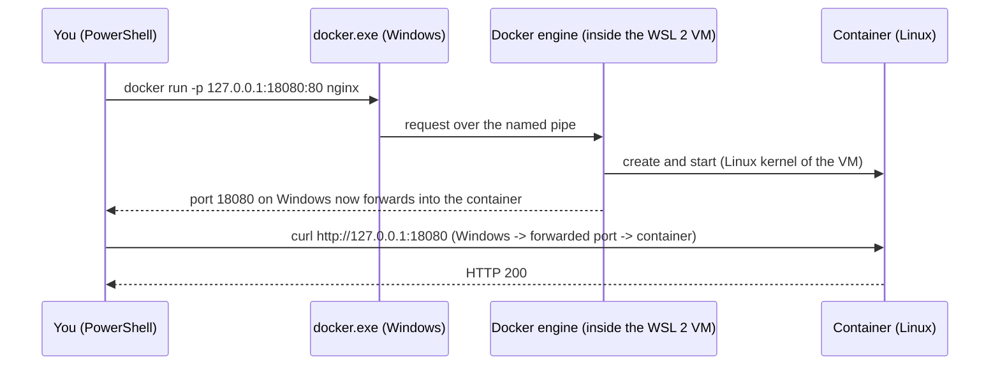

# Docker 02 — Docker Desktop on Windows (WSL2)

> **Course:** [Docker](./README.md)  ·  **Time:** ~30 min  ·  **Needs:** [Docker 01 — Images, containers and their lifecycle](./01-images-and-containers.md)
> **Used in the labs:** [Lab 00](../../labs/00-setup.md#step-1--check-the-tools-and-create-the-repo-skeleton) (tool check), [Lab 03, step 9](../../labs/03-networking.md#step-9--an-isolation-test) (why a check behaves differently on Windows), Lab 09 step 31 (cAdvisor)

## What you will learn
- Explain why Docker on Windows needs a Linux virtual machine, and what **WSL 2** is.
- Name the three layers between you and a container on this laptop: the `docker` command, the Docker engine, the Linux VM.
- Predict what is reachable from Windows and what is not: published ports, container addresses, shared folders.
- Know where memory and CPU limits for all your containers come from, and how to change them.

## Words you need
| Word | Plain-words meaning |
|---|---|
| **Kernel** | The core of an operating system: the part that talks to the hardware and starts programs. Every container uses the kernel of the machine it runs on. |
| **Virtual machine (VM)** | A whole computer simulated by software, with its own kernel, running inside your real computer. |
| **WSL 2** | "Windows Subsystem for Linux, version 2": a feature of Windows that runs a *real Linux kernel* inside a lightweight virtual machine, so Linux programs run on Windows. |
| **Distribution (distro)** | One installed Linux system inside WSL (Ubuntu, Debian…). Docker Desktop installs its own, called `docker-desktop`. |
| **Docker Desktop** | The Windows application that bundles the Docker engine, the `docker` command, a settings screen and the WSL 2 plumbing. |
| **Docker engine (daemon)** | The background program that really builds images and runs containers. It runs *inside* the Linux VM. |
| **`docker` command (client)** | The program you type in PowerShell or Git Bash. It only sends requests to the engine. |
| **Named pipe** | A Windows way for two programs on the same PC to talk (a private channel with a name, like `\\.\pipe\dockerDesktopLinuxEngine`). |
| **Context** | A saved answer to "which Docker engine am I talking to?". |
| **Bind mount** | Showing a folder of the host to a container, so both see the same files. |
| **Published port** | A container port that is made reachable on the host machine (`-p 127.0.0.1:18080:80`). |
| **Go template** | A tiny pattern language Docker uses in `--format` / `-f` options to pick fields out of its output, for example `{{.Server.Os}}` = "the operating system of the engine". |

## The idea
**Analogy.** Containers are Linux tenants, and Windows has no Linux apartment. Docker Desktop builds a small, sealed **Linux apartment inside your Windows house** (the WSL 2 virtual machine) and runs
every container in it. The `docker` command you type is a **remote control in your living room**: it sends orders to the apartment. The apartment has its own street numbers (container addresses) that
the rest of the house cannot see, so a **mail slot** (a published port) is cut into the wall for the few things you want to reach, and a **shared shelf** (a bind mount) lets both sides see the same files.

**Precisely.** A container is not a tiny computer: it is a process that shares the **kernel** of its host. A Linux container therefore needs a Linux kernel. Windows has a different kernel, so Docker Desktop
starts a lightweight VM with a real Linux kernel (via WSL 2) and runs the engine inside it. Your Windows `docker.exe` talks to that engine through a named pipe. Everything we built in the labs
(Nginx, FastAPI, Postgres…) runs in that VM.



**What happens when you type `docker run -p 127.0.0.1:18080:80 nginx...`:**


## The commands
| Command | What it does | Flags and reading the result |
|---|---|---|
| `docker version --format '...'` | Prints the versions of the **client** and of the **server** (the engine). | `--format` takes a Go template. If client and server differ in `Os`, that is the VM at work. |
| `docker info --format '...'` | Prints facts about the engine and the machine it runs on. | `.KernelVersion`, `.NCPU` (CPUs it may use), `.MemTotal` (memory in bytes), `.OperatingSystem`. |
| `docker run --rm IMG sh -c 'uname -sr'` | Runs one command in a throw-away container. | `uname -sr` prints the kernel name and version the container sees. |
| `docker context ls` | Lists the engines the client knows. | A `*` marks the one in use. |
| `wsl.exe --list --verbose` | (Windows) Lists the WSL distros and whether they run. | `STATE Running`, `VERSION 2` = WSL 2. |
| `docker run -v HOSTPATH:/data:ro` | Shows a host folder inside the container at `/data`. | `:ro` = read-only, so the container cannot change your files. |
| `docker system df` | Shows how much disk Docker uses. | `RECLAIMABLE` is what unused images, containers and cache could free. |

## Hands-on
Captured on this laptop (Windows 11, Docker 29.2.1). Git Bash users: `export MSYS_NO_PATHCONV=1` first ([Docker 01](./01-images-and-containers.md#hands-on)).

**1. The client and the engine are two different programs on two different systems.**
```bash
docker version --format 'client: {{.Client.Os}}/{{.Client.Arch}} {{.Client.Version}} | server: {{.Server.Os}}/{{.Server.Arch}} {{.Server.Version}}'
```
```text
client: windows/amd64 29.2.1 | server: linux/amd64 29.2.1
```
`windows` is the command you typed; `linux` is the engine, in the VM. (`amd64` is the 64-bit PC processor family.)

**2. What the engine runs on.**
```bash
docker info --format 'OS={{.OperatingSystem}} | Kernel={{.KernelVersion}} | CPUs={{.NCPU}} | Memory={{.MemTotal}} bytes | Driver={{.Driver}}'
```
```text
OS=Docker Desktop | Kernel=6.6.87.2-microsoft-standard-WSL2 | CPUs=16 | Memory=16393637888 bytes | Driver=overlayfs
```
**How to read it:** the kernel name ends in `microsoft-standard-WSL2`: a Linux kernel built by Microsoft for WSL 2. The VM may use 16 CPUs (all the logical processors of this laptop) and about 16.4 GB, which is
15.3 GiB: roughly **half of this machine's 31 GB of RAM**. That is the default WSL 2 limit (half the RAM of Windows, see the Microsoft link below); **every container shares this one budget**.
`overlayfs` is how Docker stacks image layers and the container's writable layer ([Docker 01](./01-images-and-containers.md)).

**3. A container sees Linux, not Windows.**
```bash
docker run --rm nginx:1.30.6-alpine sh -c 'uname -sr; head -2 /etc/os-release'
```
```text
Linux 6.6.87.2-microsoft-standard-WSL2
NAME="Alpine Linux"
ID=alpine
```
Same kernel as the engine (it is *the* kernel of the VM). Alpine Linux is the small distribution inside the Nginx image: the image brings its own programs and files, the VM brings the kernel.

**4. WSL's own view (run in PowerShell).**
```powershell
wsl.exe --list --verbose
```
```text
  NAME              STATE           VERSION
* docker-desktop    Running         2
```
Only one distro exists here, `docker-desktop`, running as WSL version 2. (If you also use Ubuntu in WSL it appears as a second row.)

**5. Which engine the client talks to.**
```bash
docker context ls
```
```text
NAME              DESCRIPTION                               DOCKER ENDPOINT                             ERROR
default           Current DOCKER_HOST based configuration   npipe:////./pipe/docker_engine              
desktop-linux *   Docker Desktop                            npipe:////./pipe/dockerDesktopLinuxEngine   
```
The `*` is on `desktop-linux`, and its endpoint is a **named pipe**: no network is involved between the command and the engine.

**6. A shared folder: a Windows folder seen from a Linux container.**
```bash
docker run --rm -v "$PWD/docs/courses:/data:ro" nginx:1.30.6-alpine ls /data
```
```text
README.md
_TEMPLATE.md
docker
networking
```
Those are the files of this project's `docs/courses` folder on the Windows disk, listed from inside a Linux container. In Git Bash `$PWD` looks like `/c/Users/...`, and Docker Desktop understands that form. In PowerShell the same folder is
written `${PWD}/docs/courses` (not run here). Keep project folders **inside the WSL/Linux side or accept slower file access**: reading Windows folders through a bind mount crosses the VM boundary and is slower than files that
live inside the VM (see the Docker link below).

**7. What you can reach from Windows: a published port, yes; a container address, no.**
```bash
docker run -d --rm --name course-wsl-demo -p 127.0.0.1:18080:80 nginx:1.30.6-alpine
IP=$(docker inspect -f '{{range .NetworkSettings.Networks}}{{.IPAddress}}{{end}}' course-wsl-demo)
curl -s -o /dev/null -w 'published port 127.0.0.1:18080 -> HTTP %{http_code}\n' --max-time 3 http://127.0.0.1:18080/
curl -s -o /dev/null -w "container address $IP -> HTTP %{http_code}\n" --max-time 3 "http://$IP/"; echo "curl exit code: $?"
docker run --rm nginx:1.30.6-alpine wget -q -O /dev/null -T 3 "http://$IP/" && echo "container -> container: OK"
docker stop course-wsl-demo
```
```text
published port 127.0.0.1:18080 -> HTTP 200
container address 172.17.0.2 -> HTTP 000
curl exit code: 28
container -> container: OK
```
**How to read it:** the published port works (the mail slot). The container's own address `172.17.0.2` is **not reachable from Windows** (`HTTP 000`, curl exit code 28 = timed out), yet another container reaches it fine, because
both live inside the VM. (`docker run -d` and `docker stop` also print the container id and name; omitted above.)

**8. How much disk Docker uses.**
```bash
docker system df
```
```text
TYPE            TOTAL     ACTIVE    SIZE      RECLAIMABLE
Images          27        15        41.24GB   25.27GB (61%)
Containers      20        4         720.8MB   720.7MB (99%)
Local Volumes   7         4         221.1MB   65.51MB (29%)
Build Cache     55        0         18.15GB   18.03GB
```
Everything lives in one virtual disk file of the VM, which grows as you pull images and build, and does not always shrink by itself. This laptop's numbers include images from other projects. (We did not run any cleanup command here.)

## What if…?
**…you want containers to use less memory?** The limit belongs to the **VM**, not to a container. It is set in a Windows file, `%UserProfile%\.wslconfig`, which Docker Desktop's WSL 2 backend honours. A typical content (this is the format from the Microsoft docs;
we did **not** change your settings):
```ini
[wsl2]
memory=8GB
processors=8
```
After editing, run `wsl.exe --shutdown` and start Docker Desktop again. Individual containers can also be capped (`docker run --memory 512m`, or `deploy.resources` in Compose).

**…the check "the API container address is not reachable from the host" passes even when the isolation is broken?** Hands-on step 7 is the reason: on Docker Desktop **no** container address is reachable from Windows, protected or not.
That is why [Lab 03, step 9](../../labs/03-networking.md#step-9--an-isolation-test) treats that check as a second line of defence and relies on "what is published" and "which networks are internal".

## In short
1. Containers need a Linux kernel, so Docker Desktop runs your engine inside a WSL 2 virtual machine; `docker.exe` is just a remote control.
2. From Windows you reach containers only through **published ports**; container addresses and Docker networks live inside the VM.
3. One VM, one memory/CPU budget (default: half your RAM) shared by all containers; change it in `.wslconfig`, and watch the disk file grow.

## Check your understanding
1. Why can a Windows PC run a Linux container, although Windows and Linux have different kernels?
2. In `docker version`, the client says `windows` and the server says `linux`. What does that tell you?
3. Your laptop has 32 GB of RAM and `docker info` reports about 16 GB. Is it a bug? Where is the limit set?
4. `curl http://172.17.0.2/` hangs from PowerShell but `curl http://127.0.0.1:18080/` works. What is the difference?
5. Why are the project's containers fast to start again after `docker compose down` and `up`?

<details><summary>Answers</summary>

1. The container does not run on Windows' kernel: Docker Desktop starts a lightweight VM (WSL 2) with a real Linux kernel, and the container runs there.
2. The `docker` program you typed is a Windows program, but the engine that does the work is Linux, running inside the VM.
3. No, it is the default: the WSL 2 VM may use half of the RAM. The limit is the `memory=` setting in `%UserProfile%\.wslconfig` (then `wsl --shutdown`).
4. The container address exists only inside the VM's networks; the published port was forwarded by Docker Desktop to Windows' `127.0.0.1`.
5. The images are already stored in the VM's disk, and a container is just a process on the already running kernel: nothing is installed or booted (see [Docker 01](./01-images-and-containers.md)).

</details>

## Official documentation
- [Docker Desktop: WSL 2 backend](https://docs.docker.com/desktop/features/wsl/) (including the note about file performance)
- [Microsoft: what is WSL?](https://learn.microsoft.com/windows/wsl/about) and [advanced settings in `.wslconfig`](https://learn.microsoft.com/windows/wsl/wsl-config)
- [Docker: contexts](https://docs.docker.com/engine/manage-resources/contexts/)
- [Docker: bind mounts](https://docs.docker.com/engine/storage/bind-mounts/)

## Where you use this in the project
- [Lab 00, step 1](../../labs/00-setup.md#step-1--check-the-tools-and-create-the-repo-skeleton): the environment check lists Docker Desktop and its version.
- [Lab 00, section 2.5](../../labs/00-setup.md#25-docker-and-make-in-five-minutes): Docker in five minutes.
- [Lab 03, step 9](../../labs/03-networking.md#step-9--an-isolation-test): why container addresses are never reachable from the host here.
- Later: Lab 09 step 31 (cAdvisor reads container statistics through the VM, which may need extra settings) and Lab 04 (named volumes live on the VM's disk, not in your Windows folders).
