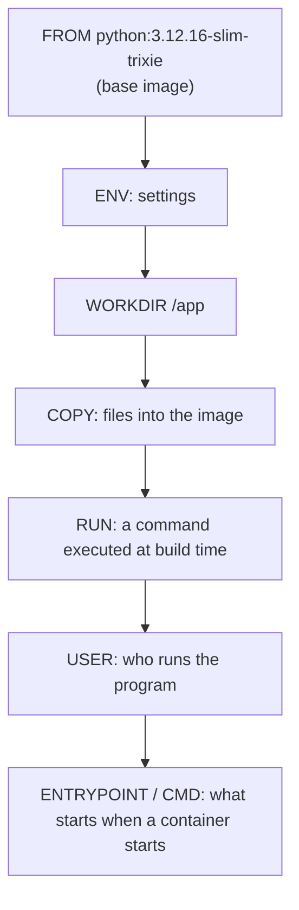
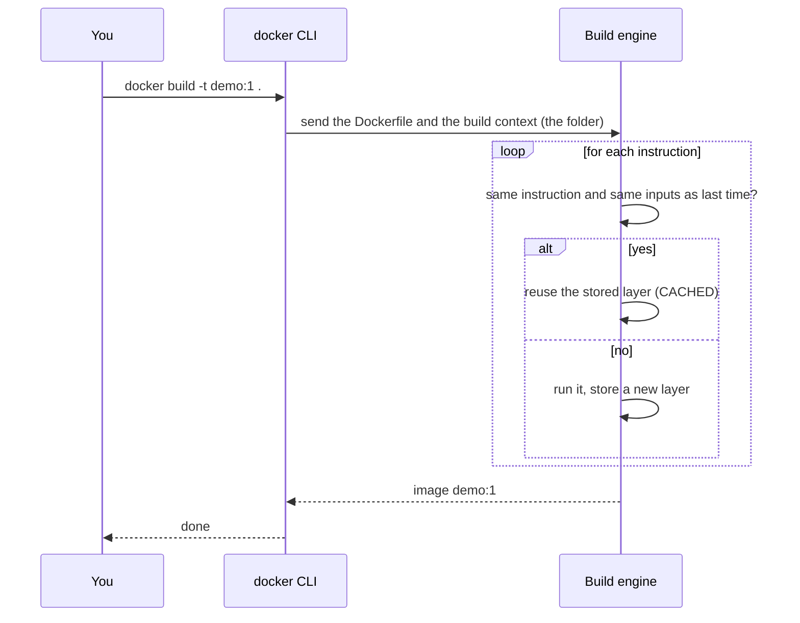

# Docker 03 — Dockerfile instructions

> **Course:** [Docker](./README.md)  ·  **Time:** ~40 min  ·  **Needs:** [Docker 01 — Images, containers and their lifecycle](./01-images-and-containers.md)
> **Used in the labs:** [Lab 01, step 2](../../labs/01-containers.md#step-2--a-minimal-api-in-a-container) (`api/Dockerfile`); the worker image of Lab 07 uses the same instructions

## What you will learn
- Read any Dockerfile line by line and say what each instruction does.
- Tell `CMD` from `ENTRYPOINT`, and `ENV` from a value given at run time.
- Explain why the project's container runs as a normal user, not as `root`.
- See with your own eyes that one instruction = one layer, and why the order of instructions matters.

## Words you need
| Word | Plain-words meaning |
|---|---|
| **Dockerfile** | A text file of instructions that Docker follows, top to bottom, to build an image. |
| **Instruction** | One line of a Dockerfile, starting with a keyword in capitals (`FROM`, `COPY`, `RUN`…). |
| **Base image** | The image you start from (`FROM`). Everything you add goes on top of it. |
| **Build** | Running the instructions to produce an image (`docker build`). |
| **Build context** | The folder you give to `docker build`; only files from it can be copied into the image. |
| **Layer** | The result of one instruction, stored as a read-only slice of the image. See [Docker 01](./01-images-and-containers.md). |
| **Build cache** | Docker's memory of layers it already built, so an unchanged instruction is not run again. |
| **Environment variable** | A named setting handed to a program from outside, like `GREETING=hello`; the program reads it by name. |
| **Working directory** | The folder a program starts in; relative paths are resolved from it. |
| **User / UID** | The account a program runs as; the UID is its number. `root` (UID 0) can do anything inside the container; a normal user cannot. |
| **Exec form** | Writing a command as a JSON list, `["python", "hello.py"]`: Docker starts the program directly, with no shell in between. |
| **Go template** | A tiny pattern language Docker uses in `--format` options to pick fields out of its output, for example `{{.Config.User}}`. |

## The idea
**Analogy.** A Dockerfile is the **recipe card for packing the sealed lunch box** (the image). It says: "start from this ready-made base box, put the salt in, set the
table here, copy these ingredients in, run this preparation step, and when someone opens the box, serve this dish". Docker follows the card line by line, and after each
line it **photographs the result** (a layer). If you change line 4 tomorrow, lines 1–3 are the same photos as yesterday, so only line 4 and the ones after it are redone.

**Precisely.** `docker build` reads the Dockerfile, runs each instruction on top of the previous result and stores one layer per instruction. Instructions that *change the
filesystem* (`COPY`, `RUN`) add real content; the others (`ENV`, `USER`, `EXPOSE`, `CMD`…) only record **settings** in the image's metadata, which a container reads when it
starts.



**Who does what during `docker build .`:**


## The code, line by line
First the project's real file, `api/Dockerfile`:

```dockerfile
FROM python:3.12.16-slim-trixie

ENV PYTHONDONTWRITEBYTECODE=1 \
    PYTHONUNBUFFERED=1

WORKDIR /app

# Dependencies first: this layer is cached until requirements.txt changes.
COPY requirements.txt .
RUN pip install --no-cache-dir -r requirements.txt

COPY main.py .

# Never run as root inside the container.
RUN useradd --system --uid 10001 --no-create-home app
USER app

EXPOSE 8000
CMD ["uvicorn", "main:app", "--host", "0.0.0.0", "--port", "8000"]
```
(In a Dockerfile a `#` starts a comment only at the beginning of a line; written after an instruction it becomes part of that instruction. That is why the comments sit on their own lines.) The table numbers the instructions 1 to 10 in
the order they appear:

| # | What it does | If you change or remove it |
|---|---|---|
| 1 `FROM` | Starts from the official Python image, pinned to an exact version ([Docker 05](./README.md#modules)). Every Dockerfile begins with one. | `python:latest` would change under you; another version may break the app. |
| 2 `ENV` | Sets two environment variables for the build **and** for every container: no `.pyc` files, and Python prints logs immediately instead of buffering them. | Without `PYTHONUNBUFFERED=1`, `docker logs` may show output late or not at all. |
| 3 `WORKDIR /app` | Creates `/app` and makes it the current folder for the next instructions and for the running program. | Files would land in `/`; `COPY ... .` would copy there. |
| 4 `COPY requirements.txt .` | Copies one file from the build context into the current folder (`.` = `/app`). | `COPY . .` would copy everything and break the cache trick below. |
| 5 `RUN pip install ...` | Runs a command **at build time** and keeps the result as a layer. `--no-cache-dir` stops pip from storing downloads (smaller image). | Remove it and the app has no libraries. |
| 6 `COPY main.py .` | Copies the application code, **after** the libraries. | Put it before step 5 and every code edit reinstalls all libraries (hands-on step 7). |
| 7 `RUN useradd ...` | Creates an unprivileged account: `--system` (a service account), `--uid 10001` (a fixed number), `--no-create-home` (no personal folder). | Without it, step 8 fails: the user must exist first. |
| 8 `USER app` | Everything after this, **including the running program**, uses this account instead of `root`. | Remove it and the API runs as `root` inside the container (hands-on step 4). |
| 9 `EXPOSE 8000` | Documents that the program listens on 8000. It is only a note: it does **not** publish the port (`-p` or `ports:` does, [Lab 01](../../labs/01-containers.md)). | Removing it changes nothing at run time. |
| 10 `CMD [...]` | The default command a container runs when it starts, in exec form. | A shell-form `CMD uvicorn ...` would start through `/bin/sh`, which can swallow stop signals ([Docker 01](./01-images-and-containers.md)). |

To see `ENTRYPOINT`, `CMD` and run-time overrides in action, we build a tiny demo image from this file (and a `hello.py` that prints its greeting, its arguments, the user and the folder):

```dockerfile
FROM python:3.12.16-slim-trixie
ENV GREETING=hello
WORKDIR /app
COPY hello.py .
RUN useradd --system --uid 10001 --no-create-home demo
USER demo
EXPOSE 8000
ENTRYPOINT ["python", "hello.py"]
CMD ["world"]
```
```python
import os, sys
print("%s, %s! (uid=%d, cwd=%s)" % (os.environ["GREETING"], " ".join(sys.argv[1:]), os.getuid(), os.getcwd()))
```
| Instruction | Role |
|---|---|
| `ENTRYPOINT ["python", "hello.py"]` | **The program** the container always runs. |
| `CMD ["world"]` | The **default arguments** given to it. Words typed after the image name in `docker run` replace `CMD`, and `ENTRYPOINT` stays. |

## The commands
| Command | What it does | Flags and reading the result |
|---|---|---|
| `docker build -t NAME:TAG .` | Builds an image from the Dockerfile in the current folder (`.` = the build context). | `-t` names the image. `--progress=plain` prints every step as plain text. |
| `docker run --rm IMAGE [ARGS]` | Runs a container; words after the image replace `CMD`. | `--rm` deletes the container at exit. |
| `docker run -e NAME=value` | Sets or replaces an environment variable for this run only. | Beats the `ENV` in the Dockerfile. |
| `docker run --entrypoint PROG` | Replaces `ENTRYPOINT` for this run (here: `id`, to print who we are). | |
| `docker run --user root` | Runs as another account for this run only. | `root` = UID 0. |
| `docker image inspect IMAGE --format '...'` | Prints the settings stored in the image. | `.Config.Entrypoint`, `.Cmd`, `.User`, `.WorkingDir`, `.ExposedPorts`. |
| `docker history IMAGE` | Lists the layers, newest first, with the instruction that made each. | `--no-trunc` shows whole lines; `--format` chooses columns. |
| `docker image rm NAME:TAG` | Deletes the image tag. | Layers used by other images stay. |

## Hands-on
Captured on this laptop (Docker 29.2.1). The files above live in a scratch folder; run the commands there. Git Bash users: no path arguments are involved, so no `MSYS_NO_PATHCONV` is needed.

**Build the demo image:**
```bash
docker build -t course-dockerfile-demo:1 .
```
The log ends with these lines (trimmed). The warning comes from `useradd` and also appears when you build the project's API image; it is harmless: system accounts normally get numbers below 1000, and we chose 10001 on purpose.
```text
#8 [4/4] RUN useradd --system --uid 10001 --no-create-home demo
#8 0.366 useradd warning: demo's uid 10001 is greater than SYS_UID_MAX 999
#9 naming to docker.io/library/course-dockerfile-demo:1 done
```

**1. Run it with the defaults.**
```bash
docker run --rm course-dockerfile-demo:1
```
```text
hello, world! (uid=10001, cwd=/app)
```
`hello` comes from `ENV`, `world` from `CMD`, `uid=10001` from `USER`, `/app` from `WORKDIR`: four instructions, four visible effects.

**2. Replace `CMD`** by typing arguments after the image name:
```bash
docker run --rm course-dockerfile-demo:1 there
```
```text
hello, there! (uid=10001, cwd=/app)
```
**3. Replace the `ENV`** value for this run:
```bash
docker run --rm -e GREETING=hi course-dockerfile-demo:1 friend
```
```text
hi, friend! (uid=10001, cwd=/app)
```
The same image behaves differently per environment: this is how the lab configures the API with variables ([Docker 06](./README.md#modules)).

**4. Who am I? `USER` against forcing `root`.**
```bash
docker run --rm --entrypoint id course-dockerfile-demo:1
docker run --rm --user root --entrypoint id course-dockerfile-demo:1
```
```text
uid=10001(demo) gid=999(demo) groups=999(demo)
uid=0(root) gid=0(root) groups=0(root)
```
By default the program is the unprivileged `demo`; `--user root` shows what it would be without the `USER` line. A flaw in the app would then give an attacker `root` inside the container, with the power
to change anything in it. (`gid=999` is the group `useradd --system` created.)

**5. What the image remembers.**
```bash
docker image inspect course-dockerfile-demo:1 --format 'Entrypoint={{.Config.Entrypoint}} Cmd={{.Config.Cmd}} User={{.Config.User}} WorkingDir={{.Config.WorkingDir}} Expose={{.Config.ExposedPorts}}'
```
```text
Entrypoint=[python hello.py] Cmd=[world] User=demo WorkingDir=/app Expose=map[8000/tcp:{}]
```
These are the settings (metadata) that a container reads at start. `EXPOSE` is stored as a note only.

**6. One instruction, one layer.**
```bash
docker history course-dockerfile-demo:1 --format 'table {{.CreatedBy}}' --no-trunc
```
```text
CREATED BY
CMD ["world"]
ENTRYPOINT ["python" "hello.py"]
EXPOSE [8000/tcp]
USER demo
RUN /bin/sh -c useradd --system --uid 10001 --no-create-home demo # buildkit
COPY hello.py . # buildkit
WORKDIR /app
ENV GREETING=hello
CMD ["python3"]
RUN /bin/sh -c set -eux; for src in idle3 pip3 pydoc3 ...        (older lines: the Python base image)
```
(Trimmed.) Our nine instructions are the top lines; below them are the layers of the base image we started from.

**7. The build cache, and what invalidates it.** Rebuild with nothing changed, then change `hello.py` and rebuild (only the step lines are shown):
```bash
docker build --progress=plain -t course-dockerfile-demo:1 .
echo '# changed again' >> hello.py
docker build --progress=plain -t course-dockerfile-demo:1 .
```
First build (A, nothing changed):
```text
#6 [2/4] WORKDIR /app
#6 CACHED
#7 [3/4] COPY hello.py .
#7 CACHED
#8 [4/4] RUN useradd --system --uid 10001 --no-create-home demo
#8 CACHED
```
Second build (B, after changing `hello.py`):
```text
#6 [2/4] WORKDIR /app
#6 CACHED
#7 [3/4] COPY hello.py .
#7 DONE 0.0s
#8 [4/4] RUN useradd --system --uid 10001 --no-create-home demo
#8 DONE 0.3s
```
**How to read it:** with nothing changed, every step is `CACHED` and the build takes no time. After changing `hello.py`, `WORKDIR` (before the change) stays cached, but `COPY` is redone, and so is the `RUN` **after**
it, although its own text did not change: *once one layer changes, every layer after it is rebuilt*. That is why the project's Dockerfile copies `requirements.txt` and installs the libraries **before** it
copies `main.py`: editing the code only redoes the last steps, and the slow `pip install` stays cached ([Docker 04](./README.md#modules)).

Clean up the demo image:
```bash
docker image rm course-dockerfile-demo:1
```
```text
Untagged: course-dockerfile-demo:1
Deleted: sha256:c49ac95a1893f79362f44253cd9b4da11959c98217511610ac020f43c026ee38
```
(The second line is the id of the image that happened to be removed in our run; yours differs.)

## What if…?
**…you force `root` or drop the `USER` line?** Hands-on step 4 is that experiment: `uid=0(root)`. Nothing breaks, which is exactly the danger: the container works either way, so the missing line goes unnoticed until it matters.
**…you put `COPY main.py .` before `RUN pip install`?** Then step 6 changes on every code edit and, as in hands-on step 7B, every layer after it, including the slow installation, is rebuilt each time. The order of the instructions in the project's file is a deliberate speed-up (we show the cache effect with the demo, we did not time the API build).

## In short
1. A Dockerfile is a recipe: each instruction makes one layer, or stores a setting that a container reads at start.
2. `ENTRYPOINT` is the program, `CMD` its default arguments; `ENV`, `CMD` and `USER` can all be overridden at `docker run`.
3. Put rarely-changing steps first (libraries) and often-changing ones last (your code), and run as an unprivileged `USER`.

## Check your understanding
1. What is the difference between `RUN` and `CMD`?
2. You run `docker run --rm demo:1 there`. Which instruction did the word `there` replace, and which stayed?
3. Why does the project's Dockerfile `COPY requirements.txt` and `RUN pip install` *before* it copies `main.py`?
4. A teammate removes the `USER app` line and everything still works. Why is that not a harmless change?
5. Does `EXPOSE 8000` make the API reachable from your browser?

<details><summary>Answers</summary>

1. `RUN` executes a command **while building** and keeps the result in the image; `CMD` sets the default command a **container runs when it starts**.
2. It replaced `CMD ["world"]`; `ENTRYPOINT ["python", "hello.py"]` stayed.
3. So the slow library installation stays in the build cache when only the code changes: a changed layer rebuilds everything after it, so the rarely-changing steps go first.
4. The program would run as `root` inside the container, so a vulnerability in the app gives an attacker far more power. The app works either way, which hides the change.
5. No. `EXPOSE` is documentation only; the port must be published with `-p` or `ports:` (the load balancer does that in this project).

</details>

## Official documentation
- [Dockerfile reference](https://docs.docker.com/reference/dockerfile/)
- [Building best practices](https://docs.docker.com/build/building/best-practices/)
- [Docker build cache](https://docs.docker.com/build/cache/)
- [`docker build` reference](https://docs.docker.com/reference/cli/docker/buildx/build/)

## Where you use this in the project
- [Lab 01, step 2](../../labs/01-containers.md#step-2--a-minimal-api-in-a-container): `api/Dockerfile`, explained line by line above.
- [Lab 01, step 3](../../labs/01-containers.md#step-3--describe-the-api-as-a-compose-service): Compose builds the image with `build: ./api`.
- Later: the worker image (Lab 07) is built with the same instructions.
