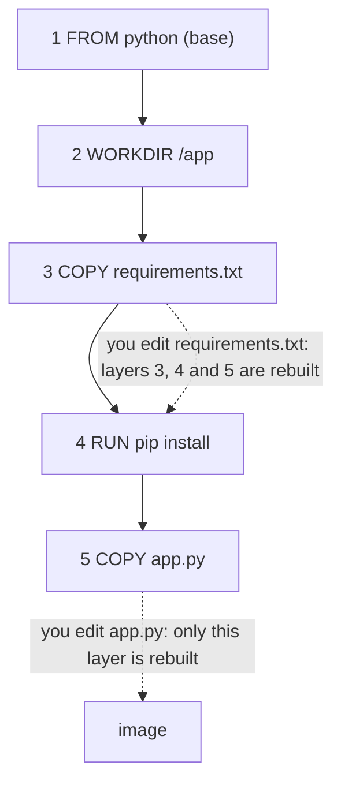
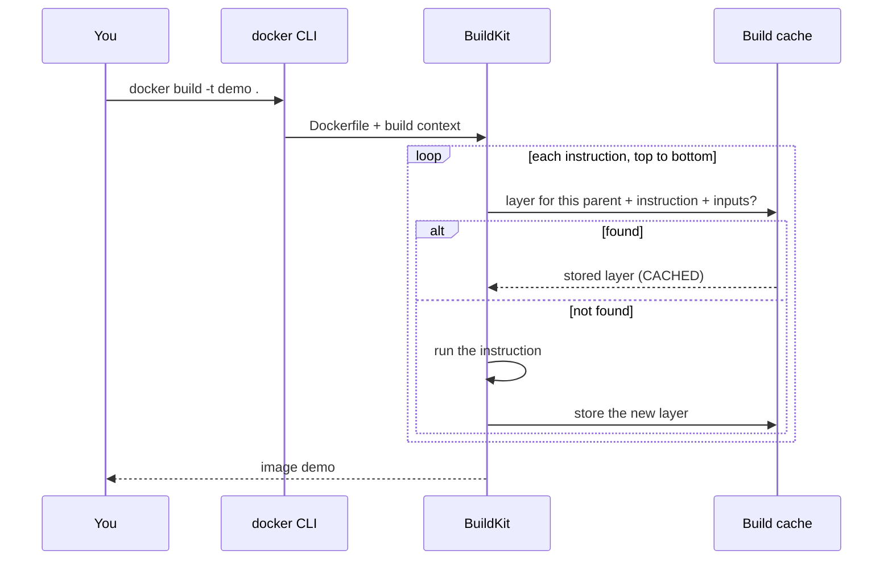

# Docker 04 — Layers and the build cache

> **Course:** [Docker](./README.md)  ·  **Time:** ~40 min  ·  **Needs:** [Docker 03 — Dockerfile instructions](./03-dockerfile.md)
> **Used in the labs:** [Lab 01, step 2](../../labs/01-containers.md#step-2--a-minimal-api-in-a-container) (`api/Dockerfile`: libraries before code); [Lab 04, step 11](../../labs/04-database.md#step-11--the-database-layer-the-first-migration-and-the-migrate-job) (new files added to the same image)

## What you will learn
- Say what a **layer** is and why an image is a stack of them.
- Predict, for any edit, which steps of a build are reused (**CACHED**) and which run again.
- Explain why `COPY requirements.txt` + `RUN pip install` come **before** `COPY` of the code.
- Read `docker history` to see the layers and their sizes.

## Words you need
| Word | Plain-words meaning |
|---|---|
| **Image** | The sealed package a container starts from: files plus settings. See [Docker 01](./01-images-and-containers.md). |
| **Layer** | The change made by one Dockerfile instruction, stored as a read-only slice. The image is the stack of all slices. |
| **Build** | Running the Dockerfile instructions, top to bottom, to produce an image (`docker build`). |
| **Build cache** | Docker's memory of layers it has already built. |
| **Cache hit** | Docker finds a stored layer for this exact instruction and reuses it: the step shows `CACHED` and takes no time. |
| **Cache miss** | No stored layer matches, so Docker runs the instruction and stores a new layer. |
| **Invalidate** | To make a stored layer unusable. Changing an instruction or the files it copies invalidates its layer **and every layer after it**. |
| **BuildKit** | The build engine inside modern Docker. It prints the `#1 [1/5] ...` progress lines you will read below. |
| **Build context** | The folder given to `docker build` (the last argument). Only files from it can be copied into the image. |
| **Pin** | Write an exact version (`six==1.15.0`) instead of "whatever is newest", so the result does not change by surprise. |

## The idea
**Analogy.** Think of building a **layer cake**. Each Dockerfile instruction bakes one layer on top of the previous one, and you keep every baked layer in the fridge. Tomorrow you
want the same cake with different icing: the sponge layers are the same, so you take them out of the fridge and only redo the icing. But if you change the **bottom** layer,
everything above it is built on something different, so all of it must be baked again. The order of the layers decides how much work a small change costs.

**Precisely.** For each instruction Docker asks: "do I already have a layer made from *this parent layer* with *this instruction* and *these inputs*?"
- For `COPY`/`ADD` the inputs are the **contents** of the copied files (not their dates).
- For `RUN` the input is only the **text of the command**. Docker does not look at what the command downloads.
- If the answer is yes, it reuses the layer (`CACHED`). If no, it runs the instruction. And once one step misses, **every later step misses too**, because their parent is now new.



**Who does what during a rebuild:**


## The code, line by line
Two Dockerfiles that build the same tiny app (`app.py` prints a line, `requirements.txt` lists one library). They differ **only in the order** of the instructions.

```dockerfile
# GOOD order: libraries first, code last
FROM python:3.12.16-slim-trixie
WORKDIR /app
COPY requirements.txt .
RUN pip install --no-cache-dir -r requirements.txt
COPY app.py .
CMD ["python", "app.py"]
```
```dockerfile
# BAD order: everything copied first
FROM python:3.12.16-slim-trixie
WORKDIR /app
COPY . .
RUN pip install --no-cache-dir -r requirements.txt
CMD ["python", "app.py"]
```
(Comments sit on their own lines: in a Dockerfile a `#` after an instruction would become part of it.)

| Line | What it does | If you change or remove it |
|---|---|---|
| `FROM python:3.12.16-slim-trixie` | Base image, pinned to an exact version. Its layers come ready-made. | A different tag means a different parent for every layer: the whole cache is useless. |
| `WORKDIR /app` | Creates and enters `/app`. A tiny layer. | Without it, `COPY ... .` copies into `/`. |
| `COPY requirements.txt .` (good) | Copies **one small file**. The layer changes only when that file's content changes. | Copy more files and the layer changes more often. |
| `RUN pip install ... -r requirements.txt` | Installs the libraries: the **slow** step (minutes with real projects). Cached while the layer above is unchanged. | Put it after a frequently changing layer and it reruns on every build. |
| `COPY app.py .` (good) | Copies the code **last**: the layer that changes most often is the top one, so an edit rebuilds only this one. | Move it above the `RUN` and each edit reinstalls all libraries. |
| `COPY . .` (bad) | Copies the **whole folder**, code included, before the install. Any edit to any file changes this layer. | See the hands-on: `pip install` reruns after a one-word edit of `app.py`. |
| `CMD [...]` | Default start command. Only a setting, so it adds 0 bytes. | See [Docker 03](./03-dockerfile.md). |

The project's own `api/Dockerfile` follows the good order. Since [Lab 04, step 11](../../labs/04-database.md#step-11--the-database-layer-the-first-migration-and-the-migrate-job) its copy
instructions are `COPY main.py db.py alembic.ini ./` and `COPY migrations ./migrations`, still **after** the `pip install` line: editing `db.py` rebuilds only those copy
layers, while adding a library to `requirements.txt` reinstalls them all.

## The commands
| Command / flag | Meaning |
|---|---|
| `docker build -t NAME:TAG DIR` | Build an image from the Dockerfile in `DIR` (also the build context) and name it `NAME:TAG`. |
| `--progress=plain` | Print every build line one after the other (no animated display), so you can read and copy it. |
| `#4 [4/5] RUN pip install ...` | One step. `[4/5]` = instruction 4 of 5. |
| `CACHED` | Cache hit for that step. |
| `DONE 1.8s` | The step ran and took 1.8 seconds. |
| `docker history IMAGE` | Lists the layers of an image, **newest first**, with the instruction that made each and its size. |
| `--format 'table {{.CreatedBy}}\t{{.Size}}'` | Choose the columns (a Go template, see [Docker 03](./03-dockerfile.md)). |
| `docker build --no-cache` | Ignore the cache and run every step (not used below). |
| `docker rmi IMAGE` | Delete a local image (used at the end to clean up). |

## Hands-on
Everything runs in a throw-away folder; nothing touches the project. The helper `b` below runs a build and rewrites BuildKit's long output as **one line per step**, in order
(the raw output is much longer; this is the same information).

```bash
mkdir cachedemo && cd cachedemo && mkdir bad good
printf 'six==1.16.0\n' > bad/requirements.txt;  printf 'six==1.15.0\n' > good/requirements.txt
printf 'print("version 10")\n' | tee bad/app.py > good/app.py
# (write the two Dockerfiles from the section above into bad/Dockerfile and good/Dockerfile)

b() { docker build --progress=plain -t "course-cache-$1:$2" "$1" 2>&1 | awk '
/^#[0-9]+ \[[0-9]+\/[0-9]+\]/ { id=$1; match($0,/\[[0-9]+\//); k=substr($0,RSTART+1,RLENGTH-2)+0; kid[id]=k
  nm=$0; sub(/^#[0-9]+ \[[0-9]+\/[0-9]+\] /,"",nm); name[k]=substr(nm,1,52); if (k>max) max=k }
/^#[0-9]+ CACHED/ { if ($1 in kid) st[kid[$1]]="CACHED" }
/^#[0-9]+ DONE/   { if (($1 in kid) && !(kid[$1] in st)) st[kid[$1]]="ran (" $3 ")" }
END { for (k=1;k<=max;k++) printf "  [%d] %-52s %s\n", k, name[k], st[k] }'; }

echo "### BAD order";  b bad 10
printf 'print("version 11")\n' > bad/app.py;  b bad 11          # edit the code, rebuild
echo "### GOOD order"; b good 10
printf 'print("version 11")\n' > good/app.py; b good 11         # same edit, rebuild
docker run --rm course-cache-good:11
docker history --format 'table {{.CreatedBy}}\t{{.Size}}' course-cache-good:11 | head -9
```
```text
### BAD order
  [1] FROM docker.io/library/python:3.12.16-slim-trixie@sh ran (0.0s)
  [2] WORKDIR /app                                         CACHED
  [3] COPY . .                                             ran (0.0s)
  [4] RUN pip install --no-cache-dir -r requirements.txt   ran (1.8s)
  ... (second build, after editing app.py)
  [1] FROM docker.io/library/python:3.12.16-slim-trixie@sh ran (0.0s)
  [2] WORKDIR /app                                         CACHED
  [3] COPY . .                                             ran (0.0s)
  [4] RUN pip install --no-cache-dir -r requirements.txt   ran (1.9s)
### GOOD order
  [1] FROM docker.io/library/python:3.12.16-slim-trixie@sh ran (0.0s)
  [2] WORKDIR /app                                         CACHED
  [3] COPY requirements.txt .                              ran (0.0s)
  [4] RUN pip install --no-cache-dir -r requirements.txt   ran (1.8s)
  [5] COPY app.py .                                        ran (0.0s)
  ... (second build, after editing app.py)
  [1] FROM docker.io/library/python:3.12.16-slim-trixie@sh ran (0.0s)
  [2] WORKDIR /app                                         CACHED
  [3] COPY requirements.txt .                              CACHED
  [4] RUN pip install --no-cache-dir -r requirements.txt   CACHED
  [5] COPY app.py .                                        ran (0.0s)
version 11
CREATED BY                                      SIZE
CMD ["python" "app.py"]                         0B
COPY app.py . # buildkit                        12.3kB
RUN /bin/sh -c pip install --no-cache-dir -r…   9.77MB
COPY requirements.txt . # buildkit              12.3kB
WORKDIR /app                                    8.19kB
CMD ["python3"]                                 0B
RUN /bin/sh -c set -eux;  for src in idle3 p…   16.4kB
RUN /bin/sh -c set -eux;   savedAptMark="$(a…   41.4MB
```
**How to read it:**
- **Bad order, second build.** The only change was one word in `app.py`, but `COPY . .` copies the whole folder, so its layer changed (`ran`) and so did every layer after it:
  **`pip install` ran again** (1.9 s here; minutes in a real project).
- **Good order, second build.** The same edit only changed `COPY app.py .`, the last layer. Steps 2, 3 and 4 are `CACHED`: no reinstall.
- `FROM ... ran (0.0s)` is only a check: the base image is already on the laptop. `WORKDIR /app` is `CACHED` even in the first builds because an earlier build on this laptop
  had already made that exact layer (same parent, same instruction): **layers are shared between images**.
- `docker history` reads from newest (top) to oldest. The libraries are the big layer of *our* part (9.77 MB); `COPY` of a few small files is 12 kB; `CMD` is 0 B because it only
  records a setting. The 41.4 MB at the bottom belongs to the Python base image.

## What if…?
**…you change `requirements.txt` in the good version?** Real result (library changed to `six==1.14.0`):
```text
  [1] FROM docker.io/library/python:3.12.16-slim-trixie@sh ran (0.0s)
  [2] WORKDIR /app                                         CACHED
  [3] COPY requirements.txt .                              ran (0.0s)
  [4] RUN pip install --no-cache-dir -r requirements.txt   ran (2.0s)
  [5] COPY app.py .                                        ran (0.0s)
```
Layer 3 changed, so 4 **and** 5 are rebuilt, although `app.py` did not change: *a change invalidates its layer and everything after it*. Running the same build again, with nothing
changed, shows `CACHED` on steps 2 to 5.

**A trap:** `RUN pip install somelibrary` (no version) is cached by its **text**. A new release of the library changes nothing for Docker, so you keep the old layer until the cache
is cleared. That is one more reason to pin versions, as this project does.

Clean up: `docker rmi course-cache-bad:10 course-cache-bad:11 course-cache-good:10 course-cache-good:11 course-cache-good:12`.

## In short
1. An image is a stack of read-only layers, one per instruction; a build reuses (`CACHED`) every layer whose instruction and inputs are unchanged.
2. A change invalidates its layer and all layers after it, so put what changes **rarely** (base image, libraries) first and what changes **often** (your code) last.
3. `docker history` shows the layers and sizes; pinning versions keeps cached layers honest.

## Check your understanding
1. What does `CACHED` next to a build step mean?
2. You edit one line in `app.py`. Which layers are rebuilt with the good Dockerfile? And with the bad one?
3. Why does `COPY requirements.txt .` come before `RUN pip install`, and `COPY app.py .` after it?
4. For a `RUN` instruction, what does Docker compare to decide on a cache hit: the command text, or what the command downloads?
5. Why does `CMD` show `0B` in `docker history`?

<details><summary>Answers</summary>

1. Docker found a stored layer for that exact instruction on that exact parent, so it reused it instead of running the step.
2. Good: only `COPY app.py .` (the last layer). Bad: `COPY . .` and `RUN pip install`, because the copy layer changed and everything after it is rebuilt.
3. The install layer only needs to change when the library list changes. Copying just `requirements.txt` first means the slow install is cached until that file changes; the code, which
   changes all the time, is copied last so edits only touch the top layer.
4. Only the command text (plus the parent layer). It does not look at what the command downloads, so unpinned installs can stay stale.
5. It only records a setting in the image's metadata; it adds no files, so the layer has no content.

</details>

## Official documentation
- [Docker build cache](https://docs.docker.com/build/cache/)
- [Cache invalidation](https://docs.docker.com/build/cache/invalidation/)
- [Dockerfile best practices](https://docs.docker.com/build/building/best-practices/)
- [`docker image history`](https://docs.docker.com/reference/cli/docker/image/history/)

## Where you use this in the project
- [Lab 01, step 2](../../labs/01-containers.md#step-2--a-minimal-api-in-a-container): `api/Dockerfile` copies `requirements.txt` and installs before copying the code.
- [Lab 04, step 11](../../labs/04-database.md#step-11--the-database-layer-the-first-migration-and-the-migrate-job): the three new libraries changed `requirements.txt`, so the install ran once; `db.py`, `alembic.ini` and `migrations/` were then copied **after** the install line, so they only added layers on top. Both `api` and `migrate` use this one image.
