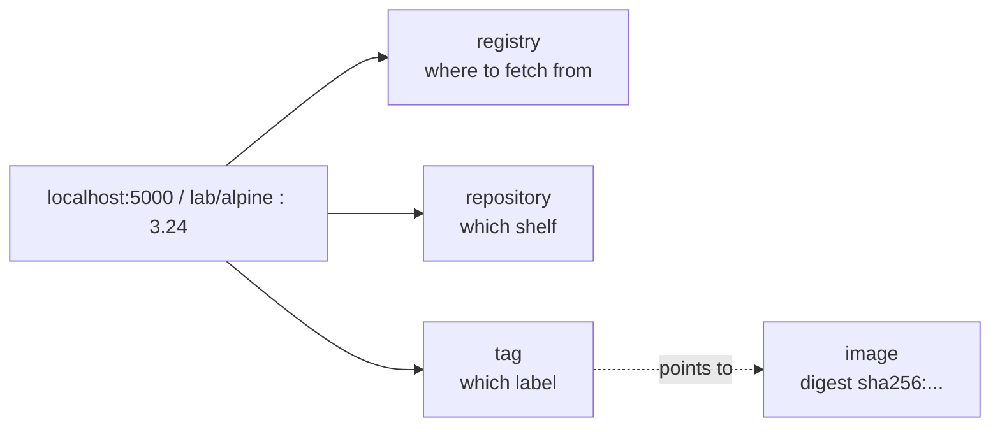
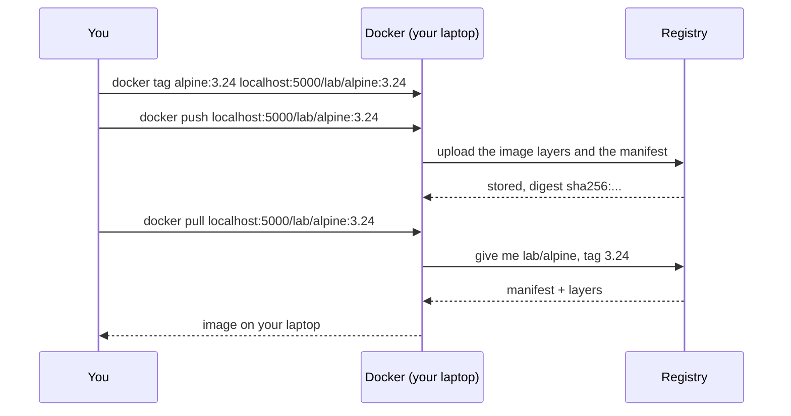

# Docker 05 — Tags, digests and registries

> **Course:** [Docker](./README.md)  ·  **Time:** ~40 min  ·  **Needs:** [Docker 01 — Images, containers and their lifecycle](./01-images-and-containers.md)
> **Used in the labs:** [Lab 01, step 2](../../labs/01-containers.md#step-2--a-minimal-api-in-a-container) (`FROM python:3.12.16-slim-trixie`), [Lab 02](../../labs/02-load-balancing.md) (`nginx:1.30.6-alpine`), [Lab 04, step 10](../../labs/04-database.md#step-10--the-postgres-container) (`postgres:18.7-alpine3.24`)

## What you will learn
- Read an image name such as `localhost:5000/lab/alpine:3.24` part by part: registry, repository, tag.
- Explain what a **tag** is (a movable label) and what a **digest** is (a fixed fingerprint), and why this project never uses `:latest`.
- Push an image to a **registry** and pull it back, using a throw-away local registry.
- Say what **Amazon ECR** is and how it fits.

## Words you need
| Word | Plain-words meaning |
|---|---|
| **Image** | The sealed package a container starts from. See [Docker 01](./01-images-and-containers.md). |
| **Registry** | A server that stores images and hands them out. Docker Hub (`docker.io`) is the best-known one; Amazon ECR is AWS's. |
| **Repository** | One shelf of a registry: all the versions of one image (`python`, `postgres`, `lab/alpine`). |
| **Tag** | A human-readable label stuck on an image inside a repository (`3.12.16-slim-trixie`). One image can have several tags, and a tag can be moved to another image. |
| **Digest** | The image's **fingerprint**: `sha256:` followed by a long number computed from its content. Same content, same digest; any change, a different digest. |
| **Hash (SHA-256)** | A function that turns any data into a fixed-length fingerprint. Change one byte and the fingerprint is completely different. |
| **Layer** | One slice of an image (the result of one Dockerfile instruction). An image is a stack of layers; a registry stores them separately. See [Docker 04](./04-layers-and-build-cache.md). |
| **Manifest** | A small file that lists an image's layers and settings. A tag points to a manifest, and the digest is the fingerprint of that manifest. |
| **Go template** | The tiny pattern language inside `--format '{{.Field}}'` options, used to pick fields out of Docker's output. See [Docker 03](./03-dockerfile.md). |
| **Pull** | Download an image from a registry to your machine. |
| **Push** | Upload an image from your machine to a registry. |
| **Multi-platform image** | One name that holds several builds of the same image (for example for Intel and for ARM processors); Docker picks the one that fits your machine. |
| **`latest`** | The tag Docker uses when you write **no** tag. It is only a name: it means "whatever the publisher last pushed under that name". |

## The idea
**Analogy.** Picture a **warehouse of sealed jars** (the registry). Each shelf (a repository) holds the jars of one recipe. A **tag** is a **sticky note** on a jar: "stable", "3.12". You can peel
a note off and stick it on a different jar tomorrow, so "stable" does not always mean the same jar. The **digest** is the **serial number engraved in the glass**: it comes from what is inside, it
can never be moved, and two jars with the same serial number are the same jar.

**Precisely.** An image name has up to four parts: `REGISTRY/REPOSITORY:TAG@DIGEST`. When you leave out the registry Docker means Docker Hub (`docker.io`), and for official images the repository
`library/`. So `python:3.12.16-slim-trixie` really is `docker.io/library/python:3.12.16-slim-trixie`. A tag is **mutable** (the publisher may point it at a new image, which is how `3.12` receives security
fixes); a digest is **immutable**. Pinning a full version tag, as this project does, keeps surprises away; pinning the digest removes them entirely.



**Who does what during `docker push` and `docker pull`:**


## The code, line by line
The image names used by this project, each part explained:

```text
python:3.12.16-slim-trixie        # api/Dockerfile (FROM)
nginx:1.30.6-alpine               # docker-compose.yml, lb
postgres:18.7-alpine3.24          # docker-compose.yml, postgres
aws-local-lab-api:0.1.0           # docker-compose.yml, api and migrate (built here, not pulled)
```

| Name | What each part means | If you change or remove it |
|---|---|---|
| `python:3.12.16-slim-trixie` | Repository `python` on Docker Hub; tag = version `3.12.16` + variant `slim` (few extra tools, smaller) + `trixie` (built on Debian 13, codename *trixie*). | `python:3.12` would silently move to newer patch versions; `python` alone means `latest`. |
| `nginx:1.30.6-alpine` | Nginx `1.30.6` built on Alpine Linux (a very small distribution). | Another version can change configuration behaviour. |
| `postgres:18.7-alpine3.24` | PostgreSQL `18.7` on Alpine `3.24`. A *major* version (18 to 19) needs a data migration. | See [Lab 04](../../labs/04-database.md#step-10--the-postgres-container). |
| `aws-local-lab-api:0.1.0` | A name we choose ourselves for the image we **build**; no registry part, so it exists only on this machine. | With a registry prefix (`123456789012.dkr.ecr...`) the same image could be pushed to ECR. |

## The commands
| Command / flag | Meaning |
|---|---|
| `docker image ls` | List local images. `--digests` adds the DIGEST column; `--filter reference=NAME:TAG` keeps only matching images (repeat the flag to list several); `--format` chooses columns. |
| `docker inspect --format '{{index .RepoDigests 0}}' IMAGE` | Print the image's full `repository@sha256:...` name (Go template, see [Docker 03](./03-dockerfile.md)). |
| `docker tag SOURCE TARGET` | Add another name (tag) to an existing image. It copies nothing: both names point to the same image. |
| `docker pull NAME[:TAG\|@sha256:...]` | Download an image; by tag or by exact digest. |
| `docker push NAME:TAG` | Upload an image to the registry named in its **name**. |
| `docker rmi NAME:TAG` | Remove one tag; the image itself is deleted when its last tag goes. |
| `docker run --rm -d --name N -p 127.0.0.1:5000:5000 IMAGE` | Start a container in the background (`-d`), deleted on stop (`--rm`), named `N`, reachable only from your own machine on port 5000. |
| `curl localhost:5000/v2/_catalog` | Ask a registry which repositories it holds (`/v2/...` is the standard registry API). |

## Hands-on
Everything is throw-away. The registry runs on `127.0.0.1` only, so nothing is sent outside your laptop (never push to a public registry by accident: the registry in the name decides where it goes).
Real output, trimmed (digests shortened with `…`).

**1. A tag and a digest, and a second tag on the same image**
```bash
docker tag alpine:3.24 course-demo/app:v1
docker image ls --digests --filter reference=python:3.12.16-slim-trixie --filter reference=alpine:3.24 --filter reference=course-demo/app:v1 \
  --format 'table {{.Repository}}\t{{.Tag}}\t{{.ID}}\t{{.Digest}}'
```
```text
REPOSITORY        TAG                   IMAGE ID       DIGEST
course-demo/app   v1                    f59abe656b69   <none>
alpine            3.24                  f59abe656b69   sha256:f59abe656b69…
python            3.12.16-slim-trixie   5e2bdb1b0d54   sha256:5e2bdb1b0d54…
```
`course-demo/app:v1` and `alpine:3.24` have the **same IMAGE ID**: `docker tag` only adds a name. (The digest is `<none>` for the new name because it has never been pushed to a registry.) In this Docker the
image ID happens to be the first characters of the digest.

**2. Pull by digest**
```bash
docker pull alpine@sha256:f59abe656b692d901e184be3445e084786602108599d2a51d229c0f5a48c71bf
```
```text
Digest: sha256:f59abe656b692d901e184be3445e084786602108599d2a51d229c0f5a48c71bf
Status: Image is up to date for alpine@sha256:f59abe656b692d901e184be3445e084786602108599d2a51d229c0f5a48c71bf
docker.io/library/alpine@sha256:f59abe656b692d901e184be3445e084786602108599d2a51d229c0f5a48c71bf
```
Asking for the **fingerprint** instead of the label: Docker already had exactly that content, so there was nothing to download. Anyone who pulls this digest gets this exact image, today or in five years.

**3. A tag is a movable label**
```bash
docker tag python:3.12.16-slim-trixie course-demo/app:stable
docker image ls --format '{{.Repository}}:{{.Tag}}  {{.ID}}' | grep 'course-demo/app:stable'
docker tag alpine:3.24 course-demo/app:stable        # move the same tag to a different image
docker image ls --format '{{.Repository}}:{{.Tag}}  {{.ID}}' | grep 'course-demo/app:stable'
```
```text
course-demo/app:stable  5e2bdb1b0d54
course-demo/app:stable  f59abe656b69
```
The tag `stable` first meant the Python image, then (after one command) the Alpine image. Anyone using `course-demo/app:stable` would have got a **different program** without changing a character. That is the danger of
loose tags.

**4. A real registry: push, look inside, pull back**
```bash
docker run --rm -d --name course-registry -p 127.0.0.1:5000:5000 registry:3.0.0
docker tag alpine:3.24 localhost:5000/lab/alpine:3.24
docker push localhost:5000/lab/alpine:3.24
curl -s localhost:5000/v2/_catalog; echo
curl -s localhost:5000/v2/lab/alpine/tags/list; echo
docker rmi localhost:5000/lab/alpine:3.24          # remove the local tag
docker pull localhost:5000/lab/alpine:3.24         # get it back from the registry
```
```text
3.24: digest: sha256:0f49f331d9212aff…  size: 1022
 Info -> Not all multiplatform-content is present and only the available single-platform image was pushed
         sha256:f59abe656b69… -> sha256:0f49f331d9212aff…
{"repositories":["lab/alpine"]}
{"name":"lab/alpine","tags":["3.24"]}
Untagged: localhost:5000/lab/alpine:3.24
Digest: sha256:0f49f331d9212aff…
Status: Downloaded newer image for localhost:5000/lab/alpine:3.24
```
The `localhost:5000/` **in the name** told Docker where to push. The registry now holds one repository, `lab/alpine`, with one tag, `3.24`. After deleting the local tag, `docker pull` downloaded it again ("Downloaded newer image").
Stop the registry afterwards: `docker stop course-registry` (it was started with `--rm`, so it disappears), and remove the demo tags with `docker rmi`.

## What if…?
**…the digest changes when you push?** In exercise 4 the push printed the digest `sha256:0f49f331…`, but `alpine:3.24` has the digest `sha256:f59abe65…`. Docker explained it right under the push:
`Not all multiplatform-content is present and only the available single-platform image was pushed`. `alpine:3.24` is a **multi-platform** name: its digest identifies a small index that lists several builds. Only the
build matching this laptop was pushed, so the registry stored a different, smaller manifest with its own digest. Lesson: a digest identifies **exactly one thing**, and copying an image between registries can legitimately
create a new one.

**…you write no tag?** `docker pull alpine` means `alpine:latest`: the tag the publisher chose to move on every release. This project never does that (not run here, on purpose): the result would change between two builds.

## In short
1. An image name is `registry/repository:tag`; with no registry Docker uses Docker Hub, and with no tag it uses `latest`.
2. A **tag** is a label you can move; a **digest** is a fingerprint of the content and never changes. Pin full version tags (or digests) so builds do not change under you.
3. A **registry** stores images: `docker push` uploads to the registry written in the name, `docker pull` downloads. In AWS that registry is ECR.

## Check your understanding
1. In `postgres:18.7-alpine3.24`, which part is the repository and which is the tag?
2. You run `docker tag alpine:3.24 myapp:v1`. How much disk space does the second name take, and why?
3. Why is `python:3.12` less safe for reproducible builds than `python:3.12.16-slim-trixie`, and what is safer still?
4. What decides **where** `docker push` sends an image?
5. A colleague says "stable always points to the same image". Is that true for a tag? For a digest?

<details><summary>Answers</summary>

1. Repository `postgres` (on Docker Hub, the official one); tag `18.7-alpine3.24` (version 18.7 built on Alpine 3.24).
2. Essentially none: `docker tag` only adds a name; both names point to the same image (same IMAGE ID).
3. `python:3.12` is moved to new patch versions over time, so two builds weeks apart can differ. The full tag is much narrower; the safest is the digest (`python@sha256:...`), which is immutable.
4. The registry part of the image **name** (`localhost:5000/...` goes to the local registry, no prefix goes to Docker Hub, an ECR URI goes to AWS).
5. False for a tag (a tag can be moved to another image, as in exercise 3). True for a digest: it is derived from the content, so it identifies exactly one image.

</details>

## Official documentation
- [Docker image names and tags (`docker tag`)](https://docs.docker.com/reference/cli/docker/image/tag/)
- [`docker pull`, including pulling by digest](https://docs.docker.com/reference/cli/docker/image/pull/)
- [Docker Hub: official images](https://docs.docker.com/docker-hub/image-library/trusted-content/)
- [Run a local registry (distribution)](https://distribution.github.io/distribution/)
- [Amazon ECR: what it is](https://docs.aws.amazon.com/AmazonECR/latest/userguide/what-is-ecr.html)

## Where you use this in the project
- [Lab 01, step 2](../../labs/01-containers.md#step-2--a-minimal-api-in-a-container): `FROM python:3.12.16-slim-trixie`, a pinned tag.
- [Lab 02](../../labs/02-load-balancing.md) and [Lab 04, step 10](../../labs/04-database.md#step-10--the-postgres-container): `nginx:1.30.6-alpine` and `postgres:18.7-alpine3.24`. The rule "never `:latest`" is in `CLAUDE.md`.
- The image we build ourselves (`aws-local-lab-api:0.1.0`) has no registry in its name, so it only exists on your laptop. In Lab 11 (planned) it will be loaded straight into the local Kubernetes cluster with `k3d image import`; in real AWS you would push it to **ECR**
  and every server would pull it from there (the [AWS course](../aws/README.md) module 03 on ECS and EKS is not written yet).
