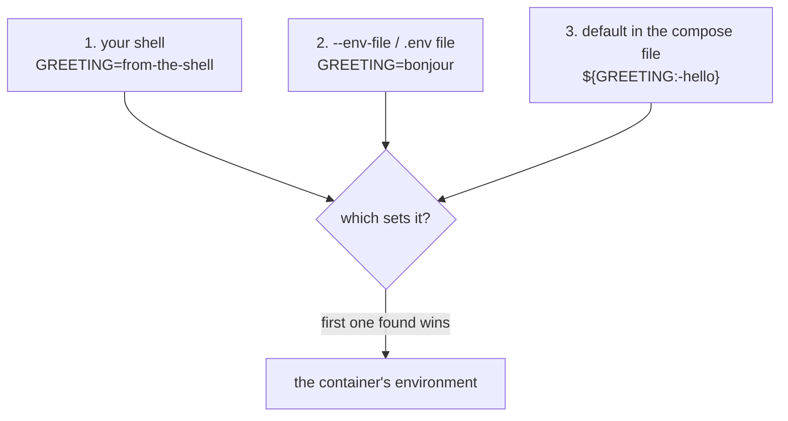
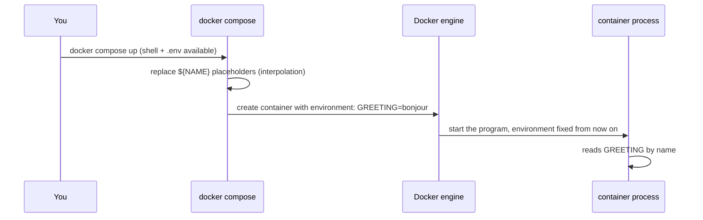

# Docker 06 — Environment variables, config and secrets

> **Course:** [Docker](./README.md)  ·  **Time:** ~40 min  ·  **Needs:** [Docker 01 — Images, containers and their lifecycle](./01-images-and-containers.md)
> **Used in the labs:** [Lab 01, step 3](../../labs/01-containers.md#step-3--describe-the-api-as-a-compose-service) (`UVICORN_LOG_LEVEL`), [Lab 04, step 10](../../labs/04-database.md#step-10--the-postgres-container) (`POSTGRES_PASSWORD`) and [step 11](../../labs/04-database.md#step-11--the-database-layer-the-first-migration-and-the-migrate-job) (`DATABASE_URL`)

## What you will learn
- Give a container its settings with `-e`, `--env-file` and Compose's `environment:`, instead of baking them into the image.
- Read the `${NAME:-default}` and `${NAME:?message}` forms, and say which source wins when several set the same variable.
- Explain why an environment variable is **not** a safe hiding place, and where this project keeps its secrets.
- Understand why changing a variable does not reach a container that is already running.

## Words you need
| Word | Plain-words meaning |
|---|---|
| **Environment variable** | A named setting handed to a program from outside, like `GREETING=hello`; the program reads it by name. |
| **Configuration (config)** | The settings that change between places (your laptop, a test, production): a port, a log level, a database address. |
| **Secret** | A config value that must stay private: a password, a token, a private key. |
| **Image** | The sealed package a container starts from. It should be the **same everywhere**; only the config changes. See [Docker 01](./01-images-and-containers.md). |
| **`.env` file** | A text file of `NAME=value` lines. Compose reads a file called `.env` next to `docker-compose.yml` automatically, to fill in `${NAME}` placeholders. |
| **`.env.example`** | A copy of `.env` with **fake** values, committed to Git so others know which variables exist. The real `.env` is never committed. |
| **Interpolation** | Compose replacing `${NAME}` in the compose file with the variable's value before it does anything else. |
| **Default value** | The text after `:-` in `${NAME:-default}`, used when `NAME` is not set. |
| **Precedence** | The order that decides which source wins when two of them set the same variable. |
| **Shell** | The program that reads your commands (Git Bash, PowerShell). Variables you set in it are *shell variables*. |
| **Secrets manager** | A service that stores secrets and hands them to authorised programs: AWS Secrets Manager, AWS Systems Manager Parameter Store. |

## The idea
**Analogy.** Picture the sealed lunch box (the image) that always contains the same recipe. The **labels you stick on it** when you hand it over ("less salt", "serve at 12:00") are the *configuration*: the box does not change, the labels do.
A **secret** is the combination of the safe. You do not write it on the label, because everyone who handles the box can read the label.

**Precisely.** A program should read its settings from the **environment** (a list of `NAME=value` pairs the operating system gives every process), so the same image runs on your laptop and in production with different values.
Docker lets you set that list when the container is **created**. Compose adds a layer of convenience: placeholders like `${NAME}` in the compose file, filled from your shell and a `.env` file. Environment variables are good for *config*; for *secrets* they are only
a convenience: they are readable by anyone who can inspect the container (hands-on 3).



**Who hands values to whom:**


## The code, line by line
The project's own lines, from `docker-compose.yml` and `.env.example`:

```yaml
    environment:
      UVICORN_LOG_LEVEL: ${API_LOG_LEVEL:-info}       # api: log level, "info" if not set
      POSTGRES_USER: ${POSTGRES_USER:-lab}            # postgres: first account
      POSTGRES_PASSWORD: ${POSTGRES_PASSWORD:?set POSTGRES_PASSWORD in .env (see .env.example)}   # no default on purpose
      DATABASE_URL: postgresql+psycopg://${POSTGRES_USER:-lab}:${POSTGRES_PASSWORD:?...}@postgres:5432/${POSTGRES_DB:-lab}   # built from the pieces
```
```bash
# .env.example (committed, fake values)
LB_HOST_PORT=80
POSTGRES_PASSWORD=change-me-local-only
```

| Line | What it does | If you change or remove it |
|---|---|---|
| `UVICORN_LOG_LEVEL: ${API_LOG_LEVEL:-info}` | Sets the variable `UVICORN_LOG_LEVEL` inside the container to the value of `API_LOG_LEVEL` from your shell or `.env`, or `info` if neither sets it. Uvicorn reads `UVICORN_*` variables, so no image change is needed. | Hard-code the value and every change means editing the compose file. |
| `${POSTGRES_USER:-lab}` | Same pattern for the database user: `lab` unless you say otherwise. | Remove `:-lab` and an unset variable becomes an empty text. |
| `${POSTGRES_PASSWORD:?message}` | `:?` means **required**: if it is not set, Compose stops with the message. There is deliberately **no default**, so a password can never end up in the repository. | Write `:-secret` and a real-looking password sits in Git. Remove `:?` and an empty password is accepted. |
| `DATABASE_URL: ...${POSTGRES_PASSWORD}...` | Compose assembles one value from several variables. The application only knows `DATABASE_URL`. | Keep the pieces in the code and the image is tied to one environment. |
| `.env.example` | Lists every variable with a harmless value. You copy it to `.env` and put your own values there. | Commit the real `.env` and your password is public. `.env` is in `.gitignore`. |

## The commands
| Command / flag | Meaning |
|---|---|
| `docker run -e NAME=value IMAGE` | Set one variable in the new container. `-e NAME` alone copies the value from your shell. |
| `docker run --env-file FILE IMAGE` | Read many `NAME=value` lines from a file. |
| `sh -c 'echo "$GREETING"'` | Run a command through a shell **inside** the container so the variable is expanded there, not by your own shell (the single quotes protect it). |
| `${#FAKE_TOKEN}` | Shell syntax: the **length** of a variable's value, handy to prove it arrived without printing it. |
| `docker inspect NAME --format '{{range .Config.Env}}{{println .}}{{end}}'` | Print the environment a container was created with, one `NAME=value` per line (a Go template, see [Docker 03](./03-dockerfile.md)). |
| `docker compose --env-file FILE ...` | Use `FILE` instead of `.env` to fill the `${...}` placeholders. |
| `docker compose -p NAME -f FILE run --rm -T SERVICE` | Run a one-off container of a service: `-p` project name, `-f` compose file, `--rm` delete it afterwards, `-T` no terminal. |
| `docker compose config -q` | Check the compose file and the placeholders; prints nothing when fine (and never prints values). |
| `env \| cut -d= -f1` | List only the **names** of the variables (everything before the first `=`), never the values. |

## Hands-on
Throw-away containers from `alpine:3.24`, **fake** values only (`not-a-real-secret-123`). Real output, trimmed. The two files used (`demo.env` and `demo.yml`) are shown in full.

```bash
printf 'GREETING=bonjour\nFAKE_TOKEN=not-a-real-secret-123\n' > demo.env
```
```yaml
# demo.yml
services:
  demo:
    image: alpine:3.24
    command: ["sh", "-c", "echo \"greeting=[$$GREETING]  token set? [$${FAKE_TOKEN:-no}]\""]
    environment:
      GREETING: ${GREETING:-hello}
```
(In a compose file `$$` means a literal `$`, so the container's shell expands the variable, not Compose.)

**1. `-e`, `--env-file`, and the value you never see**
```bash
docker run --rm -e GREETING=hello alpine:3.24 sh -c 'echo "GREETING=[$GREETING]  OTHER=[$OTHER]"'
docker run --rm --env-file demo.env alpine:3.24 sh -c 'echo "GREETING=[$GREETING]  token length: ${#FAKE_TOKEN}"'
```
```text
GREETING=[hello]  OTHER=[]
GREETING=[bonjour]  token length: 21
```
`OTHER` was never set, so it is simply empty (no error). The second container got both variables from the file; we proved the token arrived by printing only its **length** (21), not the value.

**2. Compose: default, file, and who wins**
```bash
docker compose -p course-env -f demo.yml run --rm -T demo                                   # a
docker compose -p course-env -f demo.yml --env-file demo.env run --rm -T demo               # b
GREETING=from-the-shell docker compose -p course-env -f demo.yml --env-file demo.env run --rm -T demo   # c
```
```text
greeting=[hello]  token set? [no]
greeting=[bonjour]  token set? [no]
greeting=[from-the-shell]  token set? [no]
```
(a) nothing set: the default after `:-` wins. (b) the file sets `GREETING`. (c) the **shell beats the file**: precedence is shell, then file, then default. Look at the second half of each line too: `FAKE_TOKEN` is in `demo.env` but `token set?` stays `no`. Compose
uses the file to fill `${...}` placeholders; it passes into the container **only** the variables the compose file lists under `environment:` (or `env_file:`). A variable in `.env` that no service mentions never reaches a container.

**3. An environment variable is not a hiding place**
```bash
docker run -d --rm --name course-env-test --env-file demo.env alpine:3.24 sleep 60
docker inspect course-env-test --format '{{range .Config.Env}}{{println .}}{{end}}' | grep -E 'GREETING|FAKE_TOKEN'
```
```text
GREETING=bonjour
FAKE_TOKEN=not-a-real-secret-123
```
Anyone who can run `docker inspect` on the machine reads the value in clear text. That is acceptable on your own laptop with fake credentials; for real secrets it is why production systems hand them out through a secrets manager and short-lived permissions instead.

**4. The project, names only**
```bash
docker compose exec -T --index 1 api sh -c 'env | cut -d= -f1 | grep -E "^(UVICORN|DATABASE)" | sort'
```
```text
DATABASE_URL
UVICORN_LOG_LEVEL
```
An API replica has `UVICORN_LOG_LEVEL` and `DATABASE_URL`. We printed only the **names**: `DATABASE_URL` contains the database password, and no output in this course shows it.

## What if…?
**…you change a variable while the container is running?** The environment is fixed when the container is **created**. Real result (container from exercise 3, still running, with `GREETING=bonjour`):
```bash
export GREETING=changed-on-the-host
docker exec course-env-test sh -c 'echo "inside the container: GREETING=[$GREETING]"'
echo "on the host:                GREETING=[$GREETING]"
```
```text
inside the container: GREETING=[bonjour]
on the host:                GREETING=[changed-on-the-host]
```
The running container still sees `bonjour`. To apply a new value you must **create a new container**: Compose does this for you when you run `docker compose up -d` after changing a service's configuration (it recreates the containers whose configuration changed; not run here). Remember the other half of the lesson from
[Lab 04](../../labs/04-database.md#step-10--the-postgres-container): Postgres only reads `POSTGRES_PASSWORD` when it starts on an **empty** volume, so changing it later does not change the password stored in the existing data.

**A required variable that is missing:**
```bash
docker compose -f required.yml config -q          # required.yml uses ${NEEDED:?set NEEDED in the environment}
NEEDED=x docker compose -f required.yml config -q && echo "config OK (exit 0)"
```
```text
error while interpolating services.demo.environment.NEEDED: required variable NEEDED is missing a value: set NEEDED in the environment
config OK (exit 0)
```
`:?` turns a forgotten setting into an immediate, readable error instead of a service that starts broken. Clean up: `docker stop course-env-test` and `docker compose -p course-env -f demo.yml down`.

## In short
1. Keep the image the same everywhere and pass **config** in through environment variables: `-e`, `--env-file`, or `environment:` with `${NAME:-default}` in Compose.
2. Precedence is **shell, then `.env` / `--env-file`, then the default**; use `${NAME:?message}` for values that must exist, and commit only `.env.example` with fake values.
3. Environment variables are visible to anyone who can inspect the container and are fixed at creation: fine for config, weak for secrets, which real systems keep in a secrets manager.

## Check your understanding
1. In `${LOG_LEVEL:-info}`, what happens when `LOG_LEVEL` is not set? And with `${PASSWORD:?missing}`?
2. The shell has `GREETING=a`, the `.env` file has `GREETING=b`, the compose file default is `c`. Which value does the container get?
3. A variable is listed in `.env` but no service mentions it under `environment:`. Does a container see it?
4. Why can you not hide a password from other users of the machine just by passing it with `-e`?
5. You edit `.env` while the containers run. What must happen before the program sees the new value?

<details><summary>Answers</summary>

1. `:-info` falls back to `info`. `:?missing` makes Compose stop with the message `missing`; nothing starts.
2. `a`: the shell wins over the `.env` file, which wins over the default.
3. No. `.env` only fills `${...}` placeholders; a variable reaches a container only if the compose file passes it (`environment:` or `env_file:`).
4. `docker inspect` prints the container's whole environment in clear text, so anyone with Docker access can read it.
5. A **new container** must be created (for example by `docker compose up -d`, which recreates changed services): a running container keeps the environment it was created with.

</details>

## Official documentation
- [Set environment variables in a container (`docker run -e`, `--env-file`)](https://docs.docker.com/reference/cli/docker/container/run/#env)
- [Environment variables in Compose](https://docs.docker.com/compose/how-tos/environment-variables/)
- [Order of precedence](https://docs.docker.com/compose/how-tos/environment-variables/envvars-precedence/)
- [Compose interpolation (`:-`, `:?`)](https://docs.docker.com/reference/compose-file/interpolation/)
- [The Twelve-Factor App: config](https://12factor.net/config)
- [AWS Secrets Manager: what it is](https://docs.aws.amazon.com/secretsmanager/latest/userguide/intro.html)

## Where you use this in the project
- [Lab 01, step 3](../../labs/01-containers.md#step-3--describe-the-api-as-a-compose-service): `UVICORN_LOG_LEVEL: ${API_LOG_LEVEL:-info}` and the first `.env.example`.
- [Lab 04, step 10](../../labs/04-database.md#step-10--the-postgres-container): `POSTGRES_PASSWORD` with `:?`, no default, and why a missing value stops Compose.
- [Lab 04, step 11](../../labs/04-database.md#step-11--the-database-layer-the-first-migration-and-the-migrate-job): `DATABASE_URL` built from the `POSTGRES_*` pieces and shared by the `api` and `migrate` services.
- [Lab 04, step 13](../../labs/04-database.md#step-13--the-admin-profile-a-door-to-the-database-closed-by-default): `ADMIN_DB_PORT`, and a client container that reads `.env` with `--env-file` without ever printing the password.
