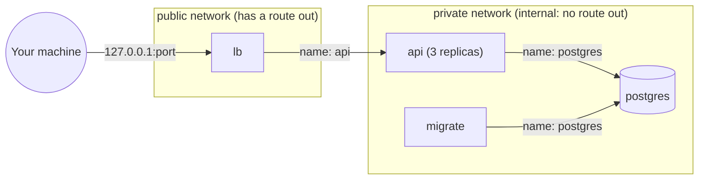
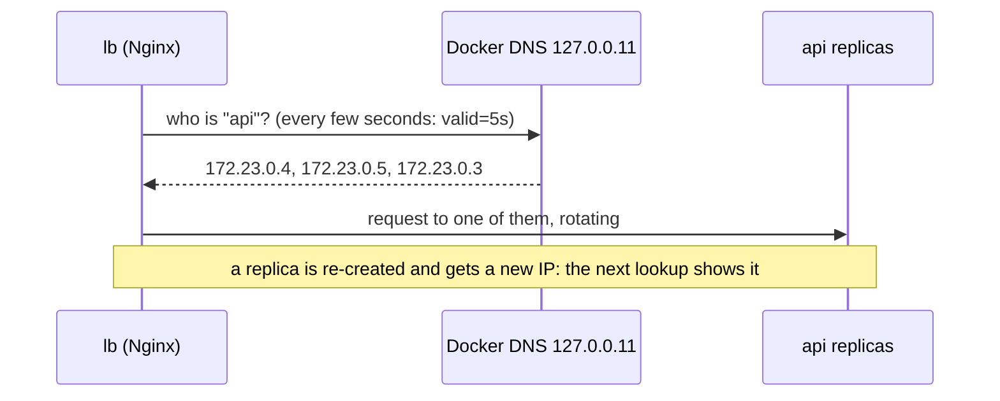

# Docker 07 — Docker networks and service-name DNS

> **Course:** [Docker](./README.md)  ·  **Time:** ~40 min  ·  **Needs:** [Docker 01 — Images, containers and their lifecycle](./01-images-and-containers.md)
> **Used in the labs:** [Lab 01, step 3](../../labs/01-containers.md#step-3--describe-the-api-as-a-compose-service) (the Compose network), [Lab 02, steps 4 and 5](../../labs/02-load-balancing.md) (`api` resolves to every replica), [Lab 03, step 8](../../labs/03-networking.md) (`public` and `private`)

## What you will learn
- Explain what a Docker network is, and why containers on a network you created can reach each other **by name** while containers on the default network cannot.
- Say what the address `127.0.0.11` is, and how one name can point to **several** containers (the three API replicas).
- Predict whether two containers can talk, from the networks they share.
- Read the `networks:` lines of the project's `docker-compose.yml` and the `resolver` line of its Nginx config.

## Words you need
| Word | Plain-words meaning |
|---|---|
| **Docker network** | A virtual network inside Docker. Containers attached to it can talk to each other; containers on different networks cannot, unless one is on both. |
| **Bridge network** | The ordinary kind of Docker network on one machine: a virtual switch connecting the containers attached to it. |
| **Default bridge** | The network every container joins if you name none. It exists, but offers **no name lookup** between containers. |
| **User-defined network** | A network you (or Compose) create. It comes with automatic name lookup. |
| **IP address** | The numeric address of a container on a network (`172.25.0.2`). It can change when the container is re-created. See [Networking 06](../networking/06-subnets-and-cidr.md). |
| **DNS** | The "phone book" that turns a name into an IP address. |
| **Embedded DNS server** | The small DNS server Docker runs for you: containers see it at `127.0.0.11`. It knows the containers of their own networks. |
| **Service name** | The name Compose gives a container's role (`api`, `postgres`). On a shared network it is a DNS name. |
| **Network alias** | An extra DNS name given to a container on a network. Several containers can share one alias. |
| **Internal network** | A network with **no route out**: its containers cannot reach the internet and nothing can be published from it ([Lab 03](../../labs/03-networking.md)). |
| **Published port** | A port of a container made reachable from your machine (`-p`, `ports:`), as for the load balancer ([Lab 01](../../labs/01-containers.md)). |

## The idea
**Analogy.** A user-defined Docker network is an **office with an internal phone directory**. Every colleague (container) is listed by name, so you dial "api" and the switchboard connects you; you never need the extension number, which changes whenever someone moves desks.
The **default bridge** is an office with phones but **no directory**: you can only call by number. Two different networks are two **separate floors with no stairs**: nobody can call across, unless one person has a desk on both floors, like the load balancer.

**Precisely.** Docker creates a virtual network and gives each attached container an IP address on it. For user-defined networks Docker adds a **DNS server** that answers with the addresses of the containers on that network, by container name, service name or alias.
When a name has **several** matches (the three `api` replicas), the answer contains **all their addresses**; the client decides which to use (Nginx rotates through them). Networks are isolated from each other, and an `internal` network has no exit.



**Who asks whom when the load balancer needs the API:**


## The code, line by line
The network lines of the project's `docker-compose.yml` (condensed: only the `networks:` parts), and the DNS lines of `lb/nginx.conf`:

```yaml
services:
  lb:
    networks: [public, private]    # the load balancer has a foot on both networks
  api:
    networks: [private]            # the API is only on the internal network
  postgres:
    networks: [private]
networks:
  public:                          # an ordinary bridge network (has a route out; ports can be published)
  private:
    internal: true                 # no route out, no published ports
```
```nginx
resolver 127.0.0.11 valid=5s;                                    # ask Docker's DNS, and re-ask every 5 seconds
server api:8000 resolve max_fails=1 fail_timeout=10s;            # follow every address behind the name "api"
```

| Line | What it does | If you change or remove it |
|---|---|---|
| `lb: networks: [public, private]` | Attaches the load balancer to both networks, so it can receive traffic (`public`, where the port is published) and reach the API (`private`). | Only `private`: the port cannot be published. Only `public`: it cannot find `api`. |
| `api: networks: [private]` | The API is reachable only by containers on `private`. | Add `public` and it sits next to the load balancer, in reach of anything on that network. |
| `internal: true` | The network has no gateway: no internet, no published ports. | Remove it and the API can reach the internet again ([Lab 03](../../labs/03-networking.md) tests this). |
| `resolver 127.0.0.11 valid=5s` | Tells Nginx which DNS server to ask (Docker's embedded one) and to refresh answers every 5 seconds. | Without it Nginx resolves `api` once at start and keeps stale addresses forever. |
| `server api:8000 resolve` | The name `api` stands for **all** replicas; `resolve` keeps the address list up to date. | Without `resolve` a re-created replica with a new IP is never found. |

## The commands
| Command / flag | Meaning |
|---|---|
| `docker network ls` | List the networks; `--filter name=TEXT` keeps names containing TEXT; `--format` chooses the columns. |
| `docker network create NAME` | Create a user-defined bridge network (with name lookup). `--internal` would make it internal. |
| `docker network inspect NAME --format '...'` | Show details of a network (subnet, whether it is internal, the containers on it and their addresses). |
| `docker run --network NAME` | Attach the new container to that network instead of the default bridge. |
| `--network-alias web` | Give the container an extra DNS name, `web`, on that network. |
| `ping -c 1 -W 2 NAME` | Send one packet (`-c 1`) and wait at most 2 seconds (`-W 2`) for the answer; a name that does not resolve fails at once with `bad address`. |
| `nslookup NAME [SERVER]` | Ask a DNS server for the addresses behind a name; the last lines of its output list them. |
| `docker compose exec -T lb nslookup api 127.0.0.11` | Run `nslookup` inside the load balancer, asking Docker's DNS server explicitly. |
| `docker network rm NAME` | Delete an unused network (containers must have left it). |

## Hands-on
Throw-away containers from `alpine:3.24` and a network called `course-net`. Real output, trimmed (image-download lines left out). You can also run the first two steps against the lab if it is up.

**1. The lab's networks, and the name `api`**
```bash
docker network ls --filter name=aws-local-lab --format 'table {{.Name}}\t{{.Driver}}\t{{.Scope}}'
docker network inspect aws-local-lab_private --format '{{.Name}}: internal={{.Internal}} subnet={{range .IPAM.Config}}{{.Subnet}}{{end}}'
docker compose exec -T lb nslookup api 127.0.0.11
```
```text
NAME                    DRIVER    SCOPE
aws-local-lab_default   bridge    local
aws-local-lab_private   bridge    local
aws-local-lab_public    bridge    local
aws-local-lab_private: internal=true subnet=172.23.0.0/16
Name:	api
Address: 172.23.0.4
Name:	api
Address: 172.23.0.5
Name:	api
Address: 172.23.0.3
```
(For the last command the header lines and blank lines are left out.) The lab has a `public` and a `private` network, `private` is `internal=true`, and asking Docker's DNS for `api` returns **three addresses**, one per replica: this is exactly what Nginx follows.
The third network, `aws-local-lab_default`, is a leftover: Compose created it on 15 November (the early labs, when the services used Compose's default network) and no container is attached to it now.

**2. No directory on the default bridge**
```bash
docker run -d --rm --name course-b alpine:3.24 sleep 120
docker run --rm alpine:3.24 ping -c 1 -W 2 course-b
```
```text
ping: bad address 'course-b'
```
Both containers are on the default bridge, running at the same time, and the name `course-b` does not resolve. Without a directory you would have to look up the IP address yourself every time.

**3. With a network you create, names work**
```bash
docker network create course-net
docker run -d --rm --name course-a --network course-net alpine:3.24 sleep 120
docker run --rm --network course-net alpine:3.24 ping -c 1 -W 2 course-a
docker run --rm --network course-net alpine:3.24 nslookup course-a
docker network inspect course-net --format '{{range .Containers}}{{.Name}} {{.IPv4Address}}{{println}}{{end}}'
```
```text
PING course-a (172.25.0.2): 56 data bytes
64 bytes from 172.25.0.2: seq=0 ttl=64 time=0.291 ms
Name:	course-a
Address: 172.25.0.2

course-a 172.25.0.2/16
```
The same kind of ping now works: `course-a` became `172.25.0.2`. `nslookup` shows the DNS answer, and `docker network inspect` shows the same address from Docker's side. You did not configure any DNS: user-defined networks have it built in.

**4. One name, several containers**
```bash
docker run -d --rm --name course-w1 --network course-net --network-alias web alpine:3.24 sleep 120
docker run -d --rm --name course-w2 --network course-net --network-alias web alpine:3.24 sleep 120
docker run --rm --network course-net alpine:3.24 nslookup web
```
```text
Server:		127.0.0.11
Address:	127.0.0.11:53

Non-authoritative answer:

Non-authoritative answer:
Name:	web
Address: 172.25.0.4
Name:	web
Address: 172.25.0.3
```
Two containers share the alias `web`, so the name returns **both addresses**. Compose does the same with a service name when you run `replicas: 3`: that is how `api` became three addresses in exercise 1. `127.0.0.11` is the embedded DNS server. (The two `Non-authoritative answer:` lines are just how this small `nslookup` prints; ignore them.)

**5. Separate floors**
```bash
docker run --rm --network aws-local-lab_public alpine:3.24 nslookup postgres
docker run --rm --network aws-local-lab_private alpine:3.24 nslookup postgres
```
```text
*** Can't find postgres: No answer
Address: 172.23.0.2
```
(Only the last lines are shown.) From the `public` network, the name `postgres` does not exist: the database is not on that network, and Docker's DNS only knows the containers of the networks you are on. From `private` it resolves to `172.23.0.2`. This is the network isolation of [Lab 03](../../labs/03-networking.md), seen through DNS.

Clean up: `docker stop course-a course-b course-w1 course-w2` (they were started with `--rm`, so they disappear) and `docker network rm course-net`.

## What if…?
**…the container behind a name is re-created?** Its IP address can change; its **name does not**. That is why the project always uses `postgres` and `api` and never an address, and why Nginx needs `resolver ... valid=5s` and `resolve`: without them it would keep the address it looked up at start-up and keep sending requests to a container that no longer exists
([Lab 02, step 6](../../labs/02-load-balancing.md) shows the experiment with a restarted replica). An address is a **snapshot**; a name is a **promise** that Docker keeps up to date.

## In short
1. Containers on a **network you created** (or that Compose created) reach each other **by name**, through Docker's embedded DNS server at `127.0.0.11`; the default bridge has no such lookup.
2. A name can return **several addresses** (replicas, or a shared alias); the client picks, and Nginx's `resolve` keeps following them as containers come and go.
3. Containers on **different networks cannot see each other**; an `internal` network also has no way out; a container attached to two networks (the load balancer) is the bridge between them.

## Check your understanding
1. Two containers run on Docker's default network. Can one ping the other by name? And on a network created with `docker network create`?
2. What is `127.0.0.11`?
3. How can `nslookup api` return three addresses in this project?
4. From the `public` network, `nslookup postgres` fails. Why, and what does that say about the design?
5. Why does the Nginx config say `resolver 127.0.0.11 valid=5s` together with `server api:8000 resolve`?

<details><summary>Answers</summary>

1. On the default bridge, no: the name does not resolve (`bad address`). On a user-defined network, yes: Docker's DNS knows every container's name there.
2. The address of Docker's embedded DNS server, seen from inside any container on a user-defined network.
3. The name `api` is shared by the three replicas of the service, so DNS answers with the address of each of them.
4. `postgres` is attached only to `private`, and the DNS server only answers about containers on the networks the asker is on. It shows the isolation works: the database is not even *findable* from `public`.
5. `resolver` says which DNS server to ask and how long answers are valid; `resolve` makes Nginx re-ask regularly and follow the current list of addresses, so a re-created replica (new IP) is found without reloading Nginx.

</details>

## Official documentation
- [Networking overview](https://docs.docker.com/engine/network/)
- [Bridge network driver (default vs user-defined)](https://docs.docker.com/engine/network/drivers/bridge/)
- [Networking in Compose](https://docs.docker.com/compose/how-tos/networking/)
- [`docker network create`](https://docs.docker.com/reference/cli/docker/network/create/)
- [Nginx `resolver` directive](https://nginx.org/en/docs/http/ngx_http_core_module.html#resolver)

## Where you use this in the project
- [Lab 01, step 3](../../labs/01-containers.md#step-3--describe-the-api-as-a-compose-service): the first Compose network (probably the origin of the leftover `aws-local-lab_default`), and a service reached by name.
- [Lab 02, steps 4 to 6](../../labs/02-load-balancing.md): `api` resolving to every replica, and the `resolver` / `resolve` lines.
- [Lab 03, step 8](../../labs/03-networking.md): `public` and `private`, and `internal: true`.
- [Lab 04](../../labs/04-database.md): `postgres` is a name on `private`; `DATABASE_URL` uses `@postgres:5432`, and the admin proxy of step 13 joins both networks.
