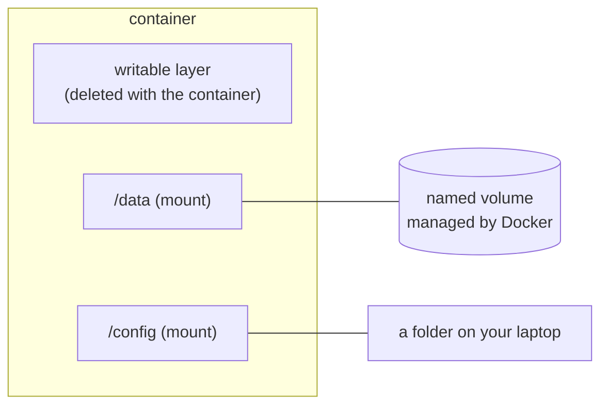
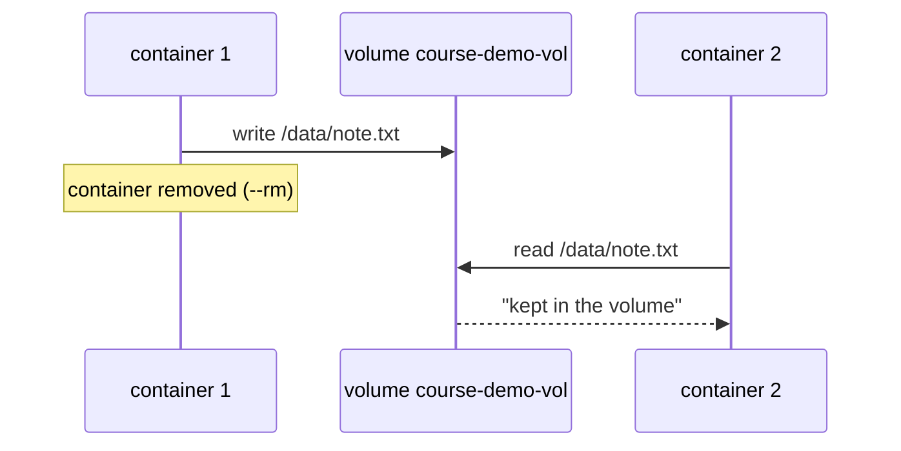

# Docker 08 — Volumes and bind mounts

> **Course:** [Docker](./README.md)  ·  **Time:** ~40 min  ·  **Needs:** [Docker 01 — Images, containers and their lifecycle](./01-images-and-containers.md)
> **Used in the labs:** [Lab 04, step 10](../../labs/04-database.md#step-10--the-postgres-container) (`pgdata`, the Postgres volume); the persistence test of Lab 04 (step 14)

## What you will learn
- Explain why a file written inside a container disappears with it, and what to do about it.
- Tell a **named volume** from a **bind mount**, and pick the right one for a database, for config files and for source code.
- Use `-v` on the command line and read the `volumes:` lines of `docker-compose.yml`.
- Avoid the two Windows traps: Git Bash rewriting paths, and mounting over a folder that already has files.

## Words you need
| Word | Plain-words meaning |
|---|---|
| **Container** | A running copy of an image, with its own private filesystem. See [Docker 01](./01-images-and-containers.md). |
| **Writable layer** | The thin, temporary storage every container gets on top of its image. It is deleted together with the container. |
| **Persistent** | Still there after the container is gone and after a restart. |
| **Mount** | Making a folder from somewhere else appear **inside** the container at a chosen path (the *mount point*). |
| **Volume (named volume)** | Storage **managed by Docker**, with a name (`pgdata`), that outlives any container. Docker decides where it lives. |
| **Bind mount** | A **folder of your own computer** shown inside the container. You choose the folder; Docker only points at it. |
| **Anonymous volume** | A volume created without a name (`-v /path`). Docker gives it a random name; `--rm` deletes it with the container. |
| **Host** | The computer Docker runs on (your laptop). With Docker Desktop on Windows, containers actually run in a small Linux virtual machine ([Docker 02](./02-docker-desktop-wsl2.md)). |
| **Read-only mount (`:ro`)** | A mount the container may read but not change. |
| **Compose project** | The name Compose puts in front of everything it creates (`aws-local-lab_pgdata`, `aws-local-lab_private`). |

## The idea
**Analogy.** A container is a **hotel room**: when you check out (the container is removed), the room is cleaned and reset, and anything you left on the desk is gone. A **named volume**
is a **safe-deposit box** kept by the hotel: you refer to it by its number, any room can open it, and it stays after you leave. A **bind mount** is a **door cut into your own house**:
the room looks straight into one of *your* folders, so what the room writes is really in your house, and what you change at home is instantly visible in the room.

**Precisely.** Everything a container writes without a mount goes to its writable layer and is lost when the container is deleted. To keep data you mount something into the container:

| | Named volume | Bind mount |
|---|---|---|
| **Who manages the storage** | Docker | You (it is your folder) |
| **You choose** | a name | a full path on the host |
| **Good for** | data that must survive: databases, uploads | config files, source code you edit, a folder you want to read from the host |
| **Survives container removal** | Yes | Yes (it is your folder) |
| **Visible in Windows Explorer** | Not easily: it lives inside Docker's Linux VM | Yes |



**Two containers, one volume:**


## The code, line by line
The project's real use, in `docker-compose.yml` ([Lab 04, step 10](../../labs/04-database.md#step-10--the-postgres-container)):
```yaml
services:
  postgres:
    volumes:
      # the named volume pgdata is mounted at /var/lib/postgresql inside the container
      - pgdata:/var/lib/postgresql

volumes:
  # declares the volume (Docker will create it as aws-local-lab_pgdata)
  pgdata:
```
And the same idea on the command line:
```bash
docker run --rm -v course-demo-vol:/data alpine:3.24 ...        # named volume
docker run --rm -v "C:/path/to/hostdir:/data" alpine:3.24 ...   # bind mount (a path = bind)
docker run --rm -v "C:/path/to/hostdir:/data:ro" alpine:3.24 ...# bind mount, read-only
```

| Line | What it does | If you change or remove it |
|---|---|---|
| `- pgdata:/var/lib/postgresql` | `NAME:PATH`. A name with no slash means **named volume**: Docker creates it if needed and mounts it at `PATH`. | Remove it and the data lives in the writable layer: it vanishes when the container is recreated ([Lab 04, check 5](../../labs/04-database.md#step-10--the-postgres-container)). |
| top-level `volumes: pgdata:` | Declares the volume so Compose creates it. Compose adds the project name: `aws-local-lab_pgdata`. | Without the declaration Compose rejects the file. |
| `-v course-demo-vol:/data` | Same `NAME:PATH` rule on the command line. | A different name is a different, empty volume. |
| `-v "C:/path/to/hostdir:/data"` | `HOSTPATH:PATH`. A **path** (it has slashes) means **bind mount**: the container sees that exact folder. | A typo in the host path may make Docker create an empty folder there, or fail. |
| `:ro` at the end | Mount read-only. | Without it the container can change or delete your files. |

**Name or path?** That is the whole rule: `pgdata:/x` is a volume, `C:/some/dir:/x` or `./dir:/x` is a bind mount.

## The commands
| Command / flag | Meaning |
|---|---|
| `docker volume create NAME` | Create a named volume (also created automatically the first time you mount it). Prints the name. |
| `docker volume ls` | List volumes. `--filter name=TEXT` keeps names containing TEXT; `--format` chooses the columns. |
| `docker volume inspect NAME` | Show details; `--format 'Mountpoint: {{.Mountpoint}}'` prints one field (Go template, see [Docker 03](./03-dockerfile.md)). |
| `docker volume rm NAME` | Delete a volume **and its data**. Docker refuses while a container uses it. A volume is never deleted automatically by `docker rm`. |
| `docker run --rm` | Delete the container (and its anonymous volumes) when it exits. Named volumes stay. |
| `-v SOURCE:PATH[:ro]` | Mount `SOURCE` at `PATH` inside the container; `:ro` = read-only. |
| `sh -c '...'` | Run a command through a shell **inside** the container (the quotes keep Git Bash from touching it, see "What if…?"). |
| `pwd -W` | Git Bash only: print the current folder as a Windows path (`C:/Users/...`), which Docker understands. |

## Hands-on
Throw-away containers from `alpine:3.24` (a tiny Linux), in a scratch folder. Real output, trimmed (image download lines and the long host path shortened).

**1. Without a volume, the file dies with its container**
```bash
docker run --rm alpine:3.24 sh -c 'echo "written in container 1" > /note.txt && cat /note.txt'
docker run --rm alpine:3.24 sh -c 'cat /note.txt'; echo "exit code: $?"
```
```text
written in container 1
cat: can't open '/note.txt': No such file or directory
exit code: 1
```
The first container wrote and read its file. The second container is a **new** copy of the image with a fresh writable layer: the file is not there.

**2. A named volume is shared and survives**
```bash
docker volume create course-demo-vol
docker run --rm -v course-demo-vol:/data alpine:3.24 sh -c 'echo "kept in the volume" > /data/note.txt'
docker run --rm -v course-demo-vol:/data alpine:3.24 sh -c 'cat /data/note.txt'
docker volume ls --filter name=course-demo-vol --filter name=aws-local-lab_pgdata --format 'table {{.Driver}}\t{{.Name}}'
docker volume inspect course-demo-vol --format 'Mountpoint: {{.Mountpoint}}'
```
```text
course-demo-vol
kept in the volume
DRIVER    VOLUME NAME
local     aws-local-lab_pgdata
local     course-demo-vol
Mountpoint: /var/lib/docker/volumes/course-demo-vol/_data
```
Two different containers, one file: the second `cat` finds what the first wrote. The listing also shows the project's own `aws-local-lab_pgdata` (the Postgres data of [Lab 04](../../labs/04-database.md)).
`Driver local` means "stored on this machine". The `Mountpoint` is a Linux path **inside Docker Desktop's VM**, not a folder you can open in Windows Explorer.

**3. A bind mount is your own folder**
```bash
mkdir hostdir && echo "created on the host" > hostdir/from-host.txt
HOSTDIR="$(pwd -W)/hostdir"
docker run --rm -v "$HOSTDIR:/data" alpine:3.24 sh -c 'cat /data/from-host.txt; echo "written by the container" > /data/from-container.txt'
ls hostdir; cat hostdir/from-container.txt
```
```text
created on the host
from-container.txt
from-host.txt
written by the container
```
The container read the file you created, and the file it wrote is now in your folder on Windows. Same folder, two views.

**4. Read-only**
```bash
docker run --rm -v "$HOSTDIR:/data:ro" alpine:3.24 sh -c 'echo x > /data/new.txt'; echo "exit code: $?"
```
```text
sh: can't create /data/new.txt: Read-only file system
exit code: 1
```
With `:ro` the container can read but not write. Use it for configuration files you do not want a program to change.

**Clean up.** The two throw-away folders are plain folders (delete them as usual). The volume stays until you remove it yourself, which is the point of a volume:
`docker volume rm course-demo-vol`. (In this project `docker volume rm` is blocked for the assistant, so run it yourself.)

## What if…?
**…you mount over a folder that already contains files?** A bind mount **hides** what the image had there; a volume starts **populated** with it. Real result, mounting at `/etc/apk`:
```bash
mkdir empty                                                                       # an empty folder on the host
docker run --rm alpine:3.24 sh -c 'ls /etc/apk'                                   # the image alone
docker run --rm -v "$(pwd -W)/empty:/etc/apk" alpine:3.24 sh -c 'ls -A /etc/apk | wc -l'   # empty folder bind-mounted
docker run --rm -v /etc/apk alpine:3.24 sh -c 'ls /etc/apk'                       # anonymous volume
```
```text
arch
keys
protected_paths.d
repositories
world
0
arch
keys
protected_paths.d
repositories
world
```
The image has five entries. Over an **empty bind-mounted folder** the container sees **0**: the image's files are hidden behind your empty folder. A **new empty volume** is first filled with a copy of what the image had there,
so the five entries are visible. (This copy only happens when the volume is empty.) Moral: never bind-mount an empty folder onto a path the program needs.

**The Windows trap: Git Bash rewrites paths.** Git Bash tries to be helpful and converts anything that looks like a Unix path into a Windows one **before** Docker sees it:
```bash
docker run --rm alpine:3.24 cat /note.txt
MSYS_NO_PATHCONV=1 docker run --rm alpine:3.24 cat /note.txt
```
```text
cat: can't open 'C:/Program Files/Git/note.txt': No such file or directory
cat: can't open '/note.txt': No such file or directory
```
The first command asked for `C:/Program Files/Git/note.txt`, a path nobody wrote. Setting `MSYS_NO_PATHCONV=1` turns the rewriting off (the second error is the real one: that file does not exist). Wrapping the command in `sh -c '...'`
(as above) also avoids it, and so does PowerShell, which does not rewrite paths.

## In short
1. A container's own storage is deleted with it; to keep data, **mount** something: a **named volume** (Docker manages it; for databases) or a **bind mount** (your folder; for config and source code).
2. `NAME:/path` is a volume, `C:/dir:/path` or `./dir:/path` is a bind mount; add `:ro` to forbid writes.
3. A bind mount hides what the image had at that path; a new volume is populated from it; `docker volume rm` is the only normal way to delete a volume's data.

## Check your understanding
1. You run `docker run --rm alpine sh -c 'echo hi > /f'` and then a second identical container runs `cat /f`. What happens, and why?
2. What is the rule that tells Docker whether `-v something:/x` is a volume or a bind mount?
3. Which one would you use for the Postgres data directory, and why?
4. What does `:ro` change?
5. A `docker run -v` command with `/some/path` fails on Windows with `C:/Program Files/Git/some/path`. What happened and how do you stop it?

<details><summary>Answers</summary>

1. The second `cat` fails with "No such file or directory": each container gets a fresh writable layer from the image, and the first one's layer was deleted with it (`--rm`).
2. If `something` is a plain name (no slash) it is a named volume; if it is a path (absolute, or starting with `./`), it is a bind mount.
3. A named volume: Docker manages it, it survives container recreation, and it is not exposed as a folder on Windows where a program or a person could damage it by accident.
4. The container can read the mounted files but any write fails with "Read-only file system".
5. Git Bash rewrote the Unix-looking path into a Windows path before Docker received it. Set `MSYS_NO_PATHCONV=1` for the command, wrap the command in `sh -c '...'`, or use PowerShell.

</details>

## Official documentation
- [Docker storage overview](https://docs.docker.com/engine/storage/)
- [Volumes](https://docs.docker.com/engine/storage/volumes/)
- [Bind mounts](https://docs.docker.com/engine/storage/bind-mounts/)
- [Compose: `volumes` in a service and at top level](https://docs.docker.com/reference/compose-file/volumes/)

## Where you use this in the project
- [Lab 04, step 10](../../labs/04-database.md#step-10--the-postgres-container): `pgdata:/var/lib/postgresql` keeps the database across `--force-recreate` (check 5). In real AWS this is the EBS storage attached to an RDS instance.
- Lab 04, step 14: `tests/04_persistence.sh` proves the same thing with `down && up` (written when that step is done).
- The Nginx config in `docker-compose.yml` (`./lb/nginx.conf:/etc/nginx/nginx.conf:ro`) is a **read-only bind mount**: your file on Windows, seen by the container, which cannot change it ([Lab 02](../../labs/02-load-balancing.md)).
