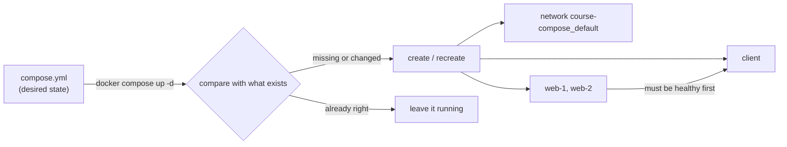
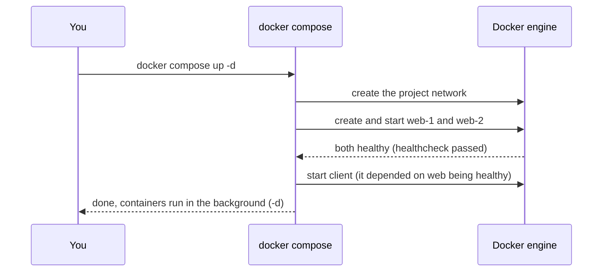

# Docker 09 — Docker Compose

> **Course:** [Docker](./README.md)  ·  **Time:** ~45 min  ·  **Needs:** [Docker 01](./01-images-and-containers.md), [Docker 07 — Docker networks and service-name DNS](./07-networks.md)
> **Used in the labs:** [Lab 01, step 3](../../labs/01-containers.md#step-3--describe-the-api-as-a-compose-service) (the first `docker-compose.yml`), [Lab 02, step 5](../../labs/02-load-balancing.md) (`replicas: 3`), [Lab 04](../../labs/04-database.md) (`depends_on`, the `migrate` job, a profile)

## What you will learn
- Read a `docker-compose.yml`: services, images, healthchecks, replicas, dependencies and profiles.
- Use the everyday commands: `config`, `up -d`, `ps`, `logs`, `exec`, `stop`, `down`.
- Explain why `docker compose up` can be run again and again safely (it only changes what differs).
- Tell `stop` from `down`, and say what `down` keeps.

## Words you need
| Word | Plain-words meaning |
|---|---|
| **Docker Compose** | A tool that starts a whole set of containers, networks and volumes from one text file, with one command. |
| **Compose file** | The text file (`docker-compose.yml` or `compose.yml`) that describes the set. |
| **Service** | One role in the file (`api`, `postgres`): an image plus how to run it. A service can run as several containers. |
| **Project** | One running copy of a Compose file. It has a **project name** that prefixes everything it creates (`aws-local-lab_private`, `course-compose-web-1`). |
| **Replica** | One of several identical containers of the same service. |
| **Healthcheck** | A command Docker runs on a timer inside a container; the container is `healthy` when it succeeds. |
| **`depends_on` condition** | What a service waits for before it starts: `service_started`, `service_healthy`, or `service_completed_successfully` (a one-shot job that finished with code 0). |
| **Profile** | A label that keeps a service switched off unless you ask for it (`--profile admin`). |
| **Default network** | The network Compose creates for a project when the file defines none; services reach each other by name on it ([Docker 07](./07-networks.md)). |
| **Idempotent** | Safe to repeat: running the command again gives the same result and changes nothing that is already right. |
| **Declarative** | You describe the **end state** you want, not the steps; the tool works out the steps. |

## The idea
**Analogy.** A Compose file is the **plan for opening a restaurant**: which stations exist (services), how many cooks at each (replicas), which station must be ready before another opens (the kitchen before the dining room), and one switch, `up`, to open everything, `down` to close it.
Run `up` on a restaurant that is already open and nothing happens, except that anything missing is opened.

**Precisely.** Compose is **declarative**: the file says what should exist, and `docker compose up` compares it with what exists and creates, starts or recreates only what is different. Containers get names of the form `<project>-<service>-<number>`. The project's network gives the services name lookup.
`docker compose down` removes the containers and networks it created; **named volumes are kept** unless you add `-v` ([Docker 08](./08-volumes-and-bind-mounts.md)).



**Who does what during `up`:**


## The code, line by line
A small project: two nginx web servers, a client that waits for them, and an optional extra service. Throw-away, with its own project name:

```yaml
name: course-compose                 # project name: prefix of every container and network

services:
  web:
    image: nginx:1.30.6-alpine       # pinned image
    deploy:
      replicas: 2                    # run two identical containers of this service
    healthcheck:
      test: ["CMD", "wget", "-q", "-O", "/dev/null", "http://127.0.0.1/"]   # succeeds when nginx answers
      interval: 3s                   # run it every 3 seconds
      timeout: 2s                    # a run that takes longer than this counts as failed
      retries: 3                     # 3 failures in a row = unhealthy
      start_period: 2s               # failures in the first 2 seconds do not count

  client:
    image: alpine:3.24
    command: ["sh", "-c", "wget -q -O /dev/null http://web/ && echo client-reached-web; sleep 3600"]
    depends_on:
      web:
        condition: service_healthy   # do not start until every web container is healthy

  debug:
    image: alpine:3.24
    profiles: ["extra"]              # off unless you pass --profile extra
    command: ["sleep", "3600"]
```

| Line | What it does | If you change or remove it |
|---|---|---|
| `name: course-compose` | Sets the project name. Without it Compose uses the folder name. | Two projects with the same name would share containers and networks. |
| `image: nginx:1.30.6-alpine` | The image to run, pinned ([Docker 05](./05-tags-and-registries.md)). | `build: ./dir` would build an image from a Dockerfile instead ([Docker 03](./03-dockerfile.md)). |
| `deploy: replicas: 2` | Two containers for this service; Docker's DNS name `web` returns both addresses ([Docker 07](./07-networks.md)). | The default is one. |
| `healthcheck: ...` | Defines "healthy" for `web`, so others can wait for it. | Without it, `service_healthy` has nothing to wait for and Compose reports an error. |
| `command: [...]` | Replaces the image's default command. Here: call `web`, print a message, then stay alive. | Remove it and the client runs the image's default (`sh`) and exits at once. |
| `depends_on: web: condition: service_healthy` | `client` starts only after `web` is healthy. | `service_started` only waits for the process to start, not to be ready. |
| `profiles: ["extra"]` | `debug` exists in the file but is skipped by a normal `up`. | Remove it and `debug` starts every time. |

## The commands
| Command / flag | Meaning |
|---|---|
| `docker compose config` | Print the file as Compose understands it (placeholders replaced, defaults added). `--services` lists only the service names; `-q` prints nothing if the file is valid. |
| `docker compose up -d` | Create what is missing and start it in the background (`-d` = detached). Re-running it only touches what changed. |
| `docker compose up -d --scale web=3` | Same, but with 3 containers of `web` for this run, whatever the file says. |
| `docker compose ps` | List this project's containers; `-a` includes stopped ones; `--format` chooses columns. |
| `docker compose logs SERVICE` | Print the output of a service's containers (`-f` follows it live). |
| `docker compose exec -T SERVICE CMD` | Run a command inside a running container of that service; `-T` means no terminal. |
| `docker compose stop` / `start` | Stop / start the containers **without removing them**. |
| `docker compose down` | Stop and **remove** the project's containers and networks; named volumes stay (`-v` would delete them). |
| `--profile NAME` | Include the services labelled with that profile. |
| `-f FILE` / `-p NAME` | Use another compose file / another project name. |

## Hands-on
In a throw-away folder with the file above saved as `compose.yml`. Real output, trimmed.

**1. What Compose understands, and what a profile adds**
```bash
docker compose config --services | sort | tr '\n' ' '
docker compose --profile extra config --services | sort | tr '\n' ' '
docker compose config | sed -n '1,12p'
```
```text
client web 
client debug web 
name: course-compose
services:
  client:
    command:
      - sh
      - -c
      - wget -q -O /dev/null http://web/ && echo client-reached-web; sleep 3600
    depends_on:
      web:
        condition: service_healthy
        required: true
    image: alpine:3.24
```
Without the profile there are two services; with `--profile extra`, `debug` joins. `config` shows the file in its full form: Compose added `required: true` to the dependency, a default you never wrote.

**2. Start everything**
```bash
docker compose up -d
```
```text
 Network course-compose_default Creating 
 Network course-compose_default Created 
 Container course-compose-web-1 Creating 
 Container course-compose-web-2 Creating 
 Container course-compose-web-1 Created 
 Container course-compose-web-2 Created 
 ...
 Container course-compose-web-1 Healthy 
 Container course-compose-web-2 Healthy 
 Container course-compose-client-1 Starting 
 Container course-compose-client-1 Started
```
(Middle lines left out.) Read the order: the network first, then the two `web` containers, and only **after both are `Healthy`** does `client` start. That is `depends_on: condition: service_healthy` at work.

**3. Look at it, read its output**
```bash
docker compose ps --format 'table {{.Service}}\t{{.Name}}\t{{.Status}}'
docker compose logs client
```
```text
SERVICE   NAME                      STATUS
client    course-compose-client-1   Up 7 seconds
web       course-compose-web-1      Up 13 seconds (healthy)
web       course-compose-web-2      Up 13 seconds (healthy)
client-reached-web
```
Names follow `<project>-<service>-<number>`. The client's log shows its message (the `client-1 |` prefix that `logs` adds is left out): it reached `web` **by name** (`http://web/`).

**4. Run `up` again: nothing to do**
```bash
docker compose up -d
```
```text
 Container course-compose-web-1 Running 
 Container course-compose-web-2 Running 
 Container course-compose-client-1 Running 
 Container course-compose-web-1 Waiting 
 Container course-compose-web-2 Waiting 
 Container course-compose-web-1 Healthy 
 Container course-compose-web-2 Healthy 
```
Every container says `Running`: nothing was created or recreated. This is **idempotence**: you can run `up -d` as often as you like (it is what `make up` does).

**5. `stop` keeps, `down` removes**
```bash
docker compose stop
docker compose ps -a --format 'table {{.Service}}\t{{.Status}}'
docker compose down
docker ps -a --format '{{.Names}}' | grep -c course-compose
```
```text
 Container course-compose-web-1 Stopping 
 Container course-compose-web-1 Stopped 
 ...
SERVICE   STATUS
client    Exited (137) 1 second ago
web       Exited (0) Less than a second ago
 ...
 Container course-compose-web-1 Removed 
 Network course-compose_default Removing 
 Network course-compose_default Removed 
0
```
(Output trimmed.) After `stop` the containers still exist (`ps -a` lists them as `Exited`). `down` removed the containers **and the network**; the last command counts 0 containers left. The two exit codes are worth reading: `web` (nginx) stopped cleanly with `0`, while `client` shows `137` = 128 + 9, "killed": its main process
is a shell running `sleep`, which typically ignores the polite stop request, so Docker killed it after its 10-second grace period ([Docker 01](./01-images-and-containers.md) explains the stop signal).

## What if…?
**…you need one more `web` while the project is running?**
```bash
docker compose up -d --scale web=3
docker compose exec -T client nslookup web
```
```text
 Container course-compose-web-1 Running 
 Container course-compose-web-2 Running 
 Container course-compose-web-3 Creating 
 Container course-compose-web-3 Created 
 ...
 Container course-compose-web-3 Healthy 
Name:	web
Address: 172.25.0.5
Name:	web
Address: 172.25.0.2
Name:	web
Address: 172.25.0.3
```
(Trimmed; the `nslookup` header lines are left out.) Compose compared the wish (3) with reality (2), **created only `web-3`**, and left the others `Running`. The service name `web` now resolves to **three** addresses, which is how the project's three `api` replicas are found by the load balancer ([Docker 07](./07-networks.md)). To make it permanent you would change `replicas:` in the file.

## In short
1. A Compose file **describes** the desired set of services, networks and volumes; `docker compose up -d` makes reality match it and **only touches what differs**, so it is safe to repeat.
2. `depends_on` with a **condition** (`service_healthy`, `service_completed_successfully`) orders start-up; **profiles** keep optional services off; `replicas` runs several copies of a service.
3. `stop` keeps the containers, `down` removes containers and networks but **keeps named volumes**; `config` shows what Compose understood, `ps`, `logs` and `exec` show and enter what runs.

## Check your understanding
1. What does `docker compose up -d` do when every container already matches the file?
2. Why does `client` start only after both `web` containers are healthy?
3. What is the difference between `docker compose stop` and `docker compose down`? What does neither delete by default?
4. A service has `profiles: ["admin"]`. What happens on a plain `docker compose up -d`, and how do you start it?
5. Which command shows the file with defaults and placeholders filled in, without starting anything?

<details><summary>Answers</summary>

1. Nothing is created or recreated: it prints `Running` for each container (it is idempotent) and returns.
2. Because of `depends_on: web: condition: service_healthy`: Compose waits until the `web` healthcheck passes for every container before starting `client`.
3. `stop` stops the containers but keeps them (`ps -a` still lists them); `down` stops **and removes** the containers and the project's networks. Neither deletes named volumes unless `down -v` is used.
4. The service is skipped (it is not created). Start it by naming the profile: `docker compose --profile admin up -d` (as the project does for `db-proxy`).
5. `docker compose config` (with `-q` it only validates, with `--services` it lists the service names).

</details>

## Official documentation
- [Docker Compose overview](https://docs.docker.com/compose/)
- [The Compose file reference](https://docs.docker.com/reference/compose-file/)
- [`depends_on` and start-up order](https://docs.docker.com/compose/how-tos/startup-order/)
- [Using profiles](https://docs.docker.com/compose/how-tos/profiles/)
- [`docker compose` CLI reference](https://docs.docker.com/reference/cli/docker/compose/)

## Where you use this in the project
Real output of `docker compose config --services` for this project:
```text
default:      api lb migrate postgres redis 
with profile: api db-proxy lb migrate postgres redis 
```
- [Lab 01, step 3](../../labs/01-containers.md#step-3--describe-the-api-as-a-compose-service): the first `docker-compose.yml`, with one service, and `docker compose up -d` / `ps`.
- [Lab 02, step 5](../../labs/02-load-balancing.md): `deploy: replicas: 3` for the `api` service, found by the load balancer through its service name.
- [Lab 04, step 11](../../labs/04-database.md#step-11--the-database-layer-the-first-migration-and-the-migrate-job): `api` waits for the one-shot `migrate` job with `service_completed_successfully`, and `migrate` waits for `postgres: service_healthy`.
- [Lab 04, step 13](../../labs/04-database.md#step-13--the-admin-profile-a-door-to-the-database-closed-by-default): `db-proxy` has `profiles: ["admin"]`, which is why it appears only in the second line above.
- `make up`, `make down` and `make test` all drive Compose (the `Makefile` calls `docker compose up -d --build --remove-orphans` and `docker compose down --remove-orphans`).
