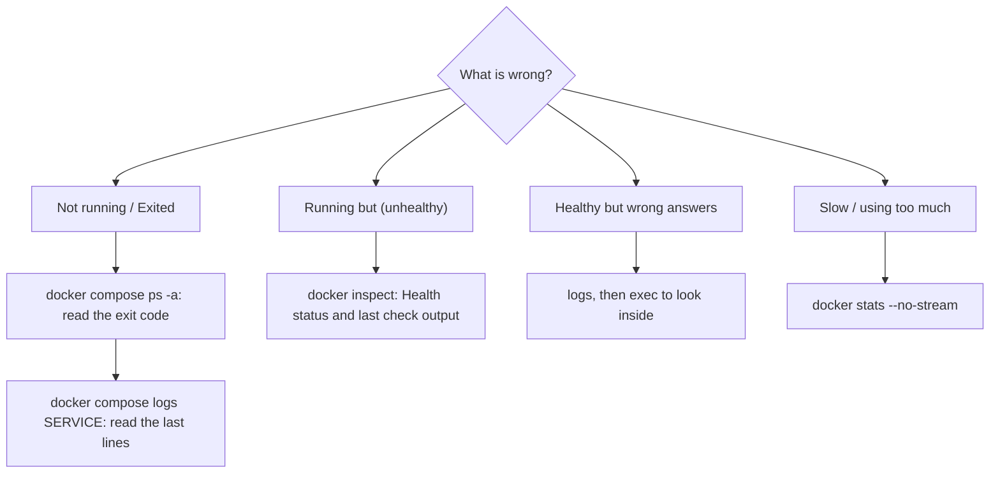
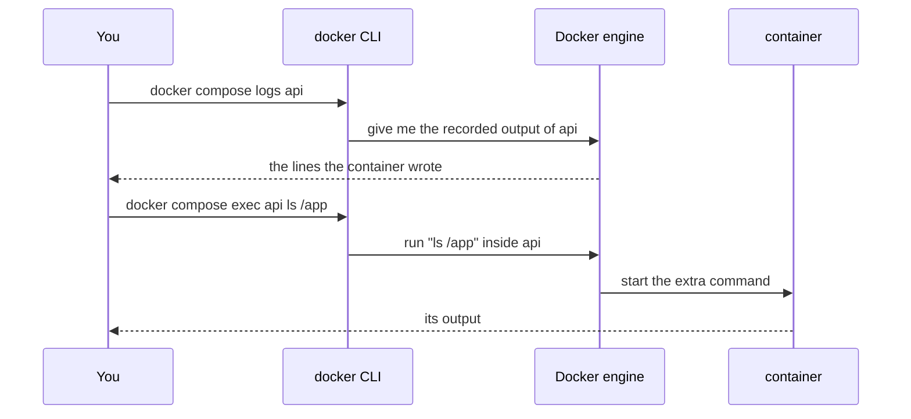

# Docker 10 — Debugging: logs, exec, inspect

> **Course:** [Docker](./README.md)  ·  **Time:** ~45 min  ·  **Needs:** [Docker 01](./01-images-and-containers.md), [Docker 09 — Docker Compose](./09-compose.md)
> **Used in the labs:** every lab. Examples: [Lab 04, step 11](../../labs/04-database.md#step-11--the-database-layer-the-first-migration-and-the-migrate-job) (the `migrate` job's log), [Lab 05, step 16](../../labs/05-caching.md#step-16--cache-aside-on-get-notesid) (the cache `HIT`/`MISS` lines)

## What you will learn
- Follow a short **checklist** when a container misbehaves: is it running, what did it say, what is it like inside, what does Docker know about it, how much does it use.
- Read **logs** with `docker compose logs` (and `docker logs`), including `--tail`, `--since` and `--timestamps`.
- Read an **exit code**, a **health status** and the **restart count** with `docker ps -a` and `docker inspect`.
- Look inside a running container with `exec`, without ever printing a secret.

## Words you need
| Word | Plain-words meaning |
|---|---|
| **Log** | The text a program writes while it runs. Docker collects what a container writes to its two output channels. |
| **stdout / stderr** | The two output channels of a program: *standard output* (normal messages) and *standard error* (problems). Docker keeps them as two separate streams. |
| **Exit code** | The number a program returns when it ends: `0` means success, anything else means failure. |
| **Status** | The state Docker shows for a container: `Up`, `Exited (3)`, `Restarting`... |
| **Healthcheck** | A command Docker runs on a timer inside a container; the status becomes `healthy` or `unhealthy`. See [Docker 09](./09-compose.md). |
| **`exec`** | Run an extra command inside an **already running** container. |
| **Interactive (`-it`)** | Keep the terminal attached so you can type to the program, as in a shell session. (Not available in the scripts of this course; you can use it in your own terminal.) |
| **`inspect`** | Print everything Docker knows about a container, network or image, as structured data. |
| **Go template** | The small pattern language in `--format '{{.State.Status}}'` that picks fields out of that data ([Docker 03](./03-dockerfile.md)). |
| **Restart count** | How many times Docker restarted the container automatically. |
| **OOM-killed** | "Out of memory killed": the system stopped the container for using too much memory. |

## The idea
**Analogy.** Debugging a container is **examining a patient**. First you check the **pulse** (`ps`: is it alive, and what is its status?). Then you **ask what happened** (`logs`: what did it say?). If that is not enough, you **look inside** (`exec`), read the **medical chart** (`inspect`: exit code, health, restarts) and measure the **vital signs** (`stats`: CPU and memory).
You go from the cheapest question to the most expensive one, and you stop as soon as you know.

**Precisely.** Docker records, for every container, the output it wrote, the state it is in, and the way it ended. All the commands below only **read** that information (except `exec`, which runs a command inside). The most useful single fact about a container that stopped is its **exit code**: `0` = it finished normally; `1` to `125` = the program itself failed;
`137` = **killed** (128 + 9: for example stopped by force or out of memory); `143` = asked to stop and obeyed (128 + 15).



**Who answers what:**


## The code, line by line
Debugging needs no code, but it needs the right **commands and format strings**. These are the ones used below, with what each one asks:

```bash
docker compose ps -a --format 'table {{.Service}}\t{{.Status}}\t{{.Ports}}'
docker compose logs --since 10m --timestamps --tail 2 api
docker inspect NAME --format 'status={{.State.Status}} exit code={{.State.ExitCode}} oom-killed={{.State.OOMKilled}}'
docker inspect NAME --format 'health={{.State.Health.Status}} failing streak={{.State.Health.FailingStreak}}'
docker stats --no-stream --format 'table {{.Name}}\t{{.CPUPerc}}\t{{.MemUsage}}' $(docker compose ps -q)
```

| Piece | What it does | If you change or remove it |
|---|---|---|
| `ps -a` | `-a` (all) includes **stopped** containers. A plain `ps` shows only running ones, so a crashed container would be invisible. | Without `-a` you cannot see why something is missing. |
| `{{.Service}}` `{{.Status}}` `{{.Ports}}` | Choose the columns of `ps`; `table` adds headings, `\t` separates columns. | The default output is wider and harder to compare. |
| `logs --tail 2` | Only the last 2 lines **per container**. | Without it you get the whole history. |
| `logs --since 10m` | Only what was written in the last 10 minutes (`30s`, `2h`... also work). | Without it you scroll through old lines. |
| `logs --timestamps` | Puts the date and time (UTC) in front of each line. | Without it you cannot tell *when* something happened. |
| `{{.State.ExitCode}}` | The number the program ended with. | The status text `Exited (3)` shows it too, but `inspect` also gives the error and the OOM flag. |
| `{{.State.OOMKilled}}` | `true` if the container was killed for using too much memory. | An exit code of `137` alone does not tell you *why* it was killed. |
| `{{.State.Health.FailingStreak}}` | How many healthchecks in a row have failed. | A single failure may be a hiccup; a growing streak is a problem. |
| `stats --no-stream` | Print one snapshot of CPU and memory and stop (without it the command refreshes forever). | Without it your script never returns. |
| `$(docker compose ps -q)` | `-q` prints only the container ids of **this project**, so `stats` shows only them. | Without it `stats` lists every container on the machine, including other projects'. |

## The commands
| Command / flag | Meaning |
|---|---|
| `docker compose ps [-a]` | Containers of this project and their status; `-a` adds the stopped ones. |
| `docker compose logs [SERVICE]` | Recorded output of a service's containers (all services if none is named). `-f` follows new lines live; `--tail N`, `--since`, `--timestamps` as above. |
| `docker logs NAME` | The same for a single container by name (use it for containers started with `docker run`). |
| `docker compose exec [-T] [--index N] SERVICE CMD` | Run `CMD` inside a running container of the service. `--index 2` picks the second replica; `-T` means no terminal; in your own terminal, `-it` gives you a shell (`exec api sh`). |
| `docker inspect NAME [--format '...']` | Everything Docker knows about the container, or just the fields you ask for. |
| `docker stats --no-stream` | CPU, memory and network use, once. |
| `docker run --name N --health-cmd 'CMD' --health-interval 2s --health-retries 2 IMAGE` | Start a container that has a healthcheck defined on the command line (used below to make an unhealthy one). |
| `env \| cut -d= -f1` | List the **names** of the environment variables, never their values (the values of `DATABASE_URL` and `REDIS_URL` hold passwords). |

## Hands-on
Against the running lab, plus two throw-away containers (`alpine:3.24`) that fail on purpose. Real output, trimmed.

**1. The pulse: what is running**
```bash
docker compose ps -a --format 'table {{.Service}}\t{{.Status}}\t{{.Ports}}'
```
```text
SERVICE    STATUS                     PORTS
api        Up 6 minutes (healthy)     8000/tcp
api        Up 6 minutes (healthy)     8000/tcp
api        Up 6 minutes (healthy)     8000/tcp
lb         Up 6 minutes (healthy)     127.0.0.1:8081->80/tcp
migrate    Exited (0) 6 minutes ago   
postgres   Up 6 minutes (healthy)     5432/tcp
redis      Up 6 minutes (healthy)     6379/tcp
```
Six containers are `Up` and `healthy`. `migrate` is `Exited (0)`: not a problem, it is a **one-shot job** that finished successfully (exit code 0).

**2. What they said: logs**
```bash
docker compose logs --tail 2 redis
docker compose logs --tail 3 lb
docker compose logs migrate
```
```text
1:M 18 Nov 2026 23:58:25.529 * Server initialized
1:M 18 Nov 2026 23:58:25.529 * Ready to accept connections tcp
127.0.0.1 - - [19/Nov/2026:00:04:36 +0000] "GET /health HTTP/1.1" 200 15 "-" "Wget"
127.0.0.1 - - [19/Nov/2026:00:04:46 +0000] "GET /health HTTP/1.1" 200 15 "-" "Wget"
127.0.0.1 - - [19/Nov/2026:00:04:56 +0000] "GET /health HTTP/1.1" 200 15 "-" "Wget"
INFO  [alembic.runtime.migration] Context impl PostgresqlImpl.
INFO  [alembic.runtime.migration] Will assume transactional DDL.
```
(The service-name prefix that `docker compose logs` adds, such as `redis-1  |`, is cut off here, and only the last lines of `migrate` are shown.) Redis says it is ready; the load balancer's log shows its own healthcheck calling `/health` every 10 seconds (`"Wget"` is the healthcheck's program); the migration job's lines are the proof that it ran.
```bash
docker compose logs --since 10m --timestamps --tail 2 api
```
```text
api-2  | 2026-11-19T00:04:47.846737012Z INFO:     127.0.0.1:36976 - "GET /health HTTP/1.1" 200 OK
api-2  | 2026-11-19T00:04:58.087881565Z INFO:     127.0.0.1:45862 - "GET /health HTTP/1.1" 200 OK
api-3  | 2026-11-19T00:04:56.831490060Z INFO:     172.22.0.7:59540 - "GET /health HTTP/1.1" 200 OK
api-3  | 2026-11-19T00:04:57.346224734Z INFO:     127.0.0.1:45846 - "GET /health HTTP/1.1" 200 OK
api-1  | 2026-11-19T00:04:48.028904742Z INFO:     127.0.0.1:36978 - "GET /health HTTP/1.1" 200 OK
api-1  | 2026-11-19T00:04:58.259805148Z INFO:     127.0.0.1:45876 - "GET /health HTTP/1.1" 200 OK
```
`--tail 2` is **per container**: three replicas, six lines. Each line starts with the replica (`api-1`, `api-2`, `api-3`) and an exact UTC timestamp. Calls from `127.0.0.1` are the container's own healthcheck; the one from `172.22.0.7` came from the load balancer.

**3. A container that ends with an error**
```bash
docker run --name course-bad alpine:3.24 sh -c 'echo "starting up"; echo "boom: cannot open /data/x" >&2; exit 3'
docker ps -a --filter name=course-bad --format 'table {{.Names}}\t{{.Status}}'
docker logs course-bad
docker inspect course-bad --format 'status={{.State.Status}} exit code={{.State.ExitCode}} error="{{.State.Error}}" oom-killed={{.State.OOMKilled}}'
```
```text
boom: cannot open /data/x
starting up
(docker run returned 3)
NAMES        STATUS
course-bad   Exited (3) Less than a second ago
boom: cannot open /data/x
starting up
status=exited exit code=3 error="" oom-killed=false
```
(The `(docker run returned 3)` line was printed by an `echo "$?"` after the command.) The container is **not** running (no `--rm`, so it stays for us to examine): `ps -a` shows `Exited (3)`: the program itself failed with code 3. `docker logs` returns what it wrote, and `inspect` confirms: exit code 3, not killed for memory (`oom-killed=false`), no Docker-level error (`error=""`: the failure is in the program, not in Docker).

**4. A container that runs but is unhealthy**
```bash
docker run -d --name course-unhealthy --health-cmd 'echo "check failed: no answer on port 80" >&2; exit 1' --health-interval 2s --health-retries 2 alpine:3.24 sleep 60
docker ps --filter name=course-unhealthy --format 'table {{.Names}}\t{{.Status}}'
docker inspect course-unhealthy --format 'health={{.State.Health.Status}} failing streak={{.State.Health.FailingStreak}}'
docker inspect course-unhealthy --format '{{(index .State.Health.Log 0).Output}}'
```
```text
NAMES              STATUS
course-unhealthy   Up 8 seconds (unhealthy)
health=unhealthy failing streak=4
check failed: no answer on port 80
```
The container is **up** (its main process runs) yet `(unhealthy)`: the healthcheck fails every time (`failing streak=4`). The last item of the health log holds the **output of the check**, which says why. This is how you find out *what* a failing healthcheck complained about. Clean up: `docker stop course-unhealthy` and `docker rm course-bad course-unhealthy`.

**5. Looking inside: `exec`**
```bash
docker compose exec -T --index 1 api sh -c 'echo "user: $(id -un)"; echo "host: $(hostname)"; ls /app'
docker compose exec -T --index 1 api sh -c 'env | cut -d= -f1 | grep -E "^(DATABASE_URL|REDIS_URL|CACHE_TTL_SECONDS|UVICORN_LOG_LEVEL)$" | sort'
```
```text
user: app
host: 6da5742dfe09
alembic.ini
db.py
main.py
migrations
requirements.txt
CACHE_TTL_SECONDS
DATABASE_URL
REDIS_URL
UVICORN_LOG_LEVEL
```
Inside the first API replica: it runs as the unprivileged user `app` ([Docker 03](./03-dockerfile.md)), its hostname is its container id, and `/app` contains exactly the files the Dockerfile copied. The second command lists only the **names** of four settings: the **values** of `DATABASE_URL` and `REDIS_URL` contain passwords, so we never print them.

**6. The chart and the vital signs: `inspect` and `stats`**
```bash
docker inspect $(docker compose ps -q postgres) --format 'health={{.State.Health.Status}} failing-streak={{.State.Health.FailingStreak}} restarts={{.RestartCount}} image={{.Config.Image}}'
docker stats --no-stream --format 'table {{.Name}}\t{{.CPUPerc}}\t{{.MemUsage}}' $(docker compose ps -q)
```
```text
health=healthy failing-streak=0 restarts=0 image=postgres:18.7-alpine3.24
NAME         CPU %     MEM USAGE / LIMIT
api-1        0.16%     66.5MiB / 15.27GiB
api-2        0.14%     66.43MiB / 15.27GiB
api-3        0.16%     66.42MiB / 15.27GiB
lb-1         0.00%     13.67MiB / 15.27GiB
postgres-1   0.00%     29.58MiB / 15.27GiB
redis-1      0.17%     3.836MiB / 15.27GiB
```
(The project-name prefix of the container names is cut off.) The database is healthy, has never failed a check and was never restarted. Each API replica uses about 66 MiB; Redis, nearly empty, 3.8 MiB. The limit shown (`15.27GiB`) is the memory of the whole Docker Desktop VM: none of these containers has its own memory limit.

## What if…?
**…the error message and the normal message come out in the wrong order?** Look back at exercise 3: the program printed `starting up` **first**, then the error, yet `docker logs` showed `boom: cannot open /data/x` **before** `starting up`. Docker stores the two output channels separately and `2>&1` merges them afterwards, so their relative order is **not guaranteed**. When you need the exact order,
read the timestamps (`--timestamps`) or let the program write both to the same channel. Never conclude "the error came first" from the order of lines alone.

## In short
1. Debug from the cheapest question to the dearest: `ps -a` (status and exit code), `logs` (what it said), `exec` (look inside), `inspect` (health, restarts, OOM), `stats` (CPU and memory).
2. An **exit code** tells you how it ended (`0` fine, `1` to `125` the program failed, `137` killed, `143` stopped on request); a **health log** tells you why a healthcheck fails.
3. Read, don't leak: print variable **names** (`env | cut -d= -f1`), never values, and remember that `--tail` is per container and the order of stdout and stderr lines is not guaranteed.

## Check your understanding
1. A service is missing from `docker compose ps`. Which flag shows it if it crashed, and what do you read next?
2. A container shows `Exited (137)`. What does 137 suggest, and which `inspect` field helps you tell why?
3. What does `(unhealthy)` mean for a container that is `Up`, and where do you read the reason?
4. Why is `docker compose exec api env` a bad idea to paste into a chat or a ticket?
5. `docker compose logs --tail 5` printed 15 lines for three replicas. Why?

<details><summary>Answers</summary>

1. `docker compose ps -a` (it includes stopped containers); then read its exit code and run `docker compose logs SERVICE` to see its last lines.
2. 137 = 128 + 9: the container was killed (by force, or by the system for using too much memory). `docker inspect ... {{.State.OOMKilled}}` says whether memory was the cause.
3. The main process is running, but the healthcheck command keeps failing. The output of the check is in `docker inspect NAME --format '{{(index .State.Health.Log 0).Output}}'` (the health log).
4. It prints every variable with its value, including `DATABASE_URL` and `REDIS_URL` which contain passwords. Print the **names** only, `env | cut -d= -f1`.
5. `--tail N` applies **per container**: 5 lines from each of the three replicas is 15 lines in total.

</details>

## Official documentation
- [`docker compose logs`](https://docs.docker.com/reference/cli/docker/compose/logs/)
- [`docker compose exec`](https://docs.docker.com/reference/cli/docker/compose/exec/)
- [`docker inspect`](https://docs.docker.com/reference/cli/docker/inspect/)
- [`docker stats`](https://docs.docker.com/reference/cli/docker/container/stats/)
- [Format command and log output (Go templates)](https://docs.docker.com/engine/cli/formatting/)

## Where you use this in the project
- [Lab 04, step 11](../../labs/04-database.md#step-11--the-database-layer-the-first-migration-and-the-migrate-job): `docker compose logs migrate` shows `Running upgrade -> 0001`, and `ps -a` shows `migrate` as `Exited (0)`.
- [Lab 04, troubleshooting](../../labs/04-database.md#6-troubleshooting): the `network <id> not found` and `Resource is still in use` problems were diagnosed from the messages of `docker compose up` and `down`, and `docker compose ps -a` shows the containers involved.
- [Lab 05, step 16](../../labs/05-caching.md#step-16--cache-aside-on-get-notesid): `docker compose logs api | grep "cache "` shows the `HIT` and `MISS` lines, one replica per line.
- [Lab 02, step 6](../../labs/02-load-balancing.md): `docker kill` and `docker start` on a replica, with `ps` showing its status change.
