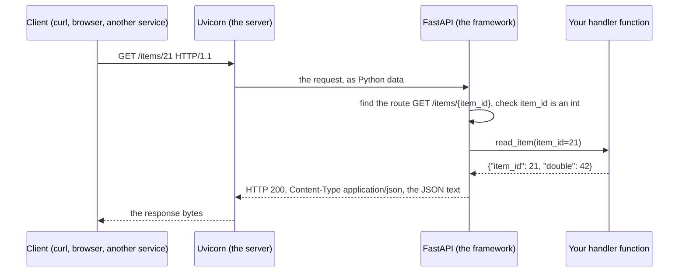
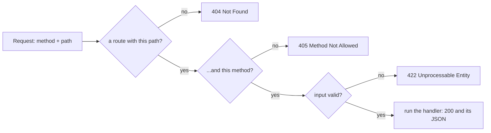

# FastAPI 01 — How a Python web API works, and routes

> **Course:** [FastAPI](./README.md)  ·  **Time:** ~40 min  ·  **Needs:** nothing (a little Python helps; [Networking 03](../networking/03-http.md) explains HTTP in depth)
> **Used in the labs:** [Lab 01, step 2](../../labs/01-containers.md) (`GET /health`, `GET /whoami` in `api/main.py`)

## What you will learn
- Say what a **web API** is and what happens between a request and its answer.
- Explain what a **route** is: an HTTP method plus a path, tied to one Python function.
- Write a small FastAPI app with three routes, and read the **status codes** it answers with: `200`, `404`, `405`, `422`.
- Tell apart the three pieces that run an API: your **code**, the **framework** (FastAPI) and the **server** (Uvicorn).
- Read `GET /health` and `GET /whoami` of this project line by line.

## Words you need
| Word | Plain-words meaning |
|---|---|
| **API** (application programming interface) | A way for one program to ask another for something. A **web API** does it over HTTP: the caller sends a request to an address and gets an answer made for programs, usually **JSON**. |
| **HTTP** | The language of the web: a **request** (method + path + headers) and a **response** (status code + headers + body). |
| **Method** | The verb of a request: `GET` (read), `POST` (create), `PUT` (replace), `DELETE` (remove). |
| **Path** | The part of the address after the host and port: in `http://localhost:8000/items/21`, the path is `/items/21`. |
| **Route** | One rule of the API: "when a request has **this method** and **this path**, run **this function**". |
| **Handler** (view function) | The Python function a route runs. Its returned value becomes the response. |
| **JSON** | A text format for data: `{"status": "ok"}`. Keys in quotes, values as text, numbers, true/false, lists or nested objects. Almost every web API speaks it. |
| **Status code** | A three-digit number in the response that says how it went: `2xx` success, `4xx` the caller made a mistake, `5xx` the server failed. |
| **Framework** | A library that handles the repetitive parts of a web app (reading the request, finding the route, building the response) so you write only the handlers. **FastAPI** is one. |
| **Server (Uvicorn)** | The program that listens on a network port, receives the raw requests and passes them to the framework. Covered in FastAPI 02 (not written yet). |
| **Decorator** | A line starting with `@` above a function that **registers or changes** it. `@app.get("/health")` registers the function below it as the handler of `GET /health`. |
| **Type hint** | A note in the code about the type of a value: `item_id: int`. FastAPI reads it to check and convert the input. |
| **Liveness probe** | A cheap URL (here `/health`) that answers as long as the process is alive; a load balancer calls it to decide whether to send traffic. |

## The idea
**Everyday analogy.** A restaurant. The **menu** lists what you can order, and each dish has a name: that is the list of **routes**. You (the client) tell the waiter what you want: the **request**. The waiter (the **server**, Uvicorn) does not cook; he takes your order to the right cook, the **handler** function, who prepares exactly that dish. The kitchen manager (the **framework**, FastAPI) knows who cooks what, checks that your order makes sense ("a dish that is not on the menu", "the number of guests must be a number"), and sends a clear message back if it does not. The plate that comes back is the **response**, and the number on the ticket (`200`, `404`...) says how it went.

**Precisely.** A web API is a program that waits for HTTP requests. For each request it:
1. reads the **method** and **path**;
2. finds the route that matches both;
3. runs the route's function, with the values found in the request;
4. turns what the function returns into an HTTP response (a Python dict becomes JSON, the status is `200` unless you say otherwise).

If no route matches the **path**, the answer is `404 Not Found`. If the path exists but not with that **method**, it is `405 Method Not Allowed`. If a route matches but the input is invalid (a text where a number is expected), FastAPI answers `422 Unprocessable Entity` **before your function runs**.





## The code, line by line
A small app with the same two routes as the project, plus one with a number in the path (`hello.py`):

```python
import socket                                   # standard library: asks the operating system things (here: the host name)

from fastapi import FastAPI                     # the framework's main class

app = FastAPI(title="hello demo")               # the application object; Uvicorn will run it


@app.get("/health")                             # route: method GET, path /health
def health():                                   # the handler
    return {"status": "ok"}                     # a dict: FastAPI sends it as JSON


@app.get("/whoami")                             # route: GET /whoami
def whoami():
    return {"hostname": socket.gethostname()}   # in a container, the host name is the container id


@app.get("/items/{item_id}")                    # {item_id} is a variable part of the path
def read_item(item_id: int):                    # the type hint makes FastAPI convert and check it
    return {"item_id": item_id, "double": item_id * 2}
```

| Line | What it does | If you change or remove it |
|---|---|---|
| `app = FastAPI(title="hello demo")` | Creates the application: the list of routes and their settings. The name `app` is what the server is told to run (`hello:app` = variable `app` in file `hello.py`). | Rename the variable and you must change the Uvicorn command too, or it fails with "Attribute 'app' not found". |
| `@app.get("/health")` | Registers the function below as the handler of `GET /health`. `.post`, `.put`, `.delete` exist for the other methods. | Remove it: the function still exists, but no route points to it, so `/health` answers `404`. |
| `def health():` | The handler. Its **name** does not matter for the URL (the decorator decides), it names the operation in the generated docs. | Two handlers with the same method and path: the first one wins, silently. |
| `return {"status": "ok"}` | The returned dict becomes the JSON body, with `Content-Type: application/json` and status `200`. | Return a number or a list and it is sent as JSON too; return nothing and the body is `null`. |
| `@app.get("/items/{item_id}")` | `{item_id}` is a **path parameter**: any text in that position is captured and given to the function. | Without the braces it would only match the literal path `/items/item_id`. |
| `item_id: int` | The **type hint**: FastAPI converts the text `"21"` into the number `21`, and answers `422` itself if it cannot (`abc`). | Remove `: int` and `item_id` stays a text: `"21" * 2` is `"2121"`, a bug. |

## The commands
| Command / flag | Meaning |
|---|---|
| `curl URL` | Send a `GET` request and print the body of the answer. |
| `curl -s` | **S**ilent: no progress bar, so only the answer is printed. |
| `curl -i` | Print the response **headers** too: the status line (`HTTP/1.1 200 OK`), then headers, then the body. |
| `curl -X POST URL` | Use another method (`-X` = request method). Here it shows what a route does when it is called with the wrong method. |
| `curl -w '  -> HTTP %{http_code}\n'` | After the answer, print a text where `%{http_code}` is replaced by the status code. |
| `curl -o /dev/null` | Throw the body away (used to check that the server answers, whatever it says). |
| `docker run -d --rm --name hello -p 127.0.0.1:8765:8000 ...` | Start a container in the background (`-d`), delete it at the end (`--rm`), call it `hello`, and publish its port 8000 on port 8765 of **your machine only** (`127.0.0.1`) (`-p`). |
| `-v "$D:/demo:ro" -w /demo` | Show your folder inside the container as `/demo`, read-only (`:ro`), and start there (`-w`). |
| `--user 10001` | Run as an ordinary user, like the project's image does (no root). |
| `aws-local-lab-api:0.1.0 uvicorn hello:app --host 0.0.0.0 --port 8000` | Use the project's own API image (it has Python, FastAPI and Uvicorn) and start Uvicorn on the `app` of `hello.py`, listening on all interfaces of the container (`0.0.0.0`) at port 8000. |
| `docker logs hello` | Print what the server wrote: one line per request. |

## Hands-on
The `hello.py` above, run in a throw-away container made from the project's API image (build it once with `make up`, or `docker compose build api`). Put `hello.py` in an empty folder, open a terminal **in that folder** (Git Bash on Windows), and start the server:

```bash
D=$(pwd -W)       # the folder as a Windows path; on Linux or macOS use D=$(pwd)
MSYS_NO_PATHCONV=1 docker run -d --rm --name hello -p 127.0.0.1:8765:8000 -v "$D:/demo:ro" -w /demo --user 10001 \
  aws-local-lab-api:0.1.0 uvicorn hello:app --host 0.0.0.0 --port 8000
curl -s -i http://127.0.0.1:8765/health
for path in /whoami /items/21 /items/abc /nothing; do curl -s -w '  -> HTTP %{http_code}\n' http://127.0.0.1:8765$path; done
curl -s -X POST -w '  -> HTTP %{http_code}\n' http://127.0.0.1:8765/health
docker logs hello
docker stop hello
```
(In Git Bash, a `$path` starting with `/` can be rewritten into a Windows path when a program is *started* with it: that is why only the `docker run` line has `MSYS_NO_PATHCONV=1`; `curl` receives full URLs.) The real output (the `date:` header and the three `GET /health` lines of the log, the readiness check and the first request, are left out):

```text
HTTP/1.1 200 OK
server: uvicorn
content-length: 15
content-type: application/json

{"status":"ok"}

{"hostname":"061e74eec93c"}  -> HTTP 200
{"item_id":21,"double":42}  -> HTTP 200
{"detail":[{"type":"int_parsing","loc":["path","item_id"],"msg":"Input should be a valid integer, unable to parse string as an integer","input":"abc"}]}  -> HTTP 422
{"detail":"Not Found"}  -> HTTP 404
{"detail":"Method Not Allowed"}  -> HTTP 405

INFO:     172.17.0.1:41956 - "GET /whoami HTTP/1.1" 200 OK
INFO:     172.17.0.1:41970 - "GET /items/21 HTTP/1.1" 200 OK
INFO:     172.17.0.1:41972 - "GET /items/abc HTTP/1.1" 422 Unprocessable Entity
INFO:     172.17.0.1:41984 - "GET /nothing HTTP/1.1" 404 Not Found
INFO:     172.17.0.1:41994 - "POST /health HTTP/1.1" 405 Method Not Allowed
```

**How to read it:**
- **`HTTP/1.1 200 OK`**, then headers: `server: uvicorn` (who answered), `content-type: application/json` (how to read the body), `content-length: 15` (the body `{"status":"ok"}` is 15 characters). A blank line, then the body.
- **`/whoami`** answers with the container's id (`061e74eec93c`): inside Docker the host name is the id. In the project, that is how the load balancer tests show *which replica* answered.
- **`/items/21`** → `{"item_id":21,"double":42}`: the text `21` of the path became the number `21` before the handler ran (`"double":42` proves it is a number).
- **`/items/abc`** → **`422`** with a JSON explanation: `loc` says where the problem is (`path`, `item_id`), `msg` what is wrong. Your handler **never ran**; FastAPI refused the request.
- **`/nothing`** → **`404`**: no route with that path. **`POST /health`** → **`405`**: the path exists but only for `GET`.
- The **log** has one line per request: the caller's address (`172.17.0.1` is your machine as seen from the container), the request line, and the status code. The log is the first place to look when a request "does nothing".

## What if…?
**…you remove the type hint?** Change `def read_item(item_id: int):` to `def read_item(item_id):` and start the server again. `/items/21` then answers `{"item_id":"21","double":"2121"}` (the text repeated twice) and `/items/abc` answers `200` with `"abcabc"`: no `422` any more. The real output of that variant:

```text
{"item_id":"21","double":"2121"}  -> HTTP 200
{"item_id":"abc","double":"abcabc"}  -> HTTP 200
```
The type hint is what turns "anything goes" into "validated input" for free.

## In short
1. A web API is a program that matches each request's **method + path** to a **route**, runs the route's **handler**, and sends back a status code and (usually) JSON.
2. In FastAPI a route is a decorator on a function: `@app.get("/health")`. The function's returned dict becomes the JSON body.
3. `404` = no such path, `405` = path exists, wrong method, `422` = the input is invalid (found by FastAPI, before your code runs).

## Check your understanding
1. In `@app.get("/whoami")`, what are the method and the path, and what does the decorator do?
2. A request `DELETE /health` arrives and only `GET /health` exists. Which status code comes back, and does the handler run?
3. What is the difference between FastAPI and Uvicorn?
4. Why does `GET /items/abc` answer `422` and not `500`?
5. Why does the load balancer need a route like `/health` that does almost nothing?

<details><summary>Answers</summary>

1. Method `GET`, path `/whoami`. The decorator registers the function below it as the handler of that route; a `GET` request for `/whoami` will run it.
2. `405 Method Not Allowed`, and the handler does not run: the path is known, the method is not.
3. FastAPI is the **framework**: it knows the routes, validates inputs and builds responses. Uvicorn is the **server**: it listens on the network port and hands each request to FastAPI. You need both.
4. `500` means the server's own code failed. Here the **caller** sent invalid input (`abc` is not an integer), which FastAPI detects from the type hint and reports as `422` before calling the handler; nothing crashed.
5. It is a cheap **liveness probe**: the load balancer calls it regularly and stops sending traffic to a replica that does not answer `200`. If the check did real work (database queries), a slow database would make healthy replicas look dead.

</details>

## Official documentation
- [FastAPI: First steps](https://fastapi.tiangolo.com/tutorial/first-steps/) and [Path parameters](https://fastapi.tiangolo.com/tutorial/path-params/)
- [MDN: HTTP request methods](https://developer.mozilla.org/en-US/docs/Web/HTTP/Methods) and [HTTP response status codes](https://developer.mozilla.org/en-US/docs/Web/HTTP/Status)
- [`curl` manual](https://curl.se/docs/manpage.html)

## Where you use this in the project
- [Lab 01, step 2](../../labs/01-containers.md): `api/main.py` defines `GET /health` (`{"status": "ok"}`) and `GET /whoami` (`{"hostname": ...}`), the two routes above, and the Dockerfile starts it with `uvicorn main:app`.
- [Lab 02](../../labs/02-load-balancing.md): the load balancer calls `/health` to decide which replicas get traffic, and the tests read `/whoami` to see which replica answered.
- Later labs add more routes to the same file (`/notes`, `/upload`, `/jobs`): [FastAPI 03](./03-parameters.md) and [FastAPI 04](./04-pydantic.md) explain the inputs they take.
