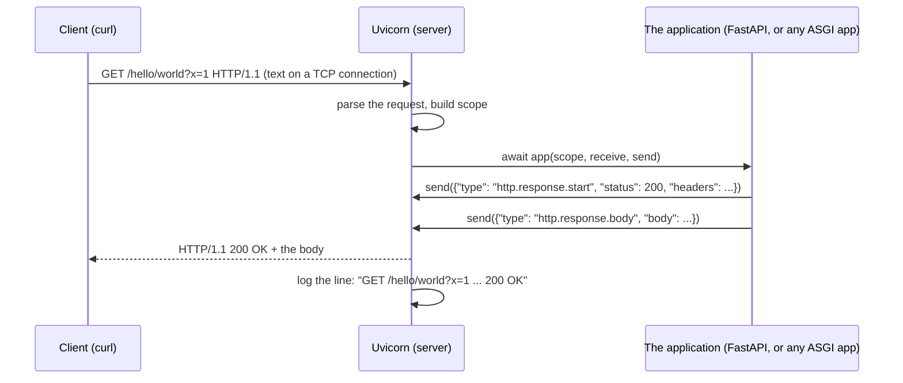
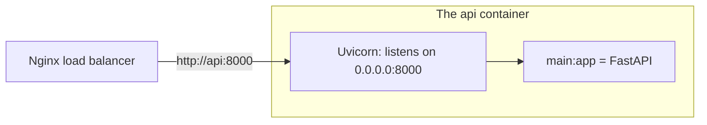

# FastAPI 02 — Uvicorn and ASGI

> **Course:** [FastAPI](./README.md)  ·  **Time:** ~40 min  ·  **Needs:** [FastAPI 01](./01-how-a-web-api-works.md)
> **Used in the labs:** [Lab 01, step 2](../../labs/01-containers.md) (`CMD ["uvicorn", "main:app", ...]` in `api/Dockerfile`)

## What you will learn
- Say what a **server** (Uvicorn) does, what an **application** (FastAPI) does, and what **ASGI** is: the contract between them.
- Read a complete ASGI application of ten lines, with no framework, and see what a request looks like to the server.
- Explain every part of the lab's start command: `uvicorn main:app --host 0.0.0.0 --port 8000`.
- Understand why `--host 127.0.0.1` makes a container unreachable, and what `--workers` changes.

## Words you need
| Word | Plain-words meaning |
|---|---|
| **Server** (here Uvicorn) | The program that **listens** on a network port, reads the raw bytes of each HTTP request, and sends back the bytes of the answer. It knows HTTP; it knows nothing about your notes. |
| **Application** (here FastAPI) | The program that decides **what to answer**: it holds your routes and handlers. It knows your business; it does not read the network. |
| **Interface** | An agreed way for two programs to talk, so either can be replaced. |
| **ASGI** (Asynchronous Server Gateway Interface) | The Python interface between a server and an application: the application is **one function** that the server calls once per request with three arguments (`scope`, `receive`, `send`). FastAPI, Starlette and Uvicorn all speak it. |
| **WSGI** | ASGI's older sibling (used by Flask and Django in their classic form): same idea, but **without** support for `async` code. |
| **`scope`** | A dictionary describing the request: its method, path, query string, headers, the client's address. |
| **`receive` / `send`** | Two functions the server hands to the application: `receive()` to read the request body, `send(message)` to write the response (first a *start* message with status and headers, then *body* messages). |
| **`async` / `await`** | Python's way to write code that can **wait** (for the database, the network) without blocking the whole program: while one request waits, the same process serves another. Explained in FastAPI 06. |
| **Event loop** | The part of the process that switches between the requests that are waiting and the ones that can run. One loop per process. |
| **Process / PID** | A running program, and the number the system gives it. Two processes do not share memory. |
| **Worker** | One server process that answers requests. With `--workers 2`, Uvicorn starts two. |
| **Listen / bind** | To **listen** is to wait for connections on a port. To **bind** is to choose *which network address* of the machine you accept them on: `127.0.0.1` (only from the machine itself) or `0.0.0.0` (from anywhere that can reach it). |
| **Lifespan** | Two special moments an ASGI app is told about: **startup** (before the first request) and **shutdown** (after the last). Used to open and close connections. |
| **`module:variable`** | How you name the application to the server: `main:app` = the variable `app` in the file `main.py`. |

## The idea
**Everyday analogy.** A restaurant again ([FastAPI 01](./01-how-a-web-api-works.md)): **Uvicorn is the front-of-house team** — it opens the door (listens on the port), greets the customer, writes the order on a standard **order slip** (the `scope`) and carries the slip to the kitchen. **ASGI is the format of that order slip and the window between dining room and kitchen**: because it is standardised, any front-of-house team can work with any kitchen. **FastAPI is the kitchen**: it reads the slip, cooks, and puts the finished plate in the window (`send`). You could replace Uvicorn with another server (Hypercorn, Daphne) without touching a line of your routes.

**Precisely.** For each request, Uvicorn:
1. accepts the TCP connection and parses the HTTP text into a request;
2. builds the `scope` dictionary, and calls the application: `await app(scope, receive, send)`;
3. the application reads what it needs from `scope` (and `receive()` for a body), then calls `send({"type": "http.response.start", "status": 200, "headers": [...]})` and `send({"type": "http.response.body", "body": b"..."})`;
4. Uvicorn writes those messages back to the client as an HTTP response, and logs one line.

FastAPI is an application like any other: `app` in `main.py` is an object that can be **called** with `(scope, receive, send)`. It looks up the route in `scope["path"]`, validates the input, calls your handler and calls `send` for you.





## The code, line by line
**1. An ASGI application with no framework** (`raw.py`). It answers every request with a JSON description of what the server told it:

```python
import json
import os


async def app(scope, receive, send):            # the whole contract: one async function, three arguments
    if scope["type"] != "http":                 # also called for "lifespan" (start/stop): we ignore it
        return
    headers = {k.decode(): v.decode() for k, v in scope["headers"]}   # headers arrive as pairs of bytes
    body = json.dumps({
        "scope_type": scope["type"],            # "http"
        "method": scope["method"],              # "GET"
        "path": scope["path"],                  # "/hello/world"
        "query": scope["query_string"].decode(),    # "x=1&y=2" (bytes, so decode)
        "http_version": scope["http_version"],  # "1.1"
        "server": scope["server"],              # [address, port] of the server side
        "client": scope["client"],              # [address, port] of the caller
        "host_header": headers.get("host"),     # what the caller typed as host
        "pid": os.getpid(),                     # the number of this process
    }).encode()                                 # the body must be bytes
    await send({"type": "http.response.start", "status": 200,
                "headers": [(b"content-type", b"application/json"), (b"content-length", str(len(body)).encode())]})
    await send({"type": "http.response.body", "body": body})
```

| Line | What it does | If you change or remove it |
|---|---|---|
| `async def app(scope, receive, send)` | The application. Uvicorn calls it once per request (and for the lifespan events). | A normal `def`, or a different number of arguments: Uvicorn fails with an error at the first request. |
| `if scope["type"] != "http": return` | Ignores everything that is not an HTTP request. Returning at once from a `lifespan` call tells Uvicorn "no startup work needed" (the log shows the application started fine). | A WebSocket connection would reach the code below and fail on `scope["method"]`. |
| `scope["headers"]` | The headers as a list of `(name, value)` pairs of **bytes**, names in lower case. | Using them as text without `.decode()` gives `b'...'` values. |
| `await send({"type": "http.response.start", ...})` | First message: the **status code and headers**. Must come first and only once. | Sending the body first is an error: the server cannot answer. |
| `await send({"type": "http.response.body", "body": body})` | Second message: the bytes of the body. Long answers can be sent in several body messages. | Forget it and the client waits for a body that never comes. |

**2. The lab's start command** (`api/Dockerfile`, last line):

```dockerfile
CMD ["uvicorn", "main:app", "--host", "0.0.0.0", "--port", "8000"]
```

| Part | What it does | If you change or remove it |
|---|---|---|
| `uvicorn` | Starts the server (a program installed by `pip install uvicorn`, pinned in `requirements.txt`). | |
| `main:app` | Import the file `main.py` and use its variable `app` (the `FastAPI(...)` object) as the application. | A wrong name stops the start with `Error loading ASGI app` and the container exits. |
| `--host 0.0.0.0` | Listen on **every** network address of the container, so other containers (the load balancer) can connect. | `127.0.0.1`: only the container itself could connect. See the experiment B below. |
| `--port 8000` | The port inside the container. The load balancer's `upstream` points at `api:8000`. | Change it and the load balancer's config must change too. |
| JSON form `["uvicorn", ...]` of `CMD` | Runs Uvicorn **directly** as the container's main process, so it receives `docker stop`'s signal and shuts down cleanly. | The text form (`CMD uvicorn ...`) would start a shell first. |

## The commands
| Command / flag | Meaning |
|---|---|
| `uvicorn raw:app --host H --port P` | Run the application `app` of `raw.py` on address H and port P. |
| `--workers N` | Start N server **processes** that share the port. The first process only supervises. |
| `--reload` (not used in the lab) | Restart when a source file changes: for development only. |
| `docker run -d --rm --name N -p 127.0.0.1:8771:8000 -v "$D:/demo:ro" -w /demo --user 10001 IMAGE ...` | A throw-away container: `-p` publishes the container's port 8000 on port 8771 of **your machine only**; `-v` shows your folder read-only as `/demo`, where `-w` starts; `--user` is the unprivileged user of the project's image. |
| `curl -s -m 5 -w "  -> curl exit %{exitcode}, HTTP %{http_code}\n" URL` | `-m 5`: give up after 5 s. `-w`: after the answer, print the **exit code** of curl and the HTTP status (`000` = no HTTP answer at all). |
| `sort \| uniq -c` | Count identical lines: here, how many requests each process answered (a `\|` in a table is a plain `|` in your terminal). |
| `docker top CONTAINER` | List the processes running inside a container. |
| `docker logs N` | The server's own log. |

## Hands-on
Put `raw.py` (above) in an empty folder and open a terminal there (Git Bash on Windows; `D=$(pwd -W)` gives the Windows path of the folder, on Linux or macOS use `D=$(pwd)`). The image is the project's own API image (build it with `make up`), which already contains Uvicorn.

**A — the bare ASGI application, one process.**
```bash
D=$(pwd -W)
MSYS_NO_PATHCONV=1 docker run -d --rm --name asgi-a -p 127.0.0.1:8771:8000 -v "$D:/demo:ro" -w /demo --user 10001 \
  aws-local-lab-api:0.1.0 uvicorn raw:app --host 0.0.0.0 --port 8000
curl -s "http://127.0.0.1:8771/hello/world?x=1&y=2"; echo
docker logs asgi-a
docker stop asgi-a
```
```text
{"scope_type": "http", "method": "GET", "path": "/hello/world", "query": "x=1&y=2", "http_version": "1.1", "server": ["172.17.0.2", 8000], "client": ["172.17.0.1", 51276], "host_header": "127.0.0.1:8771", "pid": 1}
INFO:     Started server process [1]
INFO:     Waiting for application startup.
INFO:     Application startup complete.
INFO:     Uvicorn running on http://0.0.0.0:8000 (Press CTRL+C to quit)
INFO:     172.17.0.1:51268 - "GET / HTTP/1.1" 200 OK
INFO:     172.17.0.1:51276 - "GET /hello/world?x=1&y=2 HTTP/1.1" 200 OK
```
(The first log request line, `GET /`, is the readiness loop of my script; the `&y=2` is quoted so the shell does not treat `&` as "run in the background".) **How to read it:** that is exactly what the server hands to *any* ASGI application: the path and query already split, the headers, the two ends of the connection (`172.17.0.2:8000` is the container, `172.17.0.1` is your machine seen from inside Docker's network), and `pid: 1` — in a container, the server is the first process. The startup lines are the **lifespan**: "Waiting for application startup" then "complete" (our app returned at once, so the server concluded there was nothing to do).

**B — the same app listening on `127.0.0.1` only.**
```bash
MSYS_NO_PATHCONV=1 docker run -d --rm --name asgi-b -p 127.0.0.1:8772:8000 -v "$D:/demo:ro" -w /demo --user 10001 \
  aws-local-lab-api:0.1.0 uvicorn raw:app --host 127.0.0.1 --port 8000
sleep 3
curl -s -m 5 -w "  -> curl exit %{exitcode}, HTTP %{http_code}\n" http://127.0.0.1:8772/
docker stop asgi-b
```
```text
  -> curl exit 52, HTTP 000
```
**How to read it:** the server **is** running, yet curl got **no answer** (`exit 52` = "empty reply from server", `HTTP 000`). Docker forwarded the connection to the container's network address, but Uvicorn only accepts connections made to `127.0.0.1` *inside* the container, so it never answers a connection that arrives from outside. This is the classic "works on my machine, not in Docker" mistake: **a server in a container must listen on `0.0.0.0`.**

**C — two worker processes.** Twenty requests to a server started with `--workers 2`, counting which process answered (the `pid` field):
```bash
MSYS_NO_PATHCONV=1 docker run -d --rm --name asgi-c -p 127.0.0.1:8773:8000 -v "$D:/demo:ro" -w /demo --user 10001 \
  aws-local-lab-api:0.1.0 uvicorn raw:app --host 0.0.0.0 --port 8000 --workers 2
for i in $(seq 1 20); do curl -s http://127.0.0.1:8773/; echo; done | sed -n 's/.*"pid": \([0-9]*\).*/\1/p' | sort | uniq -c
docker logs asgi-c
docker stop asgi-c
```
```text
     12 7
      8 8
INFO:     Uvicorn running on http://0.0.0.0:8000 (Press CTRL+C to quit)
INFO:     Started parent process [1]
INFO:     Started server process [8]
INFO:     Waiting for application startup.
INFO:     Started server process [7]
INFO:     Waiting for application startup.
```
(`sed -n 's/.*"pid": \([0-9]*\).*/\1/p'` keeps only the number after `"pid":`.) **How to read it:** process 1 is the **parent** (it only supervises); processes **7** and **8** each started the application (each did its own "startup") and shared the 20 requests: 12 and 8. The split is not even: the system decides which worker takes each new connection.

**The lab's own API container** is the plain case: `docker top aws-local-lab-api-1 -o pid,user,args` shows one process, run by user `10001` (not root):
```text
PID                 USER                COMMAND
74372               10001               /usr/local/bin/python3.12 /usr/local/bin/uvicorn main:app --host 0.0.0.0 --port 8000
```
(The PID is the host-side number, so it differs from the `1` seen inside the container.) One worker per container, three containers behind the load balancer: scaling is done by **adding containers** (as in ECS or Kubernetes), not by adding workers.

## What if…?
**…you used `--workers` in this project?** Processes do **not share memory**: C above shows two different PIDs, each with its own copy of the application. Anything the application keeps in a Python variable — the metrics counters added in [Lab 09, step 29](../../labs/09-monitoring.md), a cache in a dictionary — would then be split between the workers, and each `GET /metrics` would show only the numbers of the worker that happened to answer. This is one reason the lab keeps **one worker per container** and lets the load balancer spread requests over three containers: each replica's metrics are complete for that replica, and Prometheus (step 30) adds the replicas up. (This is an explanation of what the PIDs imply; the lab itself was not run with `--workers`.)

## In short
1. **Uvicorn** speaks HTTP with the network; **FastAPI** decides what to answer; **ASGI** is the small contract between them: the application is a function `app(scope, receive, send)`.
2. `uvicorn main:app --host 0.0.0.0 --port 8000` = "run the `app` of `main.py`, accept connections from anywhere, on port 8000". In a container, `--host 127.0.0.1` makes it unreachable.
3. `--workers N` starts N separate processes (no shared memory). The lab uses one per container and scales by adding containers.

## Check your understanding
1. What are the roles of Uvicorn and FastAPI in answering one request?
2. What are `scope`, `receive` and `send`?
3. In `main:app`, what is `main` and what is `app`?
4. Why does a container started with `--host 127.0.0.1` not answer `curl` from your machine, even with `-p` publishing the port?
5. With `--workers 2`, two requests in a row modify a Python list in the application. Why might the second request not see the first one's change?

<details><summary>Answers</summary>

1. Uvicorn listens on the port, parses the HTTP request, builds the `scope`, calls the application and writes the response back. FastAPI (the application) finds the route, validates the input, runs your handler and calls `send` with the result.
2. `scope` is a dictionary describing the request (method, path, headers, client address). `receive` is a function to read the request body. `send` is a function to write the response: first a start message (status, headers), then body messages.
3. `main` is the Python file `main.py` (the module); `app` is the variable in it that holds the `FastAPI(...)` application object.
4. `127.0.0.1` inside the container means "this container only". The published port forwards your connection to the container's other address, where nothing is listening, so the connection is closed without an answer (`curl` exit 52). `0.0.0.0` listens on all addresses.
5. Each worker is a separate process with its own memory. The second request may be answered by the other worker, whose list was never changed. That is why shared state belongs in a shared store (Redis, the database), not in a Python variable.

</details>

## Official documentation
- [Uvicorn: settings and deployment](https://www.uvicorn.org/settings/) and [Uvicorn: ASGI](https://www.uvicorn.org/#the-asgi-interface)
- [ASGI specification](https://asgi.readthedocs.io/en/latest/specs/www.html) (the `scope` and the messages of the HTTP protocol)
- [FastAPI: deployment concepts](https://fastapi.tiangolo.com/deployment/concepts/) and [Docker `CMD`](https://docs.docker.com/reference/dockerfile/#cmd)

## Where you use this in the project
- [Lab 01, step 2](../../labs/01-containers.md): the `CMD` line of `api/Dockerfile`; the three replicas of [Lab 02](../../labs/02-load-balancing.md) are three containers running this same command.
- [Lab 01](../../labs/01-containers.md) and [Lab 03](../../labs/03-networking.md): the load balancer reaches the API at `api:8000` because Uvicorn listens on `0.0.0.0`.
- [Lab 09, step 29](../../labs/09-monitoring.md): the in-memory metrics of each replica (one process per container).
