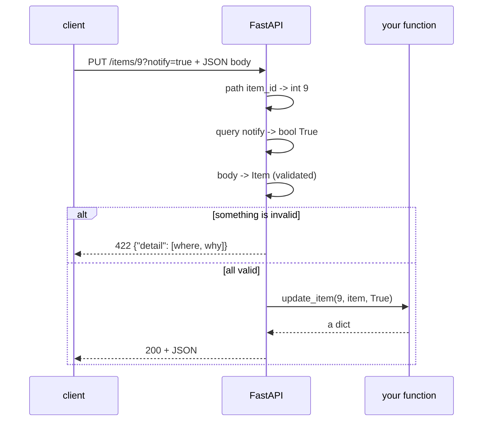

# FastAPI 03 — Path, query and body parameters

> **Course:** [FastAPI](./README.md)  ·  **Time:** ~40 min  ·  **Needs:** [Networking 03](../networking/03-http.md) helps (what a request is); [FastAPI 07](./07-dependencies.md) for the `Depends` part
> **Used in the labs:** [Lab 04, step 12](../../labs/04-database.md) (`/notes/{note_id}`, `POST /notes`) and [Lab 06, step 19](../../labs/06-object-storage.md) (`POST /upload`, a file)

## What you will learn
- Tell the four places a value can come from in a request: **path**, **query string**, **body** and **file/form field**.
- Declare each one with a plain Python function signature, and see how FastAPI decides which is which.
- Add rules (`ge`, `le`, `min_length`) and read the **422** answer when a rule is broken.
- Combine path, query and body in one route.
- Explain why an `UploadFile` route needs the `python-multipart` library.

## Words you need
| Word | Plain-words meaning |
|---|---|
| **Route** | One URL pattern plus a method that your code answers, such as `GET /items/{item_id}`. |
| **Parameter** | A value the client sends and your function receives as an argument. |
| **Path parameter** | A value inside the URL path: in `/items/7`, the `7`. |
| **Query string / query parameter** | The part after `?`: in `/items/7?q=cat&limit=3`, `q` and `limit`. |
| **Body** | Data sent in the request itself (after the headers), used by `POST` and `PUT`. Often **JSON**. |
| **JSON** | A text format for data: `{"title": "hello"}`. |
| **Form / multipart** | A body format (`multipart/form-data`) used to send files and form fields together. |
| **Validation** | Checking that a value has the right type and respects the rules, before your code runs. |
| **422** | The HTTP status "Unprocessable Content": the request was understood but its data is not valid. FastAPI sends it for every validation error. |
| **Pydantic model** | A Python class that describes a JSON object and validates it ([FastAPI 04](./README.md), planned). `Item` below is one. |
| **Type hint** | The `: int` after a name. FastAPI reads these to convert and check values. |
| **`Annotated`** | Python's way to attach extra information (such as `Query(ge=1)`) to a type hint. |

## The idea
**Analogy.** Ordering at a counter: you say **which dish** (the path: `/items/7`), then you add **options** ("with sauce, medium size": the query string), and you hand over a **form or a package** (the body or a file). The waiter (FastAPI) checks the order against the menu before it reaches the kitchen (your function): "size 100 does not exist" comes back at once, and the kitchen never sees a bad order.

**Precisely.** You write an ordinary Python function. FastAPI reads its **signature** and decides, argument by argument, where the value comes from:

| The argument is... | Taken from | Example |
|---|---|---|
| named in the route's `{braces}` | the **path** | `item_id: int` in `/items/{item_id}` |
| a simple type (`int`, `str`, `bool`) **not** in the path | the **query string** | `q: str \| None = None` |
| a **Pydantic model** | the JSON **body** | `item: Item` |
| `UploadFile` with `File()` | a **file** in a multipart body | `file: Annotated[UploadFile, File()]` |
| marked `Form()` | a **form field** in a multipart body | `description: Annotated[str, Form()]` |

Before your function runs FastAPI **converts** each value to the declared type (`"7"` becomes the integer `7`) and **checks** the rules. If anything fails it answers `422` with the exact place and reason, and your function is never called.



## The code, line by line
The demo app used in the exercise (it has the same shapes as `POST /notes` and `POST /upload`):

```python
class Item(BaseModel):                                        # 1  a JSON body shape
    title: str = Field(min_length=1, max_length=20)           # 2  required text, 1 to 20 characters
    body: str = ""                                            # 3  optional text, "" if missing

@app.get("/items/{item_id}")                                  # 4  {item_id} is a path parameter
def read_item(item_id: int,                                   # 5  path: converted to int
              q: str | None = None,                           # 6  query, optional (None if absent)
              limit: Annotated[int, Query(ge=1, le=50)] = 10):# 7  query, 1..50, default 10
    ...

@app.post("/items")                                           # 8  create
def create_item(item: Item): ...                              # 9  a model -> read from the JSON body

@app.put("/items/{item_id}")                                  # 10 path + query + body together
def update_item(item_id: int, item: Item, notify: bool = False): ...

@app.post("/files")                                           # 11 multipart body
async def upload(file: Annotated[UploadFile, File()],         # 12 a file
                 description: Annotated[str, Form()] = ""):   # 13 a form field next to it
    ...
```

| Line | What it does | If you change or remove it |
|---|---|---|
| 2 `Field(min_length=1, max_length=20)` | Rules on the value, checked before your code runs. | Remove them and an empty or huge title is accepted. |
| 3 `body: str = ""` | A default makes the field optional. | Without the default the field becomes **required**. |
| 4-5 `"/items/{item_id}"` + `item_id: int` | The name in braces and the argument name must match; the hint converts the text. | Rename one of them and FastAPI treats the argument as a query parameter. |
| 6 `q: str \| None = None` | Not in the path, simple type, has a default: an **optional query** parameter. | Without `= None` the client **must** send `?q=...` or get a 422. |
| 7 `Query(ge=1, le=50)` | Rules for a query value: *greater or equal* 1, *less or equal* 50. | Remove it and any integer is accepted, including `-5` or `10_000_000`. |
| 9 `item: Item` | A Pydantic model is read from the **JSON body**. | Declared as `item: dict` you lose the validation. |
| 10 | One function, three sources: the path (`item_id`), the body (`item`) and the query (`notify`). | The same rules apply to each source independently. |
| 12 `File()` / 13 `Form()` | Read from a **multipart** body. Needs `python-multipart` installed. | Without that library FastAPI stops at start-up with an error asking to install it. |

## The commands
| Command / flag | Meaning |
|---|---|
| `curl URL` | A `GET` request. |
| `curl -X POST URL` | Choose the method (`POST`, `PUT`, `DELETE`). |
| `curl -H 'Content-Type: application/json'` | Add a header: here "the body is JSON" (FastAPI needs it to read the body). |
| `curl -d '{"title":"hello"}'` | Send this text as the **body**. |
| `curl -F "file=@hello.txt;type=text/plain"` | Send a **multipart** form; `file=@hello.txt` attaches the file; `;type=` sets its content type. Another `-F "description=my note"` adds a form field. |
| `curl -s -w ' [HTTP %{http_code}]\n'` | `-s` silent (no progress bar); `-w` prints the status code after the body. |
| `docker run -d --rm --name N -p 127.0.0.1:18000:8000 --entrypoint sleep IMAGE 900` | Start a container that only waits, with its port 8000 reachable at `127.0.0.1:18000` on your machine (we start the app inside it afterwards). |
| `docker exec -d -w /tmp N python -m uvicorn params_demo:app --host 0.0.0.0 --port 8000` | Run the app **in the background** (`-d`) from the folder `/tmp` (`-w`); `0.0.0.0` makes it reachable from outside the container ([Networking 01](../networking/01-ip-ports-tcp.md)). |

## Hands-on
The demo app `params_demo.py` (the full file, save it as is) runs inside the project's own API image, which already has FastAPI and Uvicorn. Real output, trimmed.

```python
from typing import Annotated

from fastapi import FastAPI, File, Form, Query, UploadFile
from pydantic import BaseModel, Field

app = FastAPI()


class Item(BaseModel):
    title: str = Field(min_length=1, max_length=20)
    body: str = ""


@app.get("/items/{item_id}")
def read_item(item_id: int, q: str | None = None, limit: Annotated[int, Query(ge=1, le=50)] = 10):
    return {"item_id": item_id, "q": q, "limit": limit}


@app.post("/items")
def create_item(item: Item):
    return {"received": item}


@app.put("/items/{item_id}")
def update_item(item_id: int, item: Item, notify: bool = False):
    return {"item_id": item_id, "item": item, "notify": notify}


@app.post("/files")
async def upload(file: Annotated[UploadFile, File()], description: Annotated[str, Form()] = ""):
    data = await file.read()
    return {"filename": file.filename, "type": file.content_type, "bytes": len(data), "description": description}
```

**1. Start it**
```bash
docker run -d --rm --name fa03 -p 127.0.0.1:18000:8000 --entrypoint sleep aws-local-lab-api:0.1.0 900
docker cp params_demo.py fa03:/tmp/params_demo.py
docker exec -d -w /tmp fa03 python -m uvicorn params_demo:app --host 0.0.0.0 --port 8000
```
(Allow a few seconds for the app to start; try the first `curl` until it answers.)

**2. Path and query parameters**
```bash
curl -s -w ' [HTTP %{http_code}]\n' "localhost:18000/items/7"
curl -s -w ' [HTTP %{http_code}]\n' "localhost:18000/items/7?q=cat&limit=3"
```
```text
{"item_id":7,"q":null,"limit":10} [HTTP 200]
{"item_id":7,"q":"cat","limit":3} [HTTP 200]
```
**How to read it:** `7` came from the path and was turned into the **integer** 7. With no query string, `q` is `null` and `limit` takes its default `10`; with `?q=cat&limit=3` both come from the query.

**3. Broken rules give 422 with the exact place**
```bash
curl -s -w ' [HTTP %{http_code}]\n' "localhost:18000/items/abc"
curl -s -w ' [HTTP %{http_code}]\n' "localhost:18000/items/7?limit=100"
```
```text
{"detail":[{"type":"int_parsing","loc":["path","item_id"],"msg":"Input should be a valid integer, unable to parse string as an integer","input":"abc"}]} [HTTP 422]
{"detail":[{"type":"less_than_equal","loc":["query","limit"],"msg":"Input should be less than or equal to 50","input":"100","ctx":{"le":50}}]} [HTTP 422]
```
**How to read it:** `loc` says **where** the problem is (`["path", "item_id"]`, `["query", "limit"]`), `msg` says why, `input` shows what was received. Your function did not run for either request.

**4. The JSON body**
```bash
curl -s -w ' [HTTP %{http_code}]\n' -X POST localhost:18000/items -H 'Content-Type: application/json' -d '{"title":"hello"}'
curl -s -w ' [HTTP %{http_code}]\n' -X POST localhost:18000/items -H 'Content-Type: application/json' -d '{"title":""}'
curl -s -w ' [HTTP %{http_code}]\n' -X POST localhost:18000/items -H 'Content-Type: application/json' -d '{"body":"x"}'
```
```text
{"received":{"title":"hello","body":""}} [HTTP 200]
{"detail":[{"type":"string_too_short","loc":["body","title"],"msg":"String should have at least 1 character","input":"","ctx":{"min_length":1}}]} [HTTP 422]
{"detail":[{"type":"missing","loc":["body","title"],"msg":"Field required","input":{"body":"x"}}]} [HTTP 422]
```
**How to read it:** the first body is valid and `body` took its default `""`. The second breaks `min_length`; the third has no `title` at all (`"type":"missing"`). The same 422 shape, with `loc` starting with `body`. This is what a client of `POST /notes` sees for an empty title ([Lab 04](../../labs/04-database.md)).

**5. All three sources in one route**
```bash
curl -s -w ' [HTTP %{http_code}]\n' -X PUT "localhost:18000/items/9?notify=true" -H 'Content-Type: application/json' -d '{"title":"t","body":"b"}'
```
```text
{"item_id":9,"item":{"title":"t","body":"b"},"notify":true} [HTTP 200]
```
**How to read it:** `9` from the path, `true` from the query (converted to a boolean), the `item` from the body, all in one function call.

**6. A file and a form field**
```bash
curl -s -w ' [HTTP %{http_code}]\n' -F "file=@hello.txt;type=text/plain" -F "description=my note" localhost:18000/files
```
```text
{"filename":"hello.txt","type":"text/plain","bytes":27,"description":"my note"} [HTTP 200]
```
**How to read it:** one **multipart** request carried a file (`UploadFile` gave the name, the content type and the bytes) and a plain text field. This is the shape of the lab's `POST /upload`, which sends `-F "file=@..."`.

**7. Clean up**
```bash
docker stop fa03        # started with --rm: it removes itself
```

## What if…?
**…a path parameter and its argument name do not match?** In a throw-away container (a plain `python:3.12.16-slim-trixie` with `pip install fastapi==0.163.0 httpx`) a route declares `@app.get("/items/{item_id}")` but the function is written `def read_item(id: int)`. FastAPI's test client calls it twice:
```text
422 {'detail': [{'type': 'missing', 'loc': ['query', 'id'], 'msg': 'Field required', 'input': None}]}
200 {'id': 5}
```
`/items/7` fails: `id` is not in the path braces, so FastAPI treats it as a **required query parameter** (`loc` says `query`), and the `7` in the path goes nowhere. `/items/7?id=5` works, and answers with `5`, not `7`. Always check that the names in the braces and in the signature are identical.

**…`python-multipart` is not installed?** In the same container, importing a file that declares `file: Annotated[UploadFile, File()]` stops at once, and the error ends with the instruction `pip install python-multipart`. The app never starts: you find out at start-up, not on the first upload.

## In short
1. FastAPI decides the **source** of each argument from the signature: in the path braces, a simple type (query), a Pydantic model (JSON body), `File()`/`Form()` (multipart).
2. It **converts and validates** before your function runs, and answers `422` with `loc`, `msg` and `input` when something is wrong.
3. Rules such as `Query(ge=1, le=50)` and `Field(min_length=1)` keep bad data out of your code, your database and your storage.

## Check your understanding
1. In `GET /items/7?q=cat`, which value is a path parameter and which a query parameter, and how does FastAPI know?
2. What does the client receive for `/items/abc`, and was your function called?
3. How do you make a query parameter **required**, and how **optional**?
4. Why does the lab's `POST /upload` need the `python-multipart` library, while `POST /notes` does not?
5. What does `"loc": ["body", "title"]` tell you in a 422 answer?

<details><summary>Answers</summary>

1. `7` is the path parameter (its name appears in `{braces}` in the route), and `q` is a query parameter (a simple-typed argument that is not in the path). FastAPI decides from the route string and the function signature.
2. A `422` with `"loc":["path","item_id"]` and a message "Input should be a valid integer". The function was **not** called: validation happens first.
3. **Required:** no default (`q: str`). **Optional:** a default, such as `q: str | None = None` or `limit: int = 10`.
4. Files travel in a `multipart/form-data` body, and FastAPI uses `python-multipart` to read it. A JSON body (`POST /notes`) needs no extra library.
5. The problem is in the request **body**, in the field `title`: for example it is missing or breaks a rule such as `min_length`.

</details>

## Official documentation
- [FastAPI: path parameters](https://fastapi.tiangolo.com/tutorial/path-params/) and [query parameters](https://fastapi.tiangolo.com/tutorial/query-params/)
- [FastAPI: request body](https://fastapi.tiangolo.com/tutorial/body/) and [query parameter validations](https://fastapi.tiangolo.com/tutorial/query-params-str-validations/)
- [FastAPI: request files](https://fastapi.tiangolo.com/tutorial/request-files/) and [form data](https://fastapi.tiangolo.com/tutorial/request-forms/)
- [FastAPI: handling errors (422)](https://fastapi.tiangolo.com/tutorial/handling-errors/)

## Where you use this in the project
- [Lab 04, step 12](../../labs/04-database.md): `GET /notes/{note_id}` (path), `POST /notes` and `PUT` (JSON body, `NoteIn`), the 422 for an empty title.
- [Lab 06, step 19](../../labs/06-object-storage.md): `POST /upload` takes `file: Annotated[UploadFile, File()]`; a request without the `file` field gets the `422` you saw in exercise 4.
- [FastAPI 07](./07-dependencies.md): `Depends` arguments are resolved next to these parameters.
