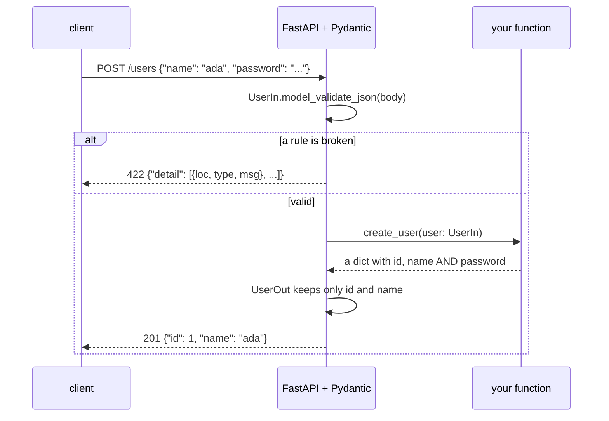

# FastAPI 04 — Pydantic models and validation

> **Course:** [FastAPI](./README.md)  ·  **Time:** ~45 min  ·  **Needs:** [FastAPI 03](./03-parameters.md) (where a value comes from in a request)
> **Used in the labs:** [Lab 04, step 12](../../labs/04-database.md) (`NoteIn` and `NoteOut`) and [Lab 06, step 19](../../labs/06-object-storage.md) (`UploadOut`)

## What you will learn
- Describe a JSON object as a Python class (a **Pydantic model**) and see what it checks for you.
- Tell **conversion** from **validation**: why `"5"` becomes `5` for an `int` but `12345678` is refused for a `str`.
- Read a `ValidationError` and the matching `422` answer.
- Use one model for what comes **in** and another for what goes **out** (`response_model`), and see what leaks without it.
- Explain `from_attributes`, `Field(...)` rules, default values and what happens to unknown fields.

## Words you need
| Word | Plain-words meaning |
|---|---|
| **Pydantic** | A Python library that turns plain data (a dict, a JSON text) into checked Python objects. FastAPI uses it for every request body and answer. |
| **Model** | A class that inherits from `BaseModel` and lists fields with their types: `title: str`. |
| **Field** | One named value of a model. `Field(...)` attaches rules to it (`min_length`, `ge`, `max_length`). |
| **Validation** | Checking that the data has the right shape and obeys the rules. It either gives you a clean object or an error, never half of each. |
| **Conversion (coercion)** | Turning a value into the declared type when that is safe and obvious (the text `"5"` into the integer `5`). |
| **`ValidationError`** | The Python exception Pydantic raises. It holds a list of **all** problems, each with a place (`loc`), a kind (`type`) and a message (`msg`). |
| **Schema** | A machine-readable description of a model (its fields, types and rules), written in the JSON Schema format. FastAPI publishes it in `/openapi.json`. |
| **Default value** | What a field takes when the client leaves it out: `body: str = ""`. A field with no default is **required**. |
| **`response_model`** | A model given to a route to say: "whatever the function returns, send only these fields, in this shape". |
| **ORM object** | A Python object that stands for a database row (SQLAlchemy gives you these, see [Databases 05](../databases/05-sqlalchemy.md)). Its values are **attributes** (`row.title`), not dict keys. |
| **`from_attributes`** | A model setting that lets Pydantic read the values from attributes of any object, so an ORM row can be turned into a model. |

## The idea
**Analogy.** A model is a **paper form with rules printed on it**: "name: at least 1 letter, password: at least 8 characters". The clerk (Pydantic) checks every box *before* the form reaches the office (your function). A badly filled form goes back at once with a list of **every** wrong box, not just the first. The office also has a second form for what it **hands back** to the customer, which has no "password" box at all: whatever the office writes down, the customer only gets what that form allows.

**Precisely.** You write a class with typed fields. Pydantic gives you three powers:
1. **Validation and conversion** when you build the object, from Python values or from JSON (`model_validate`, `model_validate_json`). The result is an object whose fields are guaranteed to have the declared type and to respect the rules.
2. **Serialization** (turning the object back into a dict or a JSON text, to send it): `model_dump`, `model_dump_json`.
3. **A schema** (`model_json_schema`). FastAPI reads it to publish the API documentation ([FastAPI 05](./README.md), planned) and to apply the same rules to every request.

FastAPI wires a model into a route in two places: a **parameter** typed with a model is the JSON **body** (checked before your code runs, `422` if wrong), and a route's **`response_model`** filters and checks what you **return**. Using a different model for each direction is the habit that keeps secrets and database internals out of answers.



## The code or config, line by line
The project's two models, in `api/main.py` ([Lab 04, step 12](../../labs/04-database.md)):
```python
class NoteIn(BaseModel):                       # what a client SENDS
    """What a client sends: the body is optional."""
    title: str = Field(min_length=1, max_length=200)   # required, 1 to 200 characters
    body: str = ""                                      # optional, "" when missing

class NoteOut(NoteIn):                         # what the API ANSWERS: NoteIn's fields plus two more
    model_config = ConfigDict(from_attributes=True)    # may be built from a database object
    id: int                                    # added by the database
    created_at: datetime                       # added by the database
```
| Line | What it does | If you change or remove it |
|---|---|---|
| `class NoteIn(BaseModel)` | Declares a model. Each annotated name in the class is a field. | Without `BaseModel` it is an ordinary class: no checks at all. |
| `title: str = Field(min_length=1, max_length=200)` | Required text between 1 and 200 characters (no default, so required). | Remove `min_length` and `{"title": ""}` is accepted. |
| `body: str = ""` | Optional text. The default makes the field optional. | Remove `= ""` and a body without `body` is refused (`"type":"missing"`). |
| `class NoteOut(NoteIn)` | Inherits `title` and `body` and adds fields: no repetition. | Copy-pasting the fields instead makes the two models drift apart. |
| `from_attributes=True` | Lets `NoteOut.model_validate(row)` read `row.id`, `row.title`... | Without it the same call fails with `model_type` (exercise, step 8). |
| `id: int`, `created_at: datetime` | Fields only the **server** knows. A client never sends them, so they are not in `NoteIn`. | Put them in `NoteIn` and clients could try to choose their own `id`. |

## The commands
| Command / flag | Meaning |
|---|---|
| `docker run --rm IMAGE ...` | Start a throw-away container; `--rm` deletes it when the command ends. |
| `-v "$D:/demo" -w /demo` | Mount your folder `$D` at `/demo` inside the container ([Docker 08](../docker/08-volumes-and-bind-mounts.md)) and start in it. |
| `MSYS_NO_PATHCONV=1` | Git Bash on Windows would rewrite `/demo` into a Windows path; this switch turns that off. `$(pwd -W)` gives the Windows form of the current folder. |
| `uvicorn api_demo:app --port 8000` | Start the web server for the object `app` of the file `api_demo.py` ([FastAPI 02](./README.md), planned). It runs in the background (`&`) so the same container can then run the client. |

## Hands-on
Runs in a throw-away container of the project's own API image (`aws-local-lab-api:0.1.0`: Python 3.12.16, FastAPI 0.163.0, Pydantic 2.14.4, check with `docker compose build api` if it is missing). Save the three files in an empty folder, here `fa04`.

**1. A model on its own** — `models_demo.py`, the whole file:
```python
"""FastAPI 04 - Pydantic models, part 1: a model on its own (no web server)."""
from datetime import datetime

from pydantic import BaseModel, ConfigDict, Field, ValidationError


class NoteIn(BaseModel):
    title: str = Field(min_length=1, max_length=200)
    body: str = ""
    tags: list[str] = []


print("1. a valid object")
note = NoteIn(title="hello", tags=["a", "b"])
print("  ", note)
print("   title:", repr(note.title), "| body (default):", repr(note.body))

print("2. conversion: the text '5' becomes the number 5 when the field is an int")


class Counter(BaseModel):
    count: int


print("  ", repr(Counter(count="5").count), "| with 5.0:", repr(Counter(count=5.0).count))

print("3. invalid data raises ValidationError (all problems at once)")
try:
    NoteIn(title="", tags="oops", extra_thing=1)
except ValidationError as exc:
    for err in exc.errors():
        print("  ", err["loc"], err["type"], "-", err["msg"])

print("4. built from a dict and from a JSON text")
print("  ", NoteIn.model_validate({"title": "from dict"}))
print("  ", NoteIn.model_validate_json('{"title": "from json", "body": "x"}'))

print("5. back to a dict / a JSON text")
print("  ", note.model_dump())
print("  ", note.model_dump_json())

print("6. each object gets its own default list")
a, b = NoteIn(title="a"), NoteIn(title="b")
a.tags.append("only-a")
print("   a.tags:", a.tags, "| b.tags:", b.tags)

print("7. unknown fields are ignored by default, refused with extra='forbid'")


class Strict(BaseModel):
    model_config = ConfigDict(extra="forbid")
    title: str


print("   NoteIn(title='x', colour='red') ->", NoteIn(title="x", colour="red"))
try:
    Strict(title="x", colour="red")
except ValidationError as exc:
    print("   Strict(...) ->", exc.errors()[0]["loc"], exc.errors()[0]["type"])

print("8. from_attributes: read the values from any object (like a database row)")


class Row:  # stands in for a SQLAlchemy object
    id = 7
    title = "from a row"
    body = ""
    created_at = datetime(2026, 11, 20, 12, 0, 0)


class NoteOut(NoteIn):
    model_config = ConfigDict(from_attributes=True)
    id: int
    created_at: datetime


print("  ", NoteOut.model_validate(Row()).model_dump_json())


class NoFlag(NoteIn):  # same fields, but without from_attributes
    id: int


try:
    NoFlag.model_validate(Row())
except ValidationError as exc:
    print("   without from_attributes ->", exc.errors()[0]["type"])
```
```bash
cd fa04 && D=$(pwd -W)
MSYS_NO_PATHCONV=1 docker run --rm -v "$D:/demo" -w /demo aws-local-lab-api:0.1.0 python models_demo.py
```
```text
1. a valid object
   title='hello' body='' tags=['a', 'b']
   title: 'hello' | body (default): ''
2. conversion: the text '5' becomes the number 5 when the field is an int
   5 | with 5.0: 5
3. invalid data raises ValidationError (all problems at once)
   ('title',) string_too_short - String should have at least 1 character
   ('tags',) list_type - Input should be a valid list
4. built from a dict and from a JSON text
   title='from dict' body='' tags=[]
   title='from json' body='x' tags=[]
5. back to a dict / a JSON text
   {'title': 'hello', 'body': '', 'tags': ['a', 'b']}
   {"title":"hello","body":"","tags":["a","b"]}
6. each object gets its own default list
   a.tags: ['only-a'] | b.tags: []
7. unknown fields are ignored by default, refused with extra='forbid'
   NoteIn(title='x', colour='red') -> title='x' body='' tags=[]
   Strict(...) -> ('colour',) extra_forbidden
8. from_attributes: read the values from any object (like a database row)
   {"title":"from a row","body":"","tags":[],"id":7,"created_at":"2026-11-20T12:00:00"}
   without from_attributes -> model_type
```
**How to read it:**
- **2:** `"5"` was **converted** to the integer 5, and `5.0` too (a float with no decimals is accepted for an `int`).
- **3:** `ValidationError` lists **every** problem, not only the first; each has `loc` (where), `type` (what kind) and `msg`. The unknown field `extra_thing` caused no error: it was ignored (see 7).
- **4 and 5:** `model_validate` reads a dict, `model_validate_json` a JSON text; `model_dump()` gives a dict back and `model_dump_json()` a JSON text.
- **6:** `a.tags` changed but `b.tags` did not: every object gets its **own** copy of the default `[]` (in plain Python a shared mutable default is a classic bug).
- **7:** unknown fields are dropped silently by default; `extra="forbid"` turns them into an error.
- **8:** `from_attributes` lets a model read a plain object's attributes. Without it: `model_type` (Pydantic expected a dict).

**2. Models in an API** — `api_demo.py` (two routes doing the same thing, only one with `response_model`) and `client.py`:
```python
"""FastAPI 04 - Pydantic models, part 2: input model, output model, response_model."""
from fastapi import FastAPI
from pydantic import BaseModel, Field

app = FastAPI()
USERS = {}


class UserIn(BaseModel):
    name: str = Field(min_length=1)
    password: str = Field(min_length=8)  # secret: must never be sent back


class UserOut(BaseModel):
    id: int
    name: str


@app.post("/users", response_model=UserOut, status_code=201)
def create_user(user: UserIn):
    new_id = len(USERS) + 1
    USERS[new_id] = user
    # We return the whole stored object, password included. response_model filters it.
    return {"id": new_id, **user.model_dump()}


@app.post("/users-leaky", status_code=201)
def create_user_leaky(user: UserIn):
    # Same code, but no response_model: everything we return goes out.
    return {"id": 99, **user.model_dump()}
```
```python
import json, urllib.error, urllib.request as u

def post(path, payload):
    req = u.Request("http://127.0.0.1:8000" + path, json.dumps(payload).encode(),
                    {"Content-Type": "application/json"}, method="POST")
    try:
        with u.urlopen(req) as r:
            return r.status, r.read().decode()
    except urllib.error.HTTPError as e:
        return e.code, e.read().decode()

good = {"name": "ada", "password": "s3cret-pass"}
print("1 valid body        ->", *post("/users", good))
print("2 password too short->", *post("/users", {"name": "ada", "password": "x"}))
print("3 two problems      ->", *post("/users", {"name": "", "password": "x"}))
print("4 number as password->", *post("/users", {"name": "ada", "password": 12345678}))
print("5 no response_model ->", *post("/users-leaky", good))
schemas = json.load(u.urlopen("http://127.0.0.1:8000/openapi.json"))["components"]["schemas"]
print("schemas:", sorted(schemas))
print("UserIn :", schemas["UserIn"]["properties"]["password"], schemas["UserIn"]["required"])
```
```bash
MSYS_NO_PATHCONV=1 docker run --rm -v "$D:/demo" -w /demo aws-local-lab-api:0.1.0 sh -c 'uvicorn api_demo:app --port 8000 --log-level warning >/tmp/server.log 2>&1 & sleep 3; python client.py'
```
```text
1 valid body        -> 201 {"id":1,"name":"ada"}
2 password too short-> 422 {"detail":[{"type":"string_too_short","loc":["body","password"],"msg":"String should have at least 8 characters","input":"x","ctx":{"min_length":8}}]}
3 two problems      -> 422 {"detail":[{"type":"string_too_short","loc":["body","name"],"msg":"String should have at least 1 character","input":"","ctx":{"min_length":1}},{"type":"string_too_short","loc":["body","password"],"msg":"String should have at least 8 characters","input":"x","ctx":{"min_length":8}}]}
4 number as password-> 422 {"detail":[{"type":"string_type","loc":["body","password"],"msg":"Input should be a valid string","input":12345678}]}
5 no response_model -> 201 {"id":99,"name":"ada","password":"s3cret-pass"}
schemas: ['HTTPValidationError', 'UserIn', 'UserOut', 'ValidationError']
UserIn : {'type': 'string', 'minLength': 8, 'title': 'Password'} ['name', 'password']
```
**How to read it:**
- **1:** valid body: `201`, and the answer holds `id` and `name` only. The function returned the password too (`**user.model_dump()`), but `response_model=UserOut` **cut it**.
- **2 and 3:** the `422` bodies list each broken rule with its `loc` (`["body","password"]`); in 3 both fields are reported in one answer.
- **4:** `12345678` (a number) is **refused** for a `str` field. Pydantic converts `"5"` to `5` but does not turn a number into text: it would hide a client mistake.
- **5:** the same function **without** `response_model` returns the password in clear text. See "What if…?".
- **Last two lines:** the schema FastAPI built from the models (`UserIn`, `UserOut`) is what `/openapi.json` publishes, with `minLength: 8` and the list of required fields. The lab's API does the same: its `NoteIn` has `required = ['title']` and `maxLength: 200`, and `NoteOut` adds `id` and `created_at` (captured from `localhost:8088/openapi.json`).

## What if…?
**…you forget the `response_model`?** Exercise 5 is the answer: `{"id":99,"name":"ada","password":"s3cret-pass"}`. The route works, the tests pass, and the secret goes to every client. This is why the lab uses `NoteOut` as `response_model` and a **separate** `NoteIn`: a field that only exists in the input model (a password) or only in the database (an internal flag) can never reach a client by accident.

## In short
1. A Pydantic model is a class of typed fields with rules: it **converts** what is safe (`"5"` to `5`), **refuses** the rest, and reports **all** problems at once.
2. FastAPI turns a model parameter into the JSON body (`422` on error) and uses `response_model` to filter what is sent back.
3. Use one model **in** and one **out**; `from_attributes=True` lets the output model read a database object.

## Check your understanding
1. What is the difference between conversion and validation? Give one value that is converted and one that is refused.
2. A client sends `{"name": "", "password": "x"}` to `/users`. How many errors are in the `422` answer, and where does each one point?
3. Why do the lab's notes have two models, `NoteIn` and `NoteOut`?
4. What does `from_attributes=True` allow, and what error appears without it?
5. What happens to a field the client sends that the model does not declare?

<details><summary>Answers</summary>

1. Validation checks the data against the declared types and rules; conversion is the safe part of that (the text `"5"` becomes the integer 5). `"5"` for an `int` is converted; the number `12345678` for a `str`, or `""` for a field with `min_length=1`, is refused.
2. Two: one with `loc` `["body","name"]` (`string_too_short`, at least 1 character) and one with `["body","password"]` (at least 8 characters). Pydantic reports every problem, not only the first.
3. The input has fields only the client knows (`title`, `body`), the output adds fields only the server knows (`id`, `created_at`). Two models stop a client from choosing server-side values and stop internal data from leaking.
4. It lets Pydantic read values from the **attributes** of any object, so a database row can become a `NoteOut`. Without it, validating that object fails with an error of type `model_type` (a dict was expected).
5. By default it is silently ignored. With `ConfigDict(extra="forbid")` it becomes a validation error (`extra_forbidden`).

</details>

## Official documentation
- [Pydantic: models](https://docs.pydantic.dev/latest/concepts/models/) and [fields](https://docs.pydantic.dev/latest/concepts/fields/)
- [Pydantic: conversion table](https://docs.pydantic.dev/latest/concepts/conversion_table/) (which values are converted to which types)
- [FastAPI: request body](https://fastapi.tiangolo.com/tutorial/body/) and [response model](https://fastapi.tiangolo.com/tutorial/response-model/)

## Where you use this in the project
- [Lab 04, step 12](../../labs/04-database.md): `NoteIn` (what clients send, with `Field(min_length=1, max_length=200)`) and `NoteOut` (`from_attributes`, `id`, `created_at`), used as the body and as `response_model` of the notes routes.
- [Lab 06, step 19](../../labs/06-object-storage.md): `UploadOut` is the `response_model` of `POST /upload` (key, size, content type, presigned URL).
- [FastAPI 03](./03-parameters.md): the same `Field` rules, and the `422` shape you read here, for path and query parameters.
