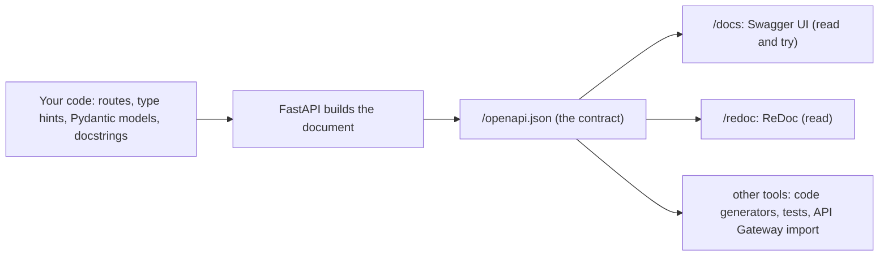

# FastAPI 05 — Automatic OpenAPI docs

> **Course:** [FastAPI](./README.md)  ·  **Time:** ~35 min  ·  **Needs:** [FastAPI 01](./01-how-a-web-api-works.md), [FastAPI 03](./03-parameters.md) and [FastAPI 04](./04-pydantic.md) help
> **Used in the labs:** the API of [Lab 01](../../labs/01-containers.md) onwards: `/docs` and `/openapi.json` exist without any code of ours

## What you will learn
- Say what **OpenAPI** is, and what `/openapi.json`, `/docs` and `/redoc` give you.
- Read a generated OpenAPI document: routes, parameters, request bodies, responses, schemas.
- Control what appears in it: `title`, `tags`, `summary`, docstrings, `response_model`, `status_code`, `include_in_schema=False`.
- See what the documentation says about **your project's** API, and what it is wise not to expose.

## Words you need
| Word | Plain-words meaning |
|---|---|
| **API contract** | A precise, written description of an API: which routes exist, what each one accepts and what it returns. Callers can rely on it. |
| **OpenAPI** | A standard format (a JSON or YAML file) for an API contract. Many tools read it: documentation pages, code generators, test tools, API gateways (AWS API Gateway can import one). |
| **Specification (spec)** | The OpenAPI document of one API. FastAPI **builds it from your code** while the app runs. |
| **Swagger UI** | A web page that turns an OpenAPI document into readable documentation, and lets you **try** each route from the browser. FastAPI serves it at `/docs`. |
| **ReDoc** | Another documentation page for the same document, at `/redoc`: read-only, tidier for long APIs. |
| **JSON Schema** | A standard way to describe the shape of a piece of JSON ("an object with a required text `title`, 1–80 characters, and an optional text `body`"). OpenAPI uses it for request and response bodies. |
| **Schema (component)** | One named JSON Schema in the spec, reused by several routes: `NoteIn`, `NoteOut`. |
| **Tag** | A label on routes that groups them in the documentation page (`notes`, `ops`). |
| **Docstring** | The text in triple quotes right under a function's `def` line. FastAPI shows it as the description of the route. |
| **CDN** | A network of servers that deliver files fast. The docs page loads its JavaScript and CSS from one, so it needs Internet access in the browser. |

## The idea
**Everyday analogy.** A restaurant menu again. If the kitchen had to **write the menu by hand** every time a dish changed, the menu would soon lie. Imagine instead that the menu is **printed automatically from the kitchen's own recipe cards**: it can never list a dish that does not exist, nor forget a new one. That is what FastAPI does: you already wrote the **recipe cards** (routes, type hints, Pydantic models) to make the code work, and FastAPI **prints the menu** (the OpenAPI document) from them, plus a **menu board** (Swagger UI) where customers can even place a test order.

**Precisely.** Everything FastAPI needs to *run* your API (the path, the method, the parameter names and types, the body model, the response model, the status code) is also what is needed to *describe* it. So at startup it assembles one JSON document and serves it at `/openapi.json`. Two web pages read that document: `/docs` (Swagger UI) and `/redoc`. Because the document comes from the same code, the docs and the behaviour cannot drift apart.



**What ends up in the document.** From the route's decorator and function: the **method and path**, the **tags**, the **summary** (taken from the function name unless you give one: `read_note` becomes "Read Note"), the **description** (the docstring), the **parameters** (path parameters are required, query parameters follow the default values), the **request body** (the Pydantic model), the **responses** (the `status_code` and the `response_model`; FastAPI adds a `422` whenever the route has inputs to validate, [FastAPI 01](./01-how-a-web-api-works.md)). From the models: one **schema** per model, with the constraints (`min_length`, `max_length`) as JSON Schema.

## The code, line by line
A small app (`docs_demo.py`) with the usual settings:

```python
from fastapi import FastAPI
from pydantic import BaseModel, Field

app = FastAPI(
    title="Notes demo",                                  # shown at the top of /docs
    summary="A tiny API to look at the generated docs",
    description="Every line of this page was **generated** from the code.",   # Markdown allowed
    version="1.2.3",                                     # the version of YOUR API (not of FastAPI)
)


class NoteIn(BaseModel):                                 # what a client sends
    title: str = Field(min_length=1, max_length=80, examples=["Shopping"])   # constraints + an example
    body: str = ""                                       # optional: it has a default


class NoteOut(NoteIn):                                   # what the API returns: NoteIn plus the id
    id: int


@app.post("/notes", response_model=NoteOut, status_code=201, tags=["notes"], summary="Create a note")
def create_note(data: NoteIn):
    """Store the note and return it with its id."""      # becomes the description of the route
    return NoteOut(id=1, **data.model_dump())


@app.get("/notes/{note_id}", response_model=NoteOut, tags=["notes"])
def read_note(note_id: int, verbose: bool = False):      # note_id: path parameter; verbose: optional query parameter
    """Read one note by its id."""
    return NoteOut(id=note_id, title="demo")


@app.get("/health", tags=["ops"])
def health():
    return {"status": "ok"}


@app.get("/secret", include_in_schema=False)             # works, but is left out of the document
def secret():
    return {"hidden": True}
```

| Line | What it does | If you change or remove it |
|---|---|---|
| `FastAPI(title=..., summary=..., description=..., version=...)` | The identity card of the API, shown at the top of `/docs` and in `info` of the document. | Without a `title` the default is "FastAPI", which is confusing when you have several APIs. |
| `Field(min_length=1, max_length=80, examples=["Shopping"])` | Constraints enforced at run time **and** published as JSON Schema; the example appears in the "try it" form. | Remove it and any length is accepted and documented as plain `string`. |
| `body: str = ""` | A default makes the field **optional** in the contract. | Remove `= ""` and `body` becomes required. |
| `tags=["notes"]` | Groups the routes in the page. | Without tags everything is in one `default` list. |
| `summary="Create a note"` | The short title of the route. | Without it FastAPI makes one from the function name (`read_note` → "Read Note"). |
| `response_model=NoteOut`, `status_code=201` | The documented success answer (`201`, with the `NoteOut` shape); also filters what is returned. | The answer would be documented as an unspecified object with status `200`. |
| the docstring | The route's description in the page. | No docstring, no description. |
| `include_in_schema=False` | The route works but is **absent** from `/openapi.json`, `/docs` and `/redoc`. The lab uses it for `/metrics`. | It is hiding, **not protecting**: anyone who knows the path can call it. |

## The commands
| Command | Meaning |
|---|---|
| `curl -s URL/openapi.json` | Fetch the document (`-s` silent). |
| `python show.py URL` | A small script of mine (below) that reads the document and prints its parts: it uses only Python's standard library (`urllib`, `json`). |
| `curl -s -o /dev/null -w "GET $p -> HTTP %{http_code}, %{content_type}\n" URL$p` | Print only the status and content type of a route (`-o /dev/null` throws the body away, `-w` prints a text with the values filled in). |
| `grep -o '<title>[^<]*</title>'` | Print only the part of the page that matches (`-o`): the text of the `<title>` tag. |
| `docker run -d --rm --name docs-demo -p 127.0.0.1:8781:8000 -v "$D:/demo:ro" -w /demo --user 10001 aws-local-lab-api:0.1.0 uvicorn docs_demo:app --host 0.0.0.0 --port 8000` | The throw-away server of [FastAPI 02](./02-uvicorn-and-asgi.md): the project's image, your folder mounted read-only, the app `docs_demo:app`, port 8000 published as 8781 on your machine only. |

## Hands-on
Put `docs_demo.py` (above) and this `show.py` in an empty folder:

```python
import json, sys, urllib.request
spec = json.load(urllib.request.urlopen(sys.argv[1] + "/openapi.json"))      # download and parse the document
print("top-level keys:", list(spec))
print("openapi version:", spec["openapi"], "| info:", {k: spec["info"][k] for k in ("title", "version")})
print("routes in the spec:")
for path, methods in spec["paths"].items():                                   # "paths": one entry per path
    for m, op in methods.items():                                             # then one per method
        print(f"  {m.upper():6} {path:18} tags={op.get('tags', [])} summary={op.get('summary')!r} responses={list(op['responses'])}")
op = spec["paths"]["/notes/{note_id}"]["get"]
print("parameters of GET /notes/{note_id}:", [(p["name"], p["in"], p["required"], p["schema"]["type"]) for p in op["parameters"]])
print("request body of POST /notes:", spec["paths"]["/notes"]["post"]["requestBody"]["content"]["application/json"]["schema"])
print("schemas:", list(spec["components"]["schemas"]))
print("NoteIn:", json.dumps(spec["components"]["schemas"]["NoteIn"]))
```
Start the server as in the table above (`D=$(pwd -W)` on Git Bash for Windows, `D=$(pwd)` elsewhere; prefix `MSYS_NO_PATHCONV=1` on Git Bash), then run the script and look at the pages:

```bash
python show.py http://127.0.0.1:8781
for p in /docs /redoc /openapi.json /secret; do curl -s -o /dev/null -w "GET $p -> HTTP %{http_code}, %{content_type}\n" http://127.0.0.1:8781$p; done
curl -s http://127.0.0.1:8781/docs | grep -o '<title>[^<]*</title>'
curl -s http://127.0.0.1:8781/docs | grep -o 'swagger-ui[^"]*\.js' | head -1
```
```text
top-level keys: ['openapi', 'info', 'paths', 'components']
openapi version: 3.1.0 | info: {'title': 'Notes demo', 'version': '1.2.3'}
routes in the spec:
  POST   /notes             tags=['notes'] summary='Create a note' responses=['201', '422']
  GET    /notes/{note_id}   tags=['notes'] summary='Read Note' responses=['200', '422']
  GET    /health            tags=['ops'] summary='Health' responses=['200']
parameters of GET /notes/{note_id}: [('note_id', 'path', True, 'integer'), ('verbose', 'query', False, 'boolean')]
request body of POST /notes: {'$ref': '#/components/schemas/NoteIn'}
schemas: ['HTTPValidationError', 'NoteIn', 'NoteOut', 'ValidationError']
NoteIn: {"properties": {"title": {"type": "string", "maxLength": 80, "minLength": 1, "title": "Title", "examples": ["Shopping"]}, "body": {"type": "string", "title": "Body", "default": ""}}, "type": "object", "required": ["title"], "title": "NoteIn"}
GET /docs -> HTTP 200, text/html; charset=utf-8
GET /redoc -> HTTP 200, text/html; charset=utf-8
GET /openapi.json -> HTTP 200, application/json
GET /secret -> HTTP 200, application/json
<title>Notes demo - Swagger UI</title>
swagger-ui-dist@5/swagger-ui-bundle.js
```
**How to read it:**
- The document has four top-level parts: `openapi` (the version of the standard, 3.1.0), `info` (the title and version we gave), **`paths`** (every route) and **`components`** (reusable schemas).
- **Three routes** are listed, with their tags and summaries: `Create a note` is the one we wrote; `Read Note` and `Health` were **made from the function names**. `/secret` is **missing** (`include_in_schema=False`), yet the next group of lines shows it **answers `200`**: hidden from the docs, not blocked.
- The responses: `201` for the create route (our `status_code`), `200` for the others, and a **`422` was added by FastAPI** on the two routes that take input (path, query or body) — not on `/health`, which has nothing to validate.
- **Parameters:** `note_id` is `in: path`, **required**, an `integer` (from `note_id: int`); `verbose` is `in: query`, **not required**, a `boolean` (it has a default).
- **Schemas:** `NoteIn` and `NoteOut` (our models) and two standard ones for the `422` answers. In `NoteIn`: `title` has `minLength`, `maxLength` and the example, and is the only **`required`** field (`body` has a default).
- `/docs` is a normal HTML page titled "Notes demo - Swagger UI". Note the last line: its code (`swagger-ui-bundle.js`) is loaded **from a CDN**, so a browser needs Internet access to display it. The JSON document itself does not.

**The project's own API.** The same listing, read from the lab through the load balancer (`curl -s http://127.0.0.1:8088/openapi.json`, then Python to print the paths):
```text
title: aws-local-lab API | version: 0.1.0 | openapi 3.1.0
  GET    /health              responses=['200']
  GET    /whoami              responses=['200']
  GET    /notes               responses=['200']
  POST   /notes               responses=['201', '422']
  GET    /notes/{note_id}     responses=['200', '422']
  PUT    /notes/{note_id}     responses=['200', '422']
  DELETE /notes/{note_id}     responses=['204', '422']
  POST   /upload              responses=['201', '422']
  POST   /jobs                responses=['202', '422']
  GET    /jobs/{job_id}       responses=['200', '422']
has /metrics: False
GET /docs through the load balancer -> HTTP 200
GET /metrics -> HTTP 200 (hidden from the spec, still served)
```
Ten routes, each with the status codes the code declares (`201` for creations, `202` for the accepted job, `204` for the delete). `/metrics` is deliberately **not listed** (`include_in_schema=False`) and still answers `200`. Also note that `/docs` is reachable **through the load balancer**, because every path that is not the page goes to the API: handy in a lab, but in production you would usually disable the docs of a public API (`FastAPI(docs_url=None, redoc_url=None, openapi_url=None)`) or put them behind authentication.

## What if…?
**…a route has no `response_model`?** The document is only as good as the code it reads. Compare the `200` answer of `GET /health` (no `response_model`) with the one of `GET /notes/{note_id}` (`response_model=NoteOut`), read from the same document:

```text
GET /health 200      : {"description": "Successful Response", "content": {"application/json": {"schema": {}}}}
GET /notes/{id} 200  : {"description": "Successful Response", "content": {"application/json": {"schema": {"$ref": "#/components/schemas/NoteOut"}}}}
```
`/health` is documented with an **empty schema** (`{}`: "some JSON, no promise about its shape"), while `/notes/{note_id}` points at the `NoteOut` schema, with all its fields and constraints. The contract is vague exactly where the code is vague, which is a good reason to write `response_model` and type hints: they make the code safer **and** the documentation sharper in one go.

## In short
1. FastAPI **builds an OpenAPI document from your code** and serves it at `/openapi.json`; `/docs` (Swagger UI) and `/redoc` are readable pages made from it. Docs and behaviour cannot drift apart.
2. Better code gives better docs: type hints, Pydantic constraints, `response_model`, `status_code`, `tags`, `summary` and docstrings all show up.
3. `include_in_schema=False` hides a route from the docs but does **not** protect it. Consider switching the docs off for a public API.

## Check your understanding
1. What are `/openapi.json`, `/docs` and `/redoc`, and which of them is the "source" of the others?
2. Where does the summary "Read Note" of `read_note` come from?
3. Why does the documented `GET /notes/{note_id}` have a `422` response, while `GET /health` does not?
4. How can a route work and yet be absent from the docs? Is that a security measure?
5. Why might the `/docs` page stay blank on a computer without Internet access, although `/openapi.json` still works?

<details><summary>Answers</summary>

1. `/openapi.json` is the machine-readable contract (the source). `/docs` (Swagger UI, interactive) and `/redoc` (read-only) are two web pages that read that JSON and display it.
2. FastAPI makes it from the function name when no `summary=` is given: `read_note` becomes "Read Note" (and `health` becomes "Health").
3. `GET /notes/{note_id}` has inputs to validate (`note_id` must be an integer), so a request can be rejected with `422`. `GET /health` takes no input, so it cannot fail validation and FastAPI documents only `200`.
4. With `include_in_schema=False` on the decorator: the route is served but not described. It is **not** a security measure: anyone who knows or guesses the path can call it. Real protection needs authentication or network rules.
5. The page's JavaScript and CSS (`swagger-ui-bundle.js`) are loaded from a CDN. Without Internet access the browser cannot get them, so the page cannot draw itself; the JSON document is served by the API and needs no CDN.

</details>

## Official documentation
- [FastAPI: first steps (interactive API docs)](https://fastapi.tiangolo.com/tutorial/first-steps/#interactive-api-docs) and [metadata and docs URLs](https://fastapi.tiangolo.com/tutorial/metadata/)
- [FastAPI: path operation configuration](https://fastapi.tiangolo.com/tutorial/path-operation-configuration/) (tags, summary, description, `include_in_schema`)
- [The OpenAPI specification](https://spec.openapis.org/oas/latest.html) and [Swagger UI](https://swagger.io/tools/swagger-ui/)

## Where you use this in the project
- [Lab 01, step 2](../../labs/01-containers.md): the API exists, so `http://localhost:8088/docs` and `/openapi.json` work from the first step; [Lab 04](../../labs/04-database.md) adds the notes routes and their models, which appear in the docs by themselves.
- [Lab 09, step 29](../../labs/09-monitoring.md): `/metrics` is declared with `include_in_schema=False`, so it does not clutter the documentation of the public routes.
- [Lab 08, step 28](../../labs/08-frontend-cdn.md): the HTTPS and the load balancer routing; remember that `/docs` is open through the same door as the rest.
