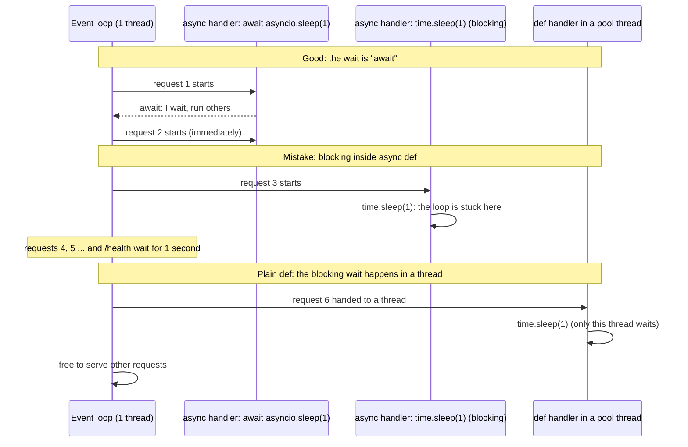

# FastAPI 06 — `async def` vs `def`

> **Course:** [FastAPI](./README.md)  ·  **Time:** ~40 min  ·  **Needs:** [FastAPI 01](./01-how-a-web-api-works.md) and [FastAPI 02](./02-uvicorn-and-asgi.md)
> **Used in the labs:** every route handler of `api/main.py` (plain `def`, on purpose) and the metrics middleware of [Lab 09, step 29](../../labs/09-monitoring.md) (`async def`)

## What you will learn
- Explain what an **event loop** is and what `await` really means.
- Say what FastAPI does with a plain `def` handler (runs it in a **thread pool**) and with an `async def` handler (runs it **on the event loop**).
- See, with timings, the one mistake that makes a whole API freeze: a **blocking call inside `async def`**.
- Choose between `def` and `async def` for a handler, and explain why the lab uses `def`.

## Words you need
| Word | Plain-words meaning |
|---|---|
| **Blocking call** | A call that makes the program **wait and do nothing else** until it finishes: `time.sleep(1)`, a normal database query, a normal HTTP request, reading a file. |
| **Concurrency** | Having several tasks **in progress** at the same time, even if only one runs at any instant (they take turns while the others wait). |
| **Thread** | One line of execution inside a process. A process can have several; the operating system switches between them. |
| **Thread pool** | A fixed group of ready-made threads that take jobs from a queue. FastAPI uses one for plain `def` handlers (40 threads by default). |
| **Event loop** | A single loop, in one thread, that runs a list of tasks: it runs one until that task says "I must wait for something" (`await`), then switches to another task that is ready. |
| **Coroutine** | A function defined with `async def`. Calling it does not run it: it gives an object that the event loop runs. |
| **`await`** | "Wait for this result, and **let the loop run other tasks meanwhile**". Allowed only inside `async def`, and only useful on things made to be awaited (`asyncio.sleep`, an async database driver, an async HTTP client). |
| **I/O** (input/output) | Anything where the program waits for the outside world: network, disk, database. The reason `async` exists: almost all the time of a web request is waiting. |
| **CPU-bound** | Work that keeps the processor busy (resizing an image, computing a hash). Waiting is not the problem, computing is: `async` does not speed it up. |
| **Latency** | How long one request takes from sending to answer. |
| **SQLAlchemy, `redis-py`, `boto3`** | The Python libraries this project uses to talk to Postgres, Redis and S3 (an object store). In their ordinary form they are **blocking**: the program waits inside the call until the server answers. |

## The idea
**Everyday analogy.** A café with **one waiter**. A *blocking* waiter takes your order, goes to the kitchen and **stands there** until your dish is ready, serving nobody else: ten customers means ten times the wait. An *async* waiter takes the order, hands it to the kitchen, and **while the dish cooks takes other orders**; when a dish is ready he brings it. One waiter, many customers, because most of the time is *waiting for the kitchen*, not working. But if this waiter ever decides to stand and watch one dish cook (a blocking call inside `async def`), the whole café stops. FastAPI offers a second solution for waiters who must stand and wait (code that cannot be async): it hires **extra waiters** (a thread pool) for them.

**Precisely.** Uvicorn ([FastAPI 02](./02-uvicorn-and-asgi.md)) runs **one event loop** per process. For each request, FastAPI looks at how your handler is declared:

| Declaration | Where FastAPI runs it | Good when | Danger |
|---|---|---|---|
| `async def handler(...)` | **On the event loop**, directly | Everything slow inside is **awaited** (`await client.get(...)`, an async driver): thousands of requests can wait at once, in one thread | A **blocking call** inside it stops the loop: *every* request of the process waits |
| `def handler(...)` | In a **thread from the pool**, so the loop stays free | The code uses ordinary **blocking libraries** (SQLAlchemy sync sessions, `redis-py`, `boto3`, `requests`) | At most one request per pool thread at a time (40 by default); more wait in a queue |



**The rule of thumb.** Use **`async def`** only when everything slow inside is awaited with an async-capable library. Use plain **`def`** when you call ordinary blocking code. If in doubt, `def`: it is never wrong in a way that freezes the server (it can only be less efficient). This project uses `def` for every route, because it talks to Postgres (SQLAlchemy, sync), Redis (`redis-py`, sync) and S3 (`boto3`, sync): all blocking libraries.

## The code, line by line
A small app (`async_demo.py`) with one handler of each kind, and a `/health` to see whether the server is blocked:

```python
import asyncio
import time

from fastapi import FastAPI

app = FastAPI()


@app.get("/health")
def health():                                   # answers at once: used to see whether the server is blocked
    return {"status": "ok"}


@app.get("/wait-def")
def wait_def():                                 # normal function: FastAPI runs it in a pool of threads
    time.sleep(1)                               # a blocking wait (like a slow database call)
    return {"waited": 1, "kind": "def + time.sleep"}


@app.get("/wait-async-blocking")
async def wait_async_blocking():                # coroutine, but the wait BLOCKS the whole event loop
    time.sleep(1)
    return {"waited": 1, "kind": "async def + time.sleep (a mistake)"}


@app.get("/wait-async-await")
async def wait_async_await():                   # coroutine that waits the right way: others run meanwhile
    await asyncio.sleep(1)
    return {"waited": 1, "kind": "async def + await asyncio.sleep"}
```

| Line | What it does | If you change or remove it |
|---|---|---|
| `def wait_def()` + `time.sleep(1)` | A blocking wait inside a **plain** function: FastAPI runs it in a pool thread, so only that thread waits. | Nothing is wrong: this is the normal way to use blocking code. |
| `async def wait_async_blocking()` + `time.sleep(1)` | `async def` puts the handler **on the event loop**, and `time.sleep` blocks that loop for a full second: nothing else in the process can run. | Replace `time.sleep(1)` by `await asyncio.sleep(1)` (the next handler) and the problem disappears. |
| `async def wait_async_await()` + `await asyncio.sleep(1)` | `asyncio.sleep` is a wait made for the loop: while it waits, the loop serves other requests. This stands for `await some_async_database_call()`. | Forget `await` and the wait does not happen at all (Python warns that the coroutine "was never awaited"). |
| `def health()` | A tiny handler: its delay shows whether the process is free. | |

## The commands
| Command / flag | Meaning |
|---|---|
| `seq 1 10 \| xargs -P 10 -I{} curl -s -o /dev/null URL` | `seq 1 10` prints the numbers 1 to 10; `xargs` runs the command once per line (`-I{}` is how it is told to), and `-P 10` allows **10 at the same time**: ten requests at nearly the same moment. In your terminal type a plain `|`; the backslash is only how a `|` is written inside a table cell. |
| `date +%s%N` | The current time as nanoseconds since 1970 (GNU `date`, as in Git Bash). Taken before and after, the difference is the elapsed time. |
| `$(( (end - start) / 1000000 ))` | Shell arithmetic: nanoseconds to milliseconds. |
| `printf '...%-22s %3d...' ARGS` | Print a formatted line: `%-22s` is a text padded to 22 characters, `%3d` a whole number in 3 columns, `%5d` in 5. It lines the results up. |
| `awk '{printf "%d", $1*1000}'` | Read the number `curl` printed (seconds, such as `0.004`), multiply by 1000 and print it as a whole number of milliseconds. |
| `curl -s -o /dev/null -w '%{time_total}' URL` | Print only the total time of the request, in seconds (`-w` = write-out, `-o /dev/null` throws the body away). |
| `command & ... wait` | `&` starts a command in the background; `wait` waits for it to finish. Used to keep a slow request running while another one is sent. |
| `docker run -d --rm --name async-demo -p 127.0.0.1:8791:8000 -v "$D:/demo:ro" -w /demo --user 10001 aws-local-lab-api:0.1.0 uvicorn async_demo:app --host 0.0.0.0 --port 8000` | The throw-away server of [FastAPI 02](./02-uvicorn-and-asgi.md): the project's image, your folder mounted read-only, one Uvicorn process (one event loop). |

## Hands-on
Put `async_demo.py` in an empty folder and run `run.sh` there (Git Bash; the script starts the container, sends the bursts, and stops it):

```bash
D=$(pwd -W)       # on Linux or macOS: D=$(pwd)
MSYS_NO_PATHCONV=1 docker run -d --rm --name async-demo -p 127.0.0.1:8791:8000 -v "$D:/demo:ro" -w /demo --user 10001 \
  aws-local-lab-api:0.1.0 uvicorn async_demo:app --host 0.0.0.0 --port 8000
U=http://127.0.0.1:8791
burst() {   # burst PATH N: N requests at once; print how long until the LAST answer arrived
  start=$(date +%s%N)
  seq 1 "$2" | xargs -P "$2" -I{} curl -s -o /dev/null "$U$1"
  end=$(date +%s%N)
  printf '  %-22s %3d requests at once -> %5d ms in all\n' "$1" "$2" $(( (end - start) / 1000000 ))
}
burst /wait-def 10; burst /wait-async-await 10; burst /wait-async-blocking 10
for p in /wait-async-await /wait-async-blocking; do
  curl -s -o /dev/null "$U$p" &        # keep a slow request running ...
  sleep 0.2
  printf '  while %-22s runs: /health took %s ms\n' "$p" "$(curl -s -o /dev/null -w '%{time_total}' $U/health | awk '{printf "%d", $1*1000}')"
  wait
done
docker stop async-demo
```
```text
== 10 requests at once, each waits 1 second
  /wait-def               10 requests at once ->  1375 ms in all
  /wait-async-await       10 requests at once ->  1299 ms in all
  /wait-async-blocking    10 requests at once -> 10126 ms in all
== is /health still quick while a blocking handler is busy?
  while /wait-async-await      runs: /health took 4 ms
  while /wait-async-blocking   runs: /health took 747 ms
```
(The `==` lines are `echo` titles of my script. `awk '{printf "%d", $1*1000}'` turns seconds into whole milliseconds.) **How to read it:**
- **Ten requests, each waiting one second.** `def` (threads) and `async def` + `await` both finish in **about 1.3 s**: all ten waited **at the same time** (the extra 0.3 s is the cost of starting ten `curl` processes). The blocking `async def` took **10.1 s**: the ten waits happened **one after the other**, because each `time.sleep` froze the only event loop.
- **Is the server still alive?** While an `await` handler was waiting, `/health` answered in **4 ms**. While the *blocking* `async def` was running, `/health` needed **747 ms**: it had to wait for the end of the second (it was sent 0.2 s after the slow request began, so about 0.8 s of waiting). That is the real danger: a single blocking call in an `async def` makes **unrelated** requests slow too, which a health check would see as a sick replica if the block lasted longer.

A fifty-requests variant of the experiment (50 requests at once to `/wait-def` and to `/wait-async-await`) gave 2.3 s and 2.2 s: no visible difference, because starting 50 `curl` processes on this machine takes about as long as the waits themselves, so the measurement cannot show the pool's limit. The documented default (40 threads, so the 41st plain-`def` request waits for a free thread) was **not** measured here.

## What if…?
**…the lab's handlers were `async def`?** They would call SQLAlchemy, `redis-py` and `boto3` in their ordinary, **blocking** form: each query would behave like the `time.sleep(1)` above, freezing the replica for the duration of the query, and a slow database would stall **every** request of that replica, health check included. Making them safely async would mean replacing the libraries (an async SQLAlchemy engine with an async driver, `redis.asyncio`, an async S3 client) and `await`-ing every call: a large change for little gain at this size. Plain `def` gets the same concurrency from the thread pool, with ordinary code. (This is the reasoning behind the lab's choice, not something that was run.) The one `async def` in the project, the metrics middleware of [Lab 09, step 29](../../labs/09-monitoring.md), only does `await call_next(request)` and fast arithmetic: no blocking call inside.

## In short
1. The **event loop** runs `async def` handlers in one thread and switches between them at each `await`: great for waiting on I/O, as long as every slow call is **awaited**.
2. A plain **`def`** handler is run by FastAPI in a **thread pool**: the right choice for ordinary blocking libraries (SQLAlchemy, `redis-py`, `boto3`). This project uses it everywhere.
3. A **blocking call inside `async def`** freezes the whole process: in the experiment ten 1-second waits took 10 s instead of 1.3 s, and `/health` waited 747 ms instead of 4 ms.

## Check your understanding
1. What happens to a plain `def` handler that FastAPI receives, and to an `async def` one?
2. Why did ten requests to `/wait-async-blocking` take about ten seconds, while ten to `/wait-def` took about one?
3. What does `await` do, and why is `await asyncio.sleep(1)` fine while `time.sleep(1)` in the same place is not?
4. Why does this project use `def` and not `async def` for its routes?
5. Does `async def` make an image-resizing handler faster? Why or why not?

<details><summary>Answers</summary>

1. A plain `def` handler is run in a thread of a pool, so the event loop stays free. An `async def` handler is run directly on the event loop, in the same thread as everything else.
2. `time.sleep` inside `async def` blocks the **only** event loop, so the ten waits ran one after another (10 × 1 s). Plain `def` handlers each ran in their own pool thread, so the ten waits overlapped.
3. `await` suspends this handler and lets the loop run other tasks until the awaited result is ready. `asyncio.sleep` is made to be awaited, so the loop is free during the wait. `time.sleep` is an ordinary blocking call: it keeps the thread, which is the loop's thread, so nothing else can run.
4. The routes use blocking libraries (sync SQLAlchemy, `redis-py`, `boto3`). As plain `def` they run in threads and cannot freeze the loop; as `async def` each query would block it.
5. No. Resizing is CPU-bound work: the processor is busy the whole time, there is nothing to wait for and nothing to switch to. In `async def` it would even block the loop. Such work belongs in a `def` handler (a thread) or, better, in a **worker** process, as in Lab 07.

</details>

## Official documentation
- [FastAPI: Concurrency and async / await](https://fastapi.tiangolo.com/async/) (the café analogy, in depth)
- [Python: `asyncio`](https://docs.python.org/3/library/asyncio.html) and [coroutines and tasks](https://docs.python.org/3/library/asyncio-task.html)
- [Starlette: threadpool for sync handlers](https://www.starlette.io/threadpool/)

## Where you use this in the project
- [Lab 01, step 2](../../labs/01-containers.md): `health()` and `whoami()` are plain `def`; [Lab 04](../../labs/04-database.md), [Lab 05](../../labs/05-caching.md) and [Lab 06](../../labs/06-object-storage.md): the handlers that query Postgres, Redis and S3 are plain `def` for the reasons above.
- [Lab 07](../../labs/07-queues-workers.md): image resizing is CPU-bound work, so it is done by a separate **worker** process, not in a request handler.
- [Lab 09, step 29](../../labs/09-monitoring.md): the only `async def` of the API, the metrics middleware.
- [Lab 02](../../labs/02-load-balancing.md): the health checks; a replica blocked for long enough would fail them, and `/health` taking 747 ms above is the first sign.
