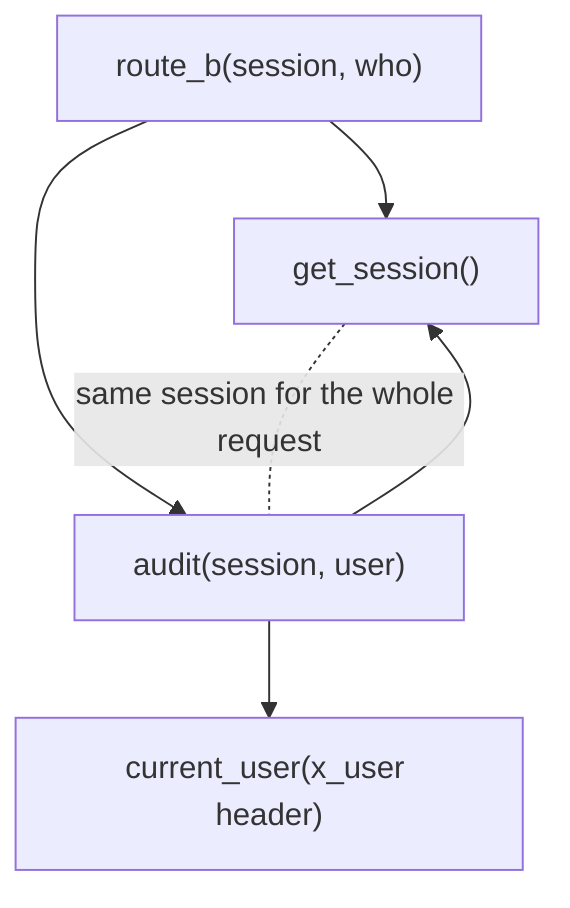
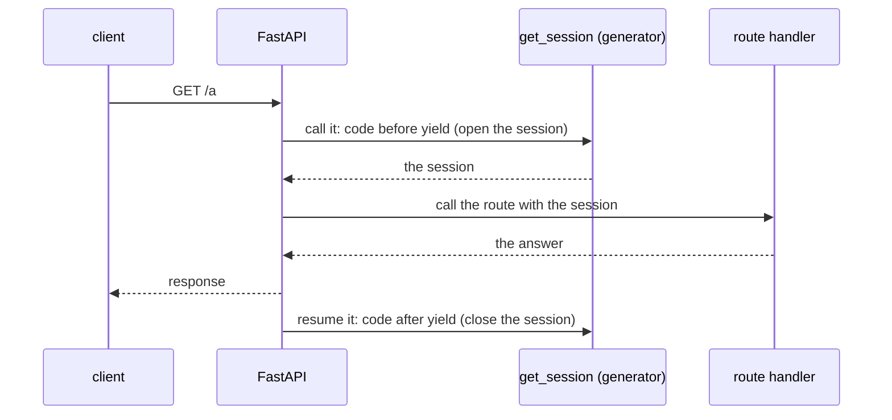

# FastAPI 07 — Dependencies and dependency injection

> **Course:** [FastAPI](./README.md)  ·  **Time:** ~45 min  ·  **Needs:** basic Python (functions and `with`); reading [Lab 04, step 12](../../labs/04-database.md#step-12--the-notes-crud) first helps
> **Used in the labs:** [Lab 04, step 12](../../labs/04-database.md#step-12--the-notes-crud) (`get_db`: one database session per request) and [step 16](../../labs/05-caching.md#step-16--cache-aside-on-get-notesid) (the same routes, now with a cache)

## What you will learn
- Say what a **dependency** is in FastAPI and what `Depends(...)` does.
- Explain **dependency injection** with the project's `get_db`: the route *declares* what it needs and FastAPI *hands it over*.
- Predict how many times a dependency runs in one request, and when its clean-up code runs, even after an error.
- Replace a dependency by a fake, without changing any route (the basis of testing).

## Words you need
| Word | Plain-words meaning |
|---|---|
| **Route** (path operation) | A function FastAPI calls for a given URL and method, like `read_note` for `GET /notes/{id}`. |
| **Dependency** | A function a route needs *before* it can do its job: "give me a database session", "tell me who the user is". |
| **Dependency injection** | Instead of the route creating what it needs, it **declares** the need as a parameter and the framework **injects** (hands in) the result. |
| **`Depends(function)`** | The marker that tells FastAPI "to fill this parameter, call `function` and use its result". |
| **Generator dependency** | A dependency written with `yield`: the code **before** `yield` runs before the route (set-up), the code **after** it runs when the response is done (clean-up). |
| **Session** | A short conversation with the database; it must be closed afterwards ([Databases 02](../databases/02-sql.md)). |
| **Request** | One call to your API, from the client's first byte to the last byte of the answer. |
| **`Annotated`** | Python's way to attach extra information to a type: `Annotated[Session, Depends(get_db)]` reads "a Session, obtained with `get_db`". |
| **Override** | Telling FastAPI "for this dependency, use that other function instead", typically in tests. |
| **Header** | A named extra line sent with a request (`X-User: sam`); FastAPI can read it into a parameter. |
| **Resource leak** | Forgetting to give back something you borrowed (a connection, a file): after a while none are left. |

## The idea
**Analogy.** A hotel receptionist hands you a **room key** when you arrive and takes it back when you leave, even if you leave in a hurry through the window. You never go to the key cabinet yourself, and the hotel never loses a key. A *dependency* is that key: the route says "I need a room key", the framework fetches it before the route starts and
**always** collects it afterwards. That is *dependency injection*: **declare what you need, do not fetch it**.

**Precisely.** A route lists its needs as parameters with `Depends(some_function)`. Before calling the route, FastAPI calls each function (first the ones **they** depend on), and passes the results in. If a dependency uses `yield`, the code after the `yield` runs once the response has been sent, **whether the request succeeded or failed**.
If the same dependency is needed twice in one request, FastAPI calls it **once** and shares the result. A dependency can also reject the request early (`HTTPException`), and in tests you can swap any dependency for a fake.



**Who does what during one request:**


## The code, line by line
A throw-away app, `app.py`, with a fake session so we can **see** the opens and closes (the fake only has a number):

```python
from typing import Annotated, Iterator

from fastapi import Depends, FastAPI, Header, HTTPException

app = FastAPI()
counter = {"n": 0}                                   # counts how many sessions were created


class FakeSession:
    """Stands in for a database session: it only has a number, so we can see who gets which."""

    def __init__(self, n):
        self.n = n

    def __str__(self):
        return f"session-{self.n}"


def get_session() -> Iterator[FakeSession]:          # a generator dependency
    counter["n"] += 1
    session = FakeSession(counter["n"])
    print(f"  open  {session}", flush=True)          # set-up: runs BEFORE the route
    try:
        yield session                                # this value is handed to the route
    finally:
        print(f"  close {session}", flush=True)      # clean-up: runs AFTER the response, even after an error


Session = Annotated[FakeSession, Depends(get_session)]   # "a FakeSession, obtained with get_session"


def current_user(x_user: Annotated[str | None, Header()] = None) -> str:
    if x_user is None:
        raise HTTPException(status_code=401, detail="missing X-User header")   # reject the request early
    return x_user


User = Annotated[str, Depends(current_user)]


def audit(session: Session, user: User) -> str:      # a dependency that depends on two others
    return f"{user} via {session}"


@app.get("/a")
def route_a(session: Session):                       # needs a session
    print(f"  handler /a uses {session}", flush=True)
    return {"session": str(session)}


@app.get("/b")
def route_b(session: Session, who: Annotated[str, Depends(audit)]):   # needs a session AND audit (which needs the same session)
    print(f"  handler /b uses {session}, audit says: {who}", flush=True)
    return {"session": str(session), "audit": who}
```

| Line | What it does | If you change or remove it |
|---|---|---|
| `yield session` in `get_session` | Hands the session to the route and **pauses** the function. FastAPI resumes it when the response is done. | Replace `yield` with `return` and there is no clean-up step: the session would never be closed by FastAPI. |
| `try: ... finally:` around the `yield` | The `finally` part runs even if the route (or a later dependency) failed. | Without `finally`, an error would skip the clean-up and leak the session. |
| `Session = Annotated[FakeSession, Depends(get_session)]` | A reusable shortcut: any parameter typed `Session` is filled by `get_session`. | Without it, write `session: FakeSession = Depends(get_session)` in every route. |
| `Header()` in `current_user` | Reads the request header `X-User` (FastAPI turns `x_user` into `X-User`). | Without `Header()`, FastAPI would look for a query parameter instead. |
| `raise HTTPException(status_code=401, ...)` | Stops the request with an error answer; the route never runs. | Return `None` instead and the route would run for anonymous users. |
| `audit(session: Session, user: User)` | A dependency with dependencies: FastAPI resolves them first, then calls `audit`. | Nothing special: dependencies can nest as deep as needed. |

The project does exactly this with the real database, in `api/main.py`:
```python
def get_db() -> Iterator[Session]:
    """One database session per request, always closed afterwards (even after an error)."""
    with SessionLocal() as session:    # "with" closes the session when the block ends
        yield session

DbSession = Annotated[Session, Depends(get_db)]
```

## The commands
| Command / flag | Meaning |
|---|---|
| `docker run --rm -v "$D:/demo" -w /demo IMAGE ...` | Run a throw-away container with your folder `$D` mounted at `/demo` ([Docker 08](../docker/08-volumes-and-bind-mounts.md)) and start in it (`-w`). Here the image is the project's own API image, which already has FastAPI and Uvicorn. |
| `MSYS_NO_PATHCONV=1` | Git Bash only: stops it from rewriting `/demo` into a Windows path ([Docker 08](../docker/08-volumes-and-bind-mounts.md)). |
| `$(pwd -W)` | Git Bash: the current folder as a Windows path that Docker understands. |
| `sh -c 'a & sleep 3; b; c'` | Run commands in one shell: `a &` starts the server **in the background**, `sleep 3` gives it time to start, then `b` and `c` run. |
| `uvicorn app:app --port 8000 --log-level warning` | Start the web server for the object `app` of the file `app.py`, quietly (only warnings). |
| `python client.py` | A tiny client (standard library only) that calls the routes and prints the status and the answer. |
| `cat /tmp/server.log` | Print what the server wrote: our `open`, `close` and `handler` lines. |

## Hands-on
In a throw-away folder with `app.py` (above) and these two small files. `client.py` calls the routes with the standard library only and prints what comes back:
```python
import sys
import urllib.error
import urllib.request


def get(path, headers=None):
    req = urllib.request.Request("http://127.0.0.1:8000" + path, headers=headers or {})
    try:
        with urllib.request.urlopen(req) as r:
            return r.status, r.read().decode()
    except urllib.error.HTTPError as e:          # 4xx/5xx answers come as exceptions: read them too
        return e.code, e.read().decode()


calls = [("/a", None), ("/a", None), ("/b", {"X-User": "sam"}), ("/b", None)]
for path, headers in calls:
    print(f"request {path} {headers or ''}".rstrip(), flush=True)
    status, body = get(path, headers)
    print(f"  -> {status} {body}", flush=True)
sys.stdout.flush()
```
and `app_test.py` (used in exercise 2) reuses the same app with one dependency replaced:
```python
from app import FakeSession, app, get_session

# Replace the real dependency by a fake one, without touching a single route.
app.dependency_overrides[get_session] = lambda: FakeSession("FAKE")
```
Real output, trimmed.

**1. One session per request, opened before and closed after**
```bash
D="$(pwd -W)"
MSYS_NO_PATHCONV=1 docker run --rm -v "$D:/demo" -w /demo aws-local-lab-api:0.1.0 sh -c 'uvicorn app:app --port 8000 --log-level warning >/tmp/server.log 2>&1 & sleep 3; python client.py; echo "--- what the server printed:"; cat /tmp/server.log'
```
```text
request /a
  -> 200 {"session":"session-1"}
request /a
  -> 200 {"session":"session-2"}
request /b {'X-User': 'sam'}
  -> 200 {"session":"session-3","audit":"sam via session-3"}
request /b
  -> 401 {"detail":"missing X-User header"}
--- what the server printed:
  open  session-1
  handler /a uses session-1
  close session-1
  open  session-2
  handler /a uses session-2
  close session-2
  open  session-3
  handler /b uses session-3, audit says: sam via session-3
  close session-3
  open  session-4
  close session-4
```
**How to read it:**
- **One session per request.** The two calls to `/a` got `session-1` and `session-2`: each request has its own, never shared between requests. For every request: `open`, then the handler, then `close`.
- **Shared inside a request.** In `/b` the session is needed twice (directly by the route and inside `audit`), yet only **one** was opened, `session-3`, and the answer shows it in both places. FastAPI calls a dependency once per request and reuses the result.
- **Clean-up even after an error.** The last request has no `X-User`, so `current_user` raised a `401` and the route never ran (no `handler` line). But `session-4` had already been opened, and it **was closed** (`close session-4`). This is what `try/finally` around the `yield` guarantees, and it is why the project never leaks database connections.

**2. Replace a dependency by a fake (what testing does)**
```bash
MSYS_NO_PATHCONV=1 docker run --rm -v "$D:/demo" -w /demo aws-local-lab-api:0.1.0 sh -c 'uvicorn app_test:app --port 8000 --log-level warning >/tmp/server.log 2>&1 & sleep 3; python client.py >/tmp/client.log 2>&1; head -6 /tmp/client.log; echo "--- what the server printed:"; cat /tmp/server.log'
```
```text
request /a
  -> 200 {"session":"session-FAKE"}
request /a
  -> 200 {"session":"session-FAKE"}
request /b {'X-User': 'sam'}
  -> 200 {"session":"session-FAKE","audit":"sam via session-FAKE"}
--- what the server printed:
  handler /a uses session-FAKE
  handler /a uses session-FAKE
  handler /b uses session-FAKE, audit says: sam via session-FAKE
```
`app_test.py` imports the same `app` and adds one line: `app.dependency_overrides[get_session] = lambda: FakeSession("FAKE")`. **No route changed**, yet every route now receives the fake: and the real `get_session` never ran (no `open` or `close` lines). In tests you would replace `get_db` by a function that returns a session on a throw-away database.
(The first version of this command piped the client's output into `head` directly, which printed a harmless `BrokenPipeError`: `head` closed the pipe early. Writing the output to a file first avoids it.)

**3. The same idea in the project**
```bash
grep -n -E "Depends|def get_db|DbSession|yield" api/main.py
```
```text
8:from fastapi import Depends, FastAPI, HTTPException, Response, status
27:def get_db() -> Iterator[Session]:
30:        yield session
33:DbSession = Annotated[Session, Depends(get_db)]
72:def create_note(data: NoteIn, db: DbSession):
81:def list_notes(db: DbSession):
94:def read_note(note_id: int, db: DbSession):
117:def update_note(note_id: int, data: NoteIn, db: DbSession):
127:def delete_note(note_id: int, db: DbSession):
```
One dependency (`get_db`, line 27) and five routes that simply ask for `db: DbSession`. None of them opens or closes a session.

## What if…?
**…a dependency raises an error halfway through?** That is the last request of exercise 1: `/b` without the header. Real result: the client got `401 {"detail":"missing X-User header"}`, the handler never ran, **and** the server printed `open session-4` followed by `close session-4`. Dependencies that already ran are cleaned up, in reverse order, when a later one fails.
Without the `try/finally` (or the `with` that the project uses), that last pair would be missing the `close`: the session would stay open until the garbage collector found it, and under load the database would run out of connections ([Databases 08](../databases/README.md), planned).

## In short
1. A **dependency** is a function a route needs; the route declares it with `Depends(...)` (often hidden in an `Annotated` alias such as `DbSession`) and FastAPI **injects** the result.
2. A dependency with `yield` has **set-up before** and **clean-up after** the route, and the clean-up runs even when the request fails. It runs **once per request**, however many places ask for it.
3. Dependencies can nest, can reject a request early, and can be **overridden** by fakes in tests without touching a route.

## Check your understanding
1. In `def read_note(note_id: int, db: DbSession)`, who creates the database session, and who closes it?
2. A route and a dependency both need the same `get_db` in one request. How many sessions are opened?
3. What does the code after `yield` do, and when does it run?
4. A later dependency raises `HTTPException(401)`. What happens to a session that an earlier dependency already opened?
5. How would a test make every route use a test database instead of the real one?

<details><summary>Answers</summary>

1. FastAPI does both: it calls `get_db` before the route (set-up), passes the session in, and resumes `get_db` after the response, where the `with` block closes it. The route does neither.
2. One: FastAPI calls a dependency once per request and shares the result.
3. It is the clean-up: it runs after the response has been produced, whether the request succeeded or failed (when written inside `try/finally` or a `with`).
4. It is still closed: FastAPI runs the clean-up of every dependency that already started, even though the route never ran.
5. By setting `app.dependency_overrides[get_db] = some_test_function`: every route that asks for `DbSession` then receives the test session; no route needs to change.

</details>

## Official documentation
- [FastAPI: Dependencies](https://fastapi.tiangolo.com/tutorial/dependencies/)
- [Dependencies with `yield`](https://fastapi.tiangolo.com/tutorial/dependencies/dependencies-with-yield/)
- [Testing dependencies with overrides](https://fastapi.tiangolo.com/advanced/testing-dependencies/)
- [Header parameters](https://fastapi.tiangolo.com/tutorial/header-params/)
- [Python `typing.Annotated`](https://docs.python.org/3/library/typing.html#typing.Annotated)

## Where you use this in the project
- [Lab 04, step 12](../../labs/04-database.md#step-12--the-notes-crud): `get_db` and the alias `DbSession`, used by all five `/notes` routes (hands-on 3 above shows the real lines).
- [Lab 05, step 16](../../labs/05-caching.md#step-16--cache-aside-on-get-notesid): `read_note` still receives its session the same way; only the order changes (cache first, session used only on a miss).
- [Databases 02](../databases/02-sql.md) and the `SessionLocal` / `engine` of [Lab 04, step 11](../../labs/04-database.md#step-11--the-database-layer-the-first-migration-and-the-migrate-job): what the dependency hands over.
