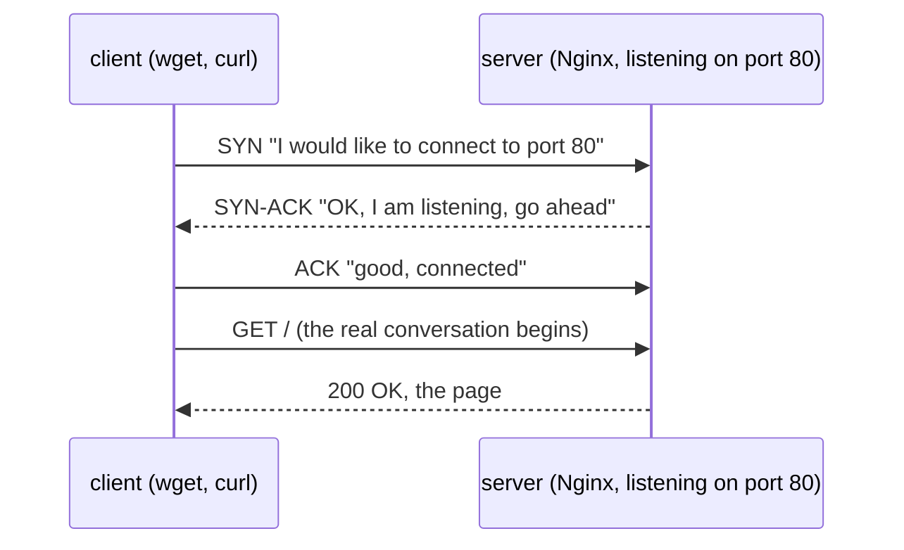
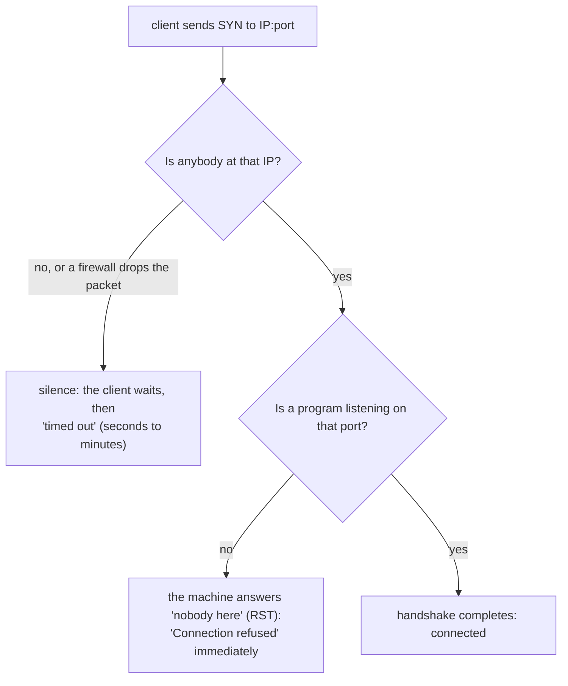

# Networking 01 — IP addresses, ports, localhost and TCP

> **Course:** [Networking](./README.md)  ·  **Time:** ~40 min  ·  **Needs:** nothing, but [Docker 01](../docker/01-images-and-containers.md) helps for the exercises
> **Used in the labs:** [Lab 01, step 2](../../labs/01-containers.md#step-2--a-minimal-api-in-a-container) (`curl localhost:<port>`, published ports) and [Lab 02, step 6](../../labs/02-load-balancing.md#step-6--health-checks-and-failover) ("refused" vs "timeout" when a replica dies)

## What you will learn
- Say what an **IP address** and a **port** are, and why you need both to reach a program.
- Explain what **`localhost` / `127.0.0.1`** means, and why it means something different inside every container.
- Describe in plain words what **TCP** is and how a connection starts.
- Tell the two classic failures apart: **"Connection refused"** (fast) and **"timed out"** (slow), and say what each one tells you.
- Read a list of listening ports (`netstat`) and a published port (`docker port`).

## Words you need
| Word | Plain-words meaning |
|---|---|
| **Network** | Machines that can send each other messages. |
| **IP address** | The number that identifies one machine (or container) on a network, for example `172.17.0.2`: four numbers from 0 to 255 separated by dots. |
| **Port** | A number from 0 to 65535 that picks **one program** on a machine. The IP address finds the machine; the port finds the program on it. |
| **Server / client** | The server waits for requests on a port; the client starts the conversation. Here Nginx is a server, `wget` and `curl` are clients. |
| **Listen** | A server "listens" on a port: it tells the operating system "send me what arrives on this port". |
| **Protocol** | An agreed set of rules for a conversation (who speaks first, what the messages look like). |
| **TCP** | *Transmission Control Protocol*: the protocol that gives two programs a reliable, ordered stream of bytes. Web pages, databases and Redis all use it. |
| **Connection** | A TCP conversation between two programs, opened by a **handshake** and closed at the end. |
| **Handshake** | The three first messages of a TCP connection, a polite "hello, hello back, OK" (details below). |
| **Packet** | One small piece of data sent over a network. A long message is cut into many packets. |
| **Loopback / `localhost`** | A special address, `127.0.0.1`, that always means "this same machine". The name `localhost` points to it. |
| **Interface** | A machine's connection to a network. `lo` is the loopback one, `eth0` is the usual real one. |
| **Published port** | Docker's way to open a door from your computer to a port inside a container (`-p 127.0.0.1:18080:80`). |
| **Timeout** | The time a program waits for an answer before giving up. |
| **`netstat`** | A command that lists network connections and listening ports. |

## The idea
**Analogy.** An IP address is the **street address of an apartment building**; a port is the **apartment number**. To deliver a letter you need both: the building tells the postman where to go, the apartment number tells him which door. A server is a resident who stays at home next to the door (it *listens*); a client rings the bell. **`localhost`** is "my own apartment": whoever says "go to localhost" always means *their own* home, which is why two people saying it mean different places.

**Precisely.** A program that wants to talk to another one opens a **TCP connection** to `IP:port`. Before any data moves, the two sides agree on it with a **three-step handshake**:



What the client sees when the first step goes wrong depends on **who answered**:



- **Refused** means *the machine is there, but no program listens on that port*. The answer is instant. Typical causes: the program is not started, wrong port.
- **Timed out** means *no answer at all*: the machine is gone, unreachable, or a firewall silently throws the packets away. The client can only wait. Typical causes: a dead server, a wrong address, a blocked route.

**Localhost.** `127.0.0.1` lives on the `lo` interface of **each** machine, and packets sent to it never leave that machine. A container has its own `lo`, so inside a container `localhost` is *that container*, not your laptop and not its neighbour.

## The code or config, line by line
Three commands we use below and what they print, with a comment on every field:

```text
$ docker run --rm alpine:3.24 ip -4 addr
1: lo: <LOOPBACK,UP,LOWER_UP> ...               # 1  interface "lo": the loopback
    inet 127.0.0.1/8 scope host lo              # 2  its address: "myself"
2: eth0@if360: <BROADCAST,MULTICAST,UP,...>     # 3  interface "eth0": the connection to the Docker network
    inet 172.17.0.2/16 ... scope global eth0    # 4  the container's real address

$ netstat -ltn
Proto Recv-Q Send-Q Local Address   Foreign Address  State
tcp        0      0 0.0.0.0:80      0.0.0.0:*        LISTEN     # 5  a program listens on port 80, on every address (IPv4)
tcp        0      0 :::80           :::*             LISTEN     # 6  the same, for IPv6

$ docker port net01-web
80/tcp -> 127.0.0.1:18080                                        # 7  port 80 of the container is published as 18080 on the laptop
```

| Line | What it does | If you change or remove it |
|---|---|---|
| 2 `127.0.0.1/8` | The loopback address: reaching it never leaves the machine. | Nothing to change: every machine has it. |
| 4 `172.17.0.2/16` | The container's address on Docker's default network. The `/16` says which addresses are "neighbours" (see [Networking 06](./06-subnets-and-cidr.md)). Docker hands it out and **may give another one next time**. | Never hard-code a container IP in a config: use the service name (see [Docker 07](../docker/07-networks.md)). |
| 5 `0.0.0.0:80` | `0.0.0.0` means "listen on **all** addresses of this machine". A server listening on `127.0.0.1:80` instead would accept **only** connections from the machine itself. | Listening on `127.0.0.1` inside a container hides the program from every other container. |
| 7 `-> 127.0.0.1:18080` | The published port, bound to the laptop's loopback only: other computers of your network cannot reach it. | `-p 18080:80` (no address) would listen on all interfaces and open it to the whole network. |

## The commands
| Command / flag | Meaning |
|---|---|
| `ip -4 addr` | List the machine's network interfaces and their IPv4 addresses (`-4` = IPv4 only). |
| `netstat -ltn` | List ports in the **l**istening state, **t**cp only, **n**umeric (show numbers, not names). |
| `docker inspect -f '{{.NetworkSettings.Networks.bridge.IPAddress}}' NAME` | Print the container's address on the default `bridge` network (a Go template, see [Docker 03](../docker/03-dockerfile.md)). |
| `wget -qO- -T 3 URL` | Fetch a URL: `-q` quiet, `-O-` write the page to the screen, `-T 3` give up after 3 seconds. Its error messages tell refused from timed out. |
| `nc -z -w 3 HOST PORT` | "netcat": only **check** (`-z`) whether a connection can be opened, waiting at most 3 seconds (`-w 3`). Prints nothing; the exit code is `0` if it worked. |
| `curl -m 3 URL` | Like `wget`; `-m 3` is the maximum time in seconds. Exit code `28` means "timed out". |
| `docker port NAME` | Show which container ports are published on which host address and port. |
| `docker run -p HOST_IP:HOST_PORT:CONTAINER_PORT` | Publish a container port. |

## Hands-on
Throw-away containers only (pinned images, nothing from the lab is touched). Real output, trimmed. One Nginx server named `net01-web` and short-lived `alpine` clients.

**1. Start a web server, and look at the addresses**
```bash
docker run -d --rm --name net01-web -p 127.0.0.1:18080:80 nginx:1.30.6-alpine
docker run --rm alpine:3.24 ip -4 addr
docker inspect -f '{{.NetworkSettings.Networks.bridge.IPAddress}}' net01-web
docker exec net01-web netstat -ltn
```
```text
1: lo: <LOOPBACK,UP,LOWER_UP> mtu 65536 qdisc noqueue state UNKNOWN qlen 1000
inet 127.0.0.1/8 scope host lo
2: eth0@if360: <BROADCAST,MULTICAST,UP,LOWER_UP,M-DOWN> mtu 1500 qdisc noqueue state UP
inet 172.17.0.2/16 brd 172.17.255.255 scope global eth0
172.17.0.2
Proto Recv-Q Send-Q Local Address           Foreign Address         State
tcp        0      0 0.0.0.0:80              0.0.0.0:*               LISTEN
tcp        0      0 :::80                   :::*                    LISTEN
```
**How to read it:** every container has two interfaces, the loopback and `eth0`. The first `alpine` container (already gone) was given `172.17.0.2`; it was reused for the web server afterwards, which shows an address is **lent**, not owned. Nginx listens on port 80 on all addresses.

**2. `localhost` is always "myself"**
```bash
docker exec net01-web wget -qO- -T 3 http://127.0.0.1:80 | head -4          # inside the server
docker run --rm alpine:3.24 wget -qO- -T 3 http://172.17.0.2:80 | head -4   # another container, the server's real IP
docker run --rm alpine:3.24 wget -qO- -T 3 http://127.0.0.1:80              # another container, "localhost"
```
```text
<!DOCTYPE html>
<html>
<head>
<title>Welcome to nginx!</title>
<!DOCTYPE html>
<html>
<head>
<title>Welcome to nginx!</title>
wget: can't connect to remote host (127.0.0.1): Connection refused
```
**How to read it:** inside the server, `127.0.0.1:80` works (it is the server itself). From a second container the **real address** works. But `127.0.0.1:80` in the second container fails: that is the *second container's own* loopback, and nothing listens there. A very common mistake: configuring an API with `localhost` as the database address inside Docker.

**3. Refused vs timed out**
```bash
docker run --rm alpine:3.24 wget -qO- -T 3 http://172.17.0.2:81         # the machine exists, port 81 has no program
docker run --rm alpine:3.24 wget -qO- -T 3 http://10.255.255.1:80       # an address nobody answers
time docker run --rm alpine:3.24 sh -c "nc -z -w 3 172.17.0.2 81; echo exit=\$?"
time docker run --rm alpine:3.24 sh -c "nc -z -w 3 10.255.255.1 80; echo exit=\$?"
```
```text
wget: can't connect to remote host (172.17.0.2): Connection refused
wget: download timed out
exit=1
real	0m0.776s
exit=1
real	0m3.700s
```
**How to read it:** the two failures look alike (exit code 1) but are not alike. The wrong **port** on a machine that exists is refused at once: the whole command, including starting the container (about 0.7 s of that), took 0.78 s. The address that **nobody answers** is silent: the client waited its full 3 seconds (3.70 s in total). With Nginx's default of **60 seconds** (see [Lab 02, step 6](../../labs/02-load-balancing.md#step-6--health-checks-and-failover)) a dead replica would stall a request for a minute: that is why the lab adds health checks and a shorter timeout.

**4. From your laptop: the published port, and the container's own IP**
```bash
curl -s -o /dev/null -w 'localhost:18080 -> HTTP %{http_code}\n' http://localhost:18080
docker port net01-web
curl -s -o /dev/null -m 3 -w 'HTTP %{http_code}\n' http://172.17.0.2:80; echo "curl exit=$?"
```
```text
localhost:18080 -> HTTP 200
80/tcp -> 127.0.0.1:18080
HTTP 000
curl exit=28
```
**How to read it:** the published port works. The container's own address `172.17.0.2` does **not** work from the laptop: the `curl` waited 3 seconds and gave up (`exit 28` = timed out, `HTTP 000` = no answer at all). On Docker Desktop (Windows, macOS) the containers live inside a hidden virtual machine, so the laptop has no route to their addresses: the published port is the only door. This is also how Lab 03 proves a private container is unreachable from the host.

**5. Clean up**
```bash
docker stop net01-web        # started with --rm: it removes itself
```

## What if…?
**…the server listened on `127.0.0.1` only?** Many frameworks do that by default (for example a development server). Inside a container that means the program accepts connections from *itself* only: the published port and other containers get a refused or empty answer, although the program "is running". The fix is to listen on `0.0.0.0`. This is why the API's start command uses `--host 0.0.0.0` ([Lab 01, step 2](../../labs/01-containers.md#step-2--a-minimal-api-in-a-container)). (Not run here: you can test it yourself with `python -m http.server --bind 127.0.0.1` in a container.)

## In short
1. **IP address + port** find a program: the IP picks the machine, the port picks the program. A server **listens**, a client **connects** (TCP handshake).
2. **`localhost` means "myself"**, and a container is a "self" of its own: use the service name or the real address to reach another container.
3. **Refused = the machine answered "nobody here" (fast); timed out = silence (slow).** Learn to tell them apart: they point to different causes.

## Check your understanding
1. What do you need to reach a web server: an IP address, a port, or both? Why?
2. An API container is configured with the database address `localhost:5432`, and the database runs in another container. What happens, and what should the address be?
3. `wget` prints `Connection refused` after a fraction of a second; another command waits 3 seconds and prints `timed out`. What does each tell you about the destination?
4. What is the difference between a server listening on `0.0.0.0:80` and on `127.0.0.1:80`?
5. In the exercise, `curl http://localhost:18080` worked but `curl http://172.17.0.2:80` from the same laptop timed out. Why?

<details><summary>Answers</summary>

1. Both. The IP address finds the machine, the port finds the program on it; one machine runs many programs, each on its own port.
2. `localhost` inside the API container is the API container itself, where no database listens, so the connection is **refused**. It must use the database's service name on the shared network (for example `postgres:5432`).
3. **Refused:** the machine exists and answered, but no program listens on that port (not started, wrong port). **Timed out:** nobody answered: the address is wrong, the machine is down or unreachable, or a firewall drops the packets.
4. `0.0.0.0` means "all addresses of this machine": other machines and containers can connect. `127.0.0.1` means "only this machine itself": other containers and the host cannot connect, even though the program is running.
5. The published port is a door Docker opens on the laptop's loopback and forwards into the container. The container's own address belongs to Docker's internal network, which the laptop has no route to (on Docker Desktop it lives inside a virtual machine), so the packets get no answer and the client times out.

</details>

## Official documentation
- [MDN: What is a URL?](https://developer.mozilla.org/en-US/docs/Learn_web_development/Howto/Web_mechanics/What_is_a_URL) (host and port parts)
- [MDN: TCP and the handshake explained](https://developer.mozilla.org/en-US/docs/Glossary/TCP_handshake)
- [Docker: publishing ports](https://docs.docker.com/engine/network/port-publishing/)
- [IANA: service names and port numbers](https://www.iana.org/assignments/service-names-port-numbers/service-names-port-numbers.xhtml) (which port means what)

## Where you use this in the project
- [Lab 01, step 2](../../labs/01-containers.md#step-2--a-minimal-api-in-a-container): the API listens on `0.0.0.0:8000` and the lab publishes a port to reach it with `curl 127.0.0.1:8000`.
- [Lab 02, step 6](../../labs/02-load-balancing.md#step-6--health-checks-and-failover): a killed replica gives "timed out", not "refused", and Nginx waits 60 s by default.
- [Lab 03, step 8](../../labs/03-networking.md): "unreachable from the host" is the timeout you saw in exercise 4.
