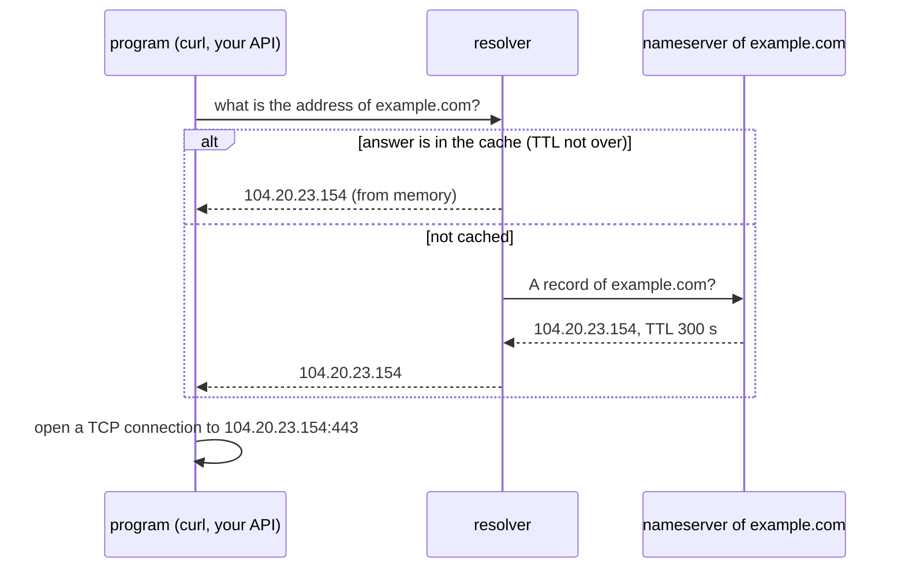
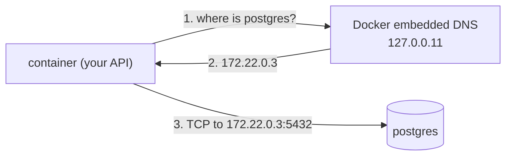

# Networking 02 — DNS

> **Course:** [Networking](./README.md)  ·  **Time:** ~40 min  ·  **Needs:** [Networking 01](./01-ip-ports-tcp.md); [Docker 07](../docker/07-networks.md) helps for the exercises
> **Used in the labs:** [Lab 02, step 4](../../labs/02-load-balancing.md#step-4--nginx-in-front-of-the-api) and [step 5](../../labs/02-load-balancing.md#step-5--three-api-replicas) (`api` resolves to three replicas, Nginx's `resolver 127.0.0.11`), [Lab 04](../../labs/04-database.md) (`postgres:5432`), [Lab 05](../../labs/05-caching.md) (`redis:6379`), [Lab 06](../../labs/06-object-storage.md) (`s3:8333`)

## What you will learn
- Explain what **DNS** does and why programs use names instead of IP addresses.
- Read the answer of `nslookup`: the server asked, the name, the address(es).
- Name the common **record types** (`A`, `AAAA`, `MX`, `NS`) and say what a **TTL** is.
- Explain how containers find each other by **service name**, and why that works on a Compose network but not on Docker's default network.
- Tell **NXDOMAIN** ("this name does not exist") from **SERVFAIL** ("I could not get an answer").

## Words you need
| Word | Plain-words meaning |
|---|---|
| **Domain name / hostname** | A human-friendly name such as `example.com` or `postgres`. |
| **DNS** | *Domain Name System*: the worldwide "phone book" that turns a name into an IP address ([Networking 01](./01-ip-ports-tcp.md)). |
| **Resolver** | The program (or server) your machine asks to look a name up. Also called a DNS client or recursive resolver. |
| **Nameserver** | A server that holds the records of a domain and answers questions about it. |
| **Record** | One line of the phone book: a name, a type and a value. |
| **A record** | "This name has this **IPv4** address." `AAAA` is the same for **IPv6** addresses. |
| **MX record** | "Mail for this domain goes to this server." |
| **NS record** | "These are the nameservers of this domain." |
| **TTL** | *Time to live*: how many seconds an answer may be remembered (cached) before asking again. |
| **Cache** | A short-term copy of an answer, to avoid asking again ([Lab 05](../../labs/05-caching.md)). |
| **NXDOMAIN** | The answer "this name does not exist". |
| **SERVFAIL** | The answer "I tried, but could not get a proper answer". |
| **Round-robin DNS** | One name with **several** addresses; clients get them in changing order, which spreads the traffic. |
| **Hosts file** | A small local file (`/etc/hosts`) with fixed name-to-address pairs, read before any DNS question. |
| **Embedded DNS (Docker)** | A tiny DNS server inside Docker's networking, at `127.0.0.11` inside a container, that knows the container and service names of the network. |

## The idea
**Analogy.** You do not remember your friends' phone numbers, you look up their **names** in your contacts. If a friend changes number, you update the contact and nobody needs to relearn anything. DNS is the contact list of the internet: programs say "connect to `postgres`", the resolver looks the name up and returns the current address. This is why we never write a container's IP in a config file: the address changes, the **name** stays.

**Precisely.** A program that wants to connect to a name first asks its **resolver**: "what is the address of `example.com`?". The resolver may already have the answer in its cache (it stays valid for the record's TTL); otherwise it asks other servers until it reaches the **nameserver** of the domain, which holds the record. The answer comes back, the program opens a TCP connection to that address and port, and the usual conversation starts.



**Inside Docker** the same thing happens in miniature. On a network created by Compose, each container's resolver is Docker's **embedded DNS** (`127.0.0.11`), which knows every service name of that network. Ask for `api` and it answers with the address of **every replica**; ask for `postgres` and you get the database's address. On Docker's default network (the plain `docker run` one) there is no such name service.



## The code or config, line by line
The two things you see inside a container: its resolver settings and the answer of a lookup (real output from the lab network, with a comment on each line):

```text
$ cat /etc/resolv.conf
nameserver 127.0.0.11              # 1  ask this server for names: Docker's embedded DNS
options ndots:0                    # 2  a name without dots is looked up as it is (no search suffixes added)

$ nslookup postgres
Server:         127.0.0.11         # 3  who answered
Address:        127.0.0.11:53      # 4  its address and port 53, the DNS port
Non-authoritative answer:          # 5  "this came from a resolver, not straight from the domain's own server"
Name:   postgres                   # 6  the name asked
Address: 172.22.0.3                # 7  the A record: where it lives
```

| Line | What it does | If you change or remove it |
|---|---|---|
| 1 `nameserver 127.0.0.11` | Tells the container where its resolver is. Docker writes it for you. | Edited to a public server such as `8.8.8.8`, container names stop resolving: only Docker's DNS knows them. |
| 2 `options ndots:0` | Names are tried exactly as typed. | With a higher `ndots`, short names get suffixes appended first (a Kubernetes habit, see later). |
| 3-4 `Server` / `Address` | Which resolver answered; port **53** is the standard DNS port. | A different server here means different answers (see experiment 5). |
| 5 `Non-authoritative answer` | The server answered from its own knowledge, not as the owner of the record. Normal for any resolver. | Not an error; ignore it. |
| 7 `Address: 172.22.0.3` | The IP the name currently points to. It can change when the container is re-created. | Never copy it into a config: use the name. |

## The commands
| Command / flag | Meaning |
|---|---|
| `nslookup NAME` | Ask the resolver for the address(es) of `NAME` and print the answer. |
| `nslookup -type=MX NAME` | Ask for another **record type** (`MX`, `NS`, `A`, `AAAA`, ...). Busybox's `nslookup` (in Alpine) accepts `-type=`. |
| `cat /etc/resolv.conf` | Show which resolver this machine or container uses. |
| `cat /etc/hosts` | Show the local fixed name-to-address list, read before DNS. |
| `docker run --rm --network NET IMAGE ...` | Run a throw-away container attached to the network `NET` (here the lab's `aws-local-lab_private`). |
| `sed -n '1,8p'` | Print only lines 1 to 8 of the output (used here to keep it short). |

## Hands-on
The lab stack is running (`make up`); the exercises use throw-away `alpine:3.24` containers, plus one `nginx` that is stopped at the end. Real output, trimmed (the second, empty `Non-authoritative answer:` that appears in some answers is the resolver's separate IPv6 (`AAAA`) question, which had no result).

**1. A service name on the lab network**
```bash
docker run --rm --network aws-local-lab_private alpine:3.24 cat /etc/resolv.conf
docker run --rm --network aws-local-lab_private alpine:3.24 nslookup postgres
```
```text
nameserver 127.0.0.11
options ndots:0
Server:		127.0.0.11
Address:	127.0.0.11:53

Non-authoritative answer:
Name:	postgres
Address: 172.22.0.3
```
**How to read it:** the container's resolver is Docker's embedded DNS, and it knows `postgres`. (The comment lines of `resolv.conf` are left out.)

**2. One name, three replicas (round-robin)**
```bash
docker run --rm --network aws-local-lab_private alpine:3.24 nslookup api
```
```text
Name:	api
Address: 172.22.0.7
Name:	api
Address: 172.22.0.6
Name:	api
Address: 172.22.0.5
```
**How to read it:** the name `api` returns **three addresses**, one per replica of the `api` service. A client that picks one of them (or Nginx, which asks again every few seconds, see [Lab 02, step 5](../../labs/02-load-balancing.md#step-5--three-api-replicas)) spreads its requests. When a replica is replaced, the list changes and nothing in the config does.

**3. A name that does not exist on that network**
```bash
docker run --rm --network aws-local-lab_private alpine:3.24 nslookup nosuchservice; echo "exit=$?"
```
```text
** server can't find nosuchservice: SERVFAIL
exit=1
```
**How to read it:** the lookup fails with exit code 1. Here the failure code is **SERVFAIL**, not NXDOMAIN: the lab's `private` network is `internal` (no route out), and I did not dig further into why Docker answers this way there. Compare with the next exercise.

**4. The default network has no name service for containers**
```bash
docker run -d --rm --name dns02-web nginx:1.30.6-alpine
docker run --rm alpine:3.24 nslookup dns02-web
```
```text
Server:		192.168.65.7
Address:	192.168.65.7:53

** server can't find dns02-web: NXDOMAIN
```
**How to read it:** on Docker's default network the resolver is `192.168.65.7` (Docker Desktop's own forwarder, which passes questions on to your computer's DNS), not `127.0.0.11`, and it has never heard of `dns02-web`: **NXDOMAIN**, "does not exist". The same container *does* exist and run; only the name service is missing. This is why Compose creates its own network: names for free.

**5. The real DNS: records of a public name**
```bash
docker run --rm alpine:3.24 nslookup example.com
docker run --rm alpine:3.24 nslookup -type=MX example.com
docker run --rm alpine:3.24 nslookup -type=NS example.com
```
```text
Name:	example.com
Address: 172.66.147.243
Name:	example.com
Address: 104.20.23.154
example.com	mail exchanger = 0
example.com	nameserver = elliott.ns.cloudflare.com
example.com	nameserver = hera.ns.cloudflare.com
```
**How to read it:** the `A` question returns two addresses (round-robin again, and these two will differ when you run it: addresses change). `MX` says where mail goes (here "nowhere": a priority of `0` and an empty server name means the domain accepts no mail). `NS` names the two **nameservers** that own the domain's records. (`nslookup` printed no TTL; `dig` would, but it is not in the small image.)

**6. Clean up**
```bash
docker stop dns02-web        # started with --rm: it removes itself
```

## What if…?
**…the resolver you ask is not the one that knows the name?** Experiments 3 and 4 are the two halves of that. A name that exists only inside Docker's network (`postgres`, `api`) can be answered **only** by Docker's embedded DNS; a public name (`example.com`) can be answered only by the real DNS. A container on the lab's `private` network asks Docker's DNS first, which is why Lab 05's API reaches `redis` by name, and why that network cannot be used to reach the internet at all (it has no route out, see [Lab 03](../../labs/03-networking.md)). When "name not found" appears, first ask **which resolver** was asked.

## In short
1. **DNS turns names into addresses.** Programs use the stable name; the address behind it can change.
2. **Records** hold the answers (`A` = IPv4 address, `MX` = mail, `NS` = nameservers) and a **TTL** says how long an answer may be cached.
3. In Docker, **Compose networks give every service a name** through the embedded DNS (`127.0.0.11`); the default network does not.

## Check your understanding
1. Why does the lab's API connect to `postgres:5432` and not to `172.22.0.3:5432`?
2. `nslookup api` printed three addresses. What does that tell you, and who benefits?
3. What is a TTL, and what is the price of a very long one?
4. Exercise 4 ended with `NXDOMAIN`. Was the container missing? What was missing?
5. What is the difference between a **resolver** and a **nameserver**?

<details><summary>Answers</summary>

1. The address is handed out by Docker and can change whenever the container is re-created. The name `postgres` always points to the current one, through Docker's DNS.
2. The `api` service has three replicas, and the DNS answer lists all of them. A load balancer or client can spread requests over them, and replaced replicas show up in the list without any config change.
3. The number of seconds an answer may be cached. A long TTL means fewer questions (faster, cheaper) but clients keep using an **old** address after a change, for as long as the TTL lasts. This is the same trade-off as a cache TTL in [Lab 05](../../labs/05-caching.md).
4. The container existed and was running. What was missing was a **name service** for container names on Docker's default network: the resolver there (`192.168.65.7`) only knows public DNS.
5. A **resolver** is the one that asks questions on behalf of programs and caches answers; a **nameserver** holds the records of a domain and gives the authoritative answer. The resolver asks nameservers.

</details>

## Official documentation
- [Docker: networking overview, DNS services](https://docs.docker.com/engine/network/)
- [Docker Compose: networking](https://docs.docker.com/compose/how-tos/networking/)
- [MDN: What is a domain name?](https://developer.mozilla.org/en-US/docs/Learn_web_development/Howto/Web_mechanics/What_is_a_domain_name)
- [AWS: Amazon Route 53 concepts](https://docs.aws.amazon.com/Route53/latest/DeveloperGuide/route-53-concepts.html) (the AWS DNS service)

## Where you use this in the project
- [Lab 02, steps 4 and 5](../../labs/02-load-balancing.md): `server api:8000 resolve` and `resolver 127.0.0.11 valid=5s` in `lb/nginx.conf` make Nginx re-ask Docker's DNS every 5 seconds, so restarted replicas rejoin.
- [Lab 04](../../labs/04-database.md), [Lab 05](../../labs/05-caching.md) and [Lab 06](../../labs/06-object-storage.md): the API reaches `postgres`, `redis` and `s3` **by service name**.
- [Docker 07](../docker/07-networks.md): the same embedded DNS, from the Docker side.
