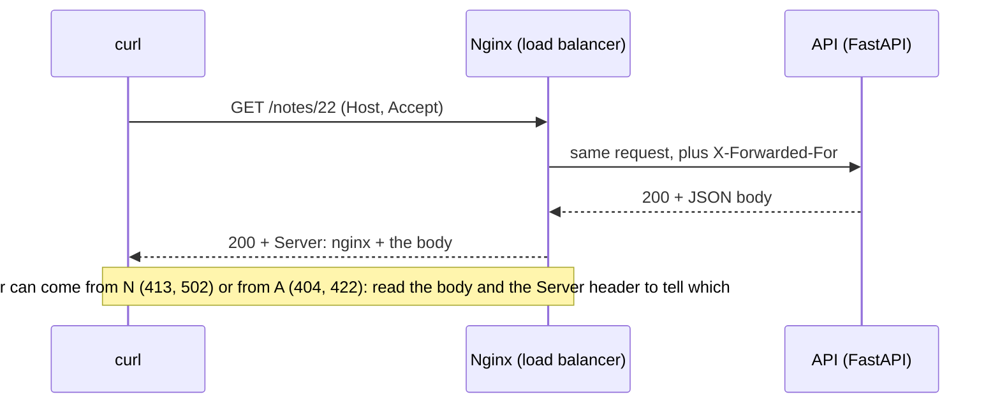

# Networking 03 — HTTP requests, responses and status codes

> **Course:** [Networking](./README.md)  ·  **Time:** ~40 min  ·  **Needs:** [Networking 01](./01-ip-ports-tcp.md) and [Networking 02](./02-dns.md)
> **Used in the labs:** [Lab 01, step 2](../../labs/01-containers.md#step-2--a-minimal-api-in-a-container) (`curl` on `/health` and `/whoami`), [Lab 02, step 6](../../labs/02-load-balancing.md#step-6--health-checks-and-failover) (502/503 during failover), [Lab 04](../../labs/04-database.md) (201, 204, 404, 422), [Lab 05](../../labs/05-caching.md) (`X-Cache`), [Lab 06, step 19](../../labs/06-object-storage.md) (413)

## What you will learn
- Read a raw **HTTP request** and **response**: start line, headers, body.
- Choose the right **method** (`GET`, `POST`, `PUT`, `DELETE`) and read the common **status codes** (2xx, 3xx, 4xx, 5xx).
- Tell **who** answered an error: your API, or the proxy in front of it (Nginx).
- Use `curl -v`, `-i`, `-I`, `-w` and `-H` to look at real traffic.
- Explain what a **header** is, with `Content-Type`, `Content-Length`, `Host` and the lab's own `X-Cache`.

## Words you need
| Word | Plain-words meaning |
|---|---|
| **HTTP** | *HyperText Transfer Protocol*: the language web clients and servers speak, on top of TCP ([Networking 01](./01-ip-ports-tcp.md)). One question (**request**), one answer (**response**). |
| **Request** | What the client sends: a method, a path, headers and sometimes a body. |
| **Response** | What the server answers: a status code, headers and usually a body. |
| **Method (verb)** | The kind of action: `GET` read, `POST` create, `PUT` replace, `DELETE` remove, `HEAD` like `GET` but headers only. |
| **Path** | The part of the URL after the host: `/notes/22`. |
| **Header** | A `Name: value` line of extra information about the message (`Content-Type: application/json`). |
| **Body** | The data part of a message, after the headers. |
| **Status code** | A three-digit number in the response that says how it went: `200`, `404`, `502`... |
| **Reverse proxy** | A server in front of your app that receives the requests and forwards them (Nginx here, [Networking 04](./README.md), planned). It can answer some errors itself. |
| **Client error / server error** | Status codes starting with **4** mean "the request has a problem"; starting with **5** mean "the server has a problem". |
| **Idempotent method** | Repeating it gives the same result as doing it once (`GET`, `PUT`, `DELETE`); `POST` is not. |
| **`curl`** | A command-line HTTP client: the best tool to look at what really travels. |

## The idea
**Analogy.** A letter exchange with a very formal office. You write on a form: **what you want** (method and path: "GET /notes/22"), **who you are and what you can read** (headers), and attach an **enclosure** if needed (the body). The office replies on a form too: a **result code** at the top ("200: done", "404: nothing under that number"), notes in the margin (headers) and the **document** you asked for (body). Every exchange is one form out, one form back; the office does not remember your last letter.

**Precisely.** HTTP is text sent over a TCP connection. A request looks like:

```text
GET /health HTTP/1.1            <- method, path, protocol version
Host: localhost:8081            <- headers, one per line
Accept: */*

                                <- an empty line ends the headers; a body would follow
```

and the response:

```text
HTTP/1.1 200 OK                 <- protocol, status code, reason phrase
Content-Type: application/json  <- headers
Content-Length: 15

{"status":"ok"}                 <- body
```

The **first digit** of the status code tells you the family:

| Code range | Meaning | Examples in this lab |
|---|---|---|
| **2xx** success | It worked. | `200 OK`, `201 Created` (new note), `204 No Content` (deleted) |
| **3xx** redirect | Look elsewhere. | (none yet) |
| **4xx** client error | **Your request** is wrong. | `404 Not Found`, `405 Method Not Allowed`, `413 Request Entity Too Large` (newer texts say "Content Too Large"), `422` invalid data |
| **5xx** server error | **The server** failed. | `502 Bad Gateway` (the app behind the proxy did not answer properly) |



## The code or config, line by line
A real exchange captured from the lab (`curl -v localhost:8081/health`), with a comment on each line:

```text
> GET /health HTTP/1.1              # 1  the request: method, path, version
> Host: localhost:8081              # 2  which site/name the client asked for (needed when one server hosts many)
> User-Agent: curl/8.12.1           # 3  who is asking
> Accept: */*                       # 4  "I accept any content type"
< HTTP/1.1 200 OK                   # 5  the response: version, status code, reason
< Server: nginx/1.30.6              # 6  which software answered: the load balancer
< Date: Thu, 19 Nov 2026 14:55:44 GMT   # 7  when
< Content-Type: application/json    # 8  what the body is
< Content-Length: 15                # 9  how many bytes the body has
< Connection: keep-alive            # 10 keep the TCP connection open for the next request
{"status":"ok"}                     # 11 the body
```

| Line | What it does | If you change or remove it |
|---|---|---|
| 1 `GET /health` | The method and the resource. `GET` must not change anything. | Use `POST` on a `GET`-only route and you get `405` (see exercise 3). |
| 2 `Host:` | The name the client used. Nginx and many servers use it to choose a site. | A different value (`example.org`) may reach another site; here the lab's Nginx ignores it and still answers `200`. |
| 8 `Content-Type: application/json` | Tells the reader how to read the body. | A wrong type makes clients parse it wrongly. When *you* send JSON, you must send `Content-Type: application/json` too. |
| 9 `Content-Length: 15` | The size of the body. A server can refuse a body from this number alone, **before** reading it (exercise 5). | A wrong value breaks the message: the body is cut or the connection hangs. |
| 6 `Server: nginx/...` | Shows **which layer** answered; an error page with this header came from Nginx, not from your API. | Hiding it (`server_tokens off`) removes a clue when debugging. |

## The commands
| Command / flag | Meaning |
|---|---|
| `curl URL` | A `GET`; prints the body only. |
| `curl -v URL` | **Verbose**: shows the request (`>` lines) and the response headers (`<` lines). Lines starting with `*` are curl's own notes. |
| `curl -i URL` | Print the response **headers plus** the body. |
| `curl -I URL` | Send a `HEAD` request: headers only. |
| `curl -X METHOD` | Choose the method (`POST`, `PUT`, `DELETE`...). |
| `curl -H 'Name: value'` | Add or replace a request header. |
| `curl -d 'text'` | Send a body (and switch the method to `POST` if none is given). |
| `curl -s` / `-o /dev/null` | `-s` no progress bar; `-o /dev/null` throw the body away. |
| `curl -w 'HTTP %{http_code}\n'` | After the transfer, print a value, here the status code. |
| `curl -D -` | Dump the response headers to the screen (`-` means "standard output"). |
| `tr -d '\r'` | Delete the carriage-return characters HTTP puts at the end of each header line (so the output lines up). |
| `sed -n '1p;/^allow/Ip;/^{/p'` | Print only the first line, the line starting with `allow` (the `I` ignores letter case) and the line starting with `{` (the JSON body). |
| `curl -m 5` | Give up after 5 seconds in total. |

## Hands-on
The lab is running (`make up`, here on port **8081**; use your `LB_HOST_PORT`). Real output, trimmed; a throw-away note is created and removed.

**1. Look at one request and its response**
```bash
curl -sv -m 5 localhost:8081/health
```
```text
* Connected to localhost (127.0.0.1) port 8081
> GET /health HTTP/1.1
> Host: localhost:8081
> User-Agent: curl/8.12.1
> Accept: */*
< HTTP/1.1 200 OK
< Server: nginx/1.30.6
< Date: Thu, 19 Nov 2026 14:55:44 GMT
< Content-Type: application/json
< Content-Length: 15
< Connection: keep-alive
{"status":"ok"}
```
(Filtered to the interesting lines: `-m 5` gives up after 5 seconds.) `*` lines are curl's notes (the TCP connection from [Networking 01](./01-ip-ports-tcp.md)), `>` is what curl **sent**, `<` is what it **received**.

**2. `POST` creates: 201 and a body**
```bash
curl -si -m 5 -X POST localhost:8081/notes -H 'Content-Type: application/json' -d '{"title":"http demo"}'
```
```text
HTTP/1.1 201 Created
Server: nginx/1.30.6
Date: Thu, 19 Nov 2026 14:55:45 GMT
Content-Type: application/json
Content-Length: 82
Connection: keep-alive

{"title":"http demo","body":"","id":22,"created_at":"2026-11-19T14:55:45.192624Z"}
```
`201 Created` (not `200`) says "a new thing exists now"; the empty line separates the headers from the body (`Content-Length: 82` is its size).

**3. A tour of status codes**
```bash
curl -s -m 5 -o /dev/null -w "GET /notes/22 -> HTTP %{http_code}\n" localhost:8081/notes/22        # and the same pattern for the others
```
```text
GET /notes/22          -> HTTP 200
GET /notes/999999      -> HTTP 404
GET /nothing-here      -> HTTP 404
DELETE /health         -> HTTP 405
POST /notes (body {})   -> HTTP 422
DELETE /notes/22       -> HTTP 204
GET /notes/22 (again)  -> HTTP 404
```
(Each line is one `curl` call with its own method and URL, labelled by hand.) The note exists (`200`), a missing number gives `404`, an unknown path gives `404`, `DELETE` on a `GET`-only route gives `405`, an empty JSON object `{}` is understood but incomplete (`422`), `DELETE` succeeds with `204` (nothing to send back) and the note is then gone (`404`).

**4. What the error bodies and headers say**
```bash
curl -si -m 5 -X DELETE localhost:8081/health | tr -d '\r' | sed -n '1p;/^allow/Ip;/^{/p'
curl -s -m 5 localhost:8081/notes/999999
```
```text
HTTP/1.1 405 Method Not Allowed
allow: GET
{"detail":"Method Not Allowed"}{"detail":"note not found"}
```
(The two answers run together because the bodies have no final newline.) `405` comes with an `allow: GET` **header** that lists what the route accepts. The `404` body, `{"detail":"note not found"}`, is the message written in the lab's API ([Lab 04](../../labs/04-database.md)).

**5. A `HEAD` request, and a `413` from the proxy**
```bash
curl -sI -m 5 localhost:8081/health
curl -s -m 5 -D - -o /dev/null -X POST localhost:8081/upload -H 'Content-Length: 9999999' -d x
```
```text
HTTP/1.1 405 Method Not Allowed
Server: nginx/1.30.6
Date: Thu, 19 Nov 2026 14:55:52 GMT
Content-Type: application/json          (first 4 lines of the HEAD answer)
HTTP/1.1 413 Request Entity Too Large
Server: nginx/1.30.6
Date: Thu, 19 Nov 2026 14:55:53 GMT
```
Two surprises, both real. First, `HEAD /health` gives `405`: the API defined `GET /health` only, and FastAPI does not add `HEAD` for you (the `allow` header would list `GET`, as in exercise 4). Second, a request that **claims** (`Content-Length: 9999999`) a body bigger than Nginx's limit is refused with `413` before the API sees anything, even though the actual body was one byte. `Server: nginx/1.30.6` shows the answer came from the load balancer. (The `413` happens at the 6 MB limit set in [Lab 06, step 19](../../labs/06-object-storage.md); the status line says "Request Entity Too Large", the same status that newer texts call "Content Too Large".)

**6. The `Host` header**
```bash
curl -s -m 5 -o /dev/null -w 'Host: example.org -> HTTP %{http_code}\n' -H 'Host: example.org' localhost:8081/health
```
```text
Host: example.org -> HTTP 200
```
The request went to the same machine but **named** another site. The lab's Nginx has one `server` block that answers any host name, so it still replies `200`. A server with several sites would use this header to choose; this is how step 20's `s3.localhost` route will work.

## What if…?
**…you cannot tell who sent a `413`?** Compare two refusals from exercise 5 and the lab step: a too-big file that passes Nginx but breaks the API's own limit answers `{"detail":"file too large ..."}` (JSON, from FastAPI), while one that breaks Nginx's limit answers an **HTML** page with `Server: nginx` (and never reaches the API). Same code, different layer: the **body format and the `Server` header** tell you where to look, in Nginx's config or in the app's code.

## In short
1. HTTP is **one request, one response**: method + path + headers (+ body) out; status code + headers (+ body) back.
2. The **first digit** of the status code says whose problem it is: **4xx** yours, **5xx** the server's; `2xx` is success.
3. Use `curl -v` or `-i` to see the truth, and read **headers** (`Server`, `Content-Type`, `Allow`, `X-Cache`) to find which layer answered.

## Check your understanding
1. What are the three parts of an HTTP request, and which part says "what do you want"?
2. What is the difference between `200`, `201` and `204`?
3. `DELETE /health` returned `405`. Who is at fault, and what header helps you fix it?
4. You see a `413` whose page ends with `nginx/1.30.6`. Does the API's code run for that request? How do you know?
5. Why does a `POST /notes` need a `Content-Type: application/json` header when you send JSON?

<details><summary>Answers</summary>

1. The **start line** (method and path: it says what you want), the **headers** (extra information) and the optional **body**.
2. `200 OK`: it worked and here is the result. `201 Created`: it worked and a **new thing** was made. `204 No Content`: it worked and there is **nothing to send back** (what `DELETE /notes/22` returned).
3. The **client**: the route exists but does not accept `DELETE`. The `allow: GET` header of the response lists the methods that are accepted.
4. No: the `Server: nginx` header and the HTML page show that Nginx answered, refusing the body (it looks at `Content-Length`) before passing the request on.
5. The header tells the server how to **read** the body. Without it FastAPI does not know the body is JSON, and the request fails validation (usually with a `422`).

</details>

## Official documentation
- [MDN: An overview of HTTP](https://developer.mozilla.org/en-US/docs/Web/HTTP/Overview) and [HTTP messages](https://developer.mozilla.org/en-US/docs/Web/HTTP/Messages)
- [MDN: HTTP response status codes](https://developer.mozilla.org/en-US/docs/Web/HTTP/Status) and [HTTP request methods](https://developer.mozilla.org/en-US/docs/Web/HTTP/Methods)
- [MDN: HTTP headers](https://developer.mozilla.org/en-US/docs/Web/HTTP/Headers)
- [curl manual](https://curl.se/docs/manpage.html)

## Where you use this in the project
- [Lab 01, step 2](../../labs/01-containers.md#step-2--a-minimal-api-in-a-container): `curl` on `/health` and `/whoami`.
- [Lab 02, step 6](../../labs/02-load-balancing.md#step-6--health-checks-and-failover): what Nginx answers (`502`/`503`) or retries when a replica dies.
- [Lab 04](../../labs/04-database.md): the notes API uses `201`, `204`, `404` and `422`.
- [Lab 05](../../labs/05-caching.md): the `X-Cache: HIT|MISS|BYPASS` header is a custom header, a lab-made clue in the response.
- [Lab 06, step 19](../../labs/06-object-storage.md): the two `413` limits (Nginx and the API).
