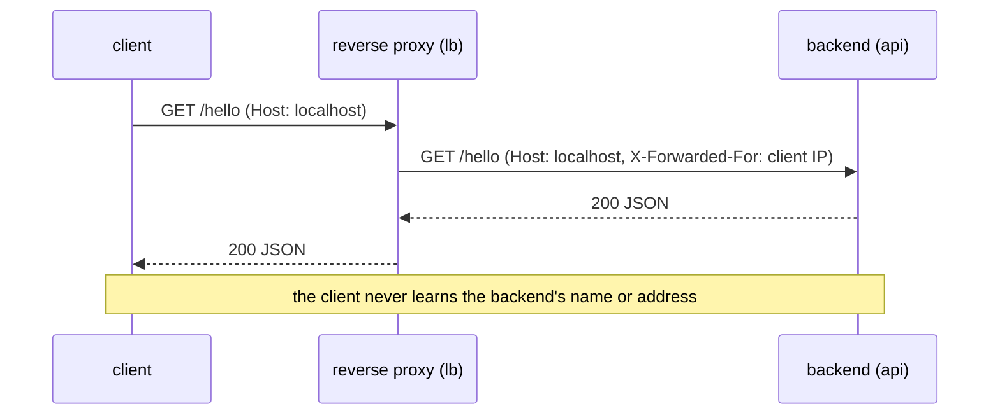
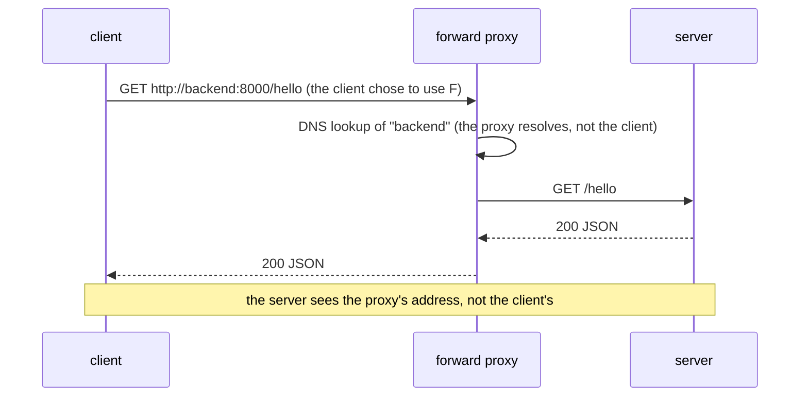

# Networking 04 — Proxies: forward vs reverse

> **Course:** [Networking](./README.md)  ·  **Time:** ~40 min  ·  **Needs:** [Networking 03](./03-http.md) (requests and headers) and [Networking 02](./02-dns.md) (names)
> **Used in the labs:** [Lab 02, step 4](../../labs/02-load-balancing.md#step-4--nginx-in-front-of-the-api) (Nginx in front of the API) and [Lab 06, step 20](../../labs/06-object-storage.md#step-20--a-public-s3-address-s3localhost-through-the-load-balancer) (`s3.localhost`)

## What you will learn
- Say what a **proxy** is, and tell a **forward proxy** from a **reverse proxy** by asking "who knows about the proxy?".
- Explain why the lab's load balancer is a reverse proxy, and what the `Host`, `X-Forwarded-For` and `X-Forwarded-Proto` headers are for.
- See with your own eyes what a backend learns (and does not learn) when a proxy sits in front of it.
- Name the AWS equivalents: a load balancer (reverse) and a NAT gateway or egress proxy (forward-like).

## Words you need
| Word | Plain-words meaning |
|---|---|
| **Proxy** | A server that passes requests along on behalf of someone else. The word means "stand-in". |
| **Client** | The program that starts a request (`curl`, a browser, the API calling S3). |
| **Origin / backend** | The server that really holds the answer (our API containers, the object store). |
| **Forward proxy** | A proxy that stands in for the **clients**. The client is set up to use it, and the backend does not know who the real client is. |
| **Reverse proxy** | A proxy that stands in for the **servers**. Clients think it *is* the server and do not know the backends exist. |
| **Peer address** | The IP address of the machine on the other end of the TCP connection ([Networking 01](./01-ip-ports-tcp.md)). Behind a proxy it is the proxy's, not the client's. |
| **Header** | A `Name: value` line of an HTTP request ([Networking 03](./03-http.md)). |
| **`Host` header** | The name the client typed in the URL. A server hosting several sites uses it to choose which one answers. |
| **`X-Forwarded-For`** | A header a proxy adds to say "the original client was this IP". The `X-` prefix marks a header that is a habit, not part of the HTTP standard. |
| **`X-Forwarded-Proto`** | A header saying whether the client used `http` or `https` (the proxy may speak plain HTTP to the backend). |
| **Absolute-form request** | A request line that holds the full URL (`GET http://backend:8000/ HTTP/1.1`), which is how a client talks to a forward proxy. |
| **Load balancer** | A reverse proxy that spreads requests over several identical backends ([Lab 02](../../labs/02-load-balancing.md)). |

## The idea
**Analogy.** A **receptionist** in front of an office is a *reverse* proxy: visitors speak to the receptionist, who walks the request to the right person; visitors never learn the staff's direct lines. A **personal assistant who phones suppliers for you** is a *forward* proxy: the supplier hears the assistant, not you; you gave the assistant the instruction on purpose.

**Precisely.** Both are servers in the middle that read a request and send it on, then bring the answer back. The difference is **whose side** they are on:

| | Forward proxy | Reverse proxy |
|---|---|---|
| Stands in for | the clients | the servers |
| Who is configured to use it | the **client** (`curl -x`, a browser setting, `http_proxy`) | nobody: clients just use its address |
| The request line | the full URL (`GET http://backend:8000/hello`) | only the path (`GET /hello`) |
| What it hides | the client from the server | the servers from the client |
| Typical uses | company web filter, cache, going out through one controlled address | load balancing, TLS termination, one entry point, caching, protection |
| In this lab / in AWS | an egress proxy or a NAT gateway ([Lab 03](../../labs/03-networking.md)) is the closest relative | the `lb` container; the Application Load Balancer |

Because a reverse proxy opens its **own** connection to the backend, the backend sees the **proxy's** address as the peer. To keep the original information the proxy copies it into headers: `Host` (what the client typed), `X-Forwarded-For` (the client's IP), `X-Forwarded-Proto` (`http` or `https`).




## The code or config, line by line
The reverse proxy, `reverse.conf` (the same ideas as the lab's `lb/nginx.conf`, [Lab 02](../../labs/02-load-balancing.md)):
```nginx
events {}

http {
    server {
        listen 8080;

        location / {
            # Pass every request on to the hidden server, found by its Docker name.
            proxy_pass http://backend:8000;
            # Tell the backend what the client asked for and who the client is.
            proxy_set_header Host              $host;
            proxy_set_header X-Forwarded-For   $remote_addr;
            proxy_set_header X-Forwarded-Proto $scheme;
        }
    }
}
```
| Line | What it does | If you change or remove it |
|---|---|---|
| `events {}` | Required, empty: Nginx's connection settings, all defaults. | Nginx refuses to start without an `events` block. |
| `listen 8080;` | The port the proxy listens on, inside its container. | Clients must then use the new port. |
| `proxy_pass http://backend:8000;` | Send each request to the container named `backend` on port 8000 (Docker DNS, [Docker 07](../docker/07-networks.md)). | Without it Nginx would try to serve files itself. |
| `proxy_set_header Host $host;` | The backend receives the `Host` the **client** used. | Default: the backend gets `Host: backend:8000` (see "What if…?"). |
| `proxy_set_header X-Forwarded-For $remote_addr;` | Adds the client's IP, so the backend can know who called. | The backend only sees the proxy's address. |
| `proxy_set_header X-Forwarded-Proto $scheme;` | Says whether the client used `http` or `https`. | The backend cannot build correct absolute links behind HTTPS. |

The forward proxy, `forward.conf` (Nginx can only forward plain HTTP, which is enough to see the idea):
```nginx
events {}

http {
    server {
        listen 8888;
        # The proxy itself looks up the names (Docker's DNS), not the client.
        resolver 127.0.0.11;

        location / {
            # The client wrote the full destination in its request: forward it there.
            proxy_pass http://$http_host$uri$is_args$args;
        }
    }
}
```
| Line | What it does | If you change or remove it |
|---|---|---|
| `listen 8888;` | The proxy's port. Clients are told to use `host:8888` as their proxy. | Clients must be reconfigured. |
| `resolver 127.0.0.11;` | Which DNS server Nginx asks at run time (Docker's built-in one). | Without it `proxy_pass` with a variable fails: Nginx cannot look up names. |
| `proxy_pass http://$http_host$uri$is_args$args;` | Build the destination from the request itself (the `Host` header, the path, the query): the client decides where to go. | A fixed address would make it a reverse proxy again. |

The backend, `echo.py`, answers with what it **saw**:
```python
"""A tiny web server that tells you what it saw: who connected and which headers arrived."""
import json
from http.server import BaseHTTPRequestHandler, HTTPServer


class Echo(BaseHTTPRequestHandler):
    def do_GET(self):
        seen = {
            "path": self.path,
            "peer_ip": self.client_address[0],  # the machine that opened the TCP connection
            "Host": self.headers.get("Host"),
            "X-Forwarded-For": self.headers.get("X-Forwarded-For"),
            "X-Forwarded-Proto": self.headers.get("X-Forwarded-Proto"),
        }
        body = (json.dumps(seen) + "\n").encode()
        self.send_response(200)
        self.send_header("Content-Type", "application/json")
        self.send_header("Content-Length", str(len(body)))
        self.end_headers()
        self.wfile.write(body)

    def log_message(self, *args):  # keep the container's output quiet
        pass


HTTPServer(("0.0.0.0", 8000), Echo).serve_forever()
```
`self.client_address[0]` is the peer address; the `.get(...)` calls read the headers. Nothing else matters here.

## The commands
| Command / flag | Meaning |
|---|---|
| `docker network create net04` | A private network for the demo; containers on it find each other by name. |
| `docker run -d --rm --name X --network net04 ... IMAGE` | Start container `X` in the background (`-d`), delete it when it stops (`--rm`), on the demo network. |
| `-p 127.0.0.1:18080:8080` | Publish the container's port 8080 on port 18080 of **your machine only** (`127.0.0.1`). |
| `-v "$D/reverse.conf:/etc/nginx/nginx.conf:ro"` | Replace Nginx's config by your file, read-only (`:ro`) ([Docker 08](../docker/08-volumes-and-bind-mounts.md)). |
| `curl -x http://localhost:18888 URL` | `-x` (`--proxy`): send the request **through that forward proxy**. The URL is the real destination. |
| `curl -H 'Host: shop.example' ...` | Send a made-up `Host` header. |
| `docker logs NAME` | The container's output; Nginx writes one access-log line per request. |

## Hands-on
Runs in throw-away containers (`nginx:1.30.6-alpine`, and the project's `aws-local-lab-api:0.1.0` for Python). Save the four files in an empty folder, here `net04` (`reverse_bare.conf` is `reverse.conf` without the three `proxy_set_header` lines, see "What if…?").

**1. Start the demo**
```bash
cd net04 && D=$(pwd -W) && export MSYS_NO_PATHCONV=1
docker network create net04
docker run -d --rm --name backend --network net04 -v "$D:/demo" -w /demo aws-local-lab-api:0.1.0 python echo.py
docker run -d --rm --name reverse --network net04 -p 127.0.0.1:18080:8080 -v "$D/reverse.conf:/etc/nginx/nginx.conf:ro" nginx:1.30.6-alpine
docker run -d --rm --name forward --network net04 -p 127.0.0.1:18888:8888 -v "$D/forward.conf:/etc/nginx/nginx.conf:ro" nginx:1.30.6-alpine
```
Addresses on this run: `backend` 172.24.0.2, `reverse` 172.24.0.3, `forward` 172.24.0.4 (`docker inspect NAME` shows yours; the backend has **no** published port).

**2. The backend is hidden; the reverse proxy is the door**
```bash
curl -s -m 3 -o /dev/null -w '%{http_code}\n' localhost:8000/        # straight to the backend
curl -s localhost:18080/hello?x=1                                    # through the reverse proxy
curl -s -H 'Host: shop.example' localhost:18080/                     # with a made-up Host
```
```text
000
{"path": "/hello?x=1", "peer_ip": "172.24.0.3", "Host": "localhost", "X-Forwarded-For": "172.24.0.1", "X-Forwarded-Proto": "http"}
{"path": "/", "peer_ip": "172.24.0.3", "Host": "shop.example", "X-Forwarded-For": "172.24.0.1", "X-Forwarded-Proto": "http"}
```
**How to read it:**
- `000` means "no connection at all": nothing on your machine listens on port 8000. The backend is reachable only through the proxy.
- `peer_ip` is `172.24.0.3`, the **proxy**, not you. The backend never talked to your machine.
- `X-Forwarded-For` is `172.24.0.1`: your client as the proxy saw it. (On Docker Desktop for Windows this is the network's gateway address, not the `127.0.0.1` you typed: Docker translates the address when it publishes a port.)
- `Host` is what you typed (`localhost`, then `shop.example`), passed on unchanged: the idea behind Lab 06's `s3.localhost` route.

**3. The forward proxy: the client chooses it, and the proxy does the lookup**
```bash
curl -s -x http://localhost:18888 http://backend:8000/hello?x=1      # through the forward proxy
curl -s -m 3 -o /dev/null -w '%{http_code}\n' http://backend:8000/hello   # same URL, no proxy
```
```text
{"path": "/hello?x=1", "peer_ip": "172.24.0.4", "Host": "backend:8000", "X-Forwarded-For": null, "X-Forwarded-Proto": null}
000
```
**How to read it:** the name `backend` means nothing on your machine, so the direct request fails (`000`). With `-x`, curl sends the request to the proxy, which looks `backend` up itself and fetches the page. The backend sees the **proxy** (`172.24.0.4`) as the peer and no `X-Forwarded-For`: the client is hidden from the server. A reverse proxy hides the server from the client; a forward proxy hides the client from the server.

**4. The two kinds of request line, in the proxies' own logs**
```bash
docker logs reverse
docker logs forward
```
```text
172.24.0.1 - - [20/Nov/2026:12:14:40 +0000] "GET /hello?x=1 HTTP/1.1" 200 131 "-" "curl/8.12.1"
172.24.0.1 - - [20/Nov/2026:12:14:41 +0000] "GET http://backend:8000/hello?x=1 HTTP/1.1" 200 124 "-" "curl/8.12.1"
```
(One line from each log, picked from the output.) The reverse proxy received `GET /hello?x=1`, only a path: for the client, the proxy **is** the server. The forward proxy received `GET http://backend:8000/hello?x=1`, the **full URL**, because the client has to tell it where to go.

**5. Clean up**
```bash
docker stop backend reverse forward reverse-bare      # started with --rm: they remove themselves
docker network rm net04
```

## What if…?
**…the reverse proxy does not set the headers?** `reverse_bare.conf` has only `proxy_pass http://backend:8000;` (the `reverse-bare` container, published on 18081):
```bash
docker run -d --rm --name reverse-bare --network net04 -p 127.0.0.1:18081:8080 -v "$D/reverse_bare.conf:/etc/nginx/nginx.conf:ro" nginx:1.30.6-alpine
curl -s localhost:18081/
```
```text
{"path": "/", "peer_ip": "172.24.0.5", "Host": "backend:8000", "X-Forwarded-For": null, "X-Forwarded-Proto": null}
```
By default Nginx sends `Host: backend:8000` (its own destination) and adds no `X-Forwarded-*`. The backend now knows neither the name the client used nor who the client is. A backend that logs client IPs, or chooses a site by `Host`, would be wrong without these three lines. This is why the lab's `lb/nginx.conf` sets `Host` and `X-Forwarded-For` (and why `s3.localhost` needed `proxy_set_header Host $http_host;`).

## In short
1. A proxy is a server in the middle. A **reverse** proxy stands in for the servers (clients do not know it is there); a **forward** proxy stands in for the clients (the client is told to use it).
2. Behind a proxy the backend sees the **proxy's** address; the proxy passes `Host`, `X-Forwarded-For` and `X-Forwarded-Proto` in headers so the backend can still know the original request.
3. The lab's `lb` container is a reverse proxy (and a load balancer, see [Lab 02](../../labs/02-load-balancing.md)); in AWS that is an Application Load Balancer.

## Check your understanding
1. Who has to know that a **forward** proxy exists: the client or the server? And for a **reverse** proxy?
2. In the hands-on, why did the backend show `peer_ip` `172.24.0.3` and not your address?
3. Which header carries the original client's IP, and who adds it?
4. What does the first line of the request look like at a forward proxy, and why is it different from a reverse proxy's?
5. What would break in a backend that picks a website by the `Host` header if the proxy did not pass `Host` on?

<details><summary>Answers</summary>

1. A forward proxy: the **client** (it is configured to use it, for example `curl -x`); the server does not know. A reverse proxy: **nobody** has to know: clients simply use its address, and the backends stay hidden.
2. Because the proxy opened its own TCP connection to the backend. The peer of that connection is the proxy (`172.24.0.3`); your address only exists on the connection between you and the proxy.
3. `X-Forwarded-For`, added by the **proxy** (`proxy_set_header X-Forwarded-For $remote_addr;`). It is a convention: the backend must choose to trust it.
4. It holds the full URL (`GET http://backend:8000/hello?x=1 HTTP/1.1`), because the client must tell the proxy where to go. A reverse proxy receives only the path (`GET /hello?x=1`): for the client it is the destination itself.
5. The backend would receive the proxy's own destination name (`backend:8000`) instead of the name the client typed, and could not tell sites apart: every request would look like it was for the same site.

</details>

## Official documentation
- [Nginx: `proxy_pass`](https://nginx.org/en/docs/http/ngx_http_proxy_module.html#proxy_pass) and [`proxy_set_header`](https://nginx.org/en/docs/http/ngx_http_proxy_module.html#proxy_set_header)
- [Nginx: reverse proxy guide](https://docs.nginx.com/nginx/admin-guide/web-server/reverse-proxy/)
- [MDN: Proxy servers and tunneling](https://developer.mozilla.org/en-US/docs/Web/HTTP/Proxy_servers_and_tunneling)
- [MDN: `X-Forwarded-For`](https://developer.mozilla.org/en-US/docs/Web/HTTP/Headers/X-Forwarded-For) and [`Host`](https://developer.mozilla.org/en-US/docs/Web/HTTP/Headers/Host)
- [AWS: What is an Application Load Balancer?](https://docs.aws.amazon.com/elasticloadbalancing/latest/application/introduction.html)

## Where you use this in the project
- [Lab 02, step 4](../../labs/02-load-balancing.md#step-4--nginx-in-front-of-the-api): the `lb` container is a reverse proxy in front of the API, with similar `proxy_set_header` lines (`Host`, `X-Real-IP`, `X-Forwarded-For`).
- [Lab 02, step 5 and 6](../../labs/02-load-balancing.md#step-5--three-api-replicas): the same proxy spreads requests over three replicas and retries when one dies.
- [Lab 06, step 20](../../labs/06-object-storage.md#step-20--a-public-s3-address-s3localhost-through-the-load-balancer): one reverse proxy, two names: the `Host` header decides between the API and the object store.
- [Lab 03](../../labs/03-networking.md): the `public` and `private` networks decide who can reach the backends: the reverse proxy sits on both.
