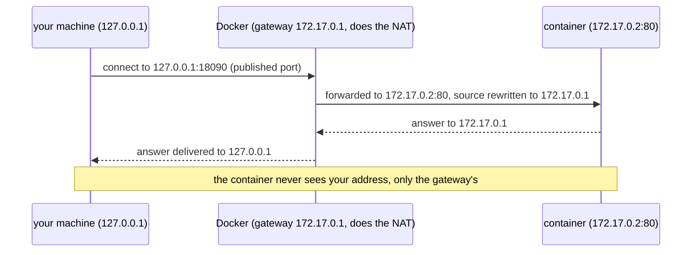
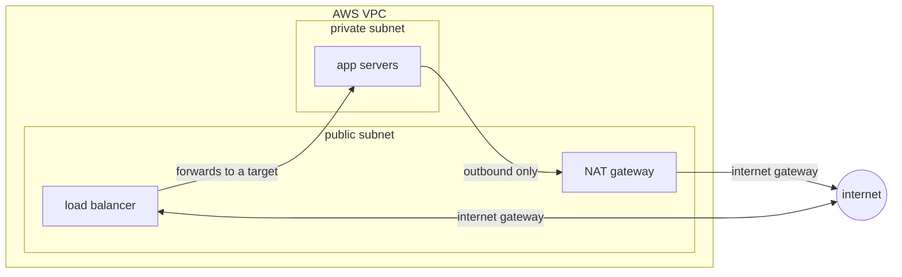

# Networking 05 — NAT and port forwarding

> **Course:** [Networking](./README.md)  ·  **Time:** ~40 min  ·  **Needs:** [Networking 01](./01-ip-ports-tcp.md) (addresses and ports) and [Networking 06](./06-subnets-and-cidr.md) (subnets); [Docker 01](../docker/01-images-and-containers.md) for the exercise
> **Used in the labs:** [Lab 01, step 3](../../labs/01-containers.md#step-3--describe-the-api-as-a-compose-service) (the `127.0.0.1:<port>:...` mapping) and [Lab 03, step 8](../../labs/03-networking.md#step-8--public-and-private-networks) (a private network with no way out)

## What you will learn
- Explain **NAT** (network address translation) and tell its two directions apart: **source NAT** for traffic going out, **port forwarding** (destination NAT) for traffic coming in.
- Read the `-p 127.0.0.1:18090:80` form of a Docker port mapping, and say who can reach the port.
- See the translation with your own eyes: what a backend sees as the client's address, and why a container's own address does not work from your machine.
- Explain why the lab's `private` network has no way out (`internal: true`) and which AWS parts do the same jobs (internet gateway, NAT gateway).

## Words you need
| Word | Plain-words meaning |
|---|---|
| **IP address / port** | The address of a machine and the number of a "door" on it ([Networking 01](./01-ip-ports-tcp.md)). |
| **Private address** | An address meant for use inside a network only. The ranges `10.0.0.0/8`, `172.16.0.0/12` and `192.168.0.0/16` are reserved for this: the internet does not route them, and many networks reuse them. Docker's `172.17.0.0/16` is one. |
| **Public address** | An address that is unique and reachable on the internet. |
| **NAT** | *Network Address Translation*: a device on the path rewrites the addresses (and sometimes ports) in the packets that go through it. |
| **Source NAT (SNAT, "masquerade")** | NAT for traffic going **out**: the device replaces the sender's private address with its own, and remembers the connection so it can send the reply back to the right sender. |
| **Port forwarding (destination NAT, DNAT)** | NAT for traffic coming **in**: a rule says "what arrives at my port X goes to machine M, port Y". |
| **Gateway / default route** | The "door out" of a network: the address a machine sends everything to that is not on its own network. A machine with no default route can only talk to its own network. |
| **Bridge network** | The kind of virtual network Docker creates by default: containers on it get private addresses and a gateway. |
| **Published port** | A Docker port mapping `-p HOST:CONTAINER`: a port of your machine forwarded to a port of a container. |
| **Network interface** | One of the ways your machine connects to a network: the Wi-Fi card, the Ethernet port, or the internal "loopback" connection that only talks to the machine itself. Each has its own address. |
| **Bind address** | The address a published port listens on: `127.0.0.1` (the loopback interface) means "this machine only", `0.0.0.0` means "every network interface". |
| **Internet gateway / NAT gateway (AWS)** | The two AWS parts that connect a VPC to the internet: the internet gateway for public subnets, the NAT gateway so private subnets can go **out** without being reachable from outside. |

## The idea
**Analogy.** A company with one street address and many offices inside. **Outgoing letters** all carry the company's address; the **mail room** notes which office sent what, so the reply is delivered to the right desk (source NAT). **Incoming visitors** who ask for "the company, door 5" are sent by the receptionist to one particular office (port forwarding). Inside, offices use short internal numbers that mean nothing to the outside world (private addresses).

**Precisely.** Private addresses cannot be used on the internet, and there are not enough public IPv4 addresses for every device. So a network gets **one** public address on a router that does NAT:
- **Outbound.** A machine at `172.17.0.2` opens a connection to a server. On the way out the router rewrites the source to its own public address and writes a line in its table (*inside 172.17.0.2:51000 ↔ outside 203.0.113.5:40001*). The server answers to the public address; the router looks in the table and sends the packet to `172.17.0.2`. Nobody on the internet can **start** a connection to `172.17.0.2`: there is no table line, and no route.
- **Inbound.** To let the outside reach a service, you add a **port-forwarding rule**: "TCP port 18090 on me → `172.17.0.2` port 80". Packets for that port get their destination rewritten and are sent on.

Docker does both for you on its bridge networks: containers have private addresses and a gateway that masquerades their outgoing traffic, and `-p` adds a forwarding rule. A network created `internal` has **no default route**, so nothing goes out at all.




## The code or config, line by line
The lab's `docker-compose.yml` uses both ideas (excerpt):
```yaml
  lb:
    ports:
      - "127.0.0.1:${LB_HOST_PORT:-80}:80"   # port forwarding: your machine's port -> the container's port 80
    networks:
      - public                               # has a gateway: can go out
      - private                              # no gateway: cannot go out
networks:
  public:
  private:
    internal: true                           # no default route, no published ports
```
| Line | What it does | If you change or remove it |
|---|---|---|
| `"127.0.0.1:${LB_HOST_PORT:-80}:80"` | `bind address : host port : container port`. Port `LB_HOST_PORT` (80 unless set) on **your machine only** is forwarded to port 80 of the container. | Remove `127.0.0.1:` and the port is open on **every network interface** of your machine (see "What if…?"). Remove the whole line and nothing outside the Docker network can reach the load balancer. |
| `networks: - public - private` | The load balancer has a foot in both networks. It is the only service that does. | A service only on `private` cannot publish a port. |
| `public:` | A normal bridge network: a gateway, so containers on it can reach the outside through NAT. | |
| `private: internal: true` | An **internal** network: containers can talk to each other but there is **no default route** and no published port. This is the lab's private subnet. | Without `internal: true`, the database and cache could reach the internet like any container. |

## The commands
| Command / flag | Meaning |
|---|---|
| `docker run -d --rm --name web1 -p 127.0.0.1:18090:80 nginx:1.30.6-alpine` | Start a throw-away web server in the background (`-d`, `--rm`, `--name`) and forward `127.0.0.1:18090` to its port 80 (`-p`). |
| `docker port web1` | Show the port mappings of a container: `80/tcp -> 127.0.0.1:18090` reads "container port 80 is reachable at that address". |
| `docker inspect web1 --format '{{range .NetworkSettings.Networks}}{{.IPAddress}}{{end}}'` | Print the container's private address. `--format` picks fields out of the JSON. |
| `curl -s -m 3 -o /dev/null -w 'HTTP %{http_code}\n' URL` | `-s` quiet, `-m 3` give up after 3 seconds, `-o /dev/null` drop the page, `-w` print only the status code. `000` means "no connection at all". |
| `docker network create --internal NAME` | Create a bridge network **without** a way out. |
| `docker run --rm alpine:3.24 ip route` | Print the routing table of a container: where it sends traffic. A line starting with `default via` is the way out. |
| `netstat -an` | (On your machine) all connections and open ports, with the address each one listens on; look for the lines marked `LISTENING`. |

## Hands-on
Throw-away containers (`nginx:1.30.6-alpine`, `alpine:3.24`, and the project's `aws-local-lab-api:0.1.0` for Python). For the echo server save `echo.py` from [Networking 04](./04-proxies.md#the-code-or-config-line-by-line). Docker Desktop on Windows runs containers in a small Linux VM: the addresses below are from that setup.

**1. Port forwarding, and the container's own address**
```bash
docker run -d --rm --name web1 -p 127.0.0.1:18090:80 nginx:1.30.6-alpine
docker port web1
curl -s -o /dev/null -w 'host 127.0.0.1:18090 -> HTTP %{http_code}\n' localhost:18090/
IP=$(docker inspect web1 --format '{{range .NetworkSettings.Networks}}{{.IPAddress}}{{end}}'); echo "container address: $IP"
curl -s -m 3 -o /dev/null -w "host -> $IP:80 -> HTTP %{http_code} (000 = no connection)\n" http://$IP:80/
```
```text
80/tcp -> 127.0.0.1:18090
host 127.0.0.1:18090 -> HTTP 200
container address: 172.17.0.2
host -> 172.17.0.2:80 -> HTTP 000 (000 = no connection)
```
**How to read it:** the web server runs on port 80 **inside** the container, but you reach it at port 18090 **on your machine**: that is the forwarding rule. Its private address `172.17.0.2` does not answer from your machine (`000`): a private address leads nowhere from outside its network. Only the published port is a door. (On a Linux machine without a VM that address often does answer; on Docker Desktop it does not.)

**2. One host port, one container**
```bash
docker run -d --rm --name web2 -p 127.0.0.1:18091:80 nginx:1.30.6-alpine     # same container port 80, another host port
docker port web2
docker run -d --rm --name web3 -p 127.0.0.1:18090:80 nginx:1.30.6-alpine     # host port already used by web1
```
```text
80/tcp -> 127.0.0.1:18091
docker: Error response from daemon: failed to set up container networking: driver failed programming external connectivity on endpoint web3 (8e06e16b...): Bind for 127.0.0.1:18090 failed: port is already allocated
```
(The endpoint id is cut.) Two containers can both listen on port 80 **inside**, because each has its own address; only the ports of **your machine** are shared, so each needs its own. This is the `port is already allocated` error of Lab 04 and Lab 06 (port 80 taken by another project).

**3. What does a backend see as the client's address?** (`echo.py` answers with `peer_ip`, the address that opened the connection)
```bash
D=$(pwd -W)    # the folder with echo.py (Git Bash on Windows)
MSYS_NO_PATHCONV=1 docker run -d --rm --name echo05 -p 127.0.0.1:18095:8000 -v "$D:/demo" -w /demo aws-local-lab-api:0.1.0 python echo.py
curl -s localhost:18095/
docker network inspect bridge --format '{{range .IPAM.Config}}{{.Gateway}}{{end}}'
```
```text
{"path": "/", "peer_ip": "172.17.0.1", "Host": "localhost:18095", "X-Forwarded-For": null, "X-Forwarded-Proto": null}
172.17.0.1
```
**How to read it:** you called from `127.0.0.1`, but the backend saw **`172.17.0.1`**, the gateway of the Docker network. The address was **translated** on the way in: the backend never learns who called, which is why a reverse proxy adds `X-Forwarded-For` ([Networking 04](./04-proxies.md)).

**4. The way out: a network with and without a default route**
```bash
docker run --rm alpine:3.24 ip route                                       # the default bridge network
docker network create --internal net05i && docker network create net05n
docker run --rm --network net05i alpine:3.24 ip route                      # created with --internal
docker run --rm --network net05n alpine:3.24 ip route                      # created without it
docker network rm net05i net05n
```
```text
default via 172.17.0.1 dev eth0 
172.17.0.0/16 dev eth0 scope link  src 172.17.0.2 
172.24.0.0/16 dev eth0 scope link  src 172.24.0.2 
default via 172.25.0.1 dev eth0 
172.25.0.0/16 dev eth0 scope link  src 172.25.0.2 
```
(`docker network inspect` printed `Internal: true` for `net05i` and `false` for `net05n`. The two blocks of output follow the order of the three commands: the first two lines are the default network, the third line is `net05i`, the last two are `net05n`.) **How to read it:** a normal network has a **`default via ...`** line: traffic for anywhere else goes to the gateway, which does the source NAT. The `--internal` network has **only** its own range and **no default line**: a container there can talk to its neighbours and to nothing else. This is the lab's `private` network, and the reason the database cannot reach the internet.

**5. Clean up**
```bash
docker stop web1 web2 echo05          # started with --rm: they remove themselves (web4, from "What if…?", too)
```

## What if…?
**…you leave out `127.0.0.1` in the mapping?** `docker run -d --rm --name web4 -p 18093:80 nginx:1.30.6-alpine` instead of `-p 127.0.0.1:18093:80`; then `docker port web4`:
```text
80/tcp -> 0.0.0.0:18093
80/tcp -> [::]:18093
```
and on Windows `netstat -an` shows who is listening (the line for `web1`'s port is there for comparison):
```text
  TCP    0.0.0.0:18093          0.0.0.0:0              LISTENING
  TCP    127.0.0.1:18090        0.0.0.0:0              LISTENING
  TCP    [::]:18093             [::]:0                 LISTENING
```
`0.0.0.0` means **every network interface**: anyone who can reach your machine (the café Wi-Fi, for example) could open port 18093. `127.0.0.1` is reachable from your machine only. This is why every published port of the lab starts with `127.0.0.1:`. (The exercise container was stopped right after.)

## In short
1. **NAT** rewrites addresses: **source NAT** lets machines with private addresses go out through one gateway; **port forwarding** sends what arrives on a port to a chosen machine and port inside.
2. Docker does both: bridge networks have a gateway that masquerades, `-p HOST:CONTAINER` forwards a port, and an `internal` network has no default route (no way out). Prefix the mapping with `127.0.0.1:` to keep it to your machine.
3. In AWS the same jobs belong to the internet gateway (public subnets), the NAT gateway (private subnets, outbound only) and the load balancer's listener (inbound forwarding).

## Check your understanding
1. What does a NAT device change in a packet leaving a private network, and how do replies find their way back?
2. In `-p 127.0.0.1:18090:80`, which number is the port of your machine and which the port inside the container? Who can use it?
3. Why did `curl http://172.17.0.2:80/` from your machine fail while `localhost:18090` worked?
4. In the echo exercise, why did the backend see `172.17.0.1` and not `127.0.0.1`? Name a header a proxy uses to pass the real address on.
5. The lab's `private` network is `internal: true`. What does the routing table of a container on it look like, and what does that prevent?

<details><summary>Answers</summary>

1. It replaces the **source** address (and port) with its own public one, and keeps a table line for the connection. When the answer comes back to that address and port, the device finds the line and sends the packet to the right private machine.
2. `18090` is the port of **your machine**, `80` the port inside the container. With `127.0.0.1:` in front, only programs on your machine can use it; without it, every network interface listens.
3. `172.17.0.2` is a private address inside Docker's network: from your machine there is no route to it. The published port is the only door, built by the port-forwarding rule.
4. The connection arrived through Docker's NAT, which rewrote the source to the network's gateway (`172.17.0.1`). A reverse proxy passes the original address in the `X-Forwarded-For` header ([Networking 04](./04-proxies.md)).
5. Only a line for its own range (for example `172.24.0.0/16 dev eth0`) and **no** `default via ...` line. It can reach its neighbours and nothing else: no internet, no way for a compromised database container to call out. (And an internal network cannot publish ports.)

</details>

## Official documentation
- [Docker: port publishing and mapping](https://docs.docker.com/engine/network/port-publishing/) and [bridge networks](https://docs.docker.com/engine/network/drivers/bridge/)
- [AWS: NAT gateways](https://docs.aws.amazon.com/vpc/latest/userguide/vpc-nat-gateway.html) and [internet gateways](https://docs.aws.amazon.com/vpc/latest/userguide/VPC_Internet_Gateway.html)
- [RFC 1918: address allocation for private internets](https://www.rfc-editor.org/rfc/rfc1918) and [RFC 3022: traditional NAT](https://www.rfc-editor.org/rfc/rfc3022)

## Where you use this in the project
- [Lab 01, step 3](../../labs/01-containers.md#step-3--describe-the-api-as-a-compose-service): the first published port, in the Compose file.
- [Lab 03, step 8](../../labs/03-networking.md#step-8--public-and-private-networks): `public` (a gateway) and `private` (`internal: true`, no way out); [step 9](../../labs/03-networking.md#step-9--an-isolation-test) tests that the database address does not answer from the host.
- [Lab 06, step 20](../../labs/06-object-storage.md#step-20--a-public-s3-address-s3localhost-through-the-load-balancer): one published port (the load balancer's) serves both the API and the object store.
- [Networking 04](./04-proxies.md): the proxy that sees only the gateway's address and must pass the client's on in a header.
