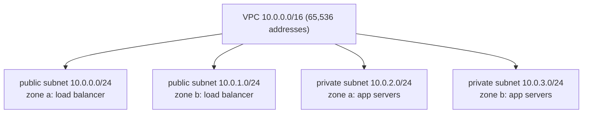
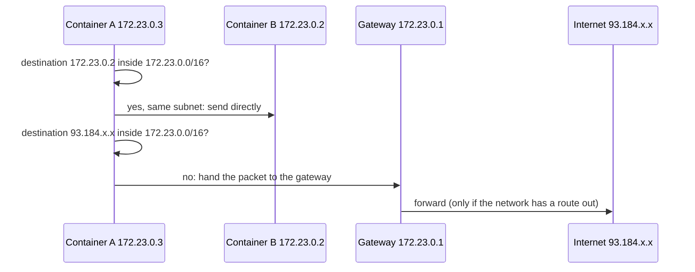

# Networking 06 — Subnets and CIDR

> **Course:** [Networking](./README.md)  ·  **Time:** ~40 min  ·  **Needs:** nothing, but [Docker 01](../docker/01-images-and-containers.md) helps for the exercises
> **Used in the labs:** [Lab 03, step 8](../../labs/03-networking.md#step-8--public-and-private-networks) (the address ranges printed by `docker network inspect`)

## What you will learn
- Read an address range such as `172.23.0.0/16` and say how many addresses it holds.
- Explain what a **subnet** is, why a network is cut into subnets, and what the number after the `/` means.
- Cut a big block (a VPC) into smaller ones, and spot two ranges that overlap.
- Understand why a tiny network "fills up" and why Docker and AWS keep some addresses for themselves.

## Words you need
| Word | Plain-words meaning |
|---|---|
| **IP address** | The number that identifies a machine (or container) on a network, like `172.23.0.5`. Four numbers from 0 to 255 separated by dots. |
| **Bit** | One binary digit: `0` or `1`. An IPv4 address is 32 bits long, written as four groups of 8 (each group is called an **octet**). |
| **Network** | A group of machines that can reach each other directly, without going through a router. |
| **Subnet** | A smaller network cut out of a bigger one. "Sub" because it lives inside a larger range. |
| **Prefix** | The first part of an address that is the same for every machine of a network (the "street name"). |
| **CIDR** | "Classless Inter-Domain Routing": the notation `address/number`. The number says how many of the 32 bits belong to the prefix. |
| **Netmask** | The same information written as an address: `255.255.0.0` means "the first 16 bits are the prefix". |
| **Gateway** | The machine on a network that forwards traffic to other networks (the "exit door"). |
| **Broadcast address** | The last address of a range, reserved for "talk to everybody on this network". Not given to a machine. |
| **Private range** | Address blocks reserved for internal networks, never used on the public internet: `10.0.0.0/8`, `172.16.0.0/12`, `192.168.0.0/16`. |
| **Overlap** | Two ranges that share at least one address. Overlapping networks cannot be used together reliably. |
| **Route table** | The rules a machine or router uses to decide where to send a packet, based on its destination. |
| **VPC** | "Virtual Private Cloud": your own isolated network inside AWS, defined by one big address range. Subnets are cut out of it. |
| **Availability Zone** | One physical data-centre location of an AWS region. A subnet lives in exactly one, so spreading subnets over several zones survives the loss of one. |
| **Go template** | A tiny pattern language Docker uses in `--format` options to pick fields out of its output, for example `{{.Containers}}` = "the containers of this network". |

## The idea
**Analogy.** A postal address has a city, a street and a house number. The first parts are the same for every house on that street, only
the house number changes. A CIDR range works the same way: the **prefix** is "city and street" (identical for everyone), the rest of the bits
are the "house number" (different for each machine). The number after `/` says *how much of the address is street and how much is house number*.
A **bigger** number means a **longer street name and fewer houses**: `/16` is a big neighbourhood, `/29` is a tiny cul-de-sac.

**Precisely.** An IPv4 address has 32 bits. In `address/N`, the first **N** bits are fixed (the network part) and the remaining **32 − N**
bits are free (the host part), so the range holds **2^(32−N)** addresses. Captured on this laptop for the two lab networks of Lab 03:

```text
172.23.0.0/16
  address : 10101100.00010111.00000000.00000000
  mask    : 11111111.11111111.00000000.00000000 = 255.255.0.0
  network bits: 16 | host bits: 16 | 2 ** host bits = 65536
10.200.0.0/29
  address : 00001010.11001000.00000000.00000000
  mask    : 11111111.11111111.11111111.11111000 = 255.255.255.248
  network bits: 29 | host bits: 3 | 2 ** host bits = 8
```
Where the mask has `1`s, the bits are fixed (the street); where it has `0`s, they can vary (the house numbers).

| Prefix | Free bits | Addresses | Typical use |
|---|---|---|---|
| `/8` | 24 | 16,777,216 | a huge private block (`10.0.0.0/8`) |
| `/16` | 16 | 65,536 | a whole VPC |
| `/24` | 8 | 256 | one subnet |
| `/28` | 4 | 16 | a very small subnet |
| `/29` | 3 | 8 | a tiny demo network |
| `/32` | 0 | 1 | exactly one machine |

**Why cut a network into subnets?** To give each *zone* its own range so that rules can be written per zone ("the public subnet has a route to the
internet, the private one does not", as in [Lab 03](../../labs/03-networking.md)). In AWS each subnet also lives in **one** Availability Zone.



**How a machine decides where to send a packet** (this is what "internal network" changes in Lab 03):


**Addresses you cannot use.** In every range the first address is the **network address** and the last is the **broadcast address**, so a `/24`
has 254 usable hosts, not 256. On top of that:
- **Docker** gives the first usable address (`.1`) to the gateway. You will see this in the exercise.
- **AWS** reserves **5** addresses in every subnet (the first four and the last one), so a `/28` leaves 11 usable addresses, not 16.
  (Check the current rule in the [AWS VPC documentation](https://docs.aws.amazon.com/vpc/latest/userguide/subnet-sizing.html).)

## The code, line by line
The Python standard library has a module, `ipaddress`, that does this arithmetic. We run it in a throw-away container:

```python
import ipaddress as ip                          # load the module and call it "ip"
vpc = ip.ip_network('10.0.0.0/16')              # parse the range; strict about the format
subs = list(vpc.subnets(new_prefix=24))         # cut it into /24 pieces
print(len(subs))                                # how many pieces
print(ip.ip_network('10.0.1.0/24').overlaps(vpc))   # True if the two ranges share an address
```

| Line | What it does | If you change or remove it |
|---|---|---|
| `import ipaddress as ip` | Makes the module available under a short name. | Without it every `ip.` line fails with `NameError`. |
| `ip.ip_network('10.0.0.0/16')` | Builds a network object. It refuses an address with stray host bits, e.g. `10.0.0.5/16` raises `ValueError`. | Another prefix changes every number printed afterwards. |
| `vpc.subnets(new_prefix=24)` | Splits the range into equal subnets of the new size. | `new_prefix=28` gives 4,096 subnets of 16 addresses. A prefix smaller than 16 is an error (you cannot split into something bigger). |
| `.overlaps(vpc)` | Answers "do these two ranges share an address?". | Use it before creating a second network. |
| `n.num_addresses` | Number of addresses (2^(32−N)). | Subtract 2 for the network and broadcast addresses. |

## The commands
| Command | What it does | Flags and reading the result |
|---|---|---|
| `docker run --rm python:3.12.16-slim-trixie python -c "..."` | Runs one line of Python in a disposable container. | `--rm` deletes the container at exit; `python -c "code"` runs the code string. The image tag is pinned. |
| `docker network create --subnet 10.200.0.0/29 NAME` | Creates a network with **exactly** this range. | Without `--subnet` Docker picks a free range itself. Prints the new network's id. |
| `docker run -d --rm --network NAME --name X IMG` | Starts a container attached to that network. | `--network` chooses the network; Docker gives the container the next free address. |
| `docker network inspect NAME --format '...'` | Prints facts about a network. | `--format` is a Go template; `.Containers` lists members, `.IPAM.Config` holds the subnet and gateway. |
| `docker network rm NAME` | Deletes a network (it must be empty). | Fails with "has active endpoints" if a container is still attached. |

## Hands-on
All outputs below were captured on this laptop (Docker 29.2.1, Docker Desktop on WSL2). Git Bash users: `export MSYS_NO_PATHCONV=1` first, as explained in
[Docker 01](../docker/01-images-and-containers.md#hands-on).

**1. The two networks of Lab 03, as numbers.**
```bash
docker run --rm python:3.12.16-slim-trixie python -c "
import ipaddress as ip
for cidr in ('172.23.0.0/16', '172.24.0.0/16'):
    n = ip.ip_network(cidr)
    print(cidr, '| mask', n.netmask, '| addresses', n.num_addresses, '| first', n.network_address, '| last', n.broadcast_address, '| usable hosts', n.num_addresses - 2)
print('172.23.0.5 in 172.23.0.0/16 ?', ip.ip_address('172.23.0.5') in ip.ip_network('172.23.0.0/16'))
print('172.23.0.5 in 172.24.0.0/16 ?', ip.ip_address('172.23.0.5') in ip.ip_network('172.24.0.0/16'))
"
```
```text
172.23.0.0/16 | mask 255.255.0.0 | addresses 65536 | first 172.23.0.0 | last 172.23.255.255 | usable hosts 65534
172.24.0.0/16 | mask 255.255.0.0 | addresses 65536 | first 172.24.0.0 | last 172.24.255.255 | usable hosts 65534
172.23.0.5 in 172.23.0.0/16 ? True
172.23.0.5 in 172.24.0.0/16 ? False
```
**How to read it:** `private` (`172.23.0.0/16`) and `public` (`172.24.0.0/16`) are two separate ranges of 65,536 addresses. The load balancer's address on
`private`, `172.23.0.5`, belongs to the first range only. Your numbers may differ: Docker picks free ranges.

**2. Cutting a VPC-sized block into subnets.**
```bash
docker run --rm python:3.12.16-slim-trixie python -c "
import ipaddress as ip
vpc = ip.ip_network('10.0.0.0/16')
subs = list(vpc.subnets(new_prefix=24))
print('10.0.0.0/16 holds', len(subs), 'subnets of size /24; the first three:')
for s in subs[:3]: print(' ', s, '->', s.num_addresses, 'addresses')
print('overlap 10.0.1.0/24 vs 10.0.0.0/16 ?', ip.ip_network('10.0.1.0/24').overlaps(vpc))
print('overlap 10.1.0.0/24 vs 10.0.0.0/16 ?', ip.ip_network('10.1.0.0/24').overlaps(vpc))
"
```
```text
10.0.0.0/16 holds 256 subnets of size /24; the first three:
  10.0.0.0/24 -> 256 addresses
  10.0.1.0/24 -> 256 addresses
  10.0.2.0/24 -> 256 addresses
overlap 10.0.1.0/24 vs 10.0.0.0/16 ? True
overlap 10.1.0.0/24 vs 10.0.0.0/16 ? False
```
**How to read it:** 65,536 ÷ 256 = 256 subnets. `10.0.1.0/24` lies *inside* the VPC (overlap = `True`, which is what you want for a subnet),
while `10.1.0.0/24` is a different block (`False`). The diagram above uses exactly these pieces.

**3. A tiny network that fills up.** A `/29` has 8 addresses: 1 network, 1 broadcast, 1 gateway, so 5 are left for containers.
```bash
docker network create --subnet 10.200.0.0/29 course-cidr-demo
for i in 1 2 3 4 5 6; do
  docker run -d --rm --network course-cidr-demo --name course-cidr-$i nginx:1.30.6-alpine > /dev/null \
    && echo "container $i: started" || echo "container $i: FAILED"
done
docker network inspect course-cidr-demo --format '{{range .Containers}}{{.Name}} {{.IPv4Address}}{{"\n"}}{{end}}subnet {{(index .IPAM.Config 0).Subnet}} gateway {{(index .IPAM.Config 0).Gateway}}' | sort
```
(`docker network create` also prints the new network's id, left out below.)
```text
container 1: started
container 2: started
container 3: started
container 4: started
container 5: started
container 6: FAILED
course-cidr-1 10.200.0.2/29
course-cidr-2 10.200.0.3/29
course-cidr-3 10.200.0.4/29
course-cidr-4 10.200.0.5/29
course-cidr-5 10.200.0.6/29
subnet 10.200.0.0/29 gateway 10.200.0.1
```
The error Docker printed for container 6 was:
```text
docker: Error response from daemon: failed to set up container networking: no available IPv4 addresses on this network's address pools: course-cidr-demo (…)
```
**How to read it:** `.0` is the network address, `.1` the gateway, `.2` to `.6` went to the five containers, `.7` is the broadcast address. The sixth container has no
address left. The same thing happens in a real subnet that is too small, which is why you size subnets with room to grow.

## What if…?
**…you create a second network whose range overlaps the first?** (The demo network from hands-on step 3 still exists at this point.)
```bash
docker network create --subnet 10.200.0.0/24 course-cidr-overlap
```
```text
Error response from daemon: invalid pool request: Pool overlaps with other one on this address space
```
Docker refuses, because `10.200.0.0/24` contains `10.200.0.0/29`. AWS refuses too: you cannot create two overlapping subnets in one VPC, and two VPCs
with overlapping ranges cannot be connected to each other later (VPC peering), so **plan your ranges before you build**.

Clean up (the containers were started with `--rm`, so stopping them removes them):
```bash
for i in 1 2 3 4 5; do docker stop course-cidr-$i > /dev/null; done
docker network rm course-cidr-demo
```
```text
course-cidr-demo
```

## In short
1. `address/N` means "the first N bits are the network, the other 32 − N bits are the host", so the range holds 2^(32−N) addresses (bigger N, smaller network).
2. A subnet is a slice of a bigger range; two ranges in the same network must never overlap.
3. Some addresses are never yours (network, broadcast, gateway; AWS keeps 5 per subnet), so size a subnet with room to grow.

## Check your understanding
1. How many addresses are in `10.0.5.0/24`, and how many hosts can use them in plain IP rules?
2. Is `10.0.3.17` inside `10.0.2.0/24`?
3. Which is the bigger network, `/16` or `/28`, and by how many addresses?
4. Why did the sixth container fail to start in the `/29` demo network?
5. Why is it a problem to give two networks the ranges `10.0.0.0/16` and `10.0.1.0/24`?

<details><summary>Answers</summary>

1. 256 addresses (2^8). Minus the network and broadcast addresses, 254 hosts.
2. No: `10.0.2.0/24` covers `10.0.2.0` to `10.0.2.255`; `10.0.3.17` is in `10.0.3.0/24`.
3. `/16` is bigger: 65,536 addresses against 16, a difference of 65,520.
4. A `/29` has 8 addresses; network, broadcast and gateway take three, leaving five for containers, and five were already in use.
5. They overlap: `10.0.1.0/24` is inside `10.0.0.0/16`, so the same address could belong to two places and traffic could not be routed reliably.

</details>

## Official documentation
- [AWS: VPC CIDR blocks](https://docs.aws.amazon.com/vpc/latest/userguide/vpc-cidr-blocks.html) and [subnet sizing](https://docs.aws.amazon.com/vpc/latest/userguide/subnet-sizing.html)
- [Docker: `docker network create`](https://docs.docker.com/reference/cli/docker/network/create/)
- [Python: the `ipaddress` module](https://docs.python.org/3/library/ipaddress.html)
- [RFC 1918: address allocation for private internets](https://www.rfc-editor.org/rfc/rfc1918)

## Where you use this in the project
- [Lab 03, step 8, check 2](../../labs/03-networking.md#step-8--public-and-private-networks): `docker network inspect` prints the `172.23.0.0/16` and `172.24.0.0/16` ranges and each container's address.
- [Lab 03, step 9](../../labs/03-networking.md#4-steps): the isolation test relies on `public` and `private` being separate ranges.
- Later: [Lab 11](../../labs/README.md) (pod and service ranges in Kubernetes) and [Lab 13](../../labs/README.md) (the CIDR of a VPC in Terraform).
