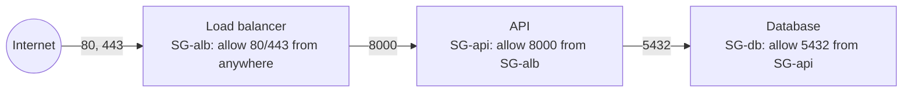
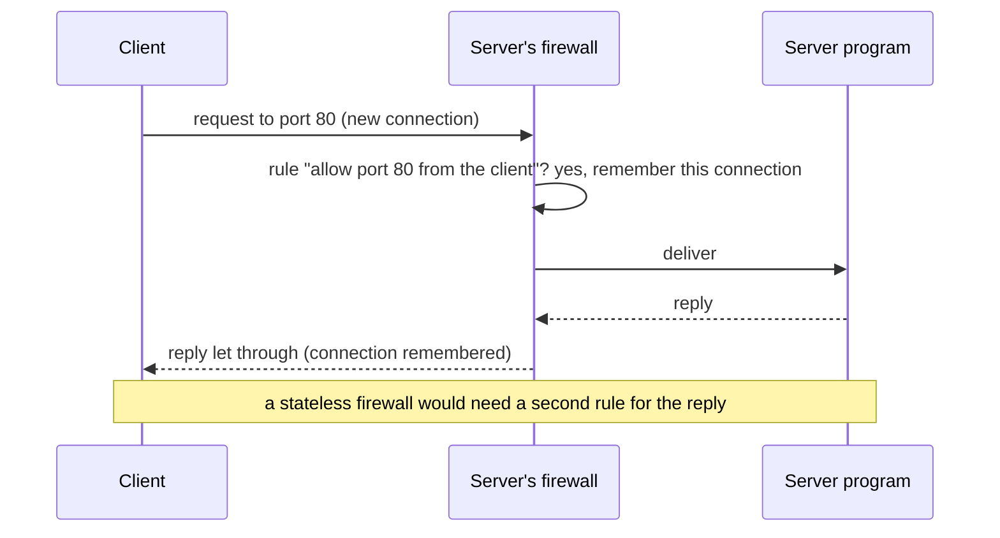

# Networking 07 — Firewalls and security groups

> **Course:** [Networking](./README.md)  ·  **Time:** ~45 min  ·  **Needs:** [Networking 06 — Subnets and CIDR](./06-subnets-and-cidr.md), [Docker 01](../docker/01-images-and-containers.md)
> **Used in the labs:** [Lab 03](../../labs/03-networking.md) (public/private networks and the isolation test), later [Lab 04](../../labs/README.md) (only the API may reach the database)

## What you will learn
- Explain what a firewall rule is made of, and why "deny everything, then allow what you need" is the safe default.
- Tell a **dropped** connection (silence, then a timeout) from a **refused** one (an immediate error), and what each means.
- Explain **stateful** filtering with a real experiment, and how an AWS **security group** differs from a **network ACL**.
- See that a Docker network is a coarse firewall, and that rules inside a machine are a finer one.

## Words you need
| Word | Plain-words meaning |
|---|---|
| **Packet** | A small chunk of data travelling over a network. A web page arrives as many packets. |
| **Port** | A number (0–65535) that says *which program* on a machine should receive a packet, like an apartment number in a building. Web servers usually listen on port 80. |
| **Protocol** | The agreed language of a conversation. TCP is the one used for web pages: it first sets up a connection, then sends data. |
| **Firewall** | A filter that looks at packets and decides, by rules, to let them through or not. |
| **Rule** | One line of a firewall: "for this direction, protocol, port and source or destination, do this action". |
| **Inbound / outbound** | Traffic arriving at a machine / leaving it. AWS also says *ingress* and *egress*. |
| **Source / destination** | Who sent the packet / who it is for (an address, a range like `10.0.0.0/24`, or in AWS another security group). |
| **Allow-list** | A policy that blocks everything by default and lists what is allowed ("default deny"). The opposite is a deny-list. |
| **Drop** | The firewall throws a packet away silently. The sender hears nothing and eventually gives up (**timeout**). |
| **Reject / refused** | The machine answers right away that nobody is listening ("connection refused"). Also what you get if the port is allowed but no program uses it. |
| **Stateful** | The firewall remembers connections: if a request was allowed out, the reply is allowed in automatically. |
| **Stateless** | The firewall judges every packet alone, with no memory: replies need their own rule. |
| **Security group** | AWS's firewall attached to a resource (a server, a database, a load balancer): stateful, allow rules only. |
| **Network ACL** | AWS's second firewall, attached to a whole subnet: stateless, allow *and* deny rules. |
| **`iptables`** | The firewall built into the Linux kernel. Docker and many tools use it. We use it here to show real rules. |
| **Capability `NET_ADMIN`** | A permission that lets a container change its own network settings, including firewall rules. Containers do not have it by default. |
| **Kernel** | The core of an operating system, the part that handles network packets and starts programs. On Linux the firewall (`iptables`) lives inside it. |
| **Chain and policy** | An `iptables` *chain* is a list of rules for one kind of traffic (`INPUT` = packets arriving at this machine). The chain's *policy* is what happens to a packet that matches no rule. |
| **Loopback (`lo`)** | A virtual network interface through which a machine talks to itself (address `127.0.0.1`). |
| **Connection tracking (`conntrack`)** | The kernel's memory of which connections currently exist. It is what lets a firewall be stateful. |
| **`apk`** | The package installer of Alpine Linux (the small Linux system inside the Nginx image). `apk add iptables` installs the `iptables` program. |

## The idea
**Analogy.** Think of a bouncer with a guest list at the door of a club. The standing order is *nobody gets in*; only names on the list
do, and only through the door written next to their name (the **port**). If someone not on the list knocks, the bouncer *ignores* them, so
they wait outside until they give up (a **drop**). If the door is on the list but the room behind it is empty, a voice answers "nobody here" at once
(**refused**). And a guest who went out for a smoke is let back in without being checked again, because the bouncer remembers them (**stateful**).

**Precisely.** A rule has a direction, a protocol, a port range, a source or destination, and an action. Rules are checked in some order, and
a **default policy** applies when nothing matches. Safe designs set the default to *deny* and add *allow* rules, so a forgotten rule fails closed.

| | Where it applies | Remembers connections? | Rule types | Default |
|---|---|---|---|---|
| **Security group** (AWS) | One resource (an instance, database, load balancer) | Yes (stateful) | Allow only | Inbound: nothing allowed. Outbound: everything allowed. |
| **Network ACL** (AWS) | A whole subnet | No (stateless) | Allow and deny, numbered, lowest number first | The default one allows all; a new custom one denies all. |
| **`iptables`** (Linux, in this lesson) | One machine or container | Optional (`conntrack`) | Allow, drop, reject, in order, first match wins | A "policy" per chain, default `ACCEPT`. |
| **Docker network membership** (Lab 03) | Containers sharing a network | n/a | Only the two states "same network" / "not" | Different networks cannot talk. |

**The AWS pattern: security groups that name each other.** Instead of listing addresses, a rule's *source* can be another security group. Then it
does not matter which address a server has, only which group it belongs to:


Nothing else can reach the API or the database, even from inside the same VPC.

**What "stateful" means in practice** (the experiment below proves it):


## The code, line by line
Four `iptables` commands turn a server into an allow-list machine (`$A` stands for the address of the one allowed client):
```bash
iptables -A INPUT -i lo -j ACCEPT                                      # 1
iptables -A INPUT -m conntrack --ctstate ESTABLISHED,RELATED -j ACCEPT # 2
iptables -A INPUT -p tcp --dport 80 -s $A -j ACCEPT                    # 3
iptables -P INPUT DROP                                                 # 4
```
| Line | What it does | If you change or remove it |
|---|---|---|
| `-A INPUT` | **A**ppend a rule to the `INPUT` chain, the list checked for packets arriving at *this* machine. Rules are checked top to bottom, first match wins. | `-I INPUT` would *insert* at the top instead; order changes the result. |
| 1: `-i lo -j ACCEPT` | Accept everything on the loopback interface `lo` (the machine talking to itself). | Without it, programs on the machine can no longer talk to each other over the loopback interface (we did not test what else breaks). |
| 2: `-m conntrack --ctstate ESTABLISHED,RELATED` | Accept packets that belong to a connection the machine already knows. This is what makes the firewall **stateful**. | Remove it and replies to connections the machine started are dropped (hands-on step 5). |
| 3: `-p tcp --dport 80 -s $A` | Accept new TCP connections to **d**estination port 80 coming from **s**ource `$A` only. This is the "guest list". | Change `-s $A` to a range (`-s 172.25.0.0/24`) to admit every container of that subnet. |
| 4: `-P INPUT DROP` | Set the **P**olicy of the chain: what happens to packets no rule accepted. `DROP` = silently discard. | `ACCEPT` (the default) turns the whole thing into a deny-list: only explicit drops would block. |

Why the policy comes **last**: set to `DROP` first, it would cut the very connection you are using to type the rules (on a remote machine).

## The commands
| Command / flag | Meaning |
|---|---|
| `docker network create NAME` | Makes a throw-away network. Containers on different user-defined networks cannot talk to each other. |
| `docker run -d --rm --name X --network NAME --cap-add NET_ADMIN IMG` | `-d` background, `--rm` delete at exit, `--network` which network, `--cap-add NET_ADMIN` gives this one container the right to edit its firewall. |
| `docker network connect NAME CONTAINER` | Attaches a running container to one more network. |
| `docker exec X apk add --no-cache iptables` | Installs the `iptables` tool inside the (Alpine-based) container; `--no-cache` keeps the image small. Needs internet once. |
| `iptables -S INPUT` | Prints the INPUT chain as the commands that would build it ("S" for specification). Read it top to bottom. |
| `iptables -D INPUT <rule>` | **D**eletes the rule that matches the text you give. |
| `wget -q -O /dev/null -T 3 URL` | Fetches a page: `-q` quiet, `-O /dev/null` discard the page, `-T 3` give up after 3 seconds. Its error message tells you *drop* (`download timed out`) from *refused* (`Connection refused`). |

## Hands-on
Captured on this laptop (Docker 29.2.1, Docker Desktop on WSL2, `iptables v1.8.13`). Addresses are what Docker assigned that time; yours will differ, so
read them with `docker inspect` and adjust. Git Bash users: `export MSYS_NO_PATHCONV=1` first ([Docker 01](../docker/01-images-and-containers.md#hands-on)).

**Setup:** a server `S`, an allowed client `A`, a client `B` that will be blocked, all on one new network.
```bash
IMG=nginx:1.30.6-alpine
docker network create course-fw-demo
docker run -d --rm --name course-fw-server --network course-fw-demo --cap-add NET_ADMIN $IMG
docker run -d --rm --name course-fw-a --network course-fw-demo $IMG
docker run -d --rm --name course-fw-b --network course-fw-demo $IMG
docker exec course-fw-server apk add --no-cache iptables
docker exec course-fw-server iptables -V
```
```text
(4/4) Installing iptables (1.8.13-r0)
OK: 61.2 MiB in 75 packages
iptables v1.8.13 (nf_tables)
```
(Addresses that time: server `172.25.0.2`, A `172.25.0.3`, B `172.25.0.4`. The container ids printed by `network create` and `run` are left out.)

Define a small helper that fetches the server's page from a client and prints a verdict (`who` = container, `to` = address, `port`):
```bash
chk() { out=$(docker exec "$1" wget -q -O /dev/null -T 3 "http://$2:${3:-80}/" 2>&1) \
  && echo "$1 -> $2:${3:-80} : OK (answered)" || echo "$1 -> $2:${3:-80} : FAILED: ${out:-timeout}"; }
```

**1. No firewall yet:** everybody gets in.
```bash
chk course-fw-a 172.25.0.2
chk course-fw-b 172.25.0.2
```
```text
course-fw-a -> 172.25.0.2:80 : OK (answered)
course-fw-b -> 172.25.0.2:80 : OK (answered)
```

**2. Switch on the allow-list** (the four lines from above, with `$A` = `172.25.0.3`) and read the result back:
```bash
docker exec course-fw-server sh -c "iptables -A INPUT -i lo -j ACCEPT && iptables -A INPUT -m conntrack --ctstate ESTABLISHED,RELATED -j ACCEPT && iptables -A INPUT -p tcp --dport 80 -s 172.25.0.3 -j ACCEPT && iptables -P INPUT DROP"
docker exec course-fw-server iptables -S INPUT
```
```text
-P INPUT DROP
-A INPUT -i lo -j ACCEPT
-A INPUT -m conntrack --ctstate RELATED,ESTABLISHED -j ACCEPT
-A INPUT -s 172.25.0.3/32 -p tcp -m tcp --dport 80 -j ACCEPT
```
`/32` is the CIDR of a single address ([Networking 06](./06-subnets-and-cidr.md)): the rule names exactly one machine.

**3. Test again.**
```bash
chk course-fw-a 172.25.0.2
chk course-fw-b 172.25.0.2
```
```text
course-fw-a -> 172.25.0.2:80 : OK (answered)
course-fw-b -> 172.25.0.2:80 : FAILED: wget: download timed out
```
**How to read it:** A is on the list, B is not, and B got **no answer at all**, only a timeout after 3 seconds: a **drop**. Real security groups behave the same way.

**4. Dropped is not the same as refused.** Allow A to port 81 too, where *nothing is listening*, and compare:
```bash
docker exec course-fw-server iptables -A INPUT -p tcp --dport 81 -s 172.25.0.3 -j ACCEPT
chk course-fw-a 172.25.0.2 81
chk course-fw-b 172.25.0.2 80
```
```text
course-fw-a -> 172.25.0.2:81 : FAILED: wget: can't connect to remote host (172.25.0.2): Connection refused
course-fw-b -> 172.25.0.2:80 : FAILED: wget: download timed out
```
**How to read it:** the first error came **instantly** (the firewall let the packet in; the machine itself answered "nobody listens here"). The second took the full 3 seconds
(the firewall swallowed it). When something "does not work" in AWS, this is the first clue: *refused* means the packet got there (check the program), *timeout* usually means a
firewall or route is in the way (check security groups and subnets).

**5. Stateful, proven.** Now the *server* calls A (an outbound request); the reply comes back **inbound** and must be allowed by rule 2. Run it, remove rule 2, run it again:
```bash
chk course-fw-server 172.25.0.3
docker exec course-fw-server iptables -D INPUT -m conntrack --ctstate ESTABLISHED,RELATED -j ACCEPT
chk course-fw-server 172.25.0.3
docker exec course-fw-server iptables -S INPUT
```
```text
course-fw-server -> 172.25.0.3:80 : OK (answered)
course-fw-server -> 172.25.0.3:80 : FAILED: wget: download timed out
-P INPUT DROP
-A INPUT -i lo -j ACCEPT
-A INPUT -s 172.25.0.3/32 -p tcp -m tcp --dport 80 -j ACCEPT
-A INPUT -s 172.25.0.3/32 -p tcp -m tcp --dport 81 -j ACCEPT
```
**How to read it:** with rule 2 the reply to the server's own request is let in automatically; without it, the very same request times out because nothing allows the reply. A security group does
that remembering for you; a **network ACL does not**, so with network ACLs you must add rules for the return traffic yourself (on the ephemeral ports, 1024–65535, the random ports clients use).

**6. A coarser layer: the network itself.** Put a client `C` on a different network and ask `A` (which has no firewall rules of its own) for a page:
```bash
docker network create course-fw-other
docker run -d --rm --name course-fw-c --network course-fw-other $IMG
chk course-fw-c 172.25.0.3
docker network connect course-fw-demo course-fw-c
chk course-fw-c 172.25.0.3
```
```text
course-fw-c -> 172.25.0.3:80 : FAILED: wget: download timed out
course-fw-c -> 172.25.0.3:80 : OK (answered)
```
**How to read it:** on a separate network, `C` cannot reach `A` at all (timeout); after joining `A`'s network it can. That is the "private network" of [Lab 03](../../labs/03-networking.md): a *coarse* firewall (same
network or not). The `iptables` rules above are the *fine* one (this port, from that address). AWS has both layers too: subnets/route tables, and security groups.

Clean up (stopping the `--rm` containers removes them):
```bash
for c in course-fw-server course-fw-a course-fw-b course-fw-c; do docker stop $c; done
docker network rm course-fw-demo course-fw-other
```
```text
course-fw-demo
course-fw-other
```
(`docker stop` prints the container names; omitted above. The two lines shown are from `docker network rm`.)

## What if…?
**…you forget the `ESTABLISHED,RELATED` rule?** Hands-on step 5 *is* that experiment: everything the machine starts (updates, calls to a database, DNS lookups) silently stops working while incoming
requests still work, which is a confusing failure. **…you set the policy to `ACCEPT` and only add drops?** You get a deny-list: anything you forgot to list is open. Allow-lists fail safe; deny-lists fail open.
(An `iptables` rule with `-j REJECT` instead of `DROP` would answer "refused" right away; we did not test it here.)

## In short
1. A firewall is a list of rules plus a default; the safe design is default **deny** plus explicit **allow** rules.
2. A **drop** looks like a timeout, a **refusal** is instant: the difference tells you whether the packet arrived.
3. AWS **security groups** are stateful allow-lists on each resource (they can name each other); **network ACLs** are stateless allow/deny lists on a subnet.

## Check your understanding
1. Your request to a server hangs for 30 seconds and then fails. Another request to a different port fails instantly with "connection refused". What does each tell you?
2. What does "stateful" save you from writing, compared with a stateless firewall?
3. An AWS security group has no inbound rules. Can anything connect to the resource? Can the resource connect out?
4. Why do we write "allow 8000 from the load balancer's security group" instead of "allow 8000 from 10.0.1.25"?
5. In the experiment, why did `B` fail but `A` succeed with the same request, and which line of the rule list decided it?

<details><summary>Answers</summary>

1. The hang is a **drop**: something (usually a firewall or a missing route) swallowed the packet. The instant refusal means the packet **arrived** and the machine answered that no program listens on that port.
2. The rule for reply traffic. A stateful firewall allows replies to allowed requests by itself; a stateless one needs an explicit return rule.
3. No inbound connection can be made (nothing is allowed in). Outbound connections are allowed: a new security group allows all outbound traffic.
4. Addresses change (servers restart, scale out). Naming the group means "anything that is a load balancer", whatever its address; the rule stays correct.
5. Rule 3, `-s 172.25.0.3 -p tcp --dport 80 -j ACCEPT`, names A only; B matched nothing, so the chain policy `DROP` applied and B timed out.

</details>

## Official documentation
- [AWS: security groups](https://docs.aws.amazon.com/vpc/latest/userguide/vpc-security-groups.html) and [network ACLs](https://docs.aws.amazon.com/vpc/latest/userguide/vpc-network-acls.html)
- [Docker: packet filtering and firewalls](https://docs.docker.com/engine/network/packet-filtering-firewalls/)
- [`iptables` manual page](https://man7.org/linux/man-pages/man8/iptables.8.html)

## Where you use this in the project
- [Lab 03, step 8](../../labs/03-networking.md#step-8--public-and-private-networks): the `public` / `private` split is the coarse layer (hands-on step 6); [section 2.3](../../labs/03-networking.md#23-how-we-reproduce-it-locally) maps it to security groups.
- [Lab 03, step 9](../../labs/03-networking.md#step-9--an-isolation-test): the isolation test checks that only the load balancer is exposed.
- [Lab 03, "Going to real AWS"](../../labs/03-networking.md#7-going-to-real-aws): the security-group chain ALB → API.
- Later: [Lab 04](../../labs/README.md), where "only the API may reach Postgres" becomes a rule you can test.
