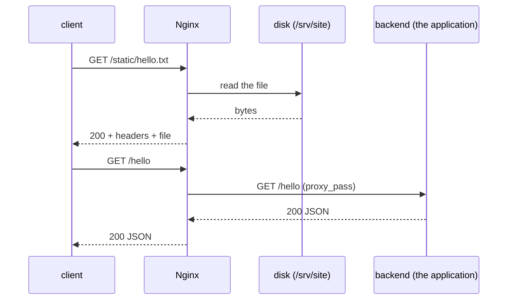

# Nginx 01 — What a web server and a reverse proxy are

> **Course:** [Nginx](./README.md)  ·  **Time:** ~45 min  ·  **Needs:** [Networking 03](../networking/03-http.md) (requests, headers, status codes) and [Networking 04](../networking/04-proxies.md) (what a proxy is); [Docker 01](../docker/01-images-and-containers.md) for the exercise
> **Used in the labs:** [Lab 02, step 4](../../labs/02-load-balancing.md#step-4--nginx-in-front-of-the-api) (`lb/nginx.conf` in front of the API); Lab 08 (the frontend)

## What you will learn
- Say what a **web server** does (it serves **files**) and what a **reverse proxy** does (it passes requests to an **application**), and that Nginx does both.
- Read a small `nginx.conf` with one `location` serving files and one forwarding requests.
- Recognise who answered: a file served by Nginx, an answer proxied from the backend, or an error made by Nginx itself.
- Tell `404`, `502` and `504` apart, and say what each says about where the problem is.
- Explain why the lab puts Nginx **in front of** the API instead of letting clients talk to the API directly.

## Words you need
| Word | Plain-words meaning |
|---|---|
| **Web server** | A program that waits for HTTP requests and answers with **files** from a folder (HTML pages, images, scripts). |
| **Static file** | A file sent exactly as it is on the disk. Opposite: **dynamic** content, produced by code at the moment of the request. |
| **Application server** | A program that runs your code to build the answer (here **Uvicorn** running the FastAPI app). |
| **Reverse proxy** | A server in front of other servers that takes the requests and passes them on ([Networking 04](../networking/04-proxies.md)). |
| **Backend / upstream** | The server behind the proxy that does the real work. Nginx calls it the *upstream*. |
| **Nginx** | A fast, widely used program that is a web server, a reverse proxy and a load balancer at once. It handles thousands of connections with a few processes. |
| **Configuration file** | The text file (`nginx.conf`) that tells Nginx what to listen on and what to do with each request. |
| **`server` block** | The part of the config that describes one site: which port it listens on and how it answers. |
| **`location` block** | A rule inside a `server`: "requests whose path starts with X are handled like this". |
| **`root`** | The folder on disk where Nginx looks for files. |
| **`proxy_pass`** | The instruction "send this request to that backend". |
| **Gateway error (502, 504)** | Errors Nginx makes when **it** works but the backend behind it does not: `502 Bad Gateway` (bad or no answer), `504 Gateway Time-out` (no answer in time). |

## The idea
**Analogy.** A **library**. The **librarian at the lending desk** walks to the shelf, takes the book you asked for and hands it over: that is a *web server*, and the books are files that already exist. For a question no book answers ("how many seats are free today?") the **receptionist** phones the specialist in the back office and reads you the answer: that is a *reverse proxy*, and the specialist is the application. One person can do both jobs, and visitors only ever talk to the front desk.

**Precisely.** As a **web server**, Nginx maps the path of a request to a file under `root`, finds the file, adds the headers (`Content-Type` from the extension, `Content-Length`, `Last-Modified`, `ETag`) and sends it, or answers `404` if the file does not exist. As a **reverse proxy** it opens its own connection to a backend, repeats the request, and returns the answer.

Why not let clients talk to the application directly? An application server such as Uvicorn is made to run Python, not to be the front door. Putting Nginx in front gives you **one entry point**, the means to **spread** requests over several copies ([Lab 02](../../labs/02-load-balancing.md)), static files served without waking Python, a place to add HTTPS and caching later, and **backends that are not reachable from outside** at all.



## The code or config, line by line
The whole experiment is one config, `nginx.conf`:
```nginx
events {}

http {
    server {
        listen 8080;
        root /srv/site;                         # where files are looked for

        location /static/ { }                   # web server: /static/x is the file /srv/site/static/x

        location / {                            # reverse proxy: everything else goes to the application
            proxy_pass http://backend:8000;
        }

        location /broken/ {                     # a proxy target that is up but has nothing listening
            proxy_pass http://idle:8000/;
        }
    }
}
```
| Line | What it does | If you change or remove it |
|---|---|---|
| `events {}` | Required, empty block for connection settings (all defaults). | Nginx refuses to start without it. |
| `http { ... }` | Everything about HTTP lives here. | |
| `server { ... }` | One site. | A second `server` block would be a second site ([Lab 06, step 20](../../labs/06-object-storage.md#step-20--a-public-s3-address-s3localhost-through-the-load-balancer)). |
| `listen 8080;` | The port inside the container. | The `-p` mapping of `docker run` must point at the new port. |
| `root /srv/site;` | Files are looked for under this folder. | Remove it and Nginx looks in its default folder, where your files are not. |
| `location /static/ { }` | Requests starting with `/static/` get the **web server** behaviour. The empty body means "nothing special": the path `/static/hello.txt` becomes the file `/srv/site/static/hello.txt`. | Remove it and `/static/...` would fall to the proxy rule below. |
| `location / { proxy_pass http://backend:8000; }` | Every other path is sent to the container `backend`, port 8000 (found by Docker DNS, [Docker 07](../docker/07-networks.md)). `/` matches everything; the longer `/static/` wins for its paths. | Without it, `/hello` would be a `404`. |
| `location /broken/ { proxy_pass http://idle:8000/; }` | A target that exists but has **nothing listening**: it exists to show a `502`. | |

## The commands
| Command / flag | Meaning |
|---|---|
| `docker run -d --rm --name web --network nginx01 -p 127.0.0.1:18100:8080 ... nginx:1.30.6-alpine` | Start Nginx in the background (`-d`, `--rm`, `--name`) on a private network and publish its port 8080 at `127.0.0.1:18100` on your machine only. |
| `-v "$D/nginx.conf:/etc/nginx/nginx.conf:ro"` | Replace Nginx's config by yours. `:ro` = read-only for the container. |
| `-v "$D/site:/srv/site:ro"` | Make your `site` folder appear as `/srv/site` for Nginx ([Docker 08](../docker/08-volumes-and-bind-mounts.md)). |
| `curl -si URL` | `-s` quiet, `-i` also print the **response headers**: you see who answered and with what. |
| `curl -s -o /dev/null -w '%{http_code}\n' URL` | Print only the status code. `-w` also knows `%{time_total}`. |
| `docker network create nginx01` | A private network for the demo: containers on it reach each other by name (`backend`, `idle`). |
| `-w /demo` (`docker run`) | Start the process in the folder `/demo` (where your files are mounted). |
| `$(pwd -W)` | Git Bash on Windows: the current folder written as a Windows path, which Docker needs for `-v` (with `MSYS_NO_PATHCONV=1` so `/demo` is not rewritten). |
| `curl -m 90 ... -w '%{time_total}'` | `-m 90` give up after 90 seconds; `%{time_total}` prints how long the request took. |
| `tr -d '
'`, `sed -E 's/^Date: .*/.../'` | Clean the output: remove carriage returns, and replace values that change at each run. |
| `docker logs web` | Nginx's own log: the `[error]` lines say why it returned a `502` or `504`. |

## Hands-on
Throw-away containers (`nginx:1.30.6-alpine`, `alpine:3.24`, and the project's `aws-local-lab-api:0.1.0` for Python). Make a folder `nginx01` with: `nginx.conf` (above), `site/static/hello.txt` containing one line `hello from a file on disk`, `echo.py` from [Networking 04](../networking/04-proxies.md#the-code-or-config-line-by-line) (a tiny backend that answers with what it saw), and this script, `run.sh`:
```bash
#!/usr/bin/env bash
D=$(pwd -W); export MSYS_NO_PATHCONV=1
docker network create nginx01 >/dev/null
docker run -d --rm --name backend --network nginx01 -v "$D:/demo" -w /demo aws-local-lab-api:0.1.0 python echo.py >/dev/null
docker run -d --rm --name idle --network nginx01 alpine:3.24 sleep 600 >/dev/null
docker run -d --rm --name web --network nginx01 -p 127.0.0.1:18100:8080 -v "$D/nginx.conf:/etc/nginx/nginx.conf:ro" -v "$D/site:/srv/site:ro" nginx:1.30.6-alpine >/dev/null
sleep 2
mask() { tr -d '\r' | sed -E 's/^(Date|Last-Modified): .*/\1: .../; s/^ETag: .*/ETag: "..."/'; }
echo "== 1. a file: Nginx answers by itself"
curl -si localhost:18100/static/hello.txt | mask
echo "== 2. a missing file: Nginx's own 404"
curl -si localhost:18100/static/nothing.txt | mask | sed -n '1,2p;9,15p'
echo "== 3. anything else: the backend answers, Nginx passes it on"
curl -si "localhost:18100/hello?x=1" | mask
echo
echo "== 4. a proxy target with nothing listening"
curl -s -o /dev/null -w '/broken/ -> %{http_code}\n' localhost:18100/broken/
docker logs web 2>&1 | grep '\[error\]' | tail -1 | sed -E 's/^[0-9/ :]+//; s/, client:.*//'
echo "== 5. the backend container stops"
docker stop backend >/dev/null
curl -s -o /dev/null -w '/static/hello.txt -> %{http_code}\n' localhost:18100/static/hello.txt
curl -s -m 90 -o /dev/null -w '/hello           -> %{http_code} after %{time_total}s\n' localhost:18100/hello
docker logs web 2>&1 | grep '\[error\]' | tail -1 | sed -E 's/^[0-9/ :]+//; s/, client:.*//'
docker stop web idle >/dev/null; docker network rm nginx01 >/dev/null
```
The script starts the three containers, runs five groups of `curl` (each prints a heading `== N. ...`) and removes everything at the end. Run `bash run.sh` (it takes just over a minute: step 5 waits for a timeout). Real output:
```text
== 1. a file: Nginx answers by itself
HTTP/1.1 200 OK
Server: nginx/1.30.6
Date: ...
Content-Type: text/plain
Content-Length: 26
Last-Modified: ...
Connection: keep-alive
ETag: "..."
Accept-Ranges: bytes

hello from a file on disk
== 2. a missing file: Nginx's own 404
HTTP/1.1 404 Not Found
Server: nginx/1.30.6
<head><title>404 Not Found</title></head>
<body>
<center><h1>404 Not Found</h1></center>
<hr><center>nginx/1.30.6</center>
</body>
</html>
== 3. anything else: the backend answers, Nginx passes it on
HTTP/1.1 200 OK
Server: nginx/1.30.6
Date: ...
Content-Type: application/json
Content-Length: 124
Connection: keep-alive

{"path": "/hello?x=1", "peer_ip": "172.24.0.4", "Host": "backend:8000", "X-Forwarded-For": null, "X-Forwarded-Proto": null}

== 4. a proxy target with nothing listening
/broken/ -> 502
[error] 30#30: *5 connect() failed (111: Connection refused) while connecting to upstream
== 5. the backend container stops
/static/hello.txt -> 200
/hello           -> 504 after 60.270601s
[error] 30#30: *8 upstream timed out (110: Operation timed out) while connecting to upstream
```
(`Date`, `Last-Modified` and `ETag` are replaced by `...` by the script's `mask` function, because they change at each run.) **How to read it:**
- **1:** Nginx answered **by itself** with the file: `Content-Type: text/plain` (from the `.txt` extension), `Content-Length: 26` (the file's size), `Last-Modified` and `ETag` (so a browser can ask "has it changed?"), and the `Server: nginx/1.30.6` header.
- **2:** a missing file is Nginx's own `404` page (`nginx/1.30.6` at the bottom): the backend was never asked, because the path is under `/static/`.
- **3:** a path under `/`, so the request was **proxied**. The body is the backend's answer (`echo.py`'s JSON), and it **shows what the proxy changed**: `peer_ip` is Nginx's address (`172.24.0.4`), `Host` is `backend:8000`, and there is no `X-Forwarded-For`. The response still carries `Server: nginx/1.30.6`: the client never learns a backend exists. The lab's `lb/nginx.conf` adds the `proxy_set_header` lines for the missing headers ([Networking 04](../networking/04-proxies.md)).
- **4:** `502 Bad Gateway`. Nginx **reached** the `idle` container, but nothing listened on port 8000 (`Connection refused`). The backend is up as a machine and absent as a program.
- **5:** the backend container is **stopped**. The **file** is still served (`200`): the web-server role does not need the backend. The proxied path answers `504 Gateway Time-out` **after 60 seconds**: nothing answered at the backend's address, so Nginx waited for its default connect timeout (60 s) and gave up (`upstream timed out ... while connecting to upstream`). (On this Docker Desktop setup the stopped container's address just swallowed the connection; on another setup it may be refused at once, which would give a `502` instead.)

## What if…?
**…you let a dead backend wait 60 seconds?** Step 5 is the answer: a client would stare at a spinner for a minute, and with three replicas and one dead, one request in three would. This is why the lab's `lb/nginx.conf` has `proxy_connect_timeout 1s;` and retries on the next replica ([Lab 02, step 6](../../labs/02-load-balancing.md#step-6--health-checks-and-failover)). Reading an error is the first debugging skill: **`404`** = Nginx found nothing at that path, **`502`** = the backend refused or answered badly, **`504`** = the backend did not answer in time, and the `[error]` line of `docker logs` tells which.

## In short
1. Nginx is a **web server** (path → file under `root`, with the right headers) and a **reverse proxy** (`proxy_pass` to a backend), chosen per `location`.
2. In front of the application it gives one entry point, load balancing, and hides the backends; static files never wake the application.
3. `404`, `502` and `504` come from Nginx but point at different places: no such path, backend refused, backend too slow.

## Check your understanding
1. What is the difference between what a web server and a reverse proxy do with a request?
2. In the experiment, which two requests were answered without the backend, and how can you tell?
3. What does `502 Bad Gateway` tell you, and how is it different from `504 Gateway Time-out`?
4. Why does the response of a proxied request still say `Server: nginx/1.30.6`, and what does that tell the client about the backend?
5. Why does the lab run Nginx in front of the API instead of publishing the API's port?

<details><summary>Answers</summary>

1. A web server looks up a **file** for the path and sends it; a reverse proxy **forwards** the request to another server (the backend) and returns that server's answer.
2. The file `/static/hello.txt` (`200`, with `Last-Modified`/`ETag`, still `200` after the backend stopped) and the missing file (Nginx's own `404` page). Both are under `/static/`, which is a web-server `location`.
3. `502`: Nginx could not get a valid answer, for example the connection was **refused** because nothing listens at the backend. `504`: the backend did **not answer in time** (here nothing answered at the address for 60 seconds). Both are about the backend, not the client.
4. The answer travelled through Nginx, which builds the response the client sees. The client talks only to Nginx and cannot tell how many backends exist or where they are.
5. One entry point (and a spot for load balancing, HTTPS, caching), static files without Python, and the API stays unreachable from outside: only Nginx's port is published ([Networking 05](../networking/05-nat-and-port-forwarding.md)).

</details>

## Official documentation
- [Nginx: beginner's guide](https://nginx.org/en/docs/beginners_guide.html) (serving static content and proxying)
- [Nginx: `ngx_http_core_module`](https://nginx.org/en/docs/http/ngx_http_core_module.html) (`server`, `location`, `root`) and [`ngx_http_proxy_module`](https://nginx.org/en/docs/http/ngx_http_proxy_module.html) (`proxy_pass`)
- [Nginx: reverse proxy admin guide](https://docs.nginx.com/nginx/admin-guide/web-server/reverse-proxy/) and [serving static content](https://docs.nginx.com/nginx/admin-guide/web-server/serving-static-content/)

## Where you use this in the project
- [Lab 02, step 4](../../labs/02-load-balancing.md#step-4--nginx-in-front-of-the-api): `lb/nginx.conf` uses the reverse-proxy half of this config (`proxy_pass http://api;`, with an `upstream` for the three replicas) and no static files; the API is published nowhere else.
- [Lab 02, step 6](../../labs/02-load-balancing.md#step-6--health-checks-and-failover): the `502`/`504` behaviour above is what the timeouts and retries protect against.
- [Lab 06, step 20](../../labs/06-object-storage.md#step-20--a-public-s3-address-s3localhost-through-the-load-balancer): a second `server` block, chosen by the `Host` header.
- Lab 08 (planned): a second Nginx serves the static frontend, the "web server" half of this module.
