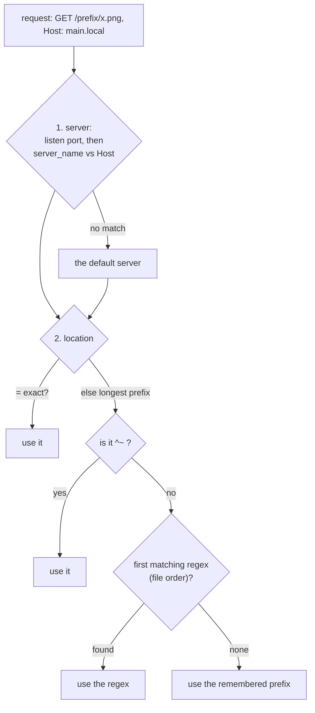

# Nginx 02 — Config structure, `server` and `location` matching

> **Course:** [Nginx](./README.md)  ·  **Time:** ~45 min  ·  **Needs:** [Nginx 01](./01-web-server-and-reverse-proxy.md) and [Networking 03](../networking/03-http.md) (the `Host` header); [Docker 01](../docker/01-images-and-containers.md) for the exercise
> **Used in the labs:** [Lab 02, step 4](../../labs/02-load-balancing.md#step-4--nginx-in-front-of-the-api) (`events`, `http`, `upstream`, `server`, `location` in `lb/nginx.conf`) and [Lab 06, step 20](../../labs/06-object-storage.md#step-20--a-public-s3-address-s3localhost-through-the-load-balancer) (a second `server`, chosen by `Host`)

## What you will learn
- Read an `nginx.conf` as a **tree of blocks**: `events`, `http`, `server`, `location`.
- Explain how Nginx picks the **`server`** for a request (port, then `Host` against `server_name`, else the default).
- Explain how it picks the **`location`**: exact `=`, longest prefix, `^~`, then regular expressions in order.
- Know that inner blocks **inherit** directives from outer ones, and the trap with `add_header`.
- Check a file with `nginx -t` **before** you use it.

## Words you need
| Word | Plain-words meaning |
|---|---|
| **Directive** | One instruction ending in `;`, such as `listen 8080;`. |
| **Block (context)** | A group of directives in `{ }`: `events`, `http`, `server`, `location`. A block's name says **where** a directive may be used. |
| **`http` block** | Everything about HTTP: it holds the `server` blocks and settings shared by all of them. |
| **`server` block** | One **virtual site**: it listens on a port and answers for some host names. One Nginx can serve several. |
| **`listen`** | The port (and optionally address) a `server` accepts connections on. |
| **`server_name`** | The host name(s) a `server` answers for. Nginx compares it with the request's `Host` header ([Networking 03](../networking/03-http.md)). |
| **Default server** | The `server` used when no `server_name` matches. It is the one marked `default_server`, or else the first one for that port. |
| **`location` block** | A rule inside a `server`: "requests whose path looks like this are handled like that". |
| **Prefix location** | `location /prefix/ { }`: matches every path that **starts** with `/prefix/`. |
| **Exact location (`=`)** | `location = /exact { }`: matches **only** the path `/exact`. |
| **`^~`** | A prefix location that, if it is the best prefix, **stops the search** before regular expressions are tried. |
| **Regular expression (regex)** | A pattern such as `\.png$` ("ends with .png"). `~` is case-sensitive, `~*` ignores case. |
| **Inheritance** | A directive set in an outer block applies to the inner blocks too, unless they set their own. |
| **`return`** | Answers at once with a status and a text, without looking for a file or a backend. Handy to test matching. |

## The idea
**Analogy.** Visitors arrive at a **business centre**. The receptionist first reads the **company name** on the visitor's badge (the `Host` header) and sends them to that company's floor (`server`); a visitor with an unknown name goes to the main company (the default server). Inside the company, the visitor's request is matched to a **department sign** (`location`): an exact room number beats everything, otherwise the most specific sign wins, with a few rules for pattern signs.

**Precisely.** The file is a tree: the main level, then `events { }` and `http { }`, and inside `http` several `server { }`, each with several `location { }`. For each request Nginx makes **two choices**:

1. **Which `server`?** Among the servers listening on the port that received the request, the one whose `server_name` matches the `Host` header; if none does, the default server.
2. **Which `location` inside it?** In this order:
   1. an **exact** match (`=`) wins immediately;
   2. otherwise Nginx finds the **longest matching prefix** and remembers it; if that prefix is `^~`, it is the answer;
   3. otherwise it tries the **regular expressions** in the **order they are written** and the first that matches wins;
   4. if no regex matches, the remembered longest prefix is the answer.

| Form | Example | Matches | Priority |
|---|---|---|---|
| `=` | `location = /exact` | only `/exact` | highest |
| `^~` | `location ^~ /static/` | paths starting with `/static/` | stops the regex search |
| `~` / `~*` | `location ~ \.png$` | regex (case-sensitive / not) | tried in file order, after prefixes |
| prefix | `location /prefix/` | paths starting with `/prefix/` | longest wins, but a matching regex overrides it |
| `/` | `location /` | everything | the catch-all prefix, shortest of all |



## The code or config, line by line
`nginx.conf` for the experiment: every `location` answers with its own name, so you can **see** which one matched:
```nginx
events {}

http {
    add_header X-Level "http"  always;         # set at the http level: inherited below ...
    add_header X-Common "yes"  always;         # ... unless a lower level sets its own add_header

    server {                                   # site 1: the default one
        listen 8080 default_server;
        server_name main.local;

        location = /exact      { return 200 "= /exact (exact match)\n"; }
        location /prefix/      { return 200 "prefix /prefix/\n"; }
        location /prefix/deep/ { return 200 "prefix /prefix/deep/ (the longer prefix)\n"; }
        location ^~ /static/   { return 200 "^~ /static/ (a prefix that beats regexes)\n"; }
        location ~ \.png$      { return 200 "regex for .png files\n"; }
        location ~* \.jpg$     { return 200 "regex for .jpg files, case-insensitive\n"; }
        location /             { return 200 "/ (catch-all)\n"; }
    }

    server {                                   # site 2: chosen by the Host header
        listen 8080;
        server_name other.local;

        location / {
            add_header X-Level "other-server" always;   # replaces ALL the add_header lines of the levels above
            return 200 "site other.local\n";
        }
    }
}
```
| Line | What it does | If you change or remove it |
|---|---|---|
| `events {}` | Required block for connection settings (all defaults here). | Nginx refuses to start without it. |
| `http { ... }` | The HTTP level: the `server` blocks and shared settings live here. | |
| `add_header X-Level "http" always;` and `X-Common` | Add a header to responses. Set at the `http` level, so every `server` and `location` **inherits** them. `always` adds it for error responses too. | |
| `listen 8080 default_server;` | Site 1 listens on 8080 and is the **default** for that port. | Without `default_server`, the first `server` (this one) would be the default anyway; saying it is clearer. |
| `server_name main.local;` / `other.local;` | The host names each site answers for. | |
| `location = /exact` | Exact match. | `/exact/` (with a slash) does **not** match: see the output. |
| `location /prefix/` and `/prefix/deep/` | Two prefixes: the longer one wins for `/prefix/deep/...`. | |
| `location ^~ /static/` | A prefix that beats the regexes. | Without `^~`, `/static/logo.png` would go to the `.png` regex. |
| `location ~ \.png$` / `~* \.jpg$` | Regexes: paths ending in `.png` (case-sensitive) / `.jpg` in any case. | |
| `location / { ... }` | The catch-all. | Without it, an unmatched path gets `404`. |
| `return 200 "...\n";` | Answers with status 200 and this text. | |
| `add_header X-Level "other-server" always;` (site 2) | A **new** `add_header` in a lower block. It **replaces all** the `add_header` lines inherited from above, not just the one with the same name. | Remove it and site 2 would show both headers of the `http` level. |

## The commands
| Command / flag | Meaning |
|---|---|
| `docker run -d --rm --name ngx02 -p 127.0.0.1:18110:8080 -v "$D/nginx.conf:/etc/nginx/nginx.conf:ro" nginx:1.30.6-alpine` | Start Nginx with your config (`-v ... :ro`, [Docker 08](../docker/08-volumes-and-bind-mounts.md)) and publish its port 8080 on your machine only (`-p`, [Networking 05](../networking/05-nat-and-port-forwarding.md)). |
| `curl -s URL` | Quiet request: print only the body. |
| `curl -s -H "Host: other.local" URL` | Send a chosen `Host` header: this is how you test a `server_name` without changing DNS. |
| `curl -si URL \| grep -i '^x-'` | `-i` also prints the response headers; `grep -i '^x-'` keeps the lines starting with `x-`. |
| `nginx -t` | **T**est the configuration file: syntax and references, without starting anything. Prints `test is successful` or the line of the error. |
| `docker exec ngx02 nginx -t` | The same inside the running container. |
| `printf '%-18s -> ' "$path"` | Print the path padded to 18 characters, so the answers line up. |

## Hands-on
Throw-away containers (`nginx:1.30.6-alpine`). Make a folder with `nginx.conf` (above), `broken.conf` (a copy of a tiny config with a typo, shown below) and this `run.sh`:
```nginx
events {}
http {
    server {
        listn 8080;
        location / { return 200 "x\n"; }
    }
}
```
```bash
#!/usr/bin/env bash
D=$(pwd -W); export MSYS_NO_PATHCONV=1
docker run -d --rm --name ngx02 -p 127.0.0.1:18110:8080 -v "$D/nginx.conf:/etc/nginx/nginx.conf:ro" nginx:1.30.6-alpine >/dev/null
sleep 2
echo "== 1. which location answers?"
for path in /exact /exact/ /prefix/a /prefix/deep/x /prefix/x.png /static/logo.png /images/logo.png /images/PHOTO.JPG /anything; do
  printf '%-18s -> ' "$path"; curl -s "localhost:18110$path"
done
echo "== 2. which server answers? (the Host header decides)"
for host in main.local other.local unknown.example; do
  printf 'Host: %-16s -> ' "$host"; curl -s -H "Host: $host" localhost:18110/
done
echo "== 3. headers: who inherits add_header?"
echo "-- main.local:";  curl -si localhost:18110/ | tr -d '\r' | grep -i '^x-'
echo "-- other.local:"; curl -si -H 'Host: other.local' localhost:18110/ | tr -d '\r' | grep -i '^x-'
echo "== 4. check the file before using it"
docker exec ngx02 nginx -t 2>&1
docker run --rm -v "$D/broken.conf:/etc/nginx/nginx.conf:ro" nginx:1.30.6-alpine nginx -t 2>&1
docker stop ngx02 >/dev/null
```
Run `bash run.sh`. Real output:
```text
== 1. which location answers?
/exact             -> = /exact (exact match)
/exact/            -> / (catch-all)
/prefix/a          -> prefix /prefix/
/prefix/deep/x     -> prefix /prefix/deep/ (the longer prefix)
/prefix/x.png      -> regex for .png files
/static/logo.png   -> ^~ /static/ (a prefix that beats regexes)
/images/logo.png   -> regex for .png files
/images/PHOTO.JPG  -> regex for .jpg files, case-insensitive
/anything          -> / (catch-all)
== 2. which server answers? (the Host header decides)
Host: main.local       -> / (catch-all)
Host: other.local      -> site other.local
Host: unknown.example  -> / (catch-all)
== 3. headers: who inherits add_header?
-- main.local:
X-Level: http
X-Common: yes
-- other.local:
X-Level: other-server
== 4. check the file before using it
nginx: the configuration file /etc/nginx/nginx.conf syntax is ok
nginx: configuration file /etc/nginx/nginx.conf test is successful
2026/11/22 16:47:29 [emerg] 1#1: unknown directive "listn" in /etc/nginx/nginx.conf:4
nginx: [emerg] unknown directive "listn" in /etc/nginx/nginx.conf:4
nginx: configuration file /etc/nginx/nginx.conf test failed
```
**How to read it:**
- **1, exact:** `/exact` hits the `=` rule, but `/exact/` does **not** (it falls to `/`).
- **1, prefixes:** `/prefix/a` uses the prefix; `/prefix/deep/x` uses the **longer** one.
- **1, the surprise:** `/prefix/x.png` is answered by the `.png` **regex**, not by the longer-looking prefix `/prefix/`: a matching regex overrides an ordinary prefix.
- **1, `^~`:** `/static/logo.png` also ends in `.png`, but the `^~ /static/` prefix **stops the regex search**, so the prefix wins. `/images/logo.png` has no such protection and goes to the regex. `PHOTO.JPG` matches the case-insensitive `~*`.
- **2:** `Host: other.local` is answered by site 2; `main.local` by site 1; the unknown name `unknown.example` falls to the **default server**, site 1.
- **3:** `main.local` shows both inherited headers. `other.local` shows **only** `X-Level: other-server`: its own `add_header` **replaced** the inherited ones, and `X-Common` disappeared.
- **4:** `nginx -t` approves the good file; for `broken.conf` it names the problem and its line: `unknown directive "listn" in /etc/nginx/nginx.conf:4`.

## What if…?
**…you write `$` inside a quoted text?** Nginx treats `$name` as a **variable**. My first version of this file had `return 200 "regex \.png$\n";` and the container refused to start; `nginx -t` explained why:
```text
[emerg] 1#1: invalid variable name in /etc/nginx/nginx.conf:15
nginx: configuration file /etc/nginx/nginx.conf test failed
```
(`$\n` looked like a variable with an invalid name.) The fix was to remove the `$` from the text. The habit to keep: run `nginx -t` before every start or reload; a container that **starts** with a broken file simply does not start (that is what happened here: `docker exec` answered `No such container`). Nginx's documentation says a running Nginx told to reload a broken file keeps its **old** configuration (not tried here).

## In short
1. The config is a tree: `http` holds `server` blocks (one per site, chosen by port and `Host`/`server_name`), each holds `location` blocks (chosen by path).
2. Location order: exact `=`, then the longest prefix (`^~` stops there), then regexes in file order, else the remembered prefix.
3. Inner blocks inherit directives, except that a new `add_header` replaces **all** inherited ones. Always check with `nginx -t`.

## Check your understanding
1. A request has `Host: shop.example` and no `server_name` matches. Which `server` answers?
2. Which location answers `/static/logo.png` with `location ^~ /static/` and `location ~ \.png$` both present? What if the `^~` is removed?
3. Why is `/exact/` not answered by `location = /exact`?
4. In the experiment, why did `other.local` lose the header `X-Common`?
5. What does `nginx -t` do, and why run it before a reload?

<details><summary>Answers</summary>

1. The **default server** for that port: the one marked `default_server`, or else the first `server` defined for it.
2. The `^~ /static/` prefix, because it is the best prefix and `^~` stops the search before the regexes. Without `^~` the regex `\.png$` is tried and matches, so the regex wins.
3. `=` means the path must be exactly `/exact`; `/exact/` is a different path, so it falls to the next best rule (here `/`).
4. Its `location` sets its own `add_header`. When a block defines any `add_header`, it **replaces all** the `add_header` directives inherited from outer blocks, not only the one with the same name.
5. It checks the configuration file (syntax and references) without starting or touching the server, and prints the line of any error. A reload with a broken file would fail, so you find the mistake before it matters.

</details>

## Official documentation
- [Nginx: how nginx processes a request](https://nginx.org/en/docs/http/request_processing.html) (server and location selection)
- [Nginx: `location`](https://nginx.org/en/docs/http/ngx_http_core_module.html#location) and [`server_name`](https://nginx.org/en/docs/http/server_names.html)
- [Nginx: `add_header` (inheritance rule)](https://nginx.org/en/docs/http/ngx_http_headers_module.html#add_header) and [configuration file structure](https://nginx.org/en/docs/beginners_guide.html#conf_structure)

## Where you use this in the project
- [Lab 02, step 4](../../labs/02-load-balancing.md#step-4--nginx-in-front-of-the-api): `lb/nginx.conf` has the same skeleton: `events`, `http`, an `upstream`, and a `server` with one `location /`.
- [Lab 06, step 20](../../labs/06-object-storage.md#step-20--a-public-s3-address-s3localhost-through-the-load-balancer): a second `server` with `server_name s3.localhost`, and `default_server` on the API's `server` so every other `Host` still reaches the API.
- [Nginx 01](./01-web-server-and-reverse-proxy.md): the `location /static/` and `location /` of its experiment follow the same matching rules.
