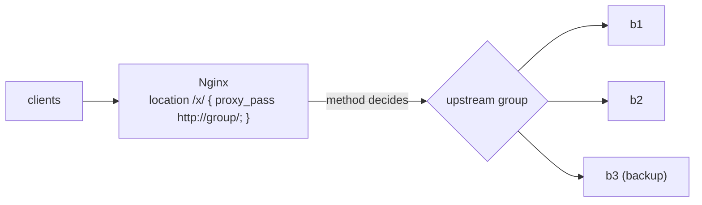

# Nginx 04 — Upstreams and load-balancing methods

> **Course:** [Nginx](./README.md)  ·  **Time:** ~45 min  ·  **Needs:** [Nginx 02](./02-config-server-location.md), [Nginx 03](./03-proxy-pass-and-headers.md) and [Networking 04](../networking/04-proxies.md); [Docker 01](../docker/01-images-and-containers.md) for the exercise
> **Used in the labs:** [Lab 02, step 5](../../labs/02-load-balancing.md#step-5--three-api-replicas) (`upstream api { ... resolve ... }` in front of three replicas) and [Lab 06, step 20](../../labs/06-object-storage.md#step-20--a-public-s3-address-s3localhost-through-the-load-balancer) (a second `upstream`, for the object store)

## What you will learn
- Write an `upstream` block: a **named group of servers** that `proxy_pass` can point to.
- Choose a **load-balancing method** (round robin, `weight`, `least_conn`, `ip_hash`) and predict how requests are spread.
- Use `backup` to keep a spare server for emergencies.
- Read the lab's own upstream (`zone`, `resolver`, `server ... resolve`, `max_fails`, `fail_timeout`) line by line.
- Measure a method instead of guessing: count which backend answered.

## Words you need
| Word | Plain-words meaning |
|---|---|
| **`upstream`** | A named group of backend servers: `upstream rr { server b1:8000; server b2:8000; }`. `proxy_pass http://rr;` then spreads requests over the group. |
| **Load balancing** | Spreading requests over several servers so none is overloaded and one can fail without the service stopping. |
| **Load-balancing method** | The rule that picks the server for each request. |
| **Round robin** | The default: each server in turn (1, 2, 3, 1, 2, 3...). |
| **`weight`** | A number that gives a server more turns in round robin: `weight=3` means three turns for each turn of a weight-1 server. Useful when servers have different power. |
| **`least_conn`** | Send the request to the server with the **fewest requests in progress**. Good when requests take very different times. |
| **`ip_hash`** | Pick the server from the client's IP address, so the **same client always reaches the same server**. |
| **Sticky session** | Keeping one client on one server (needed when a server keeps per-user state in its own memory). `ip_hash` is a simple way. |
| **`backup`** | A server used only when **all the normal ones** are unavailable. |
| **Passive health check** | Nginx notices a dead server only when a real request to it fails ([Nginx 05](./README.md), planned), then stops using it for a while. |
| **`max_fails` / `fail_timeout`** | After `max_fails` failures a server is considered down for `fail_timeout` seconds. |
| **`zone`** | A piece of **shared memory** where all Nginx worker processes keep the state of an upstream. It is required for `resolve`. |
| **`resolver` / `resolve`** | `resolver` names the DNS server Nginx asks at run time; `resolve` on a `server` makes Nginx **re-ask DNS** for its name, so changing addresses (containers restarting) are followed. |

## The idea
**Analogy.** The **checkout lanes of a supermarket**. A manager at the door sends each customer to a lane. *Round robin*: lane 1, lane 2, lane 3, then lane 1 again. *Weighted*: the express lane with the fast cashier gets three customers for each one of the others. *Least connections*: send the customer to the lane with the **shortest queue right now**, which is the fair rule when some customers have a full trolley. *IP hash*: a regular customer always goes to "his" lane because the cashier knows him. *Backup*: a lane that opens only when all the others are closed.

**Precisely.** `upstream NAME { ... }` lives in the `http` block and lists `server ADDRESS [parameters];` lines. `proxy_pass http://NAME;` ([Nginx 03](./03-proxy-pass-and-headers.md)) then asks the group for a server at **each request**. A directive at the top of the block (`least_conn;`, `ip_hash;`) selects the method; with none, it is round robin. Parameters on a `server` line adjust that one server (`weight=3`, `backup`, `max_fails=...`). If a chosen server fails to connect, Nginx can try the next one (`proxy_next_upstream`) and remember that the failed one is unavailable for a while.



## The code or config, line by line
The experiment's `nginx.conf` has **five upstreams over the same three servers**, one per method, each behind its own path:
```nginx
events {}

http {
    upstream rr {                       # default method: round robin (each server in turn)
        server b1:8000;
        server b2:8000;
        server b3:8000;
    }
    upstream weighted {                 # round robin, but b1 gets 3 turns for each turn of the others
        server b1:8000 weight=3;
        server b2:8000;
        server b3:8000;
    }
    upstream sticky {                   # the same client address always goes to the same server
        ip_hash;
        server b1:8000;
        server b2:8000;
        server b3:8000;
    }
    upstream lc {                       # the server with the fewest requests in progress
        least_conn;
        server b1:8000;
        server b2:8000;
        server b3:8000;
    }
    upstream withbackup {               # b3 only receives requests when b1 and b2 are unavailable
        server b1:8000;
        server b2:8000;
        server b3:8000 backup;
    }

    server {
        listen 8080;
        proxy_connect_timeout 1s;       # give up on a dead server after 1 second ...
        proxy_next_upstream error timeout;   # ... and try the next one

        location /rr/         { proxy_pass http://rr/; }
        location /weighted/   { proxy_pass http://weighted/; }
        location /sticky/     { proxy_pass http://sticky/; }
        location /lc/         { proxy_pass http://lc/; }
        location /withbackup/ { proxy_pass http://withbackup/; }
    }
}
```
| Line | What it does | If you change or remove it |
|---|---|---|
| `upstream rr { server b1:8000; ... }` | A group of three servers, by name and port (found by Docker DNS, [Docker 07](../docker/07-networks.md)). With no method directive: **round robin**. | Without the group, `proxy_pass` could only name one server: nothing would be spread. |
| `server b1:8000 weight=3;` | b1 gets three turns for each turn of b2 and of b3. | Remove `weight` and it is plain round robin again. |
| `ip_hash;` | Select the method: the server is chosen from the client address. | Remove it and requests are spread round robin: a client may change server at every request. |
| `least_conn;` | Select the method: fewest requests in progress. | Remove it and the slow server gets the same share as the others (section 4 of the output). |
| `server b3:8000 backup;` | b3 is used only if b1 and b2 are both unavailable. | Without `backup` b3 would share the load. |
| `proxy_connect_timeout 1s;` | A dead server is given up on after 1 second. | The default is 60 seconds: a request to a dead server would hang for a minute ([Nginx 01](./01-web-server-and-reverse-proxy.md)). |
| `proxy_next_upstream error timeout;` | If connecting fails or times out, try the next server of the group. | Without it the client would get the `502`/`504` instead of an answer from another server. |
| `location /rr/ { proxy_pass http://rr/; }` | Requests under `/rr/` go to the group `rr`; the final `/` strips the prefix ([Nginx 03](./03-proxy-pass-and-headers.md)). | Without the final `/`, `/rr/x` would reach the backend as `/rr/x`, not `/x`. |

The lab's own upstream, `lb/nginx.conf` ([Lab 02, step 5](../../labs/02-load-balancing.md#step-5--three-api-replicas)), with the extra settings for containers that come and go:
```nginx
upstream api {
    zone api 64k;                                    # shared memory, needed by "resolve"
    resolver 127.0.0.11 valid=5s;                    # Docker's DNS; treat each answer as valid for 5 s
    server api:8000 resolve max_fails=1 fail_timeout=10s;
}
```
| Line | What it does | If you change or remove it |
|---|---|---|
| `zone api 64k;` | A 64 kB shared-memory area for this group's state, visible to all Nginx worker processes. | `resolve` needs it: Nginx refuses the configuration without it. |
| `resolver 127.0.0.11 valid=5s;` | The DNS server to ask at run time (Docker's built-in one) and how long to keep an answer: re-ask every 5 seconds whatever the DNS record says. | A larger value means fewer lookups but slower reaction to a container with a new address (Lab 02 Troubleshooting asks whether this value plays a part in an intermittent failover failure). |
| `server api:8000 resolve ...` | The name `api` is looked up **again and again**; **every** address it returns (the three replicas) becomes a server of the group. | Without `resolve` the name is looked up **once at start-up** and a restarted replica with a new address is never found. |
| `max_fails=1 fail_timeout=10s` | One failure marks a server down for 10 seconds. | |

## The commands
| Command / flag | Meaning |
|---|---|
| `docker run -d --rm --name b1 --hostname b1 --network nginx04 -v "$D:/demo" -w /demo aws-local-lab-api:0.1.0 python echo.py` | A backend: `-d` background, `--rm` delete when stopped, `--name` the container name, `--hostname` the name the program reports as its own, `--network` the demo network, `-v ... -w /demo` mount the folder with `echo.py` and start in it. |
| `docker run -d --rm --name lbdemo -p 127.0.0.1:18130:8080 -v "$D/nginx.conf:/etc/nginx/nginx.conf:ro" nginx:1.30.6-alpine` | Nginx with your config (`:ro` read-only) published on your machine only. |
| `D=$(pwd -W)` and `MSYS_NO_PATHCONV=1` | Git Bash on Windows: the current folder as a Windows path for `-v`; no rewriting of `/etc/...` arguments. |
| `curl -s URL \| sed -E 's/.*"backend": "([^"]*)".*/\1/'` | Quiet request, then keep only the backend's name (the text captured by the parentheses, `\1`). |
| `sort \| uniq -c \| awk '{...}'` | Count how many times each name appears: `sort` groups equal lines, `uniq -c` counts them, `awk` prints them as `b1 x10`. |
| `for _ in $(seq 12); do ... & done; wait` | Send 12 requests **at the same time** (`&` runs each in the background); `wait` waits for all of them. |
| `docker stop b1 b2` | Stop two backends, to see how the group reacts. |
| `docker network create nginx04` | A private network for the demo, so the containers find each other by name (`b1`, `b2`, `b3`). |
| `for _ in $(seq 30); do ...; done` | Repeat 30 times: `seq 30` prints the numbers 1 to 30, and `_` is a loop variable we do not use. |
| `printf 'first 6 : '` and `printf '%s ' "$(who /rr/)"` | Print text **without** a line break, so several answers end up on one line. |
| `curl -s -o /dev/null -w '%{http_code} ' URL` | Quiet request that throws the body away (`-o /dev/null`) and prints only the status code (`-w`). |
| `sleep 3` | Wait 3 seconds, so the containers are ready before the first request. |

The backend, `echo.py`: it answers with its own host name, and **b1 sleeps 1.5 s on `/slow`** to play the overloaded server:
```python
"""A tiny backend that says who it is. Backend b1 is slow on /slow (1.5 s)."""
import json
import socket
import time
from http.server import BaseHTTPRequestHandler, ThreadingHTTPServer

NAME = socket.gethostname()


class Who(BaseHTTPRequestHandler):
    def do_GET(self):
        if self.path.endswith("/slow") and NAME == "b1":
            time.sleep(1.5)
        body = (json.dumps({"backend": NAME}) + "\n").encode()
        self.send_response(200)
        self.send_header("Content-Type", "application/json")
        self.send_header("Content-Length", str(len(body)))
        self.end_headers()
        self.wfile.write(body)

    def log_message(self, *args):
        pass


ThreadingHTTPServer(("0.0.0.0", 8000), Who).serve_forever()
```

## Hands-on
Throw-away containers (`nginx:1.30.6-alpine`, and the project's `aws-local-lab-api:0.1.0` for Python). Make a folder with `nginx.conf`, `echo.py` and this `run.sh`:
```bash
#!/usr/bin/env bash
D=$(pwd -W); export MSYS_NO_PATHCONV=1
docker network create nginx04 >/dev/null
for n in b1 b2 b3; do
  docker run -d --rm --name $n --hostname $n --network nginx04 -v "$D:/demo" -w /demo aws-local-lab-api:0.1.0 python echo.py >/dev/null
done
docker run -d --rm --name lbdemo --network nginx04 -p 127.0.0.1:18130:8080 -v "$D/nginx.conf:/etc/nginx/nginx.conf:ro" nginx:1.30.6-alpine >/dev/null
sleep 3
who() { curl -s "localhost:18130$1" | sed -E 's/.*"backend": "([^"]*)".*/\1/'; }
count() { sort | uniq -c | awk '{printf "%s x%s  ", $2, $1} END {print ""}'; }

echo "== 1. round robin (/rr/), 30 requests"
printf 'first 6 : '; for _ in $(seq 6); do printf '%s ' "$(who /rr/)"; done; echo
printf 'total   : '; for _ in $(seq 30); do who /rr/; done | count
echo "== 2. weights (/weighted/), 30 requests, b1 weight=3"
printf 'total   : '; for _ in $(seq 30); do who /weighted/; done | count
echo "== 3. ip_hash (/sticky/), 30 requests from one client"
printf 'total   : '; for _ in $(seq 30); do who /sticky/; done | count
echo "== 4. 12 requests at the same time, b1 slow: round robin against least_conn"
printf 'rr      : '; for _ in $(seq 12); do who /rr/slow & done | count; wait
printf 'least_conn: '; for _ in $(seq 12); do who /lc/slow & done | count; wait
echo "== 5. backup server (/withbackup/), 30 requests, all servers up"
printf 'total   : '; for _ in $(seq 30); do who /withbackup/; done | count
echo "== 6. b1 and b2 stopped: the backup takes over"
docker stop b1 b2 >/dev/null
printf 'codes   : '; for _ in $(seq 10); do curl -s -o /dev/null -w '%{http_code} ' localhost:18130/withbackup/; done; echo
printf 'served by: '; for _ in $(seq 10); do who /withbackup/; done | count
docker stop lbdemo b3 >/dev/null; docker network rm nginx04 >/dev/null
```
Run `bash run.sh`. Real output:
```text
== 1. round robin (/rr/), 30 requests
first 6 : b1 b2 b3 b1 b2 b3 
total   : b1 x10  b2 x10  b3 x10  
== 2. weights (/weighted/), 30 requests, b1 weight=3
total   : b1 x18  b2 x6  b3 x6  
== 3. ip_hash (/sticky/), 30 requests from one client
total   : b1 x30  
== 4. 12 requests at the same time, b1 slow: round robin against least_conn
rr      : b1 x4  b2 x4  b3 x4  
least_conn: b1 x1  b2 x5  b3 x6  
== 5. backup server (/withbackup/), 30 requests, all servers up
total   : b1 x15  b2 x15  
== 6. b1 and b2 stopped: the backup takes over
codes   : 200 200 200 200 200 200 200 200 200 200 
served by: b3 x10  
```
**How to read it:**
- **1, round robin:** the order is exactly `b1 b2 b3 b1 b2 b3`, and 30 requests give **10 each**.
- **2, weights:** with `weight=3` on b1: **18, 6, 6**, the 3 : 1 : 1 ratio.
- **3, `ip_hash`:** all 30 requests from my one machine went to **one** server (`b1`). Every request of a client lands on the same server, which is what makes sessions "sticky". (Another client address may map to another server, and if that server dies its clients are moved.)
- **4, `least_conn`:** 12 requests sent at the same time while b1 needs 1.5 s. Round robin ignores the load and hands b1 its **4** slow requests. `least_conn` sees that b1 is busy and gives it only **1**, the others taking **5** and **6**: the load follows the **speed** of each server.
- **5, `backup`:** with everything up, b3 got **nothing**; b1 and b2 shared the 30 requests (15 and 15).
- **6, failover to the backup:** with b1 and b2 stopped, all 10 requests still returned `200` and were served by **b3**. The client noticed nothing, thanks to the 1 s connect timeout and `proxy_next_upstream`. (The 1 s connect timeout means the first requests after the stop can be slower while Nginx learns the servers are down; that was not timed here.)

## What if…?
**…you load-balance by round robin and one server is much slower?** Section 4 is the answer: round robin gives the slow server the same share as the others, so a quarter or a third of your requests are slow. `least_conn` fixes it for requests of unequal duration; `weight` fixes it for servers of unequal **power**; and neither fixes a server that is **broken**: that is the job of health checks and `max_fails` ([Nginx 05](./README.md), planned). Also remember that a method says nothing about **state**: if a server keeps a user's session in its own memory, use `ip_hash`, or better, keep the state outside the servers (the lab's API keeps it in Postgres and Redis, so round robin is safe).

## In short
1. An `upstream` is a **named group of servers**; `proxy_pass http://NAME;` spreads requests over it. The default method is **round robin**.
2. `weight` unbalances round robin on purpose, `least_conn` follows the current load, `ip_hash` keeps a client on one server, and `backup` holds a spare for when all the others are down.
3. For containers, the lab adds `zone` + `resolver` + `server ... resolve` so Nginx **keeps re-reading DNS** and follows replicas that restart, and `max_fails`/`fail_timeout` to stop using a failing one.

## Check your understanding
1. With `server b1; server b2; server b3 weight=2;` and round robin, how many of 8 requests does b3 get?
2. When is `least_conn` better than round robin?
3. What does `ip_hash` guarantee, and what happens to a client when its server dies?
4. Why does the lab's upstream need `zone` and `resolver`?
5. In the experiment, what did the client see when b1 and b2 were stopped, and which settings made that possible?

<details><summary>Answers</summary>

1. Weights are 1, 1 and 2, a total of 4 per cycle, so b3 gets 2 of every 4: **4 of 8**.
2. When requests take **very different times** (some slow, some fast): it sends new requests to the servers with the fewest requests in progress instead of giving every server the same number of turns.
3. The same client address always goes to the same server (while it is available): sticky sessions. If that server dies, the client is sent to another one and loses whatever state the dead server held in its memory.
4. `resolve` (re-reading DNS to follow containers that restart or change address) needs the shared state in a `zone`, and a `resolver` to know which DNS server to ask at run time (Docker's, `127.0.0.11`).
5. Nothing: all requests returned `200`, served by the backup b3. `proxy_connect_timeout 1s` gave up quickly on the dead servers and `proxy_next_upstream error timeout` retried on the next one, and `backup` kept b3 for exactly this case.

</details>

## Official documentation
- [Nginx: `ngx_http_upstream_module`](https://nginx.org/en/docs/http/ngx_http_upstream_module.html) (`upstream`, `server` parameters, `least_conn`, `ip_hash`, `zone`, `resolve`)
- [Nginx: HTTP load balancing (admin guide)](https://docs.nginx.com/nginx/admin-guide/load-balancer/http-load-balancer/)
- [AWS: how an Application Load Balancer routes requests](https://docs.aws.amazon.com/elasticloadbalancing/latest/application/how-elastic-load-balancing-works.html) (round robin and least outstanding requests)

## Where you use this in the project
- [Lab 02, step 5](../../labs/02-load-balancing.md#step-5--three-api-replicas): `upstream api` with `zone`, `resolver ... valid=5s` and `server api:8000 resolve`, in front of three replicas; the test `02_load_balancing.sh` counts which replica answered, exactly as this module does.
- [Lab 02, step 6](../../labs/02-load-balancing.md#step-6--health-checks-and-failover): `max_fails`, `fail_timeout` and `proxy_next_upstream` when a replica dies.
- [Lab 06, step 20](../../labs/06-object-storage.md#step-20--a-public-s3-address-s3localhost-through-the-load-balancer): `upstream s3`, a group of one server, found by name.
- [Nginx 03](./03-proxy-pass-and-headers.md): the `proxy_pass` that points at an upstream.
