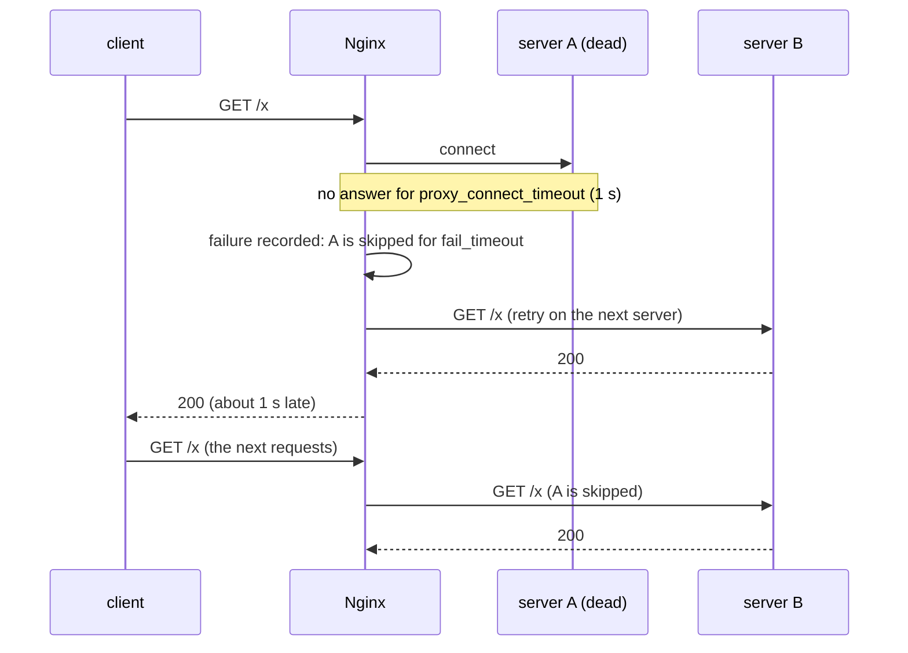

# Nginx 05 — Timeouts, retries and passive health checks

> **Course:** [Nginx](./README.md)  ·  **Time:** ~50 min  ·  **Needs:** [Nginx 03](./03-proxy-pass-and-headers.md), [Nginx 04](./04-upstream-and-load-balancing.md) and [Networking 03](../networking/03-http.md) (status codes); [Docker 01](../docker/01-images-and-containers.md) for the exercise
> **Used in the labs:** [Lab 02, step 6](../../labs/02-load-balancing.md#step-6--health-checks-and-failover) (`proxy_connect_timeout 1s`, `proxy_next_upstream`, `max_fails`, `fail_timeout`: a dead replica must not hurt users)

## What you will learn
- Name the three **timeouts** of a proxied request and what each one waits for.
- Say what Nginx does when a server fails: **retry on the next server** (`proxy_next_upstream`) and **skip the failing server for a while** (`max_fails`, `fail_timeout`).
- Explain why a `POST` is **not** retried like a `GET`.
- Read an access log that shows **every server tried** for one request.
- Tell a *passive* health check (Nginx) from an *active* one (AWS load balancer).

## Words you need
| Word | Plain-words meaning |
|---|---|
| **Timeout** | The longest Nginx waits for something before giving up on it. |
| **`proxy_connect_timeout`** | How long to wait for a **connection** to the backend to be established (default **60 s**). A dead machine does not answer at all, so Nginx waits this long. |
| **`proxy_read_timeout`** | How long to wait **between two pieces of the answer** from the backend (default **60 s**). A server that accepted the request but stays silent hits this. |
| **`proxy_send_timeout`** | The same for sending the request to the backend (default 60 s). |
| **Retry** | Sending the same request to **another** server of the group after a failure. |
| **`proxy_next_upstream`** | Says **which kinds of failure** justify a retry: `error` (could not connect or talk), `timeout`, `http_502`, `http_503`, `http_504`, ... The default is `error timeout`. |
| **Idempotent request** | A request that can be **repeated without harm**: `GET` (a read). A `POST` that creates something is not: repeating it could create it twice. |
| **Passive health check** | Nginx only learns a server is bad **from real requests** that fail. (An **active** check, like an AWS load balancer's, calls a health URL on a timer.) |
| **`max_fails` / `fail_timeout`** | After `max_fails` failures, the server is considered **down for `fail_timeout`**, and no request is sent to it. Defaults: 1 failure, 10 seconds. |
| **Failover** | Continuing to serve, on the remaining servers, when one fails. |
| **`$upstream_addr`, `$upstream_status`** | Log variables: the address(es) of **all** servers tried for the request, and the status each one gave. |

## The idea
**Analogy.** You call a restaurant to book a table. If **nobody picks up** after a while (a *timeout*), you try the next restaurant (a *retry*). If a restaurant **answers "we are full"** (a `503`), you may also try another one. You also write the first one off for the evening so you do not waste time calling it again (*`fail_timeout`*). But if you have **already placed an order** and the line goes dead, you do **not** simply order again somewhere else: you might be charged twice (a `POST` is not safe to repeat).

**Precisely.** For each request the proxy asks the group for a server, connects, sends the request and waits for the answer. Each of these steps has a **timeout** (default 60 s: far too long for a user). When a step **fails** in a way listed in `proxy_next_upstream`, Nginx **records a failure** for that server and, if the request can be repeated, **tries the next server** (up to `proxy_next_upstream_tries`). After `max_fails` failures the server is **skipped** for `fail_timeout` seconds. Nothing is checked in the background: the first request to hit a dead server **pays** for the discovery.



## The code or config, line by line
`nginx.conf` of the experiment. Each `location` is one scenario, over a small group of servers `b1`, `b2` (and `b3`); `b1` can be made to answer `503` or to stay silent:
```nginx
events {}

http {
    # One line per request: how long it took, the final status, and EVERY upstream server that was tried.
    log_format tries '$request_method $uri -> $status in $request_time s | tried $upstream_addr, statuses $upstream_status';
    access_log /dev/stdout tries;

    upstream plain  { server b1:8000; server b2:8000; }                                  # default rules: max_fails=1 fail_timeout=10s
    upstream marked { server b1:8000 max_fails=1 fail_timeout=5s; server b2:8000; }      # a failing b1 is skipped for 5 seconds
    upstream always { server b1:8000 max_fails=0; server b2:8000; }                      # b1 is never marked as failed: always tried
    upstream pool   { server b1:8000; server b2:8000; server b3:8000; }

    server {
        listen 8080;

        # 1. b1 answers 503 on /fail. Without "http_503" in proxy_next_upstream the client sees the 503.
        location /noretry/ { proxy_pass http://plain/; }
        location /retry/   { proxy_next_upstream error timeout http_503; proxy_pass http://marked/; }

        # 2. The same retry rule, GET against POST (upstream "always": every request really reaches b1).
        location /same/    { proxy_next_upstream error timeout http_503; proxy_pass http://always/; }

        # 3. b1 is silent for 3 seconds on /slow: give up after 1 second.
        location /slow/    { proxy_read_timeout 1s; proxy_pass http://always/; }

        # 4. A dead server: give up connecting after 1 second.
        location /fast/    { proxy_connect_timeout 1s; proxy_pass http://pool/; }
    }
}
```
| Line | What it does | If you change or remove it |
|---|---|---|
| `log_format tries '... tried $upstream_addr, statuses $upstream_status'` and `access_log /dev/stdout tries;` | One log line per request with the final status, the time, and **every upstream tried** with its status. | Without it you only see the final status, not that a retry happened. |
| `upstream marked { server b1:8000 max_fails=1 fail_timeout=5s; ... }` | After **1** failure, b1 is skipped for **5 s**. | The defaults are 1 and 10 s. |
| `upstream always { server b1:8000 max_fails=0; ... }` | `max_fails=0` **turns the skipping off**: b1 is tried on its turn, whatever happened before. Used so that every request really reaches b1. | |
| `location /noretry/ { proxy_pass http://plain/; }` | The default retry rule (`error timeout`): a `503` from the backend is **not** a reason to retry, so the client gets it. | |
| `proxy_next_upstream error timeout http_503;` | Also retry when the backend answers `503`. | Without `http_503` the client sees the `503`. |
| `proxy_read_timeout 1s;` | Give up on a backend that has accepted the request but sends nothing for 1 s. | The default is 60 s: a hanging backend would hang the client for a minute. |
| `proxy_connect_timeout 1s;` | Give up on a backend that does not accept the connection within 1 s (a dead machine). | The default is 60 s ([Nginx 01](./01-web-server-and-reverse-proxy.md): a `504` after 60 s). |

The backend, `echo.py`. On **b1 only**: a path ending in `/fail` answers `503`, a path ending in `/slow` waits 3 seconds before answering:
```python
"""A tiny backend that says who it is. On b1: /fail answers 503 and /slow takes 3 seconds."""
import json
import socket
import time
from http.server import BaseHTTPRequestHandler, ThreadingHTTPServer

NAME = socket.gethostname()


class Who(BaseHTTPRequestHandler):
    def handle_any(self):
        length = int(self.headers.get("Content-Length", 0))
        if length:
            self.rfile.read(length)  # read the body of a POST
        status = 200
        if NAME == "b1" and self.path.endswith("/fail"):
            status = 503
        if NAME == "b1" and self.path.endswith("/slow"):
            time.sleep(3)
        body = (json.dumps({"backend": NAME}) + "\n").encode()
        self.send_response(status)
        self.send_header("Content-Type", "application/json")
        self.send_header("Content-Length", str(len(body)))
        self.end_headers()
        self.wfile.write(body)

    do_GET = do_POST = handle_any

    def log_message(self, *args):
        pass


ThreadingHTTPServer(("0.0.0.0", 8000), Who).serve_forever()
```
The lab's own values ([Lab 02, step 6](../../labs/02-load-balancing.md#step-6--health-checks-and-failover)), for comparison:
```nginx
server api:8000 resolve max_fails=1 fail_timeout=10s;          # in the upstream
proxy_connect_timeout 1s;                                       # a dead replica: give up after 1 s ...
proxy_next_upstream error timeout http_502 http_503 http_504;   # ... and on these answers, try the next replica
proxy_next_upstream_tries 3;                                    # at most 3 servers for one request
```

## The commands
| Command / flag | Meaning |
|---|---|
| `docker run -d --rm --name b1 --hostname b1 --network nginx05 -v "$D:/demo" -w /demo aws-local-lab-api:0.1.0 python echo.py` | A backend: `-d` background, `--rm` delete when stopped (so it cannot be started again, only recreated), `--hostname` the name it reports, `--network`, `-v ... -w /demo` mount the folder and start in it. |
| `docker inspect -f '{{(index .NetworkSettings.Networks "nginx05").IPAddress}}' b1` | Print one container's IP address on the demo network: the log shows addresses, this tells which is which. |
| `curl -s -o /dev/null -w '%{http_code}:%{time_total}s ' URL` | Quiet request, body thrown away, prints the status code and the total time. `-X POST -d x` makes it a `POST` with a tiny body. |
| `docker logs lbdemo` and `grep -F 'GET /retry/fail ->'` | Nginx's access log (every request); `grep -F` searches for that exact text. |
| `docker stop b3` | Stop (and, with `--rm`, remove) a backend: a **dead** server, to test the connect timeout. |
| `D=$(pwd -W)`, `MSYS_NO_PATHCONV=1`, `sleep` | Git Bash on Windows: the folder as a Windows path and no path rewriting; `sleep N` waits N seconds. |

## Hands-on
Throw-away containers (`nginx:1.30.6-alpine`, and the project's `aws-local-lab-api:0.1.0` for Python). Make a folder with `nginx.conf`, `echo.py` and this `run.sh`:
```bash
#!/usr/bin/env bash
D=$(pwd -W); export MSYS_NO_PATHCONV=1
docker network create nginx05 >/dev/null
for n in b1 b2 b3; do
  docker run -d --rm --name $n --hostname $n --network nginx05 -v "$D:/demo" -w /demo aws-local-lab-api:0.1.0 python echo.py >/dev/null
done
docker run -d --rm --name lbdemo --network nginx05 -p 127.0.0.1:18140:8080 -v "$D/nginx.conf:/etc/nginx/nginx.conf:ro" nginx:1.30.6-alpine >/dev/null
sleep 3
for n in b1 b2 b3; do printf '%s=%s ' $n "$(docker inspect -f '{{(index .NetworkSettings.Networks "nginx05").IPAddress}}' $n)"; done; echo
code() { curl -s -o /dev/null -w '%{http_code} ' "$@"; }
timed() { curl -s -o /dev/null -w '%{http_code}:%{time_total}s ' "$@"; }
logs() { docker logs lbdemo 2>&1 | grep -F "$1" | sed -E 's/:8000//g; s/^.* -> /-> /'; }

echo "== 1. b1 answers 503 on /fail: 4 GET requests each"
printf 'without http_503 in proxy_next_upstream: '; for _ in 1 2 3 4; do code localhost:18140/noretry/fail; done; echo
printf 'with    http_503 in proxy_next_upstream: '; for _ in 1 2 3 4; do code localhost:18140/retry/fail; done; echo
echo "-- the log of the retried requests (the first one tried b1, then b2):"
logs 'GET /retry/fail ->'
echo "-- 6 seconds later (fail_timeout=5s is over): four more requests"
sleep 6; for _ in 1 2 3 4; do code localhost:18140/retry/fail; done; echo; logs 'GET /retry/fail ->' | tail -4

echo "== 2. the same retry rule: GET against POST (6 requests each)"
printf 'GET : '; for _ in $(seq 6); do code localhost:18140/same/fail; done; echo
printf 'POST: '; for _ in $(seq 6); do code -X POST -d x localhost:18140/same/fail; done; echo

echo "== 3. b1 is silent for 3 s, proxy_read_timeout 1s (6 requests each)"
printf 'GET : '; for _ in $(seq 6); do timed localhost:18140/slow/slow; done; echo
printf 'POST: '; for _ in $(seq 6); do timed -X POST -d x localhost:18140/slow/slow; done; echo
echo "-- one slow GET and one slow POST in the log:"
logs 'GET /slow/slow ->' | grep ', statuses 504' | head -1; logs 'POST /slow/slow ->' | head -1

echo "== 4. b3 is stopped, proxy_connect_timeout 1s: 9 requests"
docker stop b3 >/dev/null
for _ in $(seq 9); do timed localhost:18140/fast/x; done; echo
echo "-- the request that found the dead server:"
logs 'GET /fast/x ->' | grep -E 'in 1\.[0-9]+ s' | head -1
docker stop lbdemo b1 b2 >/dev/null 2>&1; docker network rm nginx05 >/dev/null
```
Run `bash run.sh` (about a minute). Real output:
```text
b1=172.24.0.2 b2=172.24.0.3 b3=172.24.0.4 
== 1. b1 answers 503 on /fail: 4 GET requests each
without http_503 in proxy_next_upstream: 503 200 503 200 
with    http_503 in proxy_next_upstream: 200 200 200 200 
-- the log of the retried requests (the first one tried b1, then b2):
-> 200 in 0.002 s | tried 172.24.0.2, 172.24.0.3, statuses 503, 200
-> 200 in 0.000 s | tried 172.24.0.3, statuses 200
-> 200 in 0.001 s | tried 172.24.0.3, statuses 200
-> 200 in 0.001 s | tried 172.24.0.3, statuses 200
-- 6 seconds later (fail_timeout=5s is over): four more requests
200 200 200 200 
-> 200 in 0.000 s | tried 172.24.0.3, statuses 200
-> 200 in 0.001 s | tried 172.24.0.3, statuses 200
-> 200 in 0.001 s | tried 172.24.0.2, 172.24.0.3, statuses 503, 200
-> 200 in 0.001 s | tried 172.24.0.3, statuses 200
== 2. the same retry rule: GET against POST (6 requests each)
GET : 200 200 200 200 200 200 
POST: 503 200 503 200 503 200 
== 3. b1 is silent for 3 s, proxy_read_timeout 1s (6 requests each)
GET : 200:1.217804s 200:0.210741s 200:1.207512s 200:0.206460s 200:1.210723s 200:0.223790s 
POST: 504:1.213857s 200:0.205058s 504:1.213695s 200:0.202861s 504:1.215987s 200:0.213602s 
-- one slow GET and one slow POST in the log:
-> 200 in 1.003 s | tried 172.24.0.2, 172.24.0.3, statuses 504, 200
-> 504 in 1.001 s | tried 172.24.0.2, statuses 504
== 4. b3 is stopped, proxy_connect_timeout 1s: 9 requests
200:0.214200s 200:0.204296s 200:1.204633s 200:0.214037s 200:0.215307s 200:0.214560s 200:0.212939s 200:0.211408s 200:0.215420s 
-- the request that found the dead server:
-> 200 in 1.004 s | tried 172.24.0.4, 172.24.0.2, statuses 504, 200
```
(The log lines are cut to the part after `->`; addresses: `.2` is b1, `.3` is b2, `.4` is b3. Every request takes about **0.2 s** here even when nothing goes wrong: that is most likely Docker Desktop on Windows forwarding the published port, not Nginx: the log shows Nginx itself answering in about a millisecond. What matters is the **extra second**.) **How to read it:**
- **1, without `http_503`:** the client sees `503 200 503 200`: every other request hit b1, whose `503` went straight through. **With** `http_503`: `200 200 200 200`. The log shows why: the first request **tried b1** (`503`) and then **b2** (`200`); the next three tried **only b2**: b1 had a failure recorded and is **skipped** (`max_fails=1`).
- **1, six seconds later:** after `fail_timeout=5s`, b1 is tried again: its turn comes back on the third request (`tried .2, .3 ... 503, 200`), it fails again, and is skipped again. This is the **passive health check**: Nginx **re-tests** a bad server by sending it a real request every `fail_timeout`.
- **2, GET against POST:** with the same retry rule, all six `GET` return `200` (a `503` from b1 is retried on b2) but the `POST` returns `503 200 503 200 503 200`: when b1 answers `503` to a **POST**, Nginx **does not retry** (the request was already sent, and repeating a `POST` could do the work twice). A retry needs the request to be **safe to repeat**.
- **3, a silent server:** b1 waits 3 s but `proxy_read_timeout` is 1 s. A `GET` that hits b1 **takes 1.2 s** (1 s of waiting + the retry on b2) and ends `200` (`statuses 504, 200`); a `POST` that hits b1 ends **`504` after 1.2 s**, not retried. Half the requests are fast (0.2 s), half are not.
- **4, a dead server:** b3 was stopped. Among 9 requests exactly **one** took 1.2 s: the one that found b3 dead (`tried .4, .2 ... 504, 200`: a connect timeout is recorded as `504`, then b1 answered). The other eight were fast: b3 was **skipped** after that single failure. The first user to hit a dead server pays one `proxy_connect_timeout`.

## What if…?
**…you keep the defaults?** Each timeout is **60 seconds**: with a dead server, the unlucky client waits a **minute** before the retry, and a silent server holds a connection (and a browser tab) for a minute. That is why the lab sets `proxy_connect_timeout 1s`. The price of short timeouts is the opposite risk: a server that is merely **slow** (a big report, a first upload to a store that is warming up) is treated as failed and marked down for `fail_timeout`. Timeouts are a **balance** between "fail fast" and "tolerate slowness", tuned per `location`.

**…something still goes wrong once in a while?** Even with these settings, [Lab 02](../../labs/02-load-balancing.md#6-troubleshooting) shows a failover test where **one request in roughly four runs** returns `502` right after a replica is killed (the Nginx log shows a timeout on the killed replica, then `no live upstreams`). This module explains the **parts involved** (the connect timeout, the failure mark, the retry), but the cause of that one failure is **not found yet**: the lab keeps it documented as an open question, with a lead about the DNS refresh of `resolve`.

## In short
1. Three timeouts (`proxy_connect_timeout`, `proxy_send_timeout`, `proxy_read_timeout`) default to **60 s**; set them to what a user can bear.
2. On `error`, `timeout` or the statuses you list in `proxy_next_upstream`, Nginx records a failure and **retries on the next server**; after `max_fails` failures a server is **skipped for `fail_timeout`** and then re-tested by a real request (a passive check).
3. Only **safe-to-repeat** requests (`GET`) are retried after being sent: a `POST` that reached a failing server is **not**. The `$upstream_addr` and `$upstream_status` log variables show every attempt.

## Check your understanding
1. A backend machine is switched off. What decides how long the first client waits, and how long do the following clients wait?
2. What is the default `proxy_next_upstream`, and what do you add to also retry when a backend answers `503`?
3. In the experiment, why did the `GET` get a `200` and the `POST` a `503` from the same failing server?
4. What do `max_fails=1` and `fail_timeout=5s` do together?
5. How does Nginx's health checking differ from an AWS load balancer's?

<details><summary>Answers</summary>

1. `proxy_connect_timeout` (60 s by default; 1 s in the lab): the first client waits that long, then Nginx retries on the next server. The following clients do not wait: the dead server was marked failed and is skipped for `fail_timeout`.
2. `error timeout`. Add `http_503` (`proxy_next_upstream error timeout http_503;`), as the lab does with `http_502 http_503 http_504`.
3. The `GET` is safe to repeat, so Nginx tried the next server after the `503`. The `POST` had already been sent and might have had an effect, so Nginx does **not** repeat it: the client gets the `503`.
4. After one failure the server is considered down and receives no requests for five seconds; after that, a real request is sent to it again to see whether it has recovered.
5. Nginx's check is **passive**: it learns from real requests that fail, so a user pays for the discovery. An AWS Application Load Balancer runs **active** checks: it calls a health URL on a timer and removes a failing target before users notice.

</details>

## Official documentation
- [Nginx: `proxy_next_upstream`](https://nginx.org/en/docs/http/ngx_http_proxy_module.html#proxy_next_upstream) and the other timeouts ([`proxy_connect_timeout`](https://nginx.org/en/docs/http/ngx_http_proxy_module.html#proxy_connect_timeout), [`proxy_read_timeout`](https://nginx.org/en/docs/http/ngx_http_proxy_module.html#proxy_read_timeout))
- [Nginx: `server` parameters `max_fails` and `fail_timeout`](https://nginx.org/en/docs/http/ngx_http_upstream_module.html#server) and [upstream variables](https://nginx.org/en/docs/http/ngx_http_upstream_module.html#variables)
- [AWS: health checks for your target groups](https://docs.aws.amazon.com/elasticloadbalancing/latest/application/target-group-health-checks.html) (the active counterpart)

## Where you use this in the project
- [Lab 02, step 6](../../labs/02-load-balancing.md#step-6--health-checks-and-failover): `proxy_connect_timeout 1s`, `proxy_next_upstream ...`, `proxy_next_upstream_tries 3` and `max_fails=1 fail_timeout=10s` in `lb/nginx.conf`, and the tests `02_failover.sh` (a killed replica must not fail requests) with its intermittent failure, documented in Lab 02's Troubleshooting.
- [Lab 06, step 21](../../labs/06-object-storage.md): the first upload to a freshly started store can answer `502` after about 10 s; the test retries it.
- [Nginx 04](./04-upstream-and-load-balancing.md): the groups and methods these rules apply to; [Nginx 01](./01-web-server-and-reverse-proxy.md): the `502` and `504` seen from the client.
