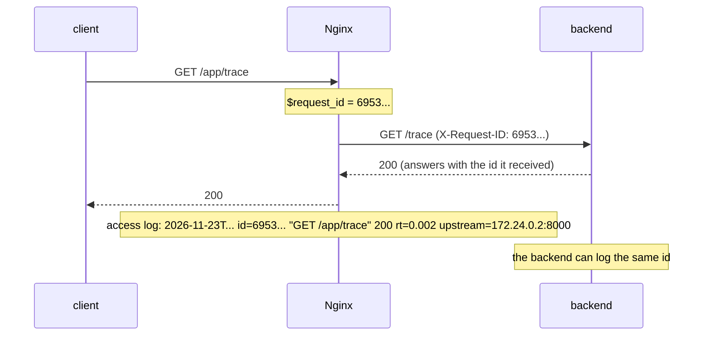

# Nginx 08 — Logs and debugging

> **Course:** [Nginx](./README.md)  ·  **Time:** ~45 min  ·  **Needs:** [Nginx 02](./02-config-server-location.md), [Nginx 03](./03-proxy-pass-and-headers.md) and [Nginx 05](./05-timeouts-retries-failover.md); [Docker 10](../docker/10-debugging.md) (`docker logs`)
> **Used in the labs:** [Lab 02, step 4](../../labs/02-load-balancing.md#step-4--nginx-in-front-of-the-api) (`nginx -t`, `docker compose logs lb`) and [Lab 02's troubleshooting](../../labs/02-load-balancing.md#6-troubleshooting) (the Nginx log is how the intermittent failover failure was investigated)

## What you will learn
- Tell the **access log** (one line per request) from the **error log** (what went wrong, with a level), and where each one goes in a Docker container.
- Read a log line, and write a **custom format** that records the time spent and **every server tried**.
- Follow **one request** through the proxy and into the backend with a **request id**.
- Check a configuration without starting it (`nginx -t`) and see the whole effective configuration (`nginx -T`).
- Use a short checklist: for each symptom (`404`, `502`, `504`...), where to look first.

## Words you need
| Word | Plain-words meaning |
|---|---|
| **Access log** | A file (or stream) with **one line for each request that Nginx has answered**: who asked, what, and the answer. |
| **Error log** | A stream of **problems and diagnostics**: a file that could not be opened, a backend that refused the connection, a configuration problem. Each entry has a **level**. |
| **Log level** | How serious an entry is. From least to most serious: `debug`, `info`, `notice`, `warn`, `error`, `crit`, `alert`, `emerg`. `error_log ... crit;` keeps only `crit` and above. |
| **`log_format`** | Defines the shape of an access-log line, using **variables** such as `$status` or `$request_time`. |
| **Standard output / standard error (stdout / stderr)** | The two output streams of a program. In the Nginx Docker image the access log goes to **stdout** and the error log to **stderr**, so `docker logs` shows both. |
| **Request id** | A unique value for each request (`$request_id`). Written in the log and passed to the backend, it lets you find **the same request in both**. |
| **Status code** | The number in the answer (`404`, `502`...). In the access log it is `$status`; the status of the **backend's** answer is `$upstream_status`. |
| **`nginx -t` / `nginx -T`** | `-t` **t**ests the configuration file and exits; `-T` also **prints** the whole effective configuration (all included files). |

## The idea
**Analogy.** A hotel reception keeps two books. The **visitor book** (the access log) gets one line for every person who came to the desk: who, what they asked, how it ended. The **incident report** (the error log) is only written when **something went wrong**: a door that would not open, a phone that nobody answered, with details for the maintenance team. To find out why a guest complained, you read the visitor book to **find the visit**, then the incident report to **learn the cause**.

**Precisely.** Nginx writes two logs. The **access log** is written when a request is **finished**, one line each, in the format you choose with `log_format`; it tells you **what** happened (the status, the size, the time, which upstream). The **error log** is written when something **fails or is notable**, with a level, and tells you **why** (`open() ... failed (2: No such file or directory)`, `connect() failed (111: Connection refused)`). In the official Docker image both are connected to the container's standard streams, so you read them with `docker logs`. The two are linked by time and by the request line, and, if you add one, by a **request id**.



## The code or config, line by line
`nginx.conf` of the experiment, with one `location` for each thing worth seeing in the logs:
```nginx
error_log /dev/stderr notice;                    # the error log: where, and from which level up

events {}

http {
    # A custom access-log format: when, which request, the answer, how long, and WHO served it.
    log_format trace '$time_iso8601 id=$request_id "$request" $status $body_bytes_sent '
                     'rt=$request_time upstream=$upstream_addr ustatus=$upstream_status urt=$upstream_response_time';

    server {
        listen 8080;
        root /srv/site;                          # an empty folder: every file request is a miss

        location /plain/ {                       # the default access-log format ("combined")
            access_log /dev/stdout;
            return 200 "plain\n";
        }

        location /app/ {                         # proxied to a backend, logged with the custom format
            access_log /dev/stdout trace;
            proxy_set_header X-Request-ID $request_id;      # hand the request id to the backend
            proxy_pass http://backend:8000/;
        }

        location /dead/ {                        # proxied to a port where nothing listens
            access_log /dev/stdout trace;
            proxy_pass http://backend:9/;
        }

        location /quiet/ {                       # no access-log line at all
            access_log off;
            return 200 "quiet\n";
        }

        location / {                             # everything else: a file that does not exist
            access_log /dev/stdout trace;
        }
    }
}
```
| Line | What it does | If you change or remove it |
|---|---|---|
| `error_log /dev/stderr notice;` | Send the error log to standard error, keeping entries of level `notice` and more serious. | A higher level (`crit`) hides most problems (section 6 of the output); `debug` shows far more (needs a debug build of Nginx, not tried here). |
| `log_format trace '...' ;` | Names a format: the time (`$time_iso8601`), the request id, the request line, the status, the bytes sent, the total time (`$request_time`), and, for proxied requests, **every** upstream address tried (`$upstream_addr`), its status and its time. | |
| `access_log /dev/stdout;` (in `/plain/`) | The access log to standard output in the **default `combined` format**. | |
| `access_log /dev/stdout trace;` | The same, in the custom format. | |
| `access_log off;` (in `/quiet/`) | **No** access-log line for this location: useful for noisy health checks. | |
| `proxy_set_header X-Request-ID $request_id;` | Hands the request id to the backend in a header. | Without it the backend cannot tell which Nginx line a request belongs to. |
| `proxy_pass http://backend:9/;` | Port 9 has nothing listening: a **refused connection** on purpose, to produce a `502` and its error-log entry. | |
| `root /srv/site;` and `location / { ... }` | An empty folder: asking for any file is a miss, which produces a `404` and an error-log entry. | |

The backend, `echo.py`, answers with the request id it received:
```python
"""A tiny backend: answers with the request id it was given by the proxy."""
import json
from http.server import BaseHTTPRequestHandler, HTTPServer


class Echo(BaseHTTPRequestHandler):
    def do_GET(self):
        body = (json.dumps({"path": self.path, "x_request_id": self.headers.get("X-Request-ID")}) + "\n").encode()
        self.send_response(200)
        self.send_header("Content-Type", "application/json")
        self.send_header("Content-Length", str(len(body)))
        self.end_headers()
        self.wfile.write(body)

    def log_message(self, *args):
        pass


HTTPServer(("0.0.0.0", 8000), Echo).serve_forever()
```

## The commands
| Command / flag | Meaning |
|---|---|
| `docker logs web` | Show everything the container printed: access log lines (stdout) and error log lines (stderr). In Docker Desktop's Git Bash both appear in your terminal. |
| `docker logs web 2>/dev/null` | Keep only **standard output** (the access log): `2>/dev/null` throws standard error away. |
| `docker logs web 2>&1 >/dev/null` | Keep only **standard error** (the error log): first send stderr to where stdout goes (`2>&1`), then throw stdout away (`>/dev/null`). Order matters. |
| `docker exec web nginx -T` | Run `nginx -T` inside the container: test the configuration and **print all of it**, as Nginx understands it. `nginx -t` only tests. |
| `grep -E '^\s*(error_log\|access_log\|log_format)'` | Keep the lines that start (after spaces) with one of these three directives. |
| `curl -s -o /dev/null URL` | Make a request and ignore the body: here only to create a log line. |
| `sed -E 's/\[[^]]*\]/[time]/'` | Replace the text between square brackets by `[time]`: shortens the log lines for reading. |
| `docker run -d --rm --name web --network nginx08 -p 127.0.0.1:18150:8080 -v "$D/nginx.conf:/etc/nginx/nginx.conf:ro" nginx:1.30.6-alpine` | Start Nginx with your config: `-d` background, `--rm` delete when stopped, `--name`, `--network`, `-p` publish on your machine only, `-v ... :ro` mount read-only. |
| `D=$(pwd -W)` and `MSYS_NO_PATHCONV=1` | Git Bash on Windows: the folder as a Windows path for `-v`, and no rewriting of `/...` arguments. |

## Hands-on
Throw-away containers (`nginx:1.30.6-alpine`, and the project's `aws-local-lab-api:0.1.0` for Python). Make a folder with `nginx.conf`, `echo.py` and this `run.sh`:
```bash
#!/usr/bin/env bash
D=$(pwd -W); export MSYS_NO_PATHCONV=1
docker network create nginx08 >/dev/null
docker run -d --rm --name backend --network nginx08 -v "$D:/demo" -w /demo aws-local-lab-api:0.1.0 python echo.py >/dev/null
docker run -d --rm --name web --network nginx08 -p 127.0.0.1:18150:8080 -v "$D/nginx.conf:/etc/nginx/nginx.conf:ro" nginx:1.30.6-alpine >/dev/null
sleep 3
access() { docker logs web 2>/dev/null | grep -v '^/docker-entrypoint\|^10-listen\|^$'; }     # standard output = access log
errors() { docker logs web 2>&1 >/dev/null | grep '\[error\]' | sed -E 's/^[0-9/]+ [0-9:]+ //; s/, client:.*, request:/ ... request:/; s/, host:.*//'; }   # standard error = error log

echo "== 1. five requests"
curl -s localhost:18150/plain/x;  curl -s -o /dev/null localhost:18150/nothing.txt
curl -s localhost:18150/app/hello; curl -s -o /dev/null localhost:18150/dead/x; curl -s localhost:18150/quiet/
echo "== 2. the access log (standard output of the container)"
access | sed -E 's/"-" "curl[^"]*"//; s/\[[^]]*\]/[time]/'
echo "== 3. the error log (standard error)"
errors
echo "== 4. one request id, in the log and in the backend's answer"
curl -s localhost:18150/app/trace
echo "log: $(access | grep 'GET /app/trace' | sed -E 's/.*id=([0-9a-f]+).*/id=\1/')"
echo "== 5. what the configuration says about logs (nginx -T prints the effective configuration)"
docker exec web nginx -T 2>/dev/null | grep -E '^\s*(error_log|access_log|log_format)' | sed -E 's/^\s+//'
echo "== 6. a higher error-log level hides events: the same 404 with error_log ... crit"
sed 's#error_log /dev/stderr notice;#error_log /dev/stderr crit;#' nginx.conf > nginx.crit.conf
docker run -d --rm --name web-crit --network nginx08 -p 127.0.0.1:18151:8080 -v "$D/nginx.crit.conf:/etc/nginx/nginx.conf:ro" nginx:1.30.6-alpine >/dev/null; sleep 2
curl -s -o /dev/null localhost:18151/nothing.txt
echo "error lines with level crit: $(docker logs web-crit 2>&1 >/dev/null | grep -c '\[error\]')  (level notice showed: $(errors | grep -c nothing.txt) for the same file)"
docker stop web web-crit backend >/dev/null 2>&1; docker network rm nginx08 >/dev/null; rm -f nginx.crit.conf
```
Run `bash run.sh`. Real output:
```text
== 1. five requests
plain
{"path": "/hello", "x_request_id": "83524c94d7098b5820a5013e58aca721"}
quiet
== 2. the access log (standard output of the container)
172.24.0.1 - - [time] "GET /plain/x HTTP/1.1" 200 6 
2026-11-23T09:27:32+00:00 id=b3963ca56903f8e637d60a73b029bcd4 "GET /nothing.txt HTTP/1.1" 404 153 rt=0.000 upstream=- ustatus=- urt=-
2026-11-23T09:27:32+00:00 id=83524c94d7098b5820a5013e58aca721 "GET /app/hello HTTP/1.1" 200 71 rt=0.002 upstream=172.24.0.2:8000 ustatus=200 urt=0.002
2026-11-23T09:27:32+00:00 id=1825aa1a232d31a7a38453702316a760 "GET /dead/x HTTP/1.1" 502 157 rt=0.000 upstream=172.24.0.2:9 ustatus=502 urt=0.001
== 3. the error log (standard error)
[error] 30#30: *2 open() "/srv/site/nothing.txt" failed (2: No such file or directory) ... request: "GET /nothing.txt HTTP/1.1"
[error] 30#30: *5 connect() failed (111: Connection refused) while connecting to upstream ... request: "GET /dead/x HTTP/1.1", upstream: "http://172.24.0.2:9/x"
== 4. one request id, in the log and in the backend's answer
{"path": "/trace", "x_request_id": "6953781078743861d91e32de894c397c"}
log: id=6953781078743861d91e32de894c397c
== 5. what the configuration says about logs (nginx -T prints the effective configuration)
error_log /dev/stderr notice;                    # the error log: where, and from which level up
log_format trace '$time_iso8601 id=$request_id "$request" $status $body_bytes_sent '
access_log /dev/stdout;
access_log /dev/stdout trace;
access_log /dev/stdout trace;
access_log off;
access_log /dev/stdout trace;
== 6. a higher error-log level hides events: the same 404 with error_log ... crit
error lines with level crit: 0  (level notice showed: 1 for the same file)
```
(Request ids are random and differ on each run; in section 2 the `sed` replaced the time in brackets and removed the browser name of the default format.) **How to read it:**
- **1:** five requests; three of them answered text (`plain`, the backend's JSON, `quiet`).
- **2, access log:** four lines, not five: **`/quiet/` left no line** (`access_log off`). The first is the **default format**: client address, time, request, status `200`, size `6`. The next three use the **custom format**: `/nothing.txt` is a `404` (`upstream=-`: no upstream involved); `/app/hello` is a `200` that took `rt=0.002` seconds and was served by `upstream=172.24.0.2:8000` (status `200`); `/dead/x` is a **`502`**, upstream `172.24.0.2:9` answered `502` (a refused connection counts as `502`).
- **3, error log:** only two entries, and they say **why**. The `404` was `open() "/srv/site/nothing.txt" failed (2: No such file or directory)`: the file is not there. The `502` was `connect() failed (111: Connection refused) while connecting to upstream`: nothing listens at `172.24.0.2:9`. The number in `*2` and `*5` is the connection number: it links an error entry to one request.
- **4, the request id:** the backend answered `x_request_id: 6953...`, and the access-log line of the same request carries `id=6953...`: **the same request, seen from both sides**. If the backend logged the header, one search for the id would find the proxy line and the application line.
- **5, `nginx -T`:** lists the effective logging directives: the `error_log`, the `log_format`, and the `access_log` of each `location` (`off` for `/quiet/`).
- **6, the level:** with `error_log ... crit;` the same missing-file request wrote **0** error entries; with `notice` it wrote 1 for that file. A high level **hides** events.

## What if…?
**…something fails and the logs seem empty?** Check in this order. (1) Is the request reaching Nginx at all? No access-log line means no (wrong port, a firewall, or `access_log off` for that location). (2) Is the error-log level too high to show the event (section 6)? (3) Are you reading the right container (`docker compose logs lb`, not `api`)? A checklist by symptom:

| Symptom | First look | Typical line or cause |
|---|---|---|
| `404` from Nginx | error log | `open() "..." failed (2: No such file or directory)`: wrong `root` or `location` ([Nginx 02](./02-config-server-location.md)) |
| `502 Bad Gateway` | error log | `connect() failed (111: Connection refused)`: the backend is down or on another port |
| `504 Gateway Time-out` | error log, `$upstream_response_time` | `upstream timed out`: the backend is too slow ([Nginx 05](./05-timeouts-retries-failover.md)) |
| `403 Forbidden` | error log | a permission on the file, or a `deny` / `limit_except` rule |
| Nginx does not start | `nginx -t` output | `unknown directive "listn"` and the line number ([Nginx 02](./02-config-server-location.md)) |
| Wrong site or wrong backend answers | `nginx -T`, `curl -v`, the `Host` header | `server_name` or `location` matching ([Nginx 02](./02-config-server-location.md)), `proxy_pass` path rules ([Nginx 03](./03-proxy-pass-and-headers.md)) |
| A request is slow or retried | the custom format | `$upstream_addr` with several addresses and `$upstream_status` `504, 200` ([Nginx 05](./05-timeouts-retries-failover.md)) |

## In short
1. Nginx has an **access log** (one line per request: what happened) and an **error log** (what went wrong and why, with a level). In the Docker image they go to stdout and stderr: `docker logs`.
2. A custom `log_format` can record the time and **every upstream tried**; a **request id** passed to the backend lets you follow one request through both.
3. `nginx -t` checks a configuration, `nginx -T` prints the effective one. Read the **access log to find the request**, the **error log to find the cause**.

## Check your understanding
1. Which log tells you **what** happened and which tells you **why**? Give an example of each from the experiment.
2. How do you see only the error log of a container with `docker logs`?
3. What is `$request_id` for, and how did the experiment show it works?
4. A `location` has `access_log off;`. What do you see for requests to it, and why would you do that?
5. A client gets a `502`. Where do you look first, and what line would you expect?

<details><summary>Answers</summary>

1. The **access log** says what: `... "GET /dead/x HTTP/1.1" 502 157 ...`. The **error log** says why: `connect() failed (111: Connection refused) while connecting to upstream`.
2. `docker logs NAME 2>&1 >/dev/null`: the error log is standard error; `2>&1` points it at the pipe and `>/dev/null` throws standard output away. (Its opposite, `2>/dev/null`, keeps the access log.)
3. It is a unique id for each request. Nginx writes it in the log and passes it to the backend in `X-Request-ID`; the backend's answer contained the same value as the log line (`6953...`), so the two sides can be matched.
4. Nothing: no access-log line is written for that location. It is used for very frequent, uninteresting requests (a health check every few seconds) that would drown the useful lines.
5. The **error log** first (the access log only says `502`): expect `connect() failed (111: Connection refused) while connecting to upstream` if the backend is down, or `upstream timed out` for a `504`.

</details>

## Official documentation
- [Nginx: `ngx_http_log_module`](https://nginx.org/en/docs/http/ngx_http_log_module.html) (`access_log`, `log_format`) and [`error_log`](https://nginx.org/en/docs/ngx_core_module.html#error_log)
- [Nginx: logging and monitoring (admin guide)](https://docs.nginx.com/nginx/admin-guide/monitoring/logging/) and [command-line parameters (`-t`, `-T`)](https://nginx.org/en/docs/switches.html)
- [Nginx: `$request_id` and the other embedded variables](https://nginx.org/en/docs/http/ngx_http_core_module.html#var_request_id)

## Where you use this in the project
- [Lab 02, step 4](../../labs/02-load-balancing.md#step-4--nginx-in-front-of-the-api): `nginx -t`, and the access log of `lb` with `docker compose logs lb` (every request of the tests appears there).
- [Lab 02's troubleshooting](../../labs/02-load-balancing.md#6-troubleshooting): the error-log lines `upstream timed out ... while connecting to upstream` and `no live upstreams` are how the intermittent `02_failover` failure was **observed**.
- [Lab 08, step 27](../../labs/08-frontend-cdn.md): the load balancer's access log proved what really reached the server (`GET / 304 0`, and no request at all for the cached script).
- [Docker 10 - Debugging](../docker/10-debugging.md): `docker logs` and `docker exec`; [Nginx 05](./05-timeouts-retries-failover.md): the log variables used to see retries.
