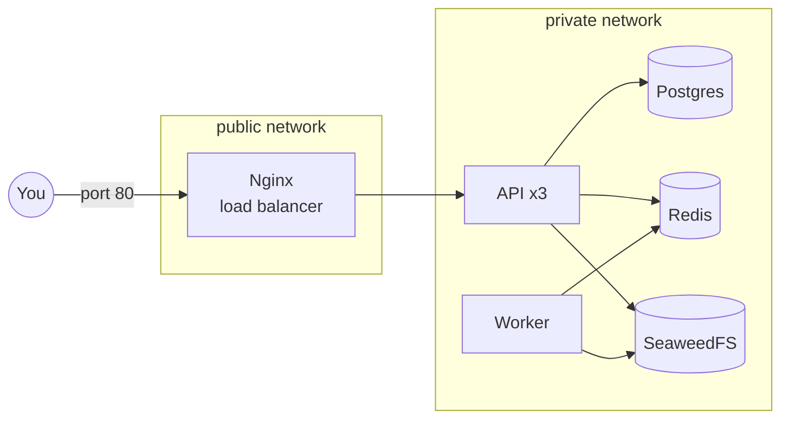

# Lab 00 — Setup: tools, Docker basics, how the course works

> **AWS equivalent:** none (preparation)  ·  **Time:** ~45 min  ·  **Difficulty:** ★☆☆
> **Builds on:** nothing  ·  **Reference solution:** commits `6c666e5` (step 0), `011f2f4`…`833afe7` (step 1) on `dev`

## 1. What you will learn
- Why we rebuild an AWS architecture locally, and what a local copy can and cannot teach.
- Which tools you need, and how to check that they are installed (with the versions this course was built with).
- The five Docker words used everywhere in the course: image, container, volume, network, Compose.
- How this repository is organised, and how to drive it with `make` from PowerShell or Git Bash.
- How to capture screenshots of web pages reproducibly, without installing a browser tool on your machine.

## 2. Theory

### 2.1 The concept
A web application in production is rarely "one server". It is a set of **separate parts** with one job
each: something that receives traffic and spreads it out, several copies of the app, a database, a cache,
a place for files, a queue for slow work, and tools to watch all of it. Learning that layout is much
easier when you can start it, break it, and look inside — for free and without fear of a bill.

### 2.2 How AWS does it
AWS offers a managed service for each part (ALB, EC2/ECS/EKS, RDS, ElastiCache, S3, SQS, CloudWatch…),
all connected inside a **VPC**. You will meet them one by one in the labs; the
[glossary](../glossary.md) lists them all.

### 2.3 How we reproduce it locally
Each AWS service has an open-source stand-in that speaks the same protocol, running in Docker:

| Concept | AWS | This course |
|---|---|---|
| Load balancer | ALB | Nginx |
| App servers | ECS / EKS | Docker Compose, then k3d |
| Database | RDS | PostgreSQL container |
| Cache | ElastiCache | Redis container |
| Object storage | S3 | SeaweedFS (S3-compatible; MinIO no longer ships images) |
| Monitoring | CloudWatch | Prometheus, Grafana, Loki |
| Infrastructure as Code | CloudFormation | Terraform + a local AWS emulator |

### 2.4 Diagram
The target architecture of Phase 1 (built step by step in labs 01–10):



### 2.5 Docker and Make in five minutes
| Word | What it is | Everyday analogy |
|---|---|---|
| **Image** | A read-only package: an app plus everything it needs. Built from a `Dockerfile`. | A recipe card plus the pre-measured ingredients |
| **Container** | A running instance of an image, isolated from the rest of the machine. Starts in a second, throw-away by default. | One dish cooked from the recipe |
| **Volume** | Storage that survives when a container is deleted. Databases keep their files here. | A lunch box you keep when the dish is eaten |
| **Network** | A virtual network; containers on the same network reach each other by *name*. | A private phone line between kitchens |
| **Compose** | One YAML file (`docker-compose.yml`) describing many containers; `docker compose up` starts them all. | The menu for the whole dinner |

A container is not a virtual machine (EC2): it shares the host's kernel, so it is much lighter. AWS runs
containers with ECS or EKS; images are stored in ECR.

**Make** is a tool that runs named recipes from a `Makefile`. We use it so that you type `make up` instead of
remembering a long command. It is only a shortcut: `make down` prints the `docker compose` command it runs,
and you can always type that command yourself.

## 3. Prerequisites
- Windows 11 (or macOS/Linux — commands are given for a Bash shell), Docker Desktop running.
- The tools below. Versions are those this course was built and tested with (Windows 11, Nov 2026); newer
  ones usually work. Docker images used later in the course are pinned separately.

| Tool | Version tested | Needed from | Install (Windows) |
|---|---|---|---|
| Git (includes Git Bash) | 2.48.1 | now | https://git-scm.com/download/win |
| Docker Desktop (Docker Engine + Compose) | 29.2.1 + Compose v5.0.2 | now | https://www.docker.com/products/docker-desktop/ |
| GNU Make | 4.4.1 | now | `winget install --id ezwinports.make -e` |
| kubectl (comes with Docker Desktop) | v1.34.1 | Lab 11 | — |
| Python (only for local experiments) | 3.12.10 | optional | https://www.python.org/downloads/ |
| k3d | — | Lab 11 | installed in Lab 11 |
| Terraform | — | Lab 13 | installed in Lab 13 |

After `winget install`, **open a new terminal**: the old one does not see the new `PATH`.

## 4. Steps

> Try each step yourself first, then compare with the reference commit.

### Step 0 — The screenshot tool
**Why:** web UIs (the frontend, Grafana, the MinIO console…) are documented with screenshots. A script run in
a pinned Docker image makes them reproducible and keeps your machine clean. Terminal results are never
screenshots: they are pasted as text.

**Do it:** create `scripts/screenshot.sh` (make it executable) with this content:

```bash
#!/usr/bin/env bash
# Capture a PNG of a web page, using Playwright (Chromium) in a pinned Docker image.
# Nothing is installed on the host except Docker.
#
# Usage:  scripts/screenshot.sh <url> <out.png> [extra-wait-ms]
#   e.g.  scripts/screenshot.sh http://grafana.localhost/ docs/labs/images/lab-09/grafana.png 2000
#
# Pages served by the load balancer use names like grafana.localhost. Inside the container
# "localhost" is the container itself, so for every *.localhost host we add
# `--add-host <name>:host-gateway` (= the Docker host, where the LB listens on port 80/443).
# Chromium treats *.localhost as loopback by itself, so the browser is also told to use the
# address from /etc/hosts (--host-resolver-rules).
#
# Never screenshot secrets (passwords, tokens). Log in with throw-away values only.
set -euo pipefail

PLAYWRIGHT_VERSION="1.65.2"
IMAGE="mcr.microsoft.com/playwright/python:v$PLAYWRIGHT_VERSION-noble"
WIDTH=1280
HEIGHT=800

if [ $# -lt 2 ]; then
  echo "usage: $0 <url> <out.png> [extra-wait-ms]" >&2
  exit 1
fi
url="$1"
out="$2"
wait_ms="${3:-500}"

# Host part of the URL (strip scheme, path and port).
host="${url#*://}"
host="${host%%[/:?#]*}"

# Docker needs absolute host paths; Git Bash must not rewrite the container paths (/out, /dev/stdin).
export MSYS_NO_PATHCONV=1
mkdir -p "$(dirname "$out")"
out_dir="$(cd "$(dirname "$out")" && { pwd -W 2>/dev/null || pwd; })"
out_name="$(basename "$out")"

docker_args=(run --rm -i -v "$out_dir:/out" -e "SHOT_HOST=$host")
case "$host" in
  *.localhost) docker_args+=(--add-host "$host:host-gateway") ;;
  localhost | 127.0.0.1)
    # Plain localhost would be the container itself: reach the Docker host instead.
    url="${url/$host/host.docker.internal}"
    docker_args+=(--add-host "host.docker.internal:host-gateway")
    ;;
esac

# The image contains the browsers but not the Python package: install the matching pinned version
# inside the throw-away container (a small wheel; the browsers are not downloaded again).
docker "${docker_args[@]}" "$IMAGE" sh -c '
  pip install -q --disable-pip-version-check --root-user-action=ignore --break-system-packages "playwright==$0" >/dev/null &&
  python - "$@"' "$PLAYWRIGHT_VERSION" "$url" "/out/$out_name" "$WIDTH" "$HEIGHT" "$wait_ms" <<'PY'
import os, socket, sys
from playwright.sync_api import sync_playwright

url, out, width, height, wait_ms = sys.argv[1], sys.argv[2], int(sys.argv[3]), int(sys.argv[4]), int(sys.argv[5])
host = os.environ.get("SHOT_HOST", "")

args = []
if host.endswith(".localhost"):
    args.append(f"--host-resolver-rules=MAP {host} {socket.gethostbyname(host)}")

with sync_playwright() as p:
    browser = p.chromium.launch(args=args)
    # Local mkcert certificates are not trusted inside the container.
    page = browser.new_page(viewport={"width": width, "height": height}, ignore_https_errors=True)
    page.goto(url, wait_until="networkidle", timeout=30000)
    page.wait_for_timeout(wait_ms)
    page.screenshot(path=out, full_page=True)
    browser.close()
print(f"saved {out}")
PY
echo "screenshot written to $out"
```

To test it, serve any page from your machine and capture it (the first run downloads the image, 3.61 GB on disk):

```bash
mkdir /tmp/site && echo '<h1>screenshot.sh test page</h1>' > /tmp/site/index.html
(cd /tmp/site && python -m http.server 8099 --bind 0.0.0.0) &
scripts/screenshot.sh http://demo.localhost:8099/ /tmp/out/demo.png
```

Then check the result, and try plain `localhost` too:

```bash
scripts/screenshot.sh http://localhost:8099/ /tmp/out/demo-plain.png
file /tmp/out/demo.png /tmp/out/demo-plain.png
```

**Expected result:**
```text
saved /out/demo.png
screenshot written to /tmp/out/demo.png
saved /out/demo-plain.png
screenshot written to /tmp/out/demo-plain.png
/tmp/out/demo.png:       PNG image data, 1280 x 800, 8-bit/color RGB, non-interlaced
/tmp/out/demo-plain.png: PNG image data, 1280 x 800, 8-bit/color RGB, non-interlaced
```
Both PNGs are 1280 × 800 pixels (about 10 KB for this tiny page). Open one to confirm it shows the test
heading and nothing else.

**What just happened:**
- The script starts a throw-away container from the pinned Playwright image, mounts the output folder at `/out`,
  and removes the container when done (`--rm`).
- A `*.localhost` name resolves to *your* machine inside Chrome, which would be the container itself. So the
  script maps the name to `host-gateway` (the Docker host) with `--add-host`, **and** tells Chromium to use
  that address with `--host-resolver-rules`. We tested `--add-host` alone: Chromium ignores `/etc/hosts` for
  `*.localhost` and fails (see Troubleshooting).
- Plain `localhost` and `127.0.0.1` are rewritten to `host.docker.internal` for the same reason.
- Later labs use this to capture pages served by the load balancer (for example `grafana.localhost`).

### Step 1 — Check the tools and create the repo skeleton
**Why:** every later lab assumes the same folders and the same three commands (`make up`, `make down`,
`make test`). We create that frame once, empty, so each lab only has to fill in its own folder.

**Do it (1/3) — check the tools** (PowerShell or Git Bash):

```bash
git --version
docker --version
docker compose version
make --version
docker info --format '{{.ServerVersion}}'
docker run --rm hello-world:linux
```

**Expected result** (trimmed; versions as in the table above):
```text
git version 2.48.1.windows.1
Docker version 29.2.1, build a5c7197
Docker Compose version v5.0.2
GNU Make 4.4.1
29.2.1
...
Hello from Docker!
This message shows that your installation appears to be working correctly.
```
`docker info` is the real test: it talks to the Docker engine, so it fails if Docker Desktop is not running
(`docker --version` does not). `hello-world` pulls a tiny image, starts a container from it, prints a message
and removes the container (`--rm`). We use the pinned tag `linux`, never `latest`: pinning means you get the
same image tomorrow as today.

**Do it (2/3) — create the skeleton** from the repository root. The reference commit is `011f2f4`:

```bash
mkdir api worker frontend lb monitoring tests k8s terraform
touch api/.gitkeep worker/.gitkeep frontend/.gitkeep lb/.gitkeep monitoring/.gitkeep \
      tests/.gitkeep k8s/.gitkeep terraform/.gitkeep
```
Git does not store empty folders; the empty `.gitkeep` file is a convention that makes Git keep them.

What each folder is for:

| Folder | Content | Lab |
|---|---|---|
| `api/` | the FastAPI application and its `Dockerfile` | 01 |
| `worker/` | the background worker that processes jobs | 07 |
| `frontend/` | static HTML/JS served by its own Nginx | 08 |
| `lb/` | the Nginx load balancer configuration | 02 |
| `monitoring/` | Prometheus, Grafana, Loki configuration | 09 |
| `tests/` | `NN_*.sh` test scripts run by `make test`, and the k6 load test | all |
| `k8s/` | Kubernetes manifests | 11 |
| `terraform/` | Terraform files | 13 |
| `docs/` | this course; `scripts/` holds helper scripts such as `screenshot.sh` | — |

`.env.example` (the template for your local, git-ignored `.env`; fake values only):

```bash
# Copy to .env (gitignored) and adjust: cp .env.example .env
# Only fake / local values here. Never put real credentials in this project.

# Prefix for container, network and volume names
COMPOSE_PROJECT_NAME=aws-local-lab
```

`docker-compose.yml` (empty for now; services are added lab by lab):

```yaml
# Services are added lab by lab (first one: `api`, Lab 01 step 3).
name: aws-local-lab
services: {}
```

`Makefile` (recipe lines must start with a **tab**, not spaces):

```make
# AWS local lab - entry points. Run `make help` to list the targets.
#
# Recipes always run in Git Bash, so they behave the same whether `make` is started from
# PowerShell, cmd or Git Bash. Adjust the path if Git is installed elsewhere. (GNU Make 4.4.1
# from winget accepts the space in "Program Files"; tested from PowerShell and Git Bash.)
ifeq ($(OS),Windows_NT)
SHELL := C:/Program Files/Git/bin/bash.exe
else
SHELL := /bin/bash
endif
.SHELLFLAGS := -eu -o pipefail -c

COMPOSE := docker compose

.DEFAULT_GOAL := help
.PHONY: help up down logs clean test load-test

help: ## List the available targets
	@grep -E '^[a-z-]+:.*## ' $(MAKEFILE_LIST) | awk -F ':.*## ' '{printf "  make %-10s %s\n", $$1, $$2}'

up: ## Build and start the lab in the background
	@if [ -z "$$($(COMPOSE) config --services)" ]; then \
	  echo "no services defined yet in docker-compose.yml - nothing to start"; \
	else \
	  $(COMPOSE) up -d --build --remove-orphans; \
	fi

down: ## Stop the lab (data volumes are kept)
	$(COMPOSE) down --remove-orphans

logs: ## Follow the logs of all services
	$(COMPOSE) logs -f --tail=100

clean: ## Stop the lab AND delete its data volumes (asks first)
	@read -r -p "This deletes ALL lab data (databases, buckets). Type 'yes' to continue: " answer; \
	  [ "$$answer" = "yes" ] || { echo "aborted"; exit 1; }
	$(COMPOSE) down -v --remove-orphans

test: ## Run all tests in tests/ (not implemented yet, see PLAN.md step 7)
	@echo "make test: not implemented yet" >&2; exit 1

load-test: ## Run the k6 load test (not implemented yet, see PLAN.md step 37)
	@echo "make load-test: not implemented yet" >&2; exit 1
```

How the Makefile works:
- `SHELL := …bash.exe` makes every recipe run in Git Bash, whatever terminal you started `make` from. Without
  it, Make on Windows may pick `cmd.exe`, where `$(...)`, `[ … ]` and `read` do not exist.
- `help` lists every target that has a `## description` comment, so the list can never go out of date.
- `up` first asks Compose for the list of services. With none, `docker compose up` would fail with
  `no service selected`, so we print a message instead. This check stays harmless once services exist.
- `down` stops and removes containers and networks but **keeps volumes**: your data survives.
- `clean` is the only target that deletes data (`down -v` removes volumes), so it asks you to type `yes`.
- `test` and `load-test` are stubs that **fail on purpose**, so nobody mistakes "nothing to run" for "all green".
  They become real in Lab 02 (step 7) and Lab 10 (step 37).

**Do it (3/3) — run make.** It works the same from PowerShell and from Git Bash, as long as you are in the
repository root:

```bash
make help
make up
make down
make test
```

**Expected result:**
```text
  make help       List the available targets
  make up         Build and start the lab in the background
  make down       Stop the lab (data volumes are kept)
  make logs       Follow the logs of all services
  make clean      Stop the lab AND delete its data volumes (asks first)
  make test       Run all tests in tests/ (not implemented yet, see PLAN.md step 7)
  make load-test  Run the k6 load test (not implemented yet, see PLAN.md step 37)

no services defined yet in docker-compose.yml - nothing to start

docker compose down --remove-orphans
time="2026-11-14T19:28:27Z" level=warning msg="Warning: No resource found to remove for project \"aws-local-lab\"."

make test: not implemented yet
make: *** [Makefile:40: test] Error 1
```
(`make help`, `make up`, `make down` print the first three blocks and exit with code 0; `make test` exits
non-zero by design.)

`make clean` asks before it deletes anything. Answer anything but `yes` and nothing happens:

```text
$ echo no | make clean
aborted
make: *** [Makefile:35: clean] Error 1
```

**What just happened:** Make read the `Makefile`, picked the target you named, and ran its recipe in Git Bash.
Nothing runs yet because `docker-compose.yml` has no services; the skeleton only proves the tools and the
commands work. From Lab 01 on, `make up` will start real containers.

## 5. Verify it works
```bash
make help          # lists 7 targets, exit code 0
make up            # "no services defined yet …", exit code 0
make down          # exit code 0
make test          # fails with "not implemented yet" (expected until Lab 02)
```

> **Changed in Lab 02, step 7.** `make test` is now real: it runs the scripts in `tests/`. The "not implemented yet"
> output on this page is what it printed at the end of Lab 00.
From both PowerShell and Git Bash. `git status` should show only the files of this lab.

## 6. Troubleshooting
| Symptom | Likely cause | Fix |
|---|---|---|
| `failed to connect to the docker API at npipe:////./pipe/dockerDesktopLinuxEngine … The system cannot find the file specified` | Docker Desktop is not running. `docker --version` works without it, which is misleading. | Start Docker Desktop, wait for "Engine running", check with `docker info`. |
| `no service selected` from `docker compose up` | `docker-compose.yml` has `services: {}`: nothing to start. | Handled in the Makefile (`up` checks `docker compose config --services` first). Disappears once Lab 01 adds the `api` service. |
| `make test` / `make load-test` print "not implemented yet" and fail | Intended: they are stubs until Lab 02 (step 7) and Lab 10 (step 37). | Nothing to fix. |
| `Invoke-WebRequest : Missing an argument for parameter 'SessionVariable'` (or another odd error) when running a `curl …` command from the labs in PowerShell | In Windows PowerShell, `curl` is an alias of `Invoke-WebRequest`, not the real curl. The labs' commands are written for Bash. | Use Git Bash for the labs' commands, or type `curl.exe` instead of `curl` in PowerShell (and `NUL` instead of `/dev/null`). `make` works the same in both shells. |
| `ModuleNotFoundError: No module named 'playwright'` | The `mcr.microsoft.com/playwright/python` image contains the browsers but not the Python package. | Install the package pinned to the same version inside the container (already done in the script). |
| `net::ERR_CONNECTION_REFUSED at http://demo.localhost:8099/` | Chromium resolves `*.localhost` to the container's own loopback and ignores `--add-host`. | Also pass `--host-resolver-rules="MAP <name> <ip>"` (already done in the script). |

## 7. Going to real AWS
- **What changes:** nothing in this lab maps to a billable resource. You would, however, create an AWS account,
  an IAM user with least-privilege permissions (never use the root user), and a budget alert *before* creating
  anything.
- **What this lab does not simulate:** accounts, regions, IAM and billing. The whole course runs with fake
  credentials against local containers.
- **Rough cost:** none. Docker Desktop is free for personal and small-business use; see the
  [Docker pricing page](https://www.docker.com/pricing/) for the current terms.

## 8. Clean up
Nothing from step 1 keeps running. `make down` is always safe (it keeps data). To remove the test page
server from step 0:

```bash
# stop the test web server started in step 0 (it ran in the background of your shell)
kill %1
```

To remove the small test image pulled in step 1: `docker rmi hello-world:linux`.

## 9. Check your understanding
1. What is the difference between an image and a container?
2. Why does `make down` keep your data, and which command would delete it?
3. Why do the `test` and `load-test` targets fail on purpose for now?
4. Why do we write `hello-world:linux` and not just `hello-world`?

<details><summary>Answers</summary>

1. An image is a read-only package (app + dependencies); a container is a running, isolated instance started
   from it. You can start many containers from one image.
2. Data lives in volumes, and `docker compose down` does not remove volumes. `docker compose down -v`
   (`make clean`, which asks for confirmation) removes them.
3. A stub that printed "OK" would look like a passing test suite. Failing loudly means "nothing is verified
   yet" can never be mistaken for "everything works".
4. Without a tag Docker uses `latest`, which changes over time. A pinned tag gives the same image every time.
   The course never uses `latest`.

</details>

## 10. Exercises (optional)
- Add a target `ps` to the `Makefile` that runs `docker compose ps`, give it a `## description`, and check that
  `make help` lists it.
- Run `make up` from a different folder with `make -C <path-to-repo> up` and note what changes.

## 11. Further reading
- [Docker overview](https://docs.docker.com/get-started/docker-overview/) and
  [Docker Compose overview](https://docs.docker.com/compose/)
- [GNU Make manual](https://www.gnu.org/software/make/manual/make.html)
- [What is AWS?](https://aws.amazon.com/what-is-aws/) and
  [Amazon VPC: how it works](https://docs.aws.amazon.com/vpc/latest/userguide/how-it-works.html)

## Go deeper
- Course: [Docker 02 - Docker Desktop on Windows (WSL2)](../courses/docker/02-docker-desktop-wsl2.md)
