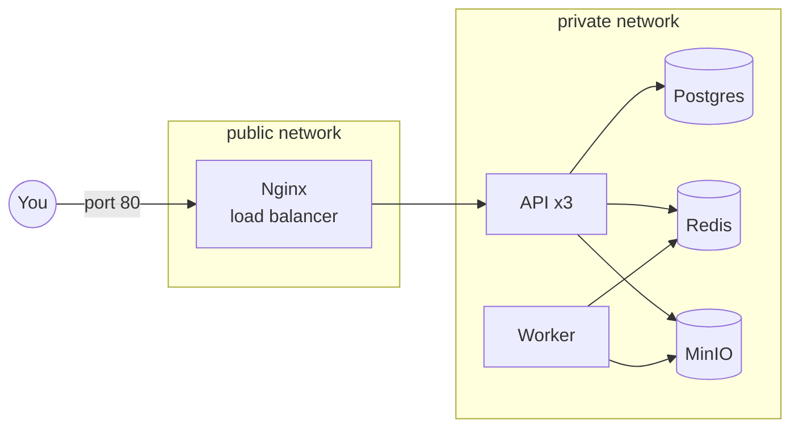

# Lab 00 — Setup: tools, Docker basics, how the course works

> **AWS equivalent:** none (preparation)  ·  **Time:** ~45 min  ·  **Difficulty:** ★☆☆
> **Builds on:** nothing  ·  **Reference solution:** commit `6c666e5` (step 0) on `dev`
>
> 🚧 **Work in progress.** Step 0 is written. The tool list, repo skeleton and "how to run make" are added
> in step 1.

## 1. What you will learn
- Why we rebuild an AWS architecture locally, and what a local copy can and cannot teach.
- How this repository and this course are organised.
- How to capture screenshots of web pages reproducibly, without installing a browser tool on your machine.

## 2. Theory

### 2.1 The concept
A web application in production is rarely "one server". It is a set of **separate parts** with one job
each: something that receives traffic and spreads it out, several copies of the app, a database, a cache,
a place for files, a queue for slow work, and tools to watch all of it. Learning that layout is much
easier when you can start it, break it, and look inside — for free and without fear of a bill.

### 2.2 How AWS does it
AWS offers a managed service for each part (ALB, EC2/ECS/EKS, RDS, ElastiCache, S3, SQS, CloudWatch…),
all connected inside a **VPC**. You will meet them one by one in the labs; the
[glossary](../glossary.md) lists them all.

### 2.3 How we reproduce it locally
Each AWS service has an open-source stand-in that speaks the same protocol, running in Docker:

| Concept | AWS | This course |
|---|---|---|
| Load balancer | ALB | Nginx |
| App servers | ECS / EKS | Docker Compose, then k3d |
| Database | RDS | PostgreSQL container |
| Cache | ElastiCache | Redis container |
| Object storage | S3 | MinIO |
| Monitoring | CloudWatch | Prometheus, Grafana, Loki |
| Infrastructure as Code | CloudFormation | Terraform + a local AWS emulator |

### 2.4 Diagram
The target architecture of Phase 1 (built step by step in labs 01–10):



## 3. Prerequisites
- Windows 11 (or macOS/Linux — commands are given for a Bash shell), Docker Desktop running.
- Git.

## 4. Steps

> Try each step yourself first, then compare with the reference commit.

### Step 0 — The screenshot tool
**Why:** web UIs (the frontend, Grafana, the MinIO console…) are documented with screenshots. A script run in
a pinned Docker image makes them reproducible and keeps your machine clean. Terminal results are never
screenshots: they are pasted as text.

**Do it:** create `scripts/screenshot.sh` (make it executable) with this content:

```bash
#!/usr/bin/env bash
# Capture a PNG of a web page, using Playwright (Chromium) in a pinned Docker image.
# Nothing is installed on the host except Docker.
#
# Usage:  scripts/screenshot.sh <url> <out.png> [extra-wait-ms]
#   e.g.  scripts/screenshot.sh http://grafana.localhost/ docs/labs/images/lab-09/grafana.png 2000
#
# Pages served by the load balancer use names like grafana.localhost. Inside the container
# "localhost" is the container itself, so for every *.localhost host we add
# `--add-host <name>:host-gateway` (= the Docker host, where the LB listens on port 80/443).
# Chromium treats *.localhost as loopback by itself, so the browser is also told to use the
# address from /etc/hosts (--host-resolver-rules).
#
# Never screenshot secrets (passwords, tokens). Log in with throw-away values only.
set -euo pipefail

PLAYWRIGHT_VERSION="1.65.2"
IMAGE="mcr.microsoft.com/playwright/python:v$PLAYWRIGHT_VERSION-noble"
WIDTH=1280
HEIGHT=800

if [ $# -lt 2 ]; then
  echo "usage: $0 <url> <out.png> [extra-wait-ms]" >&2
  exit 1
fi
url="$1"
out="$2"
wait_ms="${3:-500}"

# Host part of the URL (strip scheme, path and port).
host="${url#*://}"
host="${host%%[/:?#]*}"

# Docker needs absolute host paths; Git Bash must not rewrite the container paths (/out, /dev/stdin).
export MSYS_NO_PATHCONV=1
mkdir -p "$(dirname "$out")"
out_dir="$(cd "$(dirname "$out")" && { pwd -W 2>/dev/null || pwd; })"
out_name="$(basename "$out")"

docker_args=(run --rm -i -v "$out_dir:/out" -e "SHOT_HOST=$host")
case "$host" in
  *.localhost) docker_args+=(--add-host "$host:host-gateway") ;;
  localhost | 127.0.0.1)
    # Plain localhost would be the container itself: reach the Docker host instead.
    url="${url/$host/host.docker.internal}"
    docker_args+=(--add-host "host.docker.internal:host-gateway")
    ;;
esac

# The image contains the browsers but not the Python package: install the matching pinned version
# inside the throw-away container (a small wheel; the browsers are not downloaded again).
docker "${docker_args[@]}" "$IMAGE" sh -c '
  pip install -q --disable-pip-version-check --root-user-action=ignore --break-system-packages "playwright==$0" >/dev/null &&
  python - "$@"' "$PLAYWRIGHT_VERSION" "$url" "/out/$out_name" "$WIDTH" "$HEIGHT" "$wait_ms" <<'PY'
import os, socket, sys
from playwright.sync_api import sync_playwright

url, out, width, height, wait_ms = sys.argv[1], sys.argv[2], int(sys.argv[3]), int(sys.argv[4]), int(sys.argv[5])
host = os.environ.get("SHOT_HOST", "")

args = []
if host.endswith(".localhost"):
    args.append(f"--host-resolver-rules=MAP {host} {socket.gethostbyname(host)}")

with sync_playwright() as p:
    browser = p.chromium.launch(args=args)
    # Local mkcert certificates are not trusted inside the container.
    page = browser.new_page(viewport={"width": width, "height": height}, ignore_https_errors=True)
    page.goto(url, wait_until="networkidle", timeout=30000)
    page.wait_for_timeout(wait_ms)
    page.screenshot(path=out, full_page=True)
    browser.close()
print(f"saved {out}")
PY
echo "screenshot written to $out"
```

To test it, serve any page from your machine and capture it (the first run downloads the image, 3.61 GB on disk):

```bash
mkdir /tmp/site && echo '<h1>screenshot.sh test page</h1>' > /tmp/site/index.html
(cd /tmp/site && python -m http.server 8099 --bind 0.0.0.0) &
scripts/screenshot.sh http://demo.localhost:8099/ /tmp/out/demo.png
```

**Expected result:** (output of the test run, paths shortened)
```text
saved /out/demo-localhost.png
screenshot written to .../scratchpad/out/demo-localhost.png
```
The PNG is 1280 × 800 pixels and about 15 KB. The same command with `http://localhost:8099/` also works.

**What just happened:**
- The script starts a throw-away container from the pinned Playwright image, mounts the output folder at `/out`,
  and removes the container when done (`--rm`).
- A `*.localhost` name resolves to *your* machine inside Chrome, which would be the container itself. So the
  script maps the name to `host-gateway` (the Docker host) with `--add-host`, **and** tells Chromium to use
  that address with `--host-resolver-rules`. We tested `--add-host` alone: Chromium ignores `/etc/hosts` for
  `*.localhost` and fails (see Troubleshooting).
- Plain `localhost` and `127.0.0.1` are rewritten to `host.docker.internal` for the same reason.
- Later labs use this to capture pages served by the load balancer (for example `grafana.localhost`).

> Steps 1+ (tools, repo skeleton, how to run `make`) are added next.

## 6. Troubleshooting
| Symptom | Likely cause | Fix |
|---|---|---|
| `failed to connect to the docker API at npipe:////./pipe/dockerDesktopLinuxEngine … The system cannot find the file specified` | Docker Desktop is not running. `docker --version` works without it, which is misleading. | Start Docker Desktop, wait for "Engine running", check with `docker info`. |
| `ModuleNotFoundError: No module named 'playwright'` | The `mcr.microsoft.com/playwright/python` image contains the browsers but not the Python package. | Install the package pinned to the same version inside the container (already done in the script). |
| `net::ERR_CONNECTION_REFUSED at http://demo.localhost:8099/` | Chromium resolves `*.localhost` to the container's own loopback and ignores `--add-host`. | Also pass `--host-resolver-rules="MAP <name> <ip>"` (already done in the script). |

## 8. Clean up
```bash
# stop the test web server started above (it ran in the background of your shell)
kill %1
```
