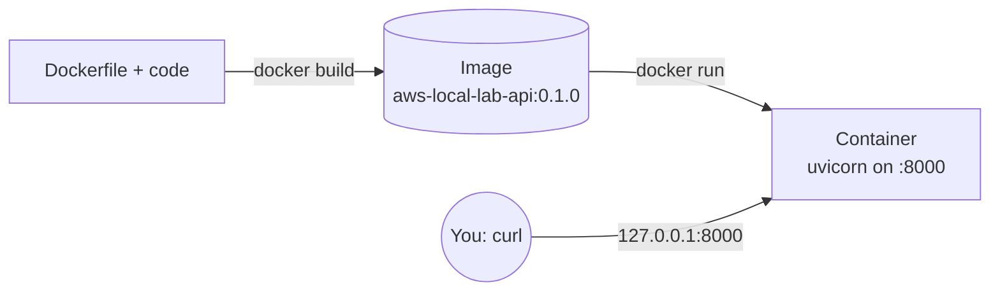

# Lab 01 — Containers and the first API

> **AWS equivalent:** EC2 / ECS / EKS (where containers run), ECR (where images are stored)  ·  **Time:** ~40 min  ·  **Difficulty:** ★☆☆
> **Builds on:** [Lab 00](./00-setup.md)  ·  **Reference solution:** commits `7ae5145` (step 2), `b502370` (step 3) on `dev`

## 1. What you will learn
- Explain the difference between a virtual machine (EC2) and a container, and why an app is "packaged" as an image.
- Write a `Dockerfile` that builds a small web API, with pinned versions and a non-root user.
- Build an image, run a container from it and call it with `curl`.
- Understand why the API answers `/whoami` with a different name in every container (it matters in Lab 02).
- Describe a service in `docker-compose.yml`: image, environment variables, published port, health check.
- Configure a container through environment variables instead of rebuilding the image.

## 2. Theory

### 2.1 The concept
"It works on my machine" is the oldest problem in deployment: the server has a different Python version,
a missing library, a different setting. A **container image** fixes this by packaging the application *and*
everything it needs (runtime, libraries, files) into one immutable unit. Anyone who runs that image gets
exactly the same environment — your laptop, a colleague's, a production server.

A **virtual machine** does this by simulating a whole computer, with its own operating system: heavy
(gigabytes, a minute to boot). A **container** is only an isolated *process*: it shares the host's kernel but
sees its own filesystem, network and process list. It is megabytes in size and starts in about a second.
Because it is so cheap, you can run many identical copies of it (Lab 02), which is how cloud applications
scale.

Three rules make an image trustworthy, and this lab applies all three:
1. **Pin versions.** `python:3.12.16-slim-trixie`, not `python` or `latest`: rebuilding next month gives the
   same result.
2. **Do not run as root.** If the app is compromised, the attacker is an unprivileged user in the container.
3. **Keep it small and cacheable.** Install dependencies in an early layer so Docker re-uses it when only your
   code changes.

### 2.2 How AWS does it
- You write a `Dockerfile` and build an **image**, then push it to **ECR** (Elastic Container Registry), AWS's
  private image store.
- A container is run by **ECS** (AWS's own orchestrator) or **EKS** (managed Kubernetes), on **Fargate**
  (AWS manages the servers) or on **EC2** instances you manage. The unit you configure is a *task definition*
  (ECS) or a *pod* (EKS): which image, how much CPU/RAM, which environment variables.
- Alternatively you run the app directly on an **EC2** virtual machine, which means installing and
  maintaining the runtime yourself.

### 2.3 How we reproduce it locally
| Concept | AWS | This lab |
|---|---|---|
| Image registry | ECR | the local Docker image store (`docker images`) |
| Image build | `docker build` in CI, then push to ECR | `docker build` on your laptop |
| Where containers run | ECS/EKS on Fargate or EC2 | Docker Desktop (step 2), then Docker Compose (step 3) |
| Task definition / pod spec | ECS task definition / Kubernetes pod | `docker run` flags (step 2), `docker-compose.yml` (step 3) |
| Settings | task definition `environment`, Parameter Store / Secrets Manager | `environment:` in Compose, values from `.env` |
| Health check | task definition `healthCheck`, target group check | Compose `healthcheck:` |
| The app | your code | FastAPI (a Python web framework) served by Uvicorn |

### 2.4 Diagram


## 3. Prerequisites
- [Lab 00](./00-setup.md) completed: Docker Desktop running (`docker info` works), `make` installed.

## 4. Steps

> Try each step yourself first, then compare with the reference commit.

### Step 2 — A minimal API in a container
**Why:** before we can balance traffic, store data or scale anything, we need one small service packaged as an
image. It has two routes: `/health` ("are you alive?", used by load balancers in Lab 02) and `/whoami` (which
container answered, used to *see* load balancing work).

**Do it:** create three files in `api/` (the folder exists since Lab 00).

`api/main.py`:
```python
import socket

from fastapi import FastAPI

app = FastAPI(title="aws-local-lab API")


@app.get("/health")
def health():
    """Liveness probe: answers as long as the process is up."""
    return {"status": "ok"}


@app.get("/whoami")
def whoami():
    """Which container answered? Inside Docker the hostname is the container id."""
    return {"hostname": socket.gethostname()}
```

`api/requirements.txt` (both versions pinned exactly):
```text
fastapi==0.163.0
uvicorn==0.54.0
```

`api/Dockerfile`:
```dockerfile
FROM python:3.12.16-slim-trixie

ENV PYTHONDONTWRITEBYTECODE=1 \
    PYTHONUNBUFFERED=1

WORKDIR /app

# Dependencies first: this layer is cached until requirements.txt changes.
COPY requirements.txt .
RUN pip install --no-cache-dir -r requirements.txt

COPY main.py .

# Never run as root inside the container.
RUN useradd --system --uid 10001 --no-create-home app
USER app

EXPOSE 8000
CMD ["uvicorn", "main:app", "--host", "0.0.0.0", "--port", "8000"]
```

Where the version numbers came from (so you can repeat it later when you update them): the newest 3.12 tag
on Docker Hub, and `pip index versions` run inside that very image:
```bash
docker run --rm python:3.12.16-slim-trixie sh -c 'pip index versions fastapi | head -1; pip index versions uvicorn | head -1'
```
```text
fastapi (0.163.0)
uvicorn (0.54.0)
```

Now build the image, run a container from it and call the API:
```bash
docker build -t aws-local-lab-api:0.1.0 api
docker run -d --rm --name lab-api-step2 -p 127.0.0.1:8000:8000 aws-local-lab-api:0.1.0
curl -i http://127.0.0.1:8000/health
curl http://127.0.0.1:8000/whoami
docker exec lab-api-step2 id
docker stop lab-api-step2
```

**Expected result** (trimmed):
```text
#11 naming to docker.io/library/aws-local-lab-api:0.1.0 done
#11 DONE 1.0s

HTTP/1.1 200 OK
{"status":"ok"}

{"hostname":"ef514d1b1543"}

uid=10001(app) gid=999(app) groups=999(app)
```
The container id and the build step numbers on your machine will differ.

**What just happened:**
- `docker build` read the `Dockerfile` top to bottom; each instruction is a **layer**. Because
  `requirements.txt` is copied and installed *before* `main.py`, editing your code does not re-download the
  libraries.
- `-t aws-local-lab-api:0.1.0` names the image and gives it an explicit version tag (never `latest`).
- `docker run -d --rm … -p 127.0.0.1:8000:8000` starts the container in the background, deletes it when it
  stops, and maps port 8000 of the container to port 8000 **of your own machine only** (`127.0.0.1`), so nobody
  on your network can reach it.
- `/whoami` returns `ef514d1b1543`: inside a container the hostname is the container id. In Lab 02, with three
  copies behind a load balancer, this is how you will see the requests being spread.
- `id` shows `uid=10001(app)`: the server does not run as root.
- `--host 0.0.0.0` inside the container means "listen on all the container's interfaces". It looks open, but
  the container has no published port unless you add `-p`, and we restrict that to `127.0.0.1`.
- FastAPI also generates interactive documentation at `/docs` (we saw HTTP 200 for it); we do not use it yet.

### Step 3 — Describe the API as a Compose service
> **Changed in Lab 02, step 4.** The temporary `ports:` mapping and the `API_HOST_PORT` setting shown in
> this step were removed when the load balancer arrived: the API is now only reachable through the load
> balancer (`http://localhost/…`). The commands below are exactly what worked at the end of Lab 01
> (commit `b502370`); to follow them literally, check out that commit.

**Why:** `docker run` with five flags is hard to remember and to share. A Compose file writes the same
decisions down once — which image, which settings, which port, how to tell it is healthy — so that `make up`
reproduces them every time. It is the local equivalent of an ECS *task definition*. Later labs add the
database, cache and the rest as more services in this one file.

**Do it:** replace the contents of `docker-compose.yml` (reference commit `b502370`):

```yaml
name: aws-local-lab

services:
  api:
    build: ./api
    image: aws-local-lab-api:0.1.0
    environment:
      # Uvicorn reads UVICORN_* variables, so the app is configured without changing the image.
      UVICORN_LOG_LEVEL: ${API_LOG_LEVEL:-info}
    ports:
      # TEMPORARY: published on your machine only (127.0.0.1). Lab 02 puts a load balancer in front
      # and removes this mapping.
      - "127.0.0.1:${API_HOST_PORT:-8000}:8000"
    healthcheck:
      # The slim image has no curl: use Python's standard library.
      test: ["CMD", "python", "-c", "import urllib.request; urllib.request.urlopen('http://127.0.0.1:8000/health', timeout=2)"]
      interval: 10s
      timeout: 3s
      retries: 3
      start_period: 5s
```

Add the two new settings to `.env.example` (and, if you want to change them, to your own `.env`):

```bash
# API (Lab 01)
API_HOST_PORT=8000
API_LOG_LEVEL=info
```

Start it, wait for `healthy`, call it:

```bash
make up
docker compose ps
curl http://127.0.0.1:8000/health
curl http://127.0.0.1:8000/whoami
```

**Expected result:**
```text
 Network aws-local-lab_default Created
 Container aws-local-lab-api-1 Created
 Container aws-local-lab-api-1 Started

NAME                  IMAGE                     COMMAND                  SERVICE   CREATED         STATUS                   PORTS
aws-local-lab-api-1   aws-local-lab-api:0.1.0   "uvicorn main:app --…"   api       8 seconds ago   Up 7 seconds (healthy)   127.0.0.1:8000->8000/tcp

{"status":"ok"}
{"hostname":"b1899752e6f6"}
```

Now prove that the settings really come from the environment, without touching the image. A variable set in
your shell takes priority over the default in the Compose file:

```bash
API_LOG_LEVEL=warning API_HOST_PORT=8001 make up
docker compose ps --format 'table {{.Service}}\t{{.Status}}\t{{.Ports}}'
curl http://127.0.0.1:8001/whoami
curl -s -o /dev/null -w '%{http_code}\n' --max-time 3 http://127.0.0.1:8000/health
docker compose logs api --no-log-prefix
make up        # back to the defaults
```
```text
 Container aws-local-lab-api-1 Recreated
SERVICE   STATUS                   PORTS
api       Up 7 seconds (healthy)   127.0.0.1:8001->8000/tcp
{"hostname":"5fee6e2e4a26"}
000
```
`000` is curl's way of saying "no connection": port 8000 is no longer open. The last `docker compose logs`
printed nothing: at level `warning`, Uvicorn no longer writes its INFO lines (start-up message and one line
per request).

**What just happened:**
- `make up` ran `docker compose up -d --build --remove-orphans`: Compose built the image from `./api`,
  created a network `aws-local-lab_default` (an automatic one, shared by every service that does not name a network; [Lab 03](./03-networking.md)
  replaces it with explicit `public` and `private` networks) and started the container
  `aws-local-lab-api-1` (`<project>-<service>-<number>`; the number matters in Lab 02 with replicas).
- `ports: "127.0.0.1:8000:8000"` = *host address : host port : container port*. Without the `127.0.0.1:` prefix
  Docker would publish the port on every network interface of your machine, i.e. to your whole Wi-Fi.
- The **health check** runs a tiny Python command inside the container every 10 s. After 3 failures in a row
  the container is marked `unhealthy`. Compose shows `(healthy)` once the first check succeeds. Docker only
  *reports* health here; in Lab 02 the load balancer uses the same idea to stop sending traffic to a broken
  copy. The image has no `curl`, so the check uses Python's standard library.
- `${API_LOG_LEVEL:-info}` means "the variable `API_LOG_LEVEL` if set (from your shell or from `.env`),
  otherwise `info`". The defaults make the project start even if you never created a `.env`.
- Changing a variable made Compose **recreate** the container (`Recreated`), because its configuration
  changed. The image was not rebuilt — that is the point of configuring through environment variables: the
  same image runs everywhere, only the settings differ (as with an ECS task definition per environment).
- Uvicorn reads any command-line option from a `UVICORN_<OPTION>` variable, which is why `UVICORN_LOG_LEVEL`
  works without a line of code.
- `/whoami` shows a new hostname after each recreate: a new container, a new id.

## 5. Verify it works
> From Lab 02, step 4 on, use `http://localhost/health` and `http://localhost/whoami` (port 80, through the load balancer) instead of port 8000.

```bash
make up
docker compose ps                     # api: Up ... (healthy)
curl -s http://127.0.0.1:8000/health  # {"status":"ok"}
curl -s http://127.0.0.1:8000/whoami  # {"hostname":"<container id>"}
docker compose exec api id            # uid=10001(app): not root
make down
```

## 6. Troubleshooting
No errors were met while building steps 2 and 3. One thing to know: the `curl` commands in this lab are written for Bash. In
Windows PowerShell, `curl` is an alias of `Invoke-WebRequest` and rejects options such as `-s` or `-i`; type `curl.exe`
instead (see the Troubleshooting table in [Lab 00](./00-setup.md#6-troubleshooting)).

## 7. Going to real AWS
- **What changes:** build the image in CI and push it to **ECR**; describe the service as an **ECS task
  definition** (image, CPU/RAM, `environment`, `healthCheck`) run by an ECS **service** on Fargate — or as a
  Kubernetes Deployment on EKS (Lab 11). Secrets would come from Secrets Manager or Parameter Store, not from
  a `.env` file.
- **What this lab does not simulate:** IAM roles for tasks, multiple Availability Zones, image scanning in ECR,
  autoscaling of the service, private networking (Lab 03).
- **Rough cost:** Fargate bills per vCPU-second and GB-second while a task runs (a small always-on task is
  roughly a few USD per month); ECR storage is a few cents per GB-month. See the
  [Fargate pricing](https://aws.amazon.com/fargate/pricing/) and [ECR pricing](https://aws.amazon.com/ecr/pricing/) pages.

## 8. Clean up
```bash
make down                              # stops and removes the container and network, keeps volumes
docker rmi aws-local-lab-api:0.1.0     # optional: also delete the image
```

## 9. Check your understanding
1. Why is a container much lighter than a virtual machine?
2. In the Dockerfile, why is `requirements.txt` copied and installed before `main.py` is copied?
3. What does `127.0.0.1:8000:8000` mean, and what would change without `127.0.0.1:`?
4. Why do we change the log level with an environment variable instead of editing the code?
5. What does the Compose `healthcheck` tell you, and what does it *not* do on its own?

<details><summary>Answers</summary>

1. It shares the host's kernel and only isolates a process (own filesystem, network, process list); a VM
   simulates a whole computer with its own operating system.
2. Docker caches each layer. Dependencies change rarely, code often: with this order, editing `main.py`
   re-uses the cached layer with the installed libraries.
3. host address : host port : container port. Without `127.0.0.1:` the port is published on all interfaces of
   your machine, so other devices on your network could reach the API.
4. The same image can then run in every environment; only the settings change. No rebuild, no code change.
5. It marks the container `healthy` or `unhealthy` by running a command at intervals. By itself Docker only
   reports it (Compose does not restart or reroute anything); a load balancer or orchestrator acts on it (Lab 02).

</details>

## 10. Exercises (optional)
- Run `API_LOG_LEVEL=warning make up`, send a request, and check with `docker compose logs api` that the per-request
  INFO lines are gone. Then run `make up` again without the variable and see them come back.
- Add a `GET /version` route to `api/main.py` that returns the string `0.1.0`, rebuild with `make up`, and
  notice from the build output which Dockerfile layers were cached.

## 11. Further reading
- [Dockerfile reference](https://docs.docker.com/reference/dockerfile/) and
  [Dockerfile best practices](https://docs.docker.com/build/building/best-practices/)
- [Compose file reference](https://docs.docker.com/reference/compose-file/) (`services`, `ports`, `healthcheck`)
- [Amazon ECS task definitions](https://docs.aws.amazon.com/AmazonECS/latest/developerguide/task_definitions.html)
  and [Amazon ECR](https://docs.aws.amazon.com/AmazonECR/latest/userguide/what-is-ecr.html)
- [FastAPI](https://fastapi.tiangolo.com/) and [Uvicorn settings](https://www.uvicorn.org/settings/)

## Go deeper
- Course: [Docker 01 - Images, containers and their lifecycle](../courses/docker/01-images-and-containers.md)
- Course: [Docker 03 - Dockerfile instructions](../courses/docker/03-dockerfile.md)
- Course: [Docker 04 - Layers and the build cache](../courses/docker/04-layers-and-build-cache.md)
- Course: [Docker 05 - Tags, digests and registries](../courses/docker/05-tags-and-registries.md)
- Course: [Docker 06 - Environment variables, config and secrets](../courses/docker/06-config-and-secrets.md)
- Course: [Docker 07 - Docker networks and service-name DNS](../courses/docker/07-networks.md)
- Course: [Docker 09 - Docker Compose](../courses/docker/09-compose.md)
- Course: [Docker 10 - Debugging: logs, exec, inspect](../courses/docker/10-debugging.md)
- Course: [FastAPI 01 - How a Python web API works, and routes](../courses/fastapi/01-how-a-web-api-works.md)
- Course: [FastAPI 02 - Uvicorn and ASGI](../courses/fastapi/02-uvicorn-and-asgi.md)
- Course: [Networking 01 - IP addresses, ports, localhost and TCP](../courses/networking/01-ip-ports-tcp.md)
- Course: [Networking 03 - HTTP requests, responses and status codes](../courses/networking/03-http.md)
- Course: [Networking 05 - NAT and port forwarding](../courses/networking/05-nat-and-port-forwarding.md)
