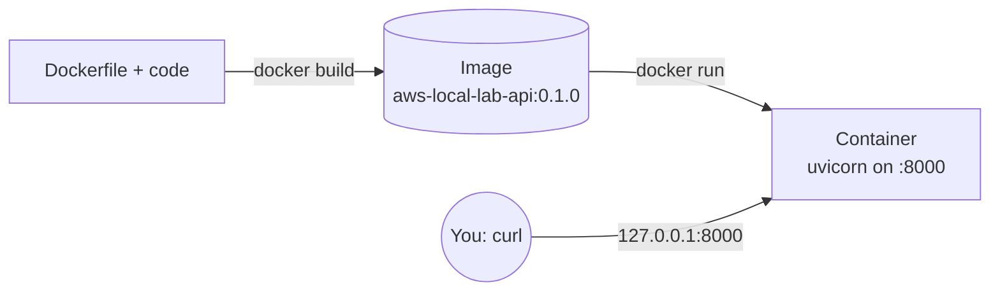

# Lab 01 — Containers and the first API

> **AWS equivalent:** EC2 / ECS / EKS (where containers run), ECR (where images are stored)  ·  **Time:** ~40 min  ·  **Difficulty:** ★☆☆
> **Builds on:** [Lab 00](./00-setup.md)  ·  **Reference solution:** commit `7ae5145` (step 2) on `dev`
>
> 🚧 **Work in progress.** Step 2 is written. Step 3 (the Compose service), verify, quiz and the closing
> sections are added with it.

## 1. What you will learn
- Explain the difference between a virtual machine (EC2) and a container, and why an app is "packaged" as an image.
- Write a `Dockerfile` that builds a small web API, with pinned versions and a non-root user.
- Build an image, run a container from it and call it with `curl`.
- Understand why the API answers `/whoami` with a different name in every container (it matters in Lab 02).

## 2. Theory

### 2.1 The concept
"It works on my machine" is the oldest problem in deployment: the server has a different Python version,
a missing library, a different setting. A **container image** fixes this by packaging the application *and*
everything it needs (runtime, libraries, files) into one immutable unit. Anyone who runs that image gets
exactly the same environment — your laptop, a colleague's, a production server.

A **virtual machine** does this by simulating a whole computer, with its own operating system: heavy
(gigabytes, a minute to boot). A **container** is only an isolated *process*: it shares the host's kernel but
sees its own filesystem, network and process list. It is megabytes in size and starts in about a second.
Because it is so cheap, you can run many identical copies of it (Lab 02), which is how cloud applications
scale.

Three rules make an image trustworthy, and this lab applies all three:
1. **Pin versions.** `python:3.12.16-slim-trixie`, not `python` or `latest`: rebuilding next month gives the
   same result.
2. **Do not run as root.** If the app is compromised, the attacker is an unprivileged user in the container.
3. **Keep it small and cacheable.** Install dependencies in an early layer so Docker re-uses it when only your
   code changes.

### 2.2 How AWS does it
- You write a `Dockerfile` and build an **image**, then push it to **ECR** (Elastic Container Registry), AWS's
  private image store.
- A container is run by **ECS** (AWS's own orchestrator) or **EKS** (managed Kubernetes), on **Fargate**
  (AWS manages the servers) or on **EC2** instances you manage. The unit you configure is a *task definition*
  (ECS) or a *pod* (EKS): which image, how much CPU/RAM, which environment variables.
- Alternatively you run the app directly on an **EC2** virtual machine, which means installing and
  maintaining the runtime yourself.

### 2.3 How we reproduce it locally
| Concept | AWS | This lab |
|---|---|---|
| Image registry | ECR | the local Docker image store (`docker images`) |
| Image build | `docker build` in CI, then push to ECR | `docker build` on your laptop |
| Where containers run | ECS/EKS on Fargate or EC2 | Docker Desktop (step 2), then Docker Compose (step 3) |
| Task definition / pod spec | ECS task definition / Kubernetes pod | `docker run` flags (step 2), `docker-compose.yml` (step 3) |
| The app | your code | FastAPI (a Python web framework) served by Uvicorn |

### 2.4 Diagram


## 3. Prerequisites
- [Lab 00](./00-setup.md) completed: Docker Desktop running (`docker info` works), `make` installed.

## 4. Steps

> Try each step yourself first, then compare with the reference commit.

### Step 2 — A minimal API in a container
**Why:** before we can balance traffic, store data or scale anything, we need one small service packaged as an
image. It has two routes: `/health` ("are you alive?", used by load balancers in Lab 02) and `/whoami` (which
container answered, used to *see* load balancing work).

**Do it:** create three files in `api/` (the folder exists since Lab 00).

`api/main.py`:
```python
import socket

from fastapi import FastAPI

app = FastAPI(title="aws-local-lab API")


@app.get("/health")
def health():
    """Liveness probe: answers as long as the process is up."""
    return {"status": "ok"}


@app.get("/whoami")
def whoami():
    """Which container answered? Inside Docker the hostname is the container id."""
    return {"hostname": socket.gethostname()}
```

`api/requirements.txt` (both versions pinned exactly):
```text
fastapi==0.163.0
uvicorn==0.54.0
```

`api/Dockerfile`:
```dockerfile
FROM python:3.12.16-slim-trixie

ENV PYTHONDONTWRITEBYTECODE=1 \
    PYTHONUNBUFFERED=1

WORKDIR /app

# Dependencies first: this layer is cached until requirements.txt changes.
COPY requirements.txt .
RUN pip install --no-cache-dir -r requirements.txt

COPY main.py .

# Never run as root inside the container.
RUN useradd --system --uid 10001 --no-create-home app
USER app

EXPOSE 8000
CMD ["uvicorn", "main:app", "--host", "0.0.0.0", "--port", "8000"]
```

Where the version numbers came from (so you can repeat it later when you update them): the newest 3.12 tag
on Docker Hub, and `pip index versions` run inside that very image:
```bash
docker run --rm python:3.12.16-slim-trixie sh -c 'pip index versions fastapi | head -1; pip index versions uvicorn | head -1'
```
```text
fastapi (0.163.0)
uvicorn (0.54.0)
```

Now build the image, run a container from it and call the API:
```bash
docker build -t aws-local-lab-api:0.1.0 api
docker run -d --rm --name lab-api-step2 -p 127.0.0.1:8000:8000 aws-local-lab-api:0.1.0
curl -i http://127.0.0.1:8000/health
curl http://127.0.0.1:8000/whoami
docker exec lab-api-step2 id
docker stop lab-api-step2
```

**Expected result** (trimmed):
```text
#11 naming to docker.io/library/aws-local-lab-api:0.1.0 done
#11 DONE 1.0s

HTTP/1.1 200 OK
{"status":"ok"}

{"hostname":"ef514d1b1543"}

uid=10001(app) gid=999(app) groups=999(app)
```
The container id and the build step numbers on your machine will differ.

**What just happened:**
- `docker build` read the `Dockerfile` top to bottom; each instruction is a **layer**. Because
  `requirements.txt` is copied and installed *before* `main.py`, editing your code does not re-download the
  libraries.
- `-t aws-local-lab-api:0.1.0` names the image and gives it an explicit version tag (never `latest`).
- `docker run -d --rm … -p 127.0.0.1:8000:8000` starts the container in the background, deletes it when it
  stops, and maps port 8000 of the container to port 8000 **of your own machine only** (`127.0.0.1`), so nobody
  on your network can reach it.
- `/whoami` returns `ef514d1b1543`: inside a container the hostname is the container id. In Lab 02, with three
  copies behind a load balancer, this is how you will see the requests being spread.
- `id` shows `uid=10001(app)`: the server does not run as root.
- `--host 0.0.0.0` inside the container means "listen on all the container's interfaces". It looks open, but
  the container has no published port unless you add `-p`, and we restrict that to `127.0.0.1`.
- FastAPI also generates interactive documentation at `/docs` (we saw HTTP 200 for it); we do not use it yet.

## 6. Troubleshooting
No errors were met in step 2. Every real error from this lab is added here as it happens.
