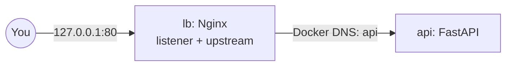

# Lab 02 — Load balancing (ALB)

> **AWS equivalent:** Application Load Balancer (ALB), listeners, target groups  ·  **Time:** ~60 min  ·  **Difficulty:** ★★☆
> **Builds on:** [Lab 01](./01-containers.md)  ·  **Reference solution:** commits `06f598b` (step 4), `23b768a` (step 5), `9c14efe` + `41bb1c7` (step 6), `7af15fa` (step 7) on `dev`

## 1. What you will learn
- Explain what a load balancer does and why a web application puts one in front of its servers.
- Name the parts of an AWS Application Load Balancer (listener, rule, target group, target) and find their
  counterparts in an Nginx configuration.
- Put Nginx in front of the API and make it the only way in.
- Understand why the load balancer must keep re-reading DNS when containers come and go.

## 2. Theory

### 2.1 The concept
So far, one container answers every request, and you talk to it directly. That has three problems:
if it crashes, the site is down; if traffic grows, one process cannot keep up; and clients need to know
exactly where it lives.

A **load balancer** is a receptionist standing in front of the application. Visitors only ever talk to the
receptionist, who hands each request to one of several identical copies of the application behind them. Because
all copies are identical, any of them can answer. This gives you:
- **One stable address** for clients, whatever happens behind it.
- **Spreading of the load** over several copies (Lab 02, step 5).
- **Resilience:** a copy that is broken is skipped (Lab 02, step 6).
- **A single door:** only the load balancer needs to be reachable from outside; everything behind it can stay
  private (Lab 03).

Technically this is a **reverse proxy**: a server that receives requests on behalf of other servers and forwards them.

### 2.2 How AWS does it
An **Application Load Balancer (ALB)** works at the HTTP level and is built from four pieces:

| ALB piece | What it is |
|---|---|
| **Listener** | "Accept HTTP on port 80 (or HTTPS on 443)." |
| **Rule** | "If the path/host looks like X, send it to target group Y." The default rule sends everything to one group. |
| **Target group** | The list of servers (the *targets*: EC2 instances, ECS tasks, IP addresses) that can answer, plus how to check their health. |
| **Health check** | A regular request ("GET /health") to each target; unhealthy targets receive no traffic. |

In the AWS console you find them under **EC2 → Load Balancing → Load Balancers** and **Target Groups**. The ALB gets
a DNS name and lives in the *public* subnets; the targets live in *private* subnets (Lab 03). ECS or EKS register and
deregister targets automatically as tasks start and stop.

### 2.3 How we reproduce it locally
| ALB concept | AWS | This lab |
|---|---|---|
| Load balancer | ALB | the `lb` container running Nginx |
| Listener | port 80 listener | `listen 80;` in the `server` block |
| Rule | default rule → target group | `location / { proxy_pass http://api; }` |
| Target group | list of targets | `upstream api { … }` |
| Targets register themselves | ECS registers each task | Docker DNS: the name `api` resolves to every container of the `api` service |
| Health check | active (the ALB calls `/health`) | step 6; open-source Nginx only does *passive* checks (it notices failures on real requests) |

> **Later change (Lab 06, step 20):** the load balancer gets a second `server` block that routes the host name
> `s3.localhost` to the object store, like an ALB listener rule that matches on the host header. The block described
> here is then marked `listen 80 default_server;` so that every other host name still reaches the API. See
> [Lab 06, step 20](./06-object-storage.md#step-20--a-public-s3-address-s3localhost-through-the-load-balancer).

Docker gives every container on a network a DNS entry, and **Docker's built-in DNS server (`127.0.0.11`)** answers
`api` with the addresses of the running `api` containers. Nginx normally resolves a name only once, when it starts,
and then keeps that address forever. A container that restarts gets a *new* address, so Nginx would keep sending
traffic to a dead one. Since **nginx 1.27.3**, a `server` line in an `upstream` block can carry the parameter
`resolve`, which makes Nginx look the name up again at regular intervals. That is the local stand-in for "ECS
registers and deregisters targets".

### 2.4 Diagram

From step 5 on, the `api` box stands for three identical containers that all answer to the name `api`.

## 3. Prerequisites
- [Lab 01](./01-containers.md) completed: `make up` starts a healthy `api` container.
- Port 80 free on your machine. If something else uses it, set `LB_HOST_PORT=8080` in your `.env` and use
  `http://localhost:8080/…` in the commands below.

## 4. Steps

> Try each step yourself first, then compare with the reference commit.

### Step 4 — Nginx in front of the API
**Why:** the load balancer is the single entry point of the architecture. We start with one API container behind
it, so that when we add replicas (step 5) nothing but a number changes. The API loses its published port: from now on
it can only be reached *through* the load balancer.

**Which Nginx version?** The `resolve` parameter needs nginx **1.27.3 or newer** (it appears in the
[nginx release notes](https://nginx.org/en/CHANGES) under "Changes with nginx 1.27.3": the `server` directive in
the `upstream` block supports `resolve`, and `resolver` can be set inside `upstream`). We pin the current stable line,
`nginx:1.30.6-alpine`, which is newer than that.

**Do it:** create `lb/nginx.conf`:

```nginx
worker_processes auto;
error_log /dev/stderr notice;

events {
    worker_connections 1024;
}

http {
    access_log /dev/stdout;

    # The "target group": every container that answers to the DNS name "api".
    upstream api {
        # Shared memory so all worker processes see the same server list and DNS results.
        zone api 64k;
        # 127.0.0.11 is Docker's built-in DNS. valid=5s: ask again every 5 seconds, ignoring the TTL.
        resolver 127.0.0.11 valid=5s;
        # "resolve" (nginx >= 1.27.3): keep following the IP addresses behind the name "api",
        # so a container that restarts with a new IP is picked up without reloading nginx.
        server api:8000 resolve;
    }

    server {
        listen 80;

        location / {
            proxy_pass http://api;
            proxy_set_header Host              $host;
            proxy_set_header X-Real-IP         $remote_addr;
            proxy_set_header X-Forwarded-For   $proxy_add_x_forwarded_for;
        }
    }
}
```

Replace `docker-compose.yml` with this (the `api` service loses its `ports:`, and a new `lb` service appears):

```yaml
name: aws-local-lab

services:
  api:
    build: ./api
    image: aws-local-lab-api:0.1.0
    environment:
      # Uvicorn reads UVICORN_* variables, so the app is configured without changing the image.
      UVICORN_LOG_LEVEL: ${API_LOG_LEVEL:-info}
    # No published port any more: the API is only reachable through the load balancer.
    healthcheck:
      # The slim image has no curl: use Python's standard library.
      test: ["CMD", "python", "-c", "import urllib.request; urllib.request.urlopen('http://127.0.0.1:8000/health', timeout=2)"]
      interval: 10s
      timeout: 3s
      retries: 3
      start_period: 5s

  lb:
    image: nginx:1.30.6-alpine
    volumes:
      - ./lb/nginx.conf:/etc/nginx/nginx.conf:ro
    ports:
      # The only door into the lab, on your machine only (127.0.0.1).
      - "127.0.0.1:${LB_HOST_PORT:-80}:80"
    depends_on:
      api:
        condition: service_healthy
    healthcheck:
      test: ["CMD", "wget", "-q", "-O", "/dev/null", "http://127.0.0.1/health"]
      interval: 10s
      timeout: 3s
      retries: 3
      start_period: 5s
```

In `.env.example`, replace the old `API_HOST_PORT` setting by the new one:

```bash
# API (Lab 01)
API_LOG_LEVEL=info

# Load balancer (Lab 02): the one published port, on 127.0.0.1 only
LB_HOST_PORT=80
```

Start everything and test it:

```bash
make up
docker compose ps
docker compose exec lb nginx -v
docker compose exec lb nginx -t
curl -i http://localhost/health
curl http://localhost/whoami
curl -s -o /dev/null -w 'http_code=%{http_code}\n' --max-time 3 http://localhost:8000/health
```

**Expected result** (trimmed):
```text
 Container aws-local-lab-api-1 Waiting
 Container aws-local-lab-api-1 Healthy
 Container aws-local-lab-lb-1 Started

NAME                  IMAGE                     COMMAND                  SERVICE   CREATED          STATUS                    PORTS
aws-local-lab-api-1   aws-local-lab-api:0.1.0   "uvicorn main:app --…"   api       12 seconds ago   Up 11 seconds (healthy)   8000/tcp
aws-local-lab-lb-1    nginx:1.30.6-alpine       "/docker-entrypoint.…"   lb        12 seconds ago   Up 6 seconds (healthy)    127.0.0.1:80->80/tcp

nginx version: nginx/1.30.6
nginx: the configuration file /etc/nginx/nginx.conf syntax is ok
nginx: configuration file /etc/nginx/nginx.conf test is successful

HTTP/1.1 200 OK
{"status":"ok"}
{"hostname":"71efbb43a2d7"}
http_code=000
```
The container id and timings on your machine will differ.

**What just happened:**
- The `api` container shows `8000/tcp` **without** a `->` arrow: the port exists inside the container network but is
  not published on your machine. Only `lb` shows `127.0.0.1:80->80/tcp`. That is the only door.
- `curl http://localhost/health` went to Nginx, which forwarded it to `api:8000` and returned the API's answer.
  `/whoami` shows the **API container's** hostname, not Nginx's: the request really was proxied.
- `http_code=000` for port 8000 is curl's way of saying "could not connect": the API is no longer reachable directly.
- `nginx -t` checks the configuration without starting anything. Run it before every reload.
- `zone api 64k` puts the upstream's server list in memory shared by all Nginx worker processes; the `resolve`
  parameter requires it, so that one DNS lookup updates all workers.
- `resolver 127.0.0.11 valid=5s` tells Nginx which DNS server to ask (Docker's) and to ask again every 5 seconds,
  whatever the DNS record's own lifetime says.
- `depends_on … service_healthy` makes Compose start `lb` only after `api` reports healthy, which is why the `make up`
  output says `Waiting` then `Healthy` before `lb` starts.
- Both Nginx and the API log each request on their standard output; compare the two with
  `docker compose logs lb api`. Nginx logs the client address, the API logs Nginx's address (it is the client from the API's point of view).
- The config file is mounted read-only (`:ro`) as `/etc/nginx/nginx.conf`, replacing the image's default. The master
  process runs as root so that it may listen on port 80; the *worker* processes, which handle requests, run as an
  unprivileged user. Check it yourself with `docker compose exec lb ps -o user,pid,args`:

  ```text
  USER     PID   COMMAND
  root         1 nginx: master process nginx -g daemon off;
  nginx       30 nginx: worker process
  nginx       31 nginx: worker process
  ```
  (First lines only: `worker_processes auto` starts one worker per CPU thread, so you will see more.)

### Step 5 — Three API replicas
**Why:** a load balancer with one server behind it only forwards. With three identical copies, a request can be
answered by any of them, and one copy can fail without the site going down (step 6). In AWS this is the *desired count*
of an ECS service, or the size of an Auto Scaling group.

**Do it:** add three lines to the `api` service in `docker-compose.yml` (reference commit `23b768a`):

```yaml
  api:
    build: ./api
    image: aws-local-lab-api:0.1.0
    deploy:
      # Three identical copies. The load balancer finds them all through the DNS name "api".
      replicas: 3
    environment:
      # …unchanged…
```

Start the stack and send 30 requests, counting how many answers came from each hostname (Git Bash):

```bash
make up
docker compose ps
for i in $(seq 1 30); do curl -s http://localhost/whoami; echo; done | sort | uniq -c
```

The same count in PowerShell (remember `curl.exe`, see Troubleshooting):

```powershell
1..30 | ForEach-Object { curl.exe -s http://localhost/whoami } | Group-Object | Select-Object Count, Name
```

**Expected result** (the PowerShell command prints the same counts as a table):
```text
Count Name
----- ----
   10 {"hostname":"6da7385d6575"}
   10 {"hostname":"b94e31d3fb8b"}
   10 {"hostname":"fee0c8303a43"}
```
and for the Git Bash commands:
```text
NAME                  SERVICE   STATUS                   PORTS
aws-local-lab-api-1   api       Up 7 seconds (healthy)   8000/tcp
aws-local-lab-api-2   api       Up 6 seconds (healthy)   8000/tcp
aws-local-lab-api-3   api       Up 6 seconds (healthy)   8000/tcp
aws-local-lab-lb-1    lb        Up 5 minutes (healthy)   127.0.0.1:80->80/tcp

     10 {"hostname":"6da7385d6575"}
     10 {"hostname":"b94e31d3fb8b"}
     10 {"hostname":"fee0c8303a43"}
```
Three different hostnames, ten requests each. Your container ids will differ.

**What just happened:**
- Compose started three containers from the same image, named `<project>-<service>-<number>`. All three are
  reachable on the Docker network under the single DNS name `api`.
- When asked for `api`, Docker's DNS returns **all three addresses**. Because the `server api:8000 resolve` line
  (step 4) makes Nginx turn every address into a server of the upstream, Nginx now has three servers and, by default,
  hands requests out in turn (**round-robin**). That is why every hostname got exactly a third of the requests.
- Look at `aws-local-lab-lb-1`: it says `Up 5 minutes` while the replicas say `Up 7 seconds`. The load balancer had been
  started earlier, when only one `api` container existed, and was **not restarted or reloaded** for this step
  (`docker inspect -f '{{.State.StartedAt}}' aws-local-lab-lb-1` shows its start time, and `docker compose logs lb` has
  no reload or signal line). It found the two new replicas by itself through DNS. Without `resolve`, Nginx would
  have kept sending everything to the single address it saw at start-up.
  What we captured when checking this (your timestamps will differ):
  ```text
  $ docker inspect -f '{{.State.StartedAt}}' aws-local-lab-lb-1
  2026-11-15T13:36:39.983552865Z          # started 6 minutes before the replicas were added
  $ docker compose logs lb --no-log-prefix | grep -E 'notice|warn|error|emerg|signal|reload'
  ... [notice] 1#1: nginx/1.30.6
  ... [notice] 1#1: start worker processes          # all stamped 13:36:40; no "signal" or "reload" line
  ```
- In the `make up` output, Compose printed `Waiting` and then `Healthy` for each of `api-1`, `api-2` and `api-3`: that
  is the `depends_on … service_healthy` rule from step 4, now applied to every replica.

**Try it: scale up and down while the stack runs.** `--scale` overrides `replicas` for one command:

```bash
docker compose up -d --scale api=5 --no-recreate
# wait ~15 s for the new containers to become healthy and for DNS to refresh (the resolver refreshes every 5 s)
for i in $(seq 1 50); do curl -s http://localhost/whoami; echo; done | sort | uniq -c
docker compose up -d --scale api=3 --no-recreate
```
```text
     10 {"hostname":"09cd98baefc7"}
     10 {"hostname":"2ca7b51b9bf6"}
     10 {"hostname":"6da7385d6575"}
      9 {"hostname":"b94e31d3fb8b"}
     11 {"hostname":"fee0c8303a43"}
```
Five hostnames, roughly an equal share each. After scaling back to three and waiting 8 seconds, 30 requests all
returned HTTP 200, and Nginx's log still contained no reload. What happens to requests sent *during* the few seconds
between a container stopping and the next DNS refresh is the subject of step 6 (health checks and failover).

### Step 6 — Health checks and failover
**Why:** replicas only help if the load balancer survives losing one. Before changing anything, we ran an experiment on
the step 5 setup so that you can see the problem first, then the fix.

**Two kinds of health checks, and what each one does here**
| | Who checks | What it decides | In this lab |
|---|---|---|---|
| Container `healthcheck` | Docker runs a command inside the container every 10 s | the status `healthy` / `unhealthy` shown by `docker compose ps`, and `depends_on … service_healthy` | already there since step 3 |
| Load balancer health check | the load balancer, either by calling `/health` regularly (**active**, what an AWS ALB does) or by noticing failed real requests (**passive**, all that open-source Nginx can do) | whether a server still receives traffic | new in this step: passive |

Nginx does not read Docker's health status; it only learns that a server is dead when a real request to it fails.

**The experiment.** From Git Bash, send 120 requests (one every 0.25 s) while a replica is killed after 8 s and started again
after 20 s. `--max-time 5` makes curl give up on any request that takes longer than 5 seconds (code `000`):

```bash
( for i in $(seq 1 120); do curl -s --max-time 5 -o /dev/null -w "%{http_code} %{time_total}\n" http://localhost/whoami; sleep 0.25; done ) > result.txt &
LOOP=$!
sleep 8;  docker kill aws-local-lab-api-2
sleep 12; docker start aws-local-lab-api-2
wait $LOOP
awk '{c[$1]++; if ($2>m) m=$2} END {for (k in c) print c[k], "x HTTP", k; print "slowest:", m, "s"}' result.txt
```

**Before** (the step 5 configuration):
```text
1 x HTTP 000
119 x HTTP 200
slowest: 5.005340 s
```
One request out of 120 hung until curl gave up. Why:
- `docker kill` removes the container, and with it its IP address. Packets sent to that address are not refused, they simply
  vanish, so a connection attempt just **waits**.
- Nginx still has the old address in its list until the next DNS refresh (up to 5 seconds, `valid=5s`).
- Any request handed to that address waits for Nginx's default connect timeout, **60 seconds**.

(Results vary: only requests that happen to be sent to the dead address suffer. In our run it was one.)

**Do it:** in `lb/nginx.conf`, change the `server` line of the upstream and add three directives (with their comments) in the `location` block
(reference commits `9c14efe` and `41bb1c7`):

```nginx
    upstream api {
        zone api 64k;
        resolver 127.0.0.11 valid=5s;
        # Passive health check: after 1 failed attempt, stop using that server for 10 seconds.
        server api:8000 resolve max_fails=1 fail_timeout=10s;
    }

    server {
        listen 80;

        location / {
            proxy_pass http://api;
            # A dead replica's IP does not answer at all: give up on it after 1 second, not 60.
            proxy_connect_timeout 1s;
            # If a server fails, retry the request on the next one (up to 3 servers in total).
            # Once a request has been sent to a server, only requests that are safe to repeat
            # (GET, HEAD, ...) are retried on another one, not a POST.
            proxy_next_upstream error timeout http_502 http_503 http_504;
            proxy_next_upstream_tries 3;
            # (the proxy_set_header lines are unchanged)
        }
    }
```

Apply it **without restarting the load balancer**: test the file, then ask Nginx to reload it:

```bash
docker compose exec lb nginx -t
docker compose exec lb nginx -s reload
docker compose exec lb nginx -T | grep -E 'max_fails|proxy_connect_timeout|proxy_next_upstream'
```
```text
nginx: configuration file /etc/nginx/nginx.conf test is successful
2026/11/15 13:49:50 [notice] 534#534: signal process started
        server api:8000 resolve max_fails=1 fail_timeout=10s;
            proxy_connect_timeout 1s;
            proxy_next_upstream error timeout http_502 http_503 http_504;
            proxy_next_upstream_tries 3;
```
`nginx -T` prints the configuration Nginx is really running, which proves the reload took effect.

**After** (same experiment, run twice):
```text
run 1:  120 x HTTP 200   slowest: 1.217146 s   requests slower than 1 s: 1
        30 requests after the restart:   9 x 6da7385d6575   10 x b94e31d3fb8b   11 x fee0c8303a43
run 2:  120 x HTTP 200   slowest: 1.220056 s   requests slower than 1 s: 1
        30 requests after the restart:  10 x 6da7385d6575   10 x b94e31d3fb8b   10 x fee0c8303a43
```
And in the load balancer's log (`docker compose logs lb`), once per run, trimmed:
```text
[error] 540#540: *522 upstream timed out (110: Operation timed out) while connecting to upstream, client: 172.22.0.1, server: , request: "GET /whoami HTTP/1.1", upstream: "http://1…
```

**What just happened:**
- **No request failed** (120 of 120 returned 200), in both runs.
- The one unlucky request in each run was handed to the dead address, waited `proxy_connect_timeout` (1 s), failed (the log
  line above), and was **retried on another replica** (`proxy_next_upstream`). The client only saw a slower answer
  (about 1.2 s) instead of a timeout.
- `max_fails=1 fail_timeout=10s` then marked that address as failed for 10 seconds, so the following requests skipped it. A
  next DNS refresh (within 5 seconds) no longer returns the address, at which point `resolve` takes it out of the list
  altogether (this follows from the `valid=5s` setting; we did not log that moment).
- After `docker start`, the replica answered again: all three hostnames appear in the 30 requests we sent 12 seconds after
  the restart. The container keeps its id (so its hostname is the same); a restarted container may get a different IP address,
  which is exactly what `resolve` + `valid=5s` handles without any reload.
- `max_fails=1` is strict: because `proxy_next_upstream` counts `http_502`, `http_503` and `http_504` as failures, a single
  such answer from a perfectly healthy replica also takes it out of rotation for 10 seconds. That is fine for a lab with
  three replicas; a busy production setup would tolerate a few more failures (`max_fails=3`, for example) before removing a server.
- **The limits of passive checking:** Nginx must lose a real request to find out; that request pays the connect timeout
  (here about 1.2 s). An AWS ALB checks `/health` on a timer (active), so users normally never hit a dead target. Open-source
  Nginx has no active checks; the retry makes the cost small, not zero.

### Step 7 — Tests for the lab
**Why:** so far we checked each step by hand. A test turns "I looked and it seemed fine" into a command anyone can re-run, and
catches the day a change silently breaks load balancing or failover. Each lab will add its own `tests/NN_*.sh`; `make test`
runs them all.

A good test **can fail**. We prove that below, by breaking the stack on purpose.

**Do it:** create two scripts in `tests/`. They only use `bash`, `curl` and `docker compose`. They find the load balancer's
address with `docker compose port lb 80`, so they follow `LB_HOST_PORT` without reading `.env`.

`tests/02_load_balancing.sh`:
```bash
#!/usr/bin/env bash
# Lab 02 test: the load balancer answers, spreads requests over the 3 API replicas,
# and is the only way in. Needs the stack to be up (make up).
set -u
cd "$(dirname "$0")/.."

fail=0
ok()  { echo "  PASS  $1"; }
bad() { echo "  FAIL  $1"; fail=1; }

# Where the load balancer is published (follows LB_HOST_PORT without reading .env).
addr=$(docker compose port lb 80 2>/dev/null)
if [ -z "$addr" ] || [ "$addr" = ":0" ]; then
  echo "  FAIL  the lb service is not running: start the lab with 'make up' first"
  exit 1
fi
url="http://${addr/0.0.0.0/127.0.0.1}"

echo "Lab 02 - load balancing ($url)"

# 1. The API answers through the load balancer.
body=$(curl -s --max-time 5 "$url/health")
[ "$body" = '{"status":"ok"}' ] && ok "GET /health through the load balancer" || bad "GET /health returned: $body"

# 2. Three API replicas are running.
replicas=$(docker compose ps --status running -q api | wc -l | tr -d ' ')
[ "$replicas" = "3" ] && ok "3 api replicas running" || bad "expected 3 api replicas, found $replicas"

# 3. 30 requests are spread over all 3 replicas (round-robin: about 10 each).
hosts=$(for _ in $(seq 30); do
  { curl -s --max-time 5 "$url/whoami"; echo; } | sed -n 's/.*"hostname":"\([^"]*\)".*/\1/p'
done | sort | uniq -c)
echo "$hosts" | sed 's/^/        /'
distinct=$(echo "$hosts" | grep -c .)
min=$(echo "$hosts" | awk 'NR==1 || $1<m {m=$1} END {print m+0}')
if [ "$distinct" = "3" ] && [ "$min" -ge 5 ]; then
  ok "30 requests reached 3 different replicas (fewest: $min)"
else
  bad "expected 3 replicas with at least 5 requests each, got $distinct replicas (fewest: $min)"
fi

# 4. The API is not published on the host: the load balancer is the only way in.
api_port=$(docker compose port api 8000 2>/dev/null)
if [ -z "$api_port" ] || [ "$api_port" = ":0" ]; then
  ok "api has no published port"
else
  bad "api is published on $api_port"
fi

[ "$fail" = 0 ] && echo "02_load_balancing: all checks passed" || echo "02_load_balancing: FAILED"
exit "$fail"
```

`tests/02_failover.sh`:
```bash
#!/usr/bin/env bash
# Lab 02 test: kill one API replica and no request fails; restart it and it rejoins.
# Needs the stack to be up (make up). The replica is always restarted at the end.
set -u
cd "$(dirname "$0")/.."

fail=0
ok()  { echo "  PASS  $1"; }
bad() { echo "  FAIL  $1"; fail=1; }

addr=$(docker compose port lb 80 2>/dev/null)
if [ -z "$addr" ] || [ "$addr" = ":0" ]; then
  echo "  FAIL  the lb service is not running: start the lab with 'make up' first"
  exit 1
fi
url="http://${addr/0.0.0.0/127.0.0.1}"

# The victim: the first api container, and the hostname it answers with (its container id).
victim=$(docker compose ps --status running -q api | head -n 1)
[ -n "$victim" ] || { echo "  FAIL  no running api container: start the lab with 'make up' first"; exit 1; }
victim_host=$(docker inspect -f '{{.Config.Hostname}}' "$victim")
trap 'docker start "$victim" >/dev/null 2>&1' EXIT

echo "Lab 02 - failover ($url, killing replica $victim_host)"

# Hostnames answered by the load balancer, over n requests (one per line).
hostnames() { for _ in $(seq "$1"); do { curl -s --max-time 5 "$url/whoami"; echo; } | sed -n 's/.*"hostname":"\([^"]*\)".*/\1/p'; done; }

# 0. Before: the victim is in rotation.
hostnames 30 | grep -q "$victim_host" && ok "replica $victim_host answers before the kill" || bad "replica $victim_host never answered before the kill"

# 1. Kill it, then send 60 requests: every one must be a 200.
docker kill "$victim" >/dev/null
codes=$(for _ in $(seq 60); do curl -s -o /dev/null -w '%{http_code}\n' --max-time 5 "$url/whoami"; done | sort | uniq -c)
echo "$codes" | sed 's/^/        /'
nok=$(echo "$codes" | awk '$2==200 {n=$1} END {print n+0}')
[ "$nok" = "60" ] && ok "60 of 60 requests succeeded with one replica dead" || bad "only $nok of 60 requests succeeded with one replica dead"

# 2. Restart it: within 60 seconds it must answer requests again, without touching nginx.
docker start "$victim" >/dev/null
rejoined=no
for _ in $(seq 30); do
  if hostnames 10 | grep -q "$victim_host"; then rejoined=yes; break; fi
  sleep 2
done
[ "$rejoined" = yes ] && ok "replica $victim_host rejoined the rotation" || bad "replica $victim_host did not rejoin within 60 seconds"

[ "$fail" = 0 ] && echo "02_failover: all checks passed" || echo "02_failover: FAILED"
exit "$fail"
```

In the `Makefile`, replace the `test` target (it used to fail on purpose):
```make
test: ## Run all tests in tests/ (the lab must be up: make up)
	@fail=0; for t in tests/*.sh; do echo "== $$t"; bash "$$t" || fail=1; done; exit $$fail
```
Every script runs even if an earlier one fails, and `make test` fails if any of them failed. Then, with the lab up (`make up`):
```bash
make test
```

**Expected result:**
```text
== tests/02_failover.sh
Lab 02 - failover (http://127.0.0.1:80, killing replica b94e31d3fb8b)
  PASS  replica b94e31d3fb8b answers before the kill
             60 200
  PASS  60 of 60 requests succeeded with one replica dead
  PASS  replica b94e31d3fb8b rejoined the rotation
02_failover: all checks passed
== tests/02_load_balancing.sh
Lab 02 - load balancing (http://127.0.0.1:80)
  PASS  GET /health through the load balancer
  PASS  3 api replicas running
             10 6da7385d6575
             10 b94e31d3fb8b
             10 fee0c8303a43
  PASS  30 requests reached 3 different replicas (fewest: 10)
  PASS  api has no published port
02_load_balancing: all checks passed
```
The exit code of `make test` is 0. If a script fails, `make` stops with an error (`Error 1`) and a non-zero exit code. A
run takes about 15 seconds (14 s in our first run).

**What just happened:**
- `02_load_balancing.sh` checks four things: `/health` answers through the load balancer, three replicas are running, 30
  requests reach all three replicas (round-robin gives exactly 10 each; the test only demands at least 5 each so it does not
  break on a harmless reordering), and `api` has no published port (`docker compose port api 8000` prints `:0`).
- `02_failover.sh` picks one replica, checks that it answers, **kills it** (`docker kill`), sends 60 requests (all must be
  200), restarts it and waits until its hostname shows up again. A `trap` restarts the replica even if the test is interrupted.
- The replica's hostname is its container id: that is how the test recognises it in `/whoami` answers.

**Prove the tests can fail.** Two experiments, run once while building (and put back afterwards):

1. Stop one replica (`docker stop`) and run the first script:
```text
Lab 02 - load balancing (http://127.0.0.1:80)
  PASS  GET /health through the load balancer
  FAIL  expected 3 api replicas, found 2
             15 6da7385d6575
             15 fee0c8303a43
  FAIL  expected 3 replicas with at least 5 requests each, got 2 replicas (fewest: 15)
  PASS  api has no published port
02_load_balancing: FAILED
```
2. Delete the `proxy_connect_timeout 1s;` line of `lb/nginx.conf` (back to the 60 s default), reload Nginx
   (`docker compose exec lb nginx -s reload`) and run the failover script:
```text
Lab 02 - failover (http://127.0.0.1:80, killing replica b94e31d3fb8b)
  PASS  replica b94e31d3fb8b answers before the kill
              2 000
             58 200
  FAIL  only 58 of 60 requests succeeded with one replica dead
  PASS  replica b94e31d3fb8b rejoined the rotation
02_failover: FAILED
```
Two requests hung for more than the 5 seconds `curl` was given (`000` is curl's "no HTTP answer"), so the test failed. This is
the same effect as the "before" experiment of step 6, now caught automatically. `git checkout lb/nginx.conf` and a reload put
the real configuration back, and `make test` was green again.

## 5. Verify it works
With the lab up (`make up`):
```bash
make test
```
It must print `all checks passed` for both scripts and exit with code 0. To look by hand as well:
```bash
docker compose ps                      # api x3 and lb, all (healthy)
curl http://localhost/whoami           # run it a few times: the hostname changes
docker compose port api 8000           # prints :0, the API is not published
```
(In PowerShell, write `curl.exe`.)

## 6. Troubleshooting
| Symptom | Likely cause | Fix |
|---|---|---|
| `grep: C:/Program Files/Git/etc/nginx/nginx.conf: No such file or directory` when running `docker compose exec lb grep … /etc/nginx/nginx.conf` | Git Bash on Windows rewrites arguments that look like Unix paths (`/etc/…`) into Windows paths before Docker sees them. | Switch the conversion off for that command: `MSYS_NO_PATHCONV=1 docker compose exec lb grep -c max_fails /etc/nginx/nginx.conf` (or write the path with two slashes: `//etc/nginx/nginx.conf`). Commands without a path argument, like `nginx -T`, are not affected. |
| `Invoke-WebRequest : Missing an argument for parameter 'SessionVariable'` when running `curl -s -o /dev/null -w …` | In Windows PowerShell, `curl` is an alias of `Invoke-WebRequest`, which has different options (`-s` is read as `-SessionVariable`). The commands in this course are written for Bash. | Run them in Git Bash, or in PowerShell call the real program `curl.exe` and write `NUL` instead of `/dev/null`: `curl.exe -s -o NUL -w "%{http_code}`n" --max-time 3 http://localhost:8000/health` (prints `000`, exit code 7: no connection). |
| `FAIL expected 3 replicas with at least 5 requests each, got 1 replicas` and one very long hostname in the output of `02_load_balancing.sh`, while the stack is healthy | A bug in our first version of the test, not in the stack: `/whoami` answers with no trailing newline, so the 30 hostnames were glued together on one line and counted as one. | Add a newline after each answer: `{ curl -s "$url/whoami"; echo; } \| sed …` (already done in the scripts above). |
| `FAIL  only 59 of 60 requests succeeded with one replica dead` from `02_failover.sh`, rarely, while everything else is healthy | Seen once, during [Lab 04, step 10](./04-database.md) (one request out of 60 failed); the later `make test` runs of steps 11 to 14 were all green, so it is intermittent and **the cause is not proven**. A plausible but unmeasured explanation: the very first request that reaches the killed replica fails before Nginx's passive check has marked it down, and the retry (`proxy_next_upstream`) did not rescue it in time. | Run the test again. If it keeps failing, look at `docker compose logs lb` right after a failure (lines like `connect() failed` or `upstream timed out` show which request was lost) and compare with the timeouts of step 6. |

## 7. Going to real AWS
- **What changes:** an Application Load Balancer with a listener on port 80 (and 443 with a certificate from ACM), a **target
  group** of type `instance` or `ip` with a health check on `/health`, and the API replicas registered in it (an ECS service
  does the registration for you). Security groups: one for the ALB (inbound 80/443 from the internet), one for the API
  (inbound 8000 **only from the ALB's security group**). The ALB spans at least two subnets in two availability zones.
- **Health checks:** an ALB checks every target on a timer (defaults: every 30 s, 5 s timeout, 5 successes to be healthy,
  2 failures to be unhealthy) and stops routing to unhealthy ones **before** a user hits them. Our Nginx only reacts to a failed
  real request (passive).
- **What this lab does not simulate:** multiple availability zones, the ALB's own scaling and high availability (Nginx is a
  single container: if it dies, everything is down), TLS termination, sticky sessions, weighted target groups, access logs to S3,
  AWS WAF, and cross-zone behaviour.
- **Rough cost:** an ALB bills per hour plus per "load balancer capacity unit"; an idle one is roughly 16 to 20 USD per
  month, more with traffic (check the [ELB pricing page](https://aws.amazon.com/elasticloadbalancing/pricing/); prices vary by
  region and change). Check what free tier or credits your account has, and delete the ALB after experimenting.

## 8. Clean up
```bash
make down        # stops and removes the containers and the network; nothing else was created
```
`make down` keeps data volumes (there are none yet). The images stay on disk; `docker image ls` lists them.

## 9. Check your understanding
1. In AWS terms, what are the listener, the target group and a target in this lab?
2. Why does `proxy_pass http://api` alone stop working correctly after a replica is restarted, and what do `resolver` and
   `resolve` change?
3. A replica dies. Without `proxy_connect_timeout 1s`, what does one unlucky visitor experience, and why?
4. What is the difference between an active and a passive health check? Which one is Nginx doing here, and which one does an
   ALB do?
5. Why does `tests/02_load_balancing.sh` accept "at least 5 requests per replica" instead of "exactly 10"?

<details><summary>Answers</summary>

1. The listener is the `server { listen 80; }` block, the target group is the `upstream api` block (every container behind
   the DNS name `api`), and a target is one API replica.
2. Plain `proxy_pass` resolves the name once, when Nginx starts, and keeps that IP address. A restarted container may get a new
   address, so Nginx would keep sending traffic to a stale one. `resolver` tells Nginx which DNS server to ask (Docker's
   `127.0.0.11`) and `resolve` makes it ask again regularly (every 5 s with `valid=5s`), so the server list follows the containers.
3. The request is sent to the dead address, which never answers, and waits for the default connect timeout of 60 seconds
   before Nginx tries another replica. With the 1 s timeout the wait is about a second (we measured about 1.2 s).
4. An active check calls a health URL on a timer and removes a failing target before users are affected (ALB). A passive check
   only notices when a real request fails (open-source Nginx, with `max_fails` and `fail_timeout`).
5. The test checks the behaviour that matters (all replicas get traffic) without depending on exact counters; a harmless change
   in how requests are counted should not turn the test red.

</details>

## 10. Exercises (optional)
- Change `replicas: 3` to `4` in `docker-compose.yml` and run `make up`. Run `make test`: which check fails, and why? Fix the
  test so that it reads the expected number of replicas from `docker compose config` instead of the fixed number 3.
- Add a third check to `02_failover.sh`: kill **two** replicas at once. Does every request still succeed? What does
  `proxy_next_upstream_tries 3` have to do with the answer?
- Set `max_fails=3` instead of 1, repeat the kill experiment of step 6, and compare how many requests are slow.

## 11. Further reading
- [How Application Load Balancers work](https://docs.aws.amazon.com/elasticloadbalancing/latest/application/introduction.html) (AWS)
- [Health checks for ALB target groups](https://docs.aws.amazon.com/elasticloadbalancing/latest/application/target-group-health-checks.html) (AWS)
- [`ngx_http_upstream_module`](https://nginx.org/en/docs/http/ngx_http_upstream_module.html): `server`, `zone`, `resolve`,
  `max_fails`, `fail_timeout` (Nginx)
- [`ngx_http_proxy_module`](https://nginx.org/en/docs/http/ngx_http_proxy_module.html): `proxy_connect_timeout`,
  `proxy_next_upstream` (Nginx)
- [Networking in Docker: DNS services](https://docs.docker.com/engine/network/#dns-services) (Docker)

## Go deeper
- Course: [Networking 02 - DNS](../courses/networking/02-dns.md)
- Course: [Networking 04 - Proxies: forward vs reverse](../courses/networking/04-proxies.md)
- Course: [Nginx 01 - What a web server and a reverse proxy are](../courses/nginx/01-web-server-and-reverse-proxy.md)
