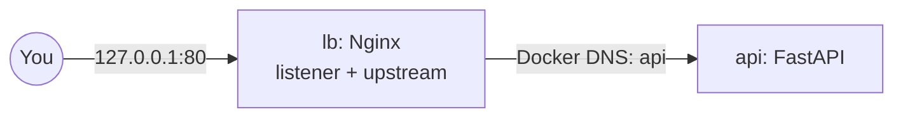

# Lab 02 — Load balancing (ALB)

> **AWS equivalent:** Application Load Balancer (ALB), listeners, target groups  ·  **Time:** ~60 min  ·  **Difficulty:** ★★☆
> **Builds on:** [Lab 01](./01-containers.md)  ·  **Reference solution:** commit `06f598b` (step 4) on `dev`
>
> 🚧 **Work in progress.** Step 4 (the load balancer) is written. Steps 5–7 (replicas, failover, tests) and the
> closing sections (verify, real-AWS mapping, clean-up, quiz) are added as they are built.

## 1. What you will learn
- Explain what a load balancer does and why a web application puts one in front of its servers.
- Name the parts of an AWS Application Load Balancer (listener, rule, target group, target) and find their
  counterparts in an Nginx configuration.
- Put Nginx in front of the API and make it the only way in.
- Understand why the load balancer must keep re-reading DNS when containers come and go.

## 2. Theory

### 2.1 The concept
So far, one container answers every request, and you talk to it directly. That has three problems:
if it crashes, the site is down; if traffic grows, one process cannot keep up; and clients need to know
exactly where it lives.

A **load balancer** is a receptionist standing in front of the application. Visitors only ever talk to the
receptionist, who hands each request to one of several identical copies of the application behind them. Because
all copies are identical, any of them can answer. This gives you:
- **One stable address** for clients, whatever happens behind it.
- **Spreading of the load** over several copies (Lab 02, step 5).
- **Resilience:** a copy that is broken is skipped (Lab 02, step 6).
- **A single door:** only the load balancer needs to be reachable from outside; everything behind it can stay
  private (Lab 03).

Technically this is a **reverse proxy**: a server that receives requests on behalf of other servers and forwards them.

### 2.2 How AWS does it
An **Application Load Balancer (ALB)** works at the HTTP level and is built from four pieces:

| ALB piece | What it is |
|---|---|
| **Listener** | "Accept HTTP on port 80 (or HTTPS on 443)." |
| **Rule** | "If the path/host looks like X, send it to target group Y." The default rule sends everything to one group. |
| **Target group** | The list of servers (the *targets*: EC2 instances, ECS tasks, IP addresses) that can answer, plus how to check their health. |
| **Health check** | A regular request ("GET /health") to each target; unhealthy targets receive no traffic. |

In the AWS console you find them under **EC2 → Load Balancing → Load Balancers** and **Target Groups**. The ALB gets
a DNS name and lives in the *public* subnets; the targets live in *private* subnets (Lab 03). ECS or EKS register and
deregister targets automatically as tasks start and stop.

### 2.3 How we reproduce it locally
| ALB concept | AWS | This lab |
|---|---|---|
| Load balancer | ALB | the `lb` container running Nginx |
| Listener | port 80 listener | `listen 80;` in the `server` block |
| Rule | default rule → target group | `location / { proxy_pass http://api; }` |
| Target group | list of targets | `upstream api { … }` |
| Targets register themselves | ECS registers each task | Docker DNS: the name `api` resolves to every container of the `api` service |
| Health check | active (the ALB calls `/health`) | step 6; open-source Nginx only does *passive* checks (it notices failures on real requests) |

Docker gives every container on a network a DNS entry, and **Docker's built-in DNS server (`127.0.0.11`)** answers
`api` with the addresses of the running `api` containers. Nginx normally resolves a name only once, when it starts,
and then keeps that address forever. A container that restarts gets a *new* address, so Nginx would keep sending
traffic to a dead one. Since **nginx 1.27.3**, a `server` line in an `upstream` block can carry the parameter
`resolve`, which makes Nginx look the name up again at regular intervals. That is the local stand-in for "ECS
registers and deregisters targets".

### 2.4 Diagram

Step 5 turns the single `api` box into three replicas; the diagram does not change otherwise.

## 3. Prerequisites
- [Lab 01](./01-containers.md) completed: `make up` starts a healthy `api` container.
- Port 80 free on your machine. If something else uses it, set `LB_HOST_PORT=8080` in your `.env` and use
  `http://localhost:8080/…` in the commands below.

## 4. Steps

> Try each step yourself first, then compare with the reference commit.

### Step 4 — Nginx in front of the API
**Why:** the load balancer is the single entry point of the architecture. We start with one API container behind
it, so that when we add replicas (step 5) nothing but a number changes. The API loses its published port: from now on
it can only be reached *through* the load balancer.

**Which Nginx version?** The `resolve` parameter needs nginx **1.27.3 or newer** (it appears in the
[nginx release notes](https://nginx.org/en/CHANGES) under "Changes with nginx 1.27.3": the `server` directive in
the `upstream` block supports `resolve`, and `resolver` can be set inside `upstream`). We pin the current stable line,
`nginx:1.30.6-alpine`, which is newer than that.

**Do it:** create `lb/nginx.conf`:

```nginx
worker_processes auto;
error_log /dev/stderr notice;

events {
    worker_connections 1024;
}

http {
    access_log /dev/stdout;

    # The "target group": every container that answers to the DNS name "api".
    upstream api {
        # Shared memory so all worker processes see the same server list and DNS results.
        zone api 64k;
        # 127.0.0.11 is Docker's built-in DNS. valid=5s: ask again every 5 seconds, ignoring the TTL.
        resolver 127.0.0.11 valid=5s;
        # "resolve" (nginx >= 1.27.3): keep following the IP addresses behind the name "api",
        # so a container that restarts with a new IP is picked up without reloading nginx.
        server api:8000 resolve;
    }

    server {
        listen 80;

        location / {
            proxy_pass http://api;
            proxy_set_header Host              $host;
            proxy_set_header X-Real-IP         $remote_addr;
            proxy_set_header X-Forwarded-For   $proxy_add_x_forwarded_for;
        }
    }
}
```

Replace `docker-compose.yml` with this (the `api` service loses its `ports:`, and a new `lb` service appears):

```yaml
name: aws-local-lab

services:
  api:
    build: ./api
    image: aws-local-lab-api:0.1.0
    environment:
      # Uvicorn reads UVICORN_* variables, so the app is configured without changing the image.
      UVICORN_LOG_LEVEL: ${API_LOG_LEVEL:-info}
    # No published port any more: the API is only reachable through the load balancer.
    healthcheck:
      # The slim image has no curl: use Python's standard library.
      test: ["CMD", "python", "-c", "import urllib.request; urllib.request.urlopen('http://127.0.0.1:8000/health', timeout=2)"]
      interval: 10s
      timeout: 3s
      retries: 3
      start_period: 5s

  lb:
    image: nginx:1.30.6-alpine
    volumes:
      - ./lb/nginx.conf:/etc/nginx/nginx.conf:ro
    ports:
      # The only door into the lab, on your machine only (127.0.0.1).
      - "127.0.0.1:${LB_HOST_PORT:-80}:80"
    depends_on:
      api:
        condition: service_healthy
    healthcheck:
      test: ["CMD", "wget", "-q", "-O", "/dev/null", "http://127.0.0.1/health"]
      interval: 10s
      timeout: 3s
      retries: 3
      start_period: 5s
```

In `.env.example`, replace the old `API_HOST_PORT` setting by the new one:

```bash
# API (Lab 01)
API_LOG_LEVEL=info

# Load balancer (Lab 02): the one published port, on 127.0.0.1 only
LB_HOST_PORT=80
```

Start everything and test it:

```bash
make up
docker compose ps
docker compose exec lb nginx -v
docker compose exec lb nginx -t
curl -i http://localhost/health
curl http://localhost/whoami
curl -s -o /dev/null -w 'http_code=%{http_code}\n' --max-time 3 http://localhost:8000/health
```

**Expected result** (trimmed):
```text
 Container aws-local-lab-api-1 Waiting
 Container aws-local-lab-api-1 Healthy
 Container aws-local-lab-lb-1 Started

NAME                  IMAGE                     COMMAND                  SERVICE   CREATED          STATUS                    PORTS
aws-local-lab-api-1   aws-local-lab-api:0.1.0   "uvicorn main:app --…"   api       12 seconds ago   Up 11 seconds (healthy)   8000/tcp
aws-local-lab-lb-1    nginx:1.30.6-alpine       "/docker-entrypoint.…"   lb        12 seconds ago   Up 6 seconds (healthy)    127.0.0.1:80->80/tcp

nginx version: nginx/1.30.6
nginx: the configuration file /etc/nginx/nginx.conf syntax is ok
nginx: configuration file /etc/nginx/nginx.conf test is successful

HTTP/1.1 200 OK
{"status":"ok"}
{"hostname":"71efbb43a2d7"}
http_code=000
```
The container id and timings on your machine will differ.

**What just happened:**
- The `api` container shows `8000/tcp` **without** a `->` arrow: the port exists inside the container network but is
  not published on your machine. Only `lb` shows `127.0.0.1:80->80/tcp`. That is the only door.
- `curl http://localhost/health` went to Nginx, which forwarded it to `api:8000` and returned the API's answer.
  `/whoami` shows the **API container's** hostname, not Nginx's: the request really was proxied.
- `http_code=000` for port 8000 is curl's way of saying "could not connect": the API is no longer reachable directly.
- `nginx -t` checks the configuration without starting anything. Run it before every reload.
- `zone api 64k` puts the upstream's server list in memory shared by all Nginx worker processes; the `resolve`
  parameter requires it, so that one DNS lookup updates all workers.
- `resolver 127.0.0.11 valid=5s` tells Nginx which DNS server to ask (Docker's) and to ask again every 5 seconds,
  whatever the DNS record's own lifetime says.
- `depends_on … service_healthy` makes Compose start `lb` only after `api` reports healthy, which is why the `make up`
  output says `Waiting` then `Healthy` before `lb` starts.
- Both Nginx and the API log each request on their standard output; compare the two with
  `docker compose logs lb api`. Nginx logs the client address, the API logs Nginx's address (it is the client from the API's point of view).
- The config file is mounted read-only (`:ro`) as `/etc/nginx/nginx.conf`, replacing the image's default. The master
  process runs as root so that it may listen on port 80; the *worker* processes, which handle requests, run as an
  unprivileged user. Check it yourself with `docker compose exec lb ps -o user,pid,args`:

  ```text
  USER     PID   COMMAND
  root         1 nginx: master process nginx -g daemon off;
  nginx       30 nginx: worker process
  nginx       31 nginx: worker process
  ```
  (First lines only: `worker_processes auto` starts one worker per CPU thread, so you will see more.)

## 6. Troubleshooting
No errors were met in step 4. Every real error from this lab is added here as it happens.
