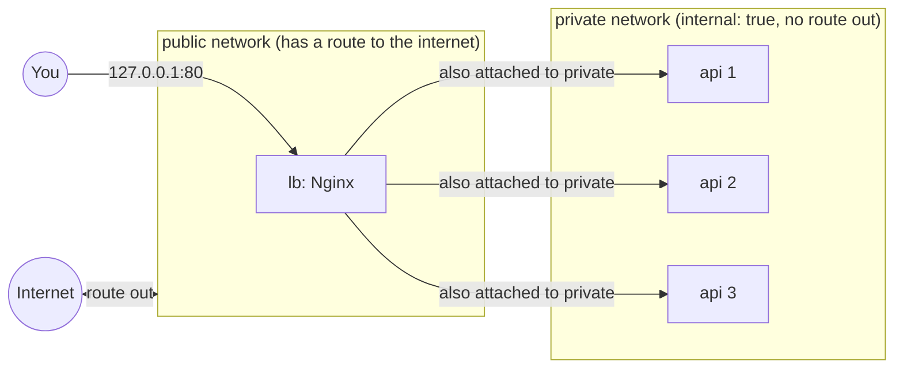

# Lab 03 — Networking (VPC, subnets, security groups)

> **AWS equivalent:** Virtual Private Cloud (VPC), public and private subnets, security groups  ·  **Time:** ~45 min  ·  **Difficulty:** ★★☆
> **Builds on:** [Lab 02](./02-load-balancing.md)  ·  **Reference solution:** commits `ce59529` (step 8) and `4a3d36a` (step 9) on `dev`

## 1. What you will learn
- Explain what a **network**, a **subnet** and a **VPC** are, and why an architecture is split into a *public* and a
  *private* part.
- Say which pieces of an application belong in the public part (almost nothing) and which in the private part (almost everything).
- Build that split with two Docker networks and one load balancer that touches both.
- Prove, with real commands, that a private container cannot reach the internet while the load balancer can.

## 2. Theory

### 2.1 The concept
Until now every container sat on one flat network, like all the rooms of a building opening onto one corridor with
the street door at the end: anyone who gets into the corridor can knock on any door, and any room can walk out to the street.

A real building has **zones**. The lobby is open to visitors. The offices behind the reception desk are only
reachable through the lobby, and the vault has no window at all. If someone breaks into the lobby, the vault is still not
in reach.

Architectures do the same with **networks**:
- A **public** zone holds the only components that visitors must reach (here: the load balancer). It has a route to
  the internet and the internet can reach it.
- A **private** zone holds everything else (the API now, the database, the cache and the queue later). It cannot be
  reached from the internet, and its machines have no direct way out.

This is called *defence in depth*: an attacker has to get through several layers, and a bug in the API does not
automatically expose the database.

### 2.2 How AWS does it
In AWS the zone is a **VPC** (Virtual Private Cloud): your own isolated network inside AWS, described by an address
range such as `10.0.0.0/16`. A VPC is cut into **subnets**, each living in one Availability Zone:

| AWS piece | What it is |
|---|---|
| **VPC** | Your private network in AWS. Nothing gets in or out unless you add a door. |
| **Public subnet** | A subnet whose route table sends internet traffic to an **Internet Gateway** (the door to the internet). Holds the load balancer. |
| **Private subnet** | A subnet with **no** route to the Internet Gateway. Holds servers and databases. |
| **NAT Gateway** | Optional: lets private machines start connections *out* (for updates) without letting anyone start connections *in*. |
| **Security group** | A virtual firewall attached to each resource: "who may connect to me, on which port". Rules can name another security group ("only the load balancer's group may reach port 8000"). |

In the console: **VPC → Your VPCs / Subnets / Route tables / Internet gateways / Security groups**.
The load balancer from Lab 02 is placed in the public subnets, and its targets in the private ones.

### 2.3 How we reproduce it locally
| Concept | AWS | This lab |
|---|---|---|
| VPC | one VPC | the Compose project (`aws-local-lab`) |
| Public subnet | route to an Internet Gateway | Docker network `public` (a normal bridge network) |
| Private subnet | no route out | Docker network `private` with `internal: true` |
| Resource in a subnet | instance / task in a subnet | a service listing the network under `networks:` |
| A resource in two subnets | an ALB spans several subnets | the `lb` service is listed in **both** networks |
| Security group "only the ALB may reach the API" | inbound rule from the ALB's group | the API is on `private` only, so only containers that share `private` can reach it (**step 9** tests it) |

A Docker network is a stand-in for a subnet: it has an address range and a gateway, and only containers attached to it
can talk to each other. `internal: true` removes the gateway to the outside, which is what makes a subnet "private".

**What is not the same:** a security group filters per resource and per port. Docker has nothing like it: inside the
`private` network every container can talk to every other one. We will note this again in "Going to real AWS".

### 2.4 Diagram


## 3. Prerequisites
- [Lab 02](./02-load-balancing.md) completed: `make up` starts the `lb` and three healthy `api` containers, and `make test` is green.

## 4. Steps

> Try each step yourself first, then compare with the reference commit.

### Step 8 — Public and private networks
**Why:** the API must only be reachable through the load balancer, and it must have no way to the internet (a private
subnet). The load balancer is the one component that needs both: a door to the outside and a door to the API.

**First, look at where we start.** Until now Compose put everything on its automatic `default` network, so the API can
reach the internet. This small probe (Python's standard library, because the slim image has no `curl`) tries to download a
page and prints a one-line verdict whether it works or not. Put it in a shell variable, we reuse it below:

```bash
PROBE="
import urllib.request
try:
    r = urllib.request.urlopen('http://example.com', timeout=5)
    print('internet: reachable, HTTP', r.status)
except Exception as e:
    print('internet: NOT reachable ->', type(e).__name__, e)"
docker compose exec -T --index 1 api python -c "$PROBE"
```
```text
internet: reachable, HTTP 200
```
Flags: `exec` runs a command in a running container, `-T` turns off the interactive terminal (needed in scripts),
`--index 1` picks the first of the three `api` replicas.

**Do it.** Edit `docker-compose.yml`: declare the two networks at the bottom of the file, then attach each service to the
network(s) it belongs to. Changed parts:

```yaml
services:
  api:
    # ... (unchanged) ...
    networks:
      # Private subnet: only this network, so no route to the internet and no door to the host.
      - private

  lb:
    # ... (unchanged) ...
    networks:
      # The load balancer has a foot in both: public (the door) and private (to reach the API).
      - public
      - private

networks:
  # Like the public subnets of a VPC: has a route to the internet. Only the load balancer joins it.
  public:
  # Like the private subnets: "internal" means no route out and no published ports.
  private:
    internal: true
```

| Line | What it does | If you change or remove it |
|---|---|---|
| `networks:` at the bottom | Declares the networks of the project. Compose names them `<project>_<name>`: `aws-local-lab_public`, `aws-local-lab_private`. | Without it, the names under each service would be an error ("refers to undefined network"). |
| `public:` (empty) | A normal network with default settings, which includes a gateway to the outside world. | Add `internal: true` and the load balancer could no longer be reached from your browser. |
| `private:` + `internal: true` | A network with **no gateway**: containers on it can talk to each other and to nothing else. | Remove `internal: true` and the API could reach the internet again (try it, then run the check below). |
| `api` → `networks: [private]` | The API joins only the private network. | Add `public` and the API would sit next to the load balancer in the public zone: the isolation is gone. |
| `lb` → `networks: [public, private]` | The load balancer joins both: it receives traffic on `public` and forwards it on `private`. | Remove `private` and Nginx can no longer resolve or reach `api` (502 / "host not found"). |
| `ports:` on `lb` (unchanged) | Publishes port 80 on your machine, only on `127.0.0.1`. | Unchanged: it works because `lb` is on the non-internal `public` network. |

**Apply it:**
```bash
docker compose up -d --remove-orphans
```
Compose notices that the network settings changed and re-creates the containers it must; `--remove-orphans` also removes
containers of services that no longer exist in the file. Wait until all four containers are `healthy`:

```bash
docker compose ps --format 'table {{.Service}}\t{{.Status}}\t{{.Ports}}'
```
```text
SERVICE   STATUS                    PORTS
api       Up 13 seconds (healthy)   8000/tcp
api       Up 14 seconds (healthy)   8000/tcp
api       Up 13 seconds (healthy)   8000/tcp
lb        Up 7 seconds (healthy)    127.0.0.1:80->80/tcp
```

**Check 1 — the networks exist, and `private` is internal:**
```bash
docker network ls --filter name=aws-local-lab --format 'table {{.Name}}\t{{.Driver}}\t{{.Internal}}'
```
```text
NAME                    DRIVER    INTERNAL
aws-local-lab_default   bridge    false
aws-local-lab_private   bridge    true
aws-local-lab_public    bridge    false
```
`DRIVER bridge` is Docker's ordinary single-host network. `INTERNAL true` is the "private subnet" flag.
(`aws-local-lab_default` is the old automatic network. It is now empty and `docker compose down` removes it.)

**Check 2 — who is attached to which network, and the address range ("subnet") of each:**
```bash
for n in public private; do
  echo "$n:"
  docker network inspect aws-local-lab_$n --format '{{range .Containers}}  {{.Name}}  {{.IPv4Address}}{{"\n"}}{{end}}{{range .IPAM.Config}}  subnet {{.Subnet}} gateway {{.Gateway}}{{"\n"}}{{end}}'
done
```
```text
public:
  aws-local-lab-lb-1  172.24.0.2/16
  subnet 172.24.0.0/16 gateway 172.24.0.1

private:
  aws-local-lab-api-1  172.23.0.3/16
  aws-local-lab-lb-1  172.23.0.5/16
  aws-local-lab-api-3  172.23.0.4/16
  aws-local-lab-api-2  172.23.0.2/16
  subnet 172.23.0.0/16 gateway 172.23.0.1
```
`docker network inspect` prints everything Docker knows about a network; `--format` is a Go template that keeps only the
containers and the address range. Read it like an AWS console: `public` contains only the load balancer, `private`
contains the load balancer and the three API replicas. The load balancer has **two addresses**, one per network.
(Your addresses may differ: Docker picks free ranges.)

**Check 3 — the application still works through the load balancer:**
```bash
curl -s -i localhost/health | head -1
for i in 1 2 3 4 5 6; do curl -s localhost/whoami; echo; done | sort | uniq -c
```
```text
HTTP/1.1 200 OK
      2 {"hostname":"216f87fe11c7"}
      3 {"hostname":"a26c46f4f0dd"}
      1 {"hostname":"ace790a9d92c"}
```
All three replicas answer, so Nginx still finds them through Docker DNS, now over the `private` network.

**Check 4 — the private container has no way out, the load balancer does:**
```bash
docker compose exec -T --index 1 api python -c "$PROBE"      # the same probe as before
docker compose exec -T lb wget -q -O /dev/null -T 5 http://example.com && echo "internet: reachable"
```
```text
internet: NOT reachable -> URLError <urlopen error [Errno -3] Temporary failure in name resolution>
internet: reachable
```
The same probe that printed `HTTP 200` before now reports a failure (its `try/except` turns the error into one line): the API is on `private` only. The load balancer, which is also
on `public`, still reaches the internet (`wget -q -O /dev/null -T 5` downloads quietly, throws the page away and gives up after 5 seconds).

**What just happened:**
- You rebuilt the VPC idea: one zone with a door to the internet (`public`) and one without (`private`).
- The load balancer is the only bridge between them, exactly like an ALB placed in the public subnets and forwarding to
  targets in private ones.
- The error says *name resolution* rather than "timeout": on an `internal` network Docker does not forward DNS queries
  outside either, so the name `example.com` is not even looked up. In a real private subnet without a NAT Gateway the DNS
  lookup works but the connection times out. The conclusion is the same: **nothing leaves**.
- Containers did not move: they were re-created with the new settings. The data of a container is lost this way, which does not matter
  for a stateless API (Lab 01) but will matter for the database (Lab 04, named volumes).

**Regression check:** the Lab 02 tests still pass with the new networks.
```bash
make test
```
```text
== tests/02_failover.sh
  PASS  60 of 60 requests succeeded with one replica dead
  PASS  replica 216f87fe11c7 rejoined the rotation
02_failover: all checks passed
== tests/02_load_balancing.sh
  PASS  3 api replicas running
  PASS  30 requests reached 3 different replicas (fewest: 10)
  PASS  api has no published port
02_load_balancing: all checks passed
```
(Trimmed to the key lines.)

### Step 9 — An isolation test
**Why:** checks by hand prove it works once; a script proves it keeps working. Someone adding a `ports:` line to the API, or
dropping `internal: true`, silently opens the architecture, and nothing would notice. The test turns the rules of this lab into
checks that go red when they are broken.

**Do it.** Create `tests/03_network_isolation.sh` (same style as the Lab 02 tests: `PASS` / `FAIL` lines and an exit code). `make test`
runs every `tests/*.sh`, so nothing else has to change.

```bash
#!/usr/bin/env bash
# Lab 03 test: the network layout behaves like a VPC. Only the load balancer is exposed,
# the API lives on an internal (private) network and cannot reach the internet.
# Needs the stack to be up (make up).
set -u
cd "$(dirname "$0")/.."

fail=0
ok()   { echo "  PASS  $1"; }
bad()  { echo "  FAIL  $1"; fail=1; }
skip() { echo "  SKIP  $1"; }

addr=$(docker compose port lb 80 2>/dev/null)
if [ -z "$addr" ] || [ "$addr" = ":0" ]; then
  echo "  FAIL  the lb service is not running: start the lab with 'make up' first"
  exit 1
fi
url="http://${addr/0.0.0.0/127.0.0.1}"

echo "Lab 03 - network isolation ($url)"

# 1. Only the load balancer publishes a port on the host, and it is port 80 inside.
published=$(docker compose ps --format '{{.Service}} {{.Ports}}' | grep -- '->' || true)
if [ "$(echo "$published" | grep -c .)" = "1" ] && echo "$published" | grep -Eq '^lb .*->80/tcp'; then
  ok "only lb publishes a port ($(echo "$published" | cut -d' ' -f2-))"
else
  bad "expected only lb to publish a port, got: $published"
fi

# 2. The private network is internal; the API is on it and nowhere else; the lb is on both.
nets_of() { docker inspect -f '{{range $k, $v := .NetworkSettings.Networks}}{{$k}} {{end}}' "$1"; }
private=$(docker compose ps -q lb | head -1 | xargs docker inspect -f '{{range $k, $v := .NetworkSettings.Networks}}{{$k}} {{end}}' | tr ' ' '\n' | grep '_private$')
internal=$(docker network inspect -f '{{.Internal}}' "$private" 2>/dev/null)
[ "$internal" = "true" ] && ok "network $private is internal" || bad "network ${private:-private} is not internal (Internal=$internal)"

api_ids=$(docker compose ps -q api)
wrong=0
for id in $api_ids; do
  [ "$(nets_of "$id" | xargs)" = "$private" ] || wrong=1
done
[ -n "$api_ids" ] && [ "$wrong" = 0 ] && ok "every api replica is on $private only" || bad "an api replica is on another network than $private"

lb_nets=$(nets_of "$(docker compose ps -q lb | head -1)" | wc -w | tr -d ' ')
[ "$lb_nets" = "2" ] && ok "lb is attached to 2 networks (public + private)" || bad "lb is attached to $lb_nets network(s), expected 2"

# 3. The API cannot be reached from the host, neither on a published port nor on its container address.
if curl -s -o /dev/null --max-time 2 http://127.0.0.1:8000/health; then
  bad "the API answers on 127.0.0.1:8000"
else
  ok "127.0.0.1:8000 does not answer"
fi
api_ip=$(docker inspect -f "{{(index .NetworkSettings.Networks \"$private\").IPAddress}}" "$(echo "$api_ids" | head -1)")
if curl -s -o /dev/null --max-time 2 "http://$api_ip:8000/health"; then
  bad "the API answers from the host on its container address $api_ip"
else
  ok "the API container address ($api_ip) is not reachable from the host"
fi

# 4. ...but it is reachable through the load balancer (the lb is the bridge between the networks).
body=$(curl -s --max-time 5 "$url/health")
[ "$body" = '{"status":"ok"}' ] && ok "the API answers through the load balancer" || bad "GET /health through the lb returned: $body"

# 5. The API has no way to the internet. The lb is the control: if it cannot get out either
#    (no internet on this machine), the result would prove nothing, so the check is skipped.
if ! docker compose exec -T lb wget -q -O /dev/null -T 5 http://example.com 2>/dev/null; then
  skip "no internet from the lb either: cannot prove the API is cut off"
elif docker compose exec -T --index 1 api python -c \
  "import urllib.request; urllib.request.urlopen('http://example.com', timeout=5)" >/dev/null 2>&1; then
  bad "the API container can reach the internet"
else
  ok "the API container cannot reach the internet (the lb can)"
fi

[ "$fail" = 0 ] && echo "03_network_isolation: all checks passed" || echo "03_network_isolation: FAILED"
exit "$fail"
```

| Check | What it proves | Key lines |
|---|---|---|
| 1 | The only door is the load balancer's port 80. `docker compose ps --format` prints each service with its ports; a published port contains `->`, an exposed-only one (`8000/tcp`) does not. | `grep -- '->'`, then "exactly one line, and it is `lb`" |
| 2 | The layout is the one we designed: `private` is `internal`, the API replicas are on it and nowhere else, the load balancer is on two networks. | `docker inspect` / `docker network inspect` with `-f` templates |
| 3 | The host cannot reach the API: not on `127.0.0.1:8000`, not on the container's own address on `private`. `curl` returning an error (exit code not 0) is the pass. | `curl -s -o /dev/null --max-time 2` |
| 4 | The API is still reachable **through** the load balancer: the isolation did not break the application. | `curl $url/health` |
| 5 | The API cannot reach the internet. The load balancer is the *control*: if it cannot reach the internet either (your laptop is offline), the test says `SKIP` instead of passing for the wrong reason. | `wget` from `lb`, then the Python call from `api` |

Shell details worth knowing: `set -u` makes unset variables an error; `|| true` after `grep` stops a "no match" from ending the script;
`${addr/0.0.0.0/127.0.0.1}` is a Bash text replacement (Docker may report `0.0.0.0`); `xargs` hands the output of one command to the next one as arguments.

**Run it:**
```bash
bash tests/03_network_isolation.sh
```
```text
Lab 03 - network isolation (http://127.0.0.1:80)
  PASS  only lb publishes a port (127.0.0.1:80->80/tcp)
  PASS  network aws-local-lab_private is internal
  PASS  every api replica is on aws-local-lab_private only
  PASS  lb is attached to 2 networks (public + private)
  PASS  127.0.0.1:8000 does not answer
  PASS  the API container address (172.23.0.3) is not reachable from the host
  PASS  the API answers through the load balancer
  PASS  the API container cannot reach the internet (the lb can)
03_network_isolation: all checks passed
```

**Prove that the test can fail.** A test that cannot fail proves nothing. Break the isolation on purpose, without touching your real
file, using a throw-away override file (Compose merges several `-f` files; the last one wins). Save it **outside** the repository:

```yaml
# break-isolation.yml  (throw-away, do not commit)
services:
  api:
    ports:
      - "127.0.0.1::8000"      # publish the API on a random host port
networks:
  private:
    internal: false            # give the "private" network a way out
```
```bash
docker compose -f docker-compose.yml -f /path/to/break-isolation.yml up -d
bash tests/03_network_isolation.sh
```
```text
  FAIL  expected only lb to publish a port, got: api 127.0.0.1:59713->8000/tcp
api 127.0.0.1:59714->8000/tcp
api 127.0.0.1:59715->8000/tcp
lb 127.0.0.1:80->80/tcp
  FAIL  network aws-local-lab_private is not internal (Internal=false)
  PASS  every api replica is on aws-local-lab_private only
  PASS  lb is attached to 2 networks (public + private)
  PASS  127.0.0.1:8000 does not answer
  PASS  the API container address (172.23.0.2) is not reachable from the host
  PASS  the API answers through the load balancer
  FAIL  the API container can reach the internet
03_network_isolation: FAILED
```
Three checks go red, for the three things we broke. Then put the real configuration back and check it is green again:
```bash
docker compose up -d --remove-orphans
bash tests/03_network_isolation.sh | tail -1
```
```text
03_network_isolation: all checks passed
```

**What just happened:**
- The test fails exactly where the layout was broken and passes where it was not, so it checks what it claims to check.
- **A limit of the "not reachable from the host" checks:** with the isolation broken, `127.0.0.1:8000` still printed `PASS` (the API was published
  on a *random* port, not on 8000), and the container-address check also passes on this machine. On Docker Desktop the container networks live inside
  a WSL2 virtual machine, so their addresses are not routable from Windows anyway. On a Linux host, that check becomes meaningful. This is why checks 1 and 2
  (what is published, what is internal) are the real guards here, and 3 only a second line of defence.
- `make test` now runs three scripts. The full run is green:

```bash
make test
```
```text
== tests/02_failover.sh
02_failover: all checks passed
== tests/02_load_balancing.sh
02_load_balancing: all checks passed
== tests/03_network_isolation.sh
03_network_isolation: all checks passed
```
(Trimmed to the summary lines.)

## 5. Verify it works
With the lab up (`make up`):
```bash
make test
```
It must print `all checks passed` for the three scripts and exit with code 0. To look by hand as well:
```bash
docker network ls --filter name=aws-local-lab        # default (unused), private, public
docker network inspect aws-local-lab_private --format '{{.Internal}}'    # true
docker compose ps                                    # only lb shows 127.0.0.1:80->80/tcp
curl -s localhost/whoami                             # works through the load balancer
```
(In PowerShell, write `curl.exe`.)

## 6. Troubleshooting
| Symptom | Likely cause | Fix |
|---|---|---|
| `Bind for 127.0.0.1:8000 failed: port is already allocated` when you add `ports: ["127.0.0.1:8000:8000"]` to `api` | The `api` service has 3 replicas and they all ask for the same host port; a host port can only be used once. This is also why the API has no published port: the load balancer is the way in. | Do not publish the API. If you really need to test one replica from the host, publish a random port (`"127.0.0.1::8000"`, find it with `docker compose ps`) or use `docker compose exec`. |
| `Error response from daemon: container … is not connected to the network aws-local-lab_private` when you run `docker compose up -d` right after a failed `up` | Compose was interrupted halfway while re-creating containers and networks, and its view of what is attached to what is stale. | Run `docker compose up -d --remove-orphans` again; it completed on the next attempt for us. |
| `FAIL the lb service is not running: start the lab with 'make up' first` | The stack is down or half-started (for example after a failed `up`). | `make up`, wait until `docker compose ps` shows `(healthy)`, run the test again. |
| `SKIP no internet from the lb either` in `03_network_isolation.sh` | The laptop is offline, so the control (the load balancer) cannot reach the internet and the API check would prove nothing. | Reconnect and run the test again. |
| The API "can reach the internet" after you edit `docker-compose.yml` | `internal: true` was removed from `private`, or `api` was attached to `public`. | The test names it (`FAIL network … is not internal` or `FAIL the API container can reach the internet`); restore the file and `docker compose up -d`. |

## 7. Going to real AWS
- **What changes:** a **VPC** (for example `10.0.0.0/16`) with at least **two public subnets** (one per Availability Zone), an **Internet Gateway**
  and a route `0.0.0.0/0 → Internet Gateway` for them; the ALB lives there. **Two or more private subnets** (one per AZ) hold the app servers, with
  **no** route to the Internet Gateway. If they must fetch updates or call an external API, add a **NAT Gateway** in a public subnet and route
  `0.0.0.0/0 → NAT Gateway` from the private subnets (outbound only), or use **VPC endpoints** for AWS services.
- **Security groups instead of "network membership":** one for the ALB (inbound 80/443 from the internet), one for the API
  (inbound 8000 **only from the ALB's security group**, so even another machine in the VPC cannot call it). Security groups are *stateful*:
  the answer to an allowed request is allowed automatically. **Network ACLs** are an extra, stateless firewall per subnet.
- **What this lab does not simulate:** per-resource, per-port rules (here, every container on `private` can talk to every other one), route
  tables, Internet and NAT gateways as objects, several AZs, VPC Flow Logs, network ACLs, and IPv6.
- **Rough cost:** a VPC, subnets, route tables, security groups and an Internet Gateway are free. A **NAT Gateway** is the classic surprise: it
  bills per hour plus per GB processed (very roughly 30 USD a month per gateway before any traffic, and you want one per AZ in production). Public IPv4
  addresses also bill per hour. Check the [VPC pricing page](https://aws.amazon.com/vpc/pricing/), as prices vary by region and change.

## 8. Clean up
```bash
make down        # stops and removes the containers and the networks; nothing else was created
docker network ls --filter name=aws-local-lab    # empty
```
`make down` removes the `public` and `private` networks and the unused `default` one. Images stay on disk. If you ran the "break the isolation"
experiment, delete your throw-away `break-isolation.yml`.

## 9. Check your understanding
1. In AWS terms, what are the `public` and `private` networks of this lab, and what makes `private` private?
2. Why is the load balancer attached to **both** networks, and what would happen if it were only on `public`?
3. The API container prints `NOT reachable … Temporary failure in name resolution` when it tries to download a page. Is that the same failure as in a real
   private subnet without a NAT Gateway? What is the common conclusion?
4. Why does `03_network_isolation.sh` run the same download from the load balancer before it judges the API?
5. Which security-group rule would you write in AWS to say "only the load balancer may call the API on port 8000", and what do we use here instead?

<details><summary>Answers</summary>

1. `public` is a public subnet (it has a route to the internet), `private` is a private subnet. `internal: true` removes the gateway out of the
   network, so containers on it can talk to each other and to nothing else.
2. It receives visitors on `public` (where port 80 is published) and forwards to the API on `private`. Only on `public`, it could not reach the API (different
   network), and the application would answer `502` or "host not found".
3. Not exactly: Docker does not forward DNS outside an internal network, so the name lookup fails; in a real private subnet the lookup works but the connection
   times out. In both cases nothing leaves the private network.
4. As a control. If the laptop is offline, the API check would "pass" for the wrong reason. If the load balancer reaches the internet and the API does not, the
   difference is the network layout, which is what we want to prove.
5. An inbound rule on the API's security group: protocol TCP, port 8000, **source = the ALB's security group**. Here the same idea is expressed by network membership:
   only containers on `private` can reach the API, and only the load balancer is on both networks.

</details>

## 10. Exercises (optional)
- Add a fourth service on `public` only (for example `nginx:1.30.6-alpine` named `probe`) and try to reach the API from it (`docker compose exec probe wget -qO- http://api:8000/health`).
  What happens, and which real AWS object does this experiment resemble?
- Attach `api` to `public` as well and run the test. Which checks go red? Restore the file.
- Run `docker network inspect aws-local-lab_public` and `aws-local-lab_private`, and write down the two subnets. Then decide which ranges you would give a VPC with two public and two private
  subnets (see the course module [Networking 06](../courses/networking/06-subnets-and-cidr.md)).

## 11. Further reading
- [How Amazon VPC works](https://docs.aws.amazon.com/vpc/latest/userguide/how-it-works.html) (AWS)
- [Control traffic to your AWS resources using security groups](https://docs.aws.amazon.com/vpc/latest/userguide/vpc-security-groups.html) (AWS)
- [NAT gateways](https://docs.aws.amazon.com/vpc/latest/userguide/vpc-nat-gateway.html) (AWS)
- [Networking in Docker: bridge networks and the `internal` option](https://docs.docker.com/engine/network/drivers/bridge/) (Docker)
- [Compose file reference: `networks`](https://docs.docker.com/reference/compose-file/networks/) (Docker)

## Go deeper
- Course: [Networking 06 - Subnets and CIDR](../courses/networking/06-subnets-and-cidr.md)
- Course: [Networking 07 - Firewalls and security groups](../courses/networking/07-firewalls-and-security-groups.md)
